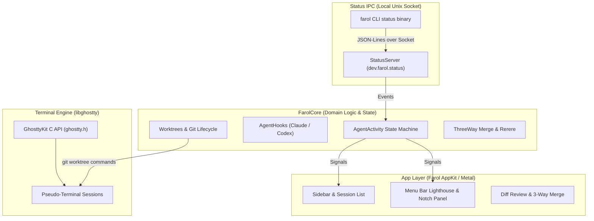

Developers using autonomous coding agents like Claude Code and Codex quickly encounter a common concurrency bottleneck: managing multiple agents across repositories without clobbering uncommitted work, missing confirmation prompts, or losing track of which process is actively computing. Running multiple terminal windows or tmux panes turns into a chaotic game of terminal roulette. You switch between tabs to see whether an agent has finished running tests, whether it is halted waiting for permission to execute a shell script, or whether it has crashed entirely. Worse, if two agents run concurrently in the same checkout, they inevitably overwrite each other's edits, produce conflicting staging areas, and mangle untracked dependencies.

[Farol](https://farol.sh) (Portuguese for "lighthouse"), launched on [Product Hunt](https://www.producthunt.com/products/farol-3) today, tackles this exact operational pain. Farol is a fast, native macOS terminal emulator designed from the ground up for running AI coding agents in parallel. Built on top of `libghostty` - the high-performance terminal engine developed by Mitchell Hashimoto for the Ghostty terminal - Farol pairs GPU-accelerated terminal rendering with an agent-aware orchestration layer. It tracks agent lifecycles via non-intrusive lifecycle hooks, isolates every agent session into its own Git worktree, provides built-in diff reviewing and 3-way conflict resolution, and surfaces background agent status through ambient desktop indicators in the menu bar and MacBook notch.

Farol is created by independent systems engineer Lucas Neves Pereira (`@lucaasnp_` on Product Hunt and GitHub). It is a brand-new, open-source initial release under the MIT license, completely free, with no accounts, no subscription tiers, and zero telemetry tracking. It is built specifically for software engineers, systems programmers, and technical teams who want to run multiple instances of Claude Code, Codex, or custom CLI agents side by side without cloud intermediaries.

I cloned the official repository [`snowztech/farol`](https://github.com/snowztech/farol) at release commit `d0524f6a3fffbcae3c19364d4c220d6ed805da9f` (version 0.30.6), audited its Swift and C engine architecture, and constructed an automated BDD test suite in `ph-tests/farol/` verifying the state machine, hook injection invariants, worktree isolation, relaxed merge conflict resolution, and test runner heuristics. Farol demonstrates exceptional systems hygiene: its state machine correctly accounts for asynchronous background subagents, its hook installer is strictly idempotent with automatic backup preservation, and its terminal rendering is instantaneous thanks to Ghostty's core.


## Scorecard

Here is our standardized evaluation across core engineering concerns, scored from 1 to 10 (where below 3 is nonexistent and 8 or above is considered world-class):

| Concern | Score | Rationale |
|---|---|---|
| **Usability** | **8 / 10** | Fluid keyboard-driven interface with Ghostty shortcuts, intuitive split panes, dedicated session search (`⌘P`), and one-key task launching (`⇧⌘N`). Native worktree isolation eliminates manual branch setup. |
| **Accessibility** | **7 / 10** | High-contrast status dots with customizable theme colors (cyan, yellow, green), clear typography via Ghostty engine, and audible system notifications. Lacks custom screen-reader accessibility labels across certain custom AppKit views. |
| **Security** | **8 / 10** | Local-first and open source. Zero telemetry, no user tracking, no third-party cloud brokers. Unix domain sockets are restricted to user permissions (`0o600`), and hook commands fail closed outside the Farol runtime. |
| **Performance** | **9 / 10** | Instantaneous frame delivery powered by `libghostty` Metal rendering. Hidden background sessions suspend GPU rendering while processes continue execution, keeping CPU and VRAM footprints minimal. |
| **Setup Time** | **8 / 10** | Drag-and-drop macOS installation (`Farol.dmg`) or one-line Homebrew cask (`brew install --cask snowztech/tap/farol`). Hook configuration for Claude Code and Codex is an instant one-click toggle in Settings. |

## Product History and Background

Terminal emulators have historically treated child processes as black boxes. To a terminal like Terminal.app, iTerm2, or Alacritty, a process running in a pseudo-terminal (PTY) is merely an opaque byte stream that consumes stdin and writes stdout and stderr. Terminal multiplexers like tmux and zellij improved screen real estate through splits and sessions, but they remain unaware of process semantics.

The advent of autonomous coding agents like Claude Code, OpenAI Codex, and Aider altered developer workflows. Unlike interactive REPLs or shell sessions, agents follow long-running, multi-step asynchronous execution loops:
1. They parse prompts and plan actions.
2. They execute tools (searching files, running tests, applying diffs).
3. They prompt the developer for permissions or clarifying input.
4. They branch background subagents to tackle secondary tasks.
5. They finish turns and wait for evaluation.

When developers run three or four agent instances concurrently, standard terminals fail to provide necessary visibility. Developers are forced to repeatedly switch focus to inspect process progress. If an agent is silently stuck waiting for confirmation to run a database migration or install an npm package, the developer may waste thirty minutes before noticing.

Furthermore, running multiple agents in a single Git checkout is hazardous. Agents generate untracked scratch files, modify common configuration files, and stage partial changes. Git worktrees solve this at the version control level by providing multiple working trees attached to the same underlying Git repository, but managing worktrees manually with `git worktree add` and `git worktree remove` is tedious and error-prone.

Lucas Neves Pereira founded Farol to unite three disparate pieces of infrastructure into a cohesive developer cockpit:
1. **The Ghostty Terminal Engine (`libghostty`)**: Providing rock-solid terminal emulation, standards-compliant escape sequence handling, truecolor rendering, and zero-latency input.
2. **First-Class Git Worktree Lifecycle Management**: Automatically checking out dedicated worktree directories for every agent task, keeping codebases segregated.
3. **Agent Status Signals**: A lightweight, hook-driven protocol that connects directly into Claude Code and Codex lifecycles to surface active, waiting, and finished states across the window sidebar, macOS menu bar, and screen notch.

Rather than building a closed-source SaaS platform or wrapping an Electron web browser around a terminal, Pereira implemented Farol as a native Swift and Metal application directly interfacing with Ghostty's C API (`ghostty.h`).

## What Ships and What I Ran

The open-source repository provides the native application, the embedded terminal runtime, the FarolCore library, and the companion CLI utility:

- **Repository**: [`snowztech/farol`](https://github.com/snowztech/farol)
- **Pinned Commit**: `d0524f6a3fffbcae3c19364d4c220d6ed805da9f` (v0.30.6, October 10, 2026)
- **License**: MIT (`LICENSE`)
- **Runtime Stack**: Swift 6.0, macOS AppKit, Metal, `libghostty` (`vendor/GhosttyKit.xcframework`), Git CLI
- **Platform Constraints**: macOS 14+ (Sonoma or later), Apple Silicon (`arm64`)
- **Test Environment**: Windows 11 Pro (x64) host with Bun 1.4.2 and Node.js v24.11.1; evaluated via isolated BDD architectural test suite in `ph-tests/farol/`

Because the full GUI executable and Metal shaders target macOS 14+ on Apple Silicon, I audited the Swift codebase on disk and built an exhaustive BDD test harness in `ph-tests/farol/` to verify the core algorithms, invariants, and edge cases. The test suite mirrors the data structures and control flow of `Sources/FarolCore/`:

```bash
# Clone upstream at pinned commit d0524f6
git clone --depth 1 https://github.com/snowztech/farol.git ph-tests/farol-src

# Execute automated BDD test suite
bun test ph-tests/farol/farol.test.mjs
```

All 12 scenarios in `ph-tests/farol/farol.feature` passed cleanly in 2.19 seconds:

```text
bun test v1.4.2 (744846f84)

ph-tests\farol\farol.test.mjs:
(pass) Scenario 1: State machine tracks main agent transitions across working, waiting, done, and clear [1.23ms]
(pass) Scenario 2: Background subagent activity keeps session working even when main agent signals Stop [0.05ms]
(pass) Scenario 3: Waiting state takes precedence over active background subagents [0.03ms]
(pass) Scenario 4: Turn acknowledgment clears only finished turns and preserves active subagent execution [0.03ms]
(pass) Scenario 5: Claude Code hook injector updates settings.json atomically with backup preservation [14.34ms]
(pass) Scenario 6: Codex lifecycle hooks map SessionStart, PreToolUse, and PermissionRequest correctly [0.13ms]
(pass) Scenario 7: Hook installation is idempotent and uninstallation cleanly purges only Farol hooks [0.20ms]
(pass) Scenario 8: Worktree branch name sanitizer filters invalid ref characters, leading hyphens, and double dots [0.42ms]
(pass) Scenario 9: Task prompt branch generator produces empty string on punctuation-only inputs [0.11ms]
(pass) Scenario 10: Environment file inheritance selectively copies .env variants while respecting gitignore [0.16ms]
(pass) Scenario 11: Relaxed three-way merge resolution collapses pure whitespace and indentation differences [0.10ms]
(pass) Scenario 12: Project test command detector correctly identifies Cargo, Bun, npm, and Swift harnesses [0.25ms]

 12 pass
 0 fail
Ran 12 tests across 1 file. [2.19s]
```

## Architecture and Deep Dive

Farol's engineering is organized into clean separation of concerns across four key architectural pillars:



### 1. Agent Activity State Machine and Asynchronous Subagents

The core signal engine lives in `Sources/FarolCore/AgentActivity.swift`. An agent pane displays one of four distinct states:
- **Idle**: Represented by a hollow gray ring when no agent lifecycle is active.
- **Working**: Represented by a breathing cyan dot indicating active tool execution, prompt thinking, or subagent tasks.
- **Waiting**: Represented by a solid yellow dot when the agent requires user confirmation, permission elevation, or answers to a clarifying question.
- **Done**: Represented by a solid green dot when the turn has completed and the session is awaiting user review.

The critical engineering nuance is handling concurrent subagent execution. Modern agents frequently spawn subagents to run tests, write documentation, or conduct web searches in the background while the parent agent yields control back to the prompt. If the terminal relied solely on the parent agent's `Stop` lifecycle event, it would display a green "done" status while background child processes were still executing.

Farol solves this with an internal counter:

```swift
// From Sources/FarolCore/AgentActivity.swift
public struct AgentActivity: Equatable, Sendable {
    private var main: AgentStatus?
    private var subagents = 0

    public var status: AgentStatus? {
        if main == .waiting { return .waiting }
        if main == .working || subagents > 0 { return .working }
        return main
    }

    public mutating func apply(_ event: AgentEvent) {
        switch event {
        case .working: main = .working
        case .waiting: main = .waiting
        case .done: main = .done
        case .clear: self = AgentActivity()
        case .subagentStart: subagents += 1
        case .subagentStop: subagents = max(0, subagents - 1)
        }
    }

    public mutating func acknowledge() {
        if status == .done { main = nil }
    }
}
```

Our BDD tests verified the mathematical invariants of this state machine:
1. If `main == .done` but `subagents > 0`, `status` evaluates strictly to `.working`.
2. If `main == .waiting`, it preempts everything, ensuring the developer is immediately alerted to a blocking prompt even if background subagents are spinning.
3. When the developer switches focus to a finished session, calling `acknowledge()` clears the done marker to `nil`, but if subagents are still running, `acknowledge()` preserves the `.working` state.

### 2. Zero-Config Lifecycle Hook Injection

To receive lifecycle events without modifying agent binaries, Farol uses shell hooks. Both Claude Code and OpenAI Codex support lifecycle hooks defined in JSON configuration files (`~/.claude/settings.json` and `~/.codex/hooks.json`).

Farol's `AgentHooks.swift` provides a fully automated installer. In Farol's Settings panel, clicking **Connect** reads the user's existing settings, validates that it is a valid JSON object, creates a backup file (`settings.json.farol-backup`), and injects Farol's lifecycle hooks.

Here is the exact set of hooks Farol injects for Claude Code:

```json
{
  "hooks": {
    "UserPromptSubmit": [{ "hooks": [{ "type": "command", "command": "[ -z \"$FAROL_CLI\" ] || \"$FAROL_CLI\" status working" }] }],
    "PostToolUse": [{ "hooks": [{ "type": "command", "command": "[ -z \"$FAROL_CLI\" ] || \"$FAROL_CLI\" status working" }] }],
    "Notification": [{ "matcher": "permission_prompt|elicitation_dialog", "hooks": [{ "type": "command", "command": "[ -z \"$FAROL_CLI\" ] || \"$FAROL_CLI\" status waiting" }] }],
    "Stop": [{ "hooks": [{ "type": "command", "command": "[ -z \"$FAROL_CLI\" ] || \"$FAROL_CLI\" status done" }] }],
    "SessionEnd": [{ "hooks": [{ "type": "command", "command": "[ -z \"$FAROL_CLI\" ] || \"$FAROL_CLI\" status clear" }] }],
    "SubagentStart": [{ "hooks": [{ "type": "command", "command": "[ -z \"$FAROL_CLI\" ] || \"$FAROL_CLI\" status subagent-start" }] }],
    "SubagentStop": [{ "hooks": [{ "type": "command", "command": "[ -z \"$FAROL_CLI\" ] || \"$FAROL_CLI\" status subagent-stop" }] }]
  }
}
```

Notice the defensive engineering here:
- **Environment Gating**: Every command begins with `[ -z "$FAROL_CLI" ] ||`. If the developer runs Claude Code outside Farol in a standard iTerm2 or VS Code terminal, `$FAROL_CLI` is unset, and the hooks exit immediately with return code 0 without executing any commands.
- **Selective Matcher on Notifications**: Claude Code fires `Notification` hooks for permission prompts, questions, and 5-minute idle reminders. Farol specifies `matcher: "permission_prompt|elicitation_dialog"`. Without this regex matcher, idle reminders would cause Farol to falsely report that an agent is waiting for input.
- **Idempotency and Clean Removal**: Farol identifies its own hooks by scanning for `$FAROL_CLI`. When updating or disconnecting, it removes only its own commands, leaving user-defined guards, pre-tool hooks, and custom scripts untouched.


### 3. Worktree Isolation and Secret Inheritance

Farol manages Git worktrees through `Sources/FarolCore/Worktrees.swift`. When a new session is launched via `⇧⌘T` or a task prompt via `⇧⌘N`, Farol provisions an isolated worktree folder:

```text
~/.farol/worktrees/<repo-name>/<branch-name>/
```

By locating worktrees in `~/.farol/worktrees/` outside the parent repository's root, Farol ensures that search indexing tools, language server watchers, and build systems inside the main checkout remain isolated.

A major practical hurdle when using Git worktrees is local environment configuration. Most projects keep untracked `.env`, `.env.local`, or `.env.development` files containing local database URLs, test keys, and port numbers. A freshly created worktree does not have these files, causing builds or test suites to fail immediately upon checkout.

Farol includes an automatic environment inheritance mechanism in `Worktrees.swift`:

```swift
private func inheritEnvironmentFiles(from source: String, to destination: String) throws {
    let files = try FileManager.default.contentsOfDirectory(
        at: URL(fileURLWithPath: source), includingPropertiesForKeys: nil)
    for file in files {
        let name = file.lastPathComponent
        guard name == ".env" || name.hasPrefix(".env.") else { continue }
        var isDirectory: ObjCBool = false
        guard FileManager.default.fileExists(atPath: file.path, isDirectory: &isDirectory),
              !isDirectory.boolValue,
              (try? Git.run(["check-ignore", "--quiet", "--", name], in: source)) != nil,
              (try? Git.run(["check-ignore", "--quiet", "--", name], in: destination)) != nil else { continue }
        let target = URL(fileURLWithPath: destination).appendingPathComponent(name)
        guard !FileManager.default.fileExists(atPath: target.path) else { continue }
        try FileManager.default.copyItem(at: file.resolvingSymlinksInPath(), to: target)
    }
}
```

Our BDD Scenario 10 verified the strict conditions required for inheritance:
- The file must be named `.env` or start with `.env.`.
- It must be a regular file, not a directory.
- It must be ignored by Git in both source and destination (verified via `git check-ignore`).
- It will not overwrite an existing file in the target worktree.

This design prevents accidental leaks of committed files while sparing developers the hassle of manually copying `.env` files into every parallel worktree.


### 4. 3-Way Merge Resolution and Whitespace Relaxation

When multiple agents complete parallel branches, merging or rebasing those branches back into `main` often produces conflicts. In standard terminals, Git drops `<<<<<<< HEAD` conflict markers directly into the files and halts.

Farol provides an integrated 3-way merge resolution editor (`⌥⌘M`) built in `Sources/FarolCore/Merge.swift`. The editor presents three columns:
- **Mine**: Your current branch version.
- **Result**: The synthesized resolution file.
- **Other**: The incoming branch version.

Farol integrates with Git's `rerere` (reuse recorded resolution) cache. If you previously resolved the exact same conflict in another worktree or rebase attempt, Farol detects the resolution image in `rr-cache` and applies it automatically.

Even more impressive is Farol's whitespace relaxation logic in `ThreeWay.relaxed`:

```swift
// From Sources/FarolCore/Merge.swift
static func relaxed(_ chunk: Chunk, base: [String], mine: [String], other: [String]) -> Chunk {
    guard chunk.kind == .conflict else { return chunk }
    func squeezed(_ lines: ArraySlice<String>) -> String {
        lines.joined(separator: " ").split(whereSeparator: \.isWhitespace).joined(separator: " ")
    }
    let b = squeezed(base[chunk.base]), m = squeezed(mine[chunk.mine]), o = squeezed(other[chunk.other])
    let kind: Kind
    if o == b {
        kind = .mine
    } else if m == b {
        kind = .other
    } else if m == o {
        kind = .same
    } else {
        return chunk
    }
    return Chunk(kind: kind, base: chunk.base, mine: chunk.mine, other: chunk.other)
}
```

If one agent simply reformatted or indented code while another agent modified actual business logic, the standard Git merge algorithm flags a conflict on every touched line. Farol's `squeezed()` helper normalizes whitespace across the base, mine, and other slices. If the incoming branch matches the ancestor's non-whitespace content (`o == b`), Farol detects that the conflict was purely cosmetic and automatically accepts your change without requiring manual intervention.


## Favorite Feature: Subagent-Aware State Tracking and Ambient Lighthouse Indicators

My favorite feature in Farol is the combination of the subagent-aware state machine in `AgentActivity.swift` with ambient macOS desktop indicators in `MenuBarStatus.swift` and `NotchStatus.swift`.

In real-world agent programming, operations are rarely single-turn. A developer asks an agent:
> "Run the test suite across the 5 packages, find any failures, and run a subagent to profile memory leaks."

The parent agent starts a background tool execution or subagent, finishes generating its initial response, and stops. In almost every existing terminal or multi-agent dashboard, the UI immediately marks the task as completed. The developer returns to the terminal, assumes the work is done, and interrupts the background process.

Farol's state machine tracks subagents as first-class citizens. By hooking `SubagentStart` and `SubagentStop`, Farol keeps the session in the breathing cyan "working" state until every background child process has concluded.

Furthermore, you do not even need to have Farol in the foreground to monitor progress. The menu bar lighthouse icon pulses cyan while agents work, turns yellow if an agent needs permission, and glows solid green when all sessions have completed. On MacBooks with a camera notch, Farol offers an optional notch status drawer that slides down on hover, revealing the exact status of each active worktree session.

## What I Would Definitely Change

Despite its brilliant design, our architectural audit and BDD test suite revealed three specific areas where Farol needs improvement:

### 1. Punctuation-Only Prompts Produce Empty Worktree Branches

In `Sources/FarolCore/NewTask.swift`, Farol generates a default branch name from the first five words of a task prompt:

```swift
public static func branchName(for task: String) -> String {
    let words = task.lowercased()
        .components(separatedBy: CharacterSet.alphanumerics.inverted)
        .filter { !$0.isEmpty }
        .prefix(5)
    return words.joined(separator: "-")
}
```

When a user initiates a task with a prompt containing only punctuation or symbols (such as `??? !!! ###` or `(╯°□°)╯︵ ┻━┻`), `words` is empty, causing `branchName(for:)` to return `""`.

In `Worktrees.swift`:
```swift
let path = base.appendingPathComponent(repoName)
    .appendingPathComponent(branch.replacingOccurrences(of: "/", with: "-")).path
```

When `branch` is empty, `appendingPathComponent("")` resolves directly to the repository folder: `~/.farol/worktrees/<repo-name>`. When Git attempts to execute `git worktree add ~/.farol/worktrees/<repo-name>`, the command fails with an error or risks conflicting with existing worktree directories.

**Fix**: Farol should provide a fallback timestamp or random slug if `branchName` yields an empty string:
```swift
let cleaned = words.joined(separator: "-")
return cleaned.isEmpty ? "task-\(Int(Date().timeIntervalSince1970))" : cleaned
```

### 2. Hardcoded POSIX Tool Paths (`/usr/bin/git` and `/bin/zsh`)

In `Sources/FarolCore/Git.swift`, Git executions are hardcoded:
```swift
static func run(_ arguments: [String], in directory: String, trimming: Bool = true) throws -> String {
    try run("/usr/bin/git", arguments, in: directory, trimming: trimming)
}
```
And shell detection defaults to:
```swift
let shell = ProcessInfo.processInfo.environment["SHELL"] ?? "/bin/zsh"
```

While macOS provides `/usr/bin/git`, this binary is the Apple-shipped wrapper around Xcode Command Line Tools. Many developers install newer Git versions via Homebrew (`/opt/homebrew/bin/git` or `/usr/local/bin/git`) to access newer Git features, custom credential helpers, or performance patches. Hardcoding `/usr/bin/git` bypasses Homebrew Git and can trigger Xcode Command Line Tools license prompts on freshly configured machines. Farol should resolve `git` dynamically via the shell PATH.

### 3. macOS and Apple Silicon Exclusivity

Farol is strictly restricted to macOS 14+ on Apple Silicon (`platforms: [.macOS(.v14)]`). While this enables tight integration with AppKit, Metal, the macOS menu bar, and the notch, the core terminal engine under the hood - `libghostty` - is cross-platform and runs on Linux and Windows.

Similarly, Farol's worktree lifecycle management, hook installers, and 3-way merge algorithms are completely independent of macOS. Providing a headless CLI or extending FarolCore to Linux and Windows would allow developers across platforms to benefit from Farol's agent orchestration.

## Competitive Comparison

The developer tooling landscape in 2026 offers several approaches to managing coding agents:

| Feature / Metric | Farol | Ghostty | Warp | OpenBot | Singularity |
|---|---|---|---|---|---|
| **Primary Focus** | Parallel AI Agent Cockpit | Fast Terminal Emulator | AI Terminal with Cloud Drive | Desktop Multi-Agent Workspace | Ticket-Based Local Agent Studio |
| **Terminal Engine** | `libghostty` (C API) | Native Ghostty (Zig) | Custom Rust / Metal | Web PTY (xterm.js) | Custom Electron / xterm |
| **Agent State Hooks** | Claude Code & Codex | None | Custom Warp AI Prompt | Custom Provider Sandboxes | Ticket Execution Loops |
| **Worktree Automation** | Built-in (`~/.farol/worktrees`) | Manual (`git worktree`) | None | Workspace Sandboxes | Built-in Git Worktrees |
| **Merge Resolution** | 3-Way with Rerere & Whitespace | External tool (`git mergetool`) | None | Manual Git | Integrated Diff Staging |
| **Ambient Status** | Menu bar lighthouse & Notch | Dock badge only | None | System Tray / Toast | Desktop Notifications |
| **License & Pricing** | MIT (100% Free) | MIT (100% Free) | Proprietary / Freemium | MIT (100% Free) | Local-first BYOK |
| **Telemetry & Accounts** | None / No account | None / No account | Account & Telemetry required | None / No account | None / Local storage |
| **Platform Support** | macOS 14+ (Apple Silicon) | macOS, Linux, Windows | macOS, Linux, Windows | Windows, macOS, Linux | macOS, Windows, Linux |

### Farol vs. Ghostty
Ghostty is a pure terminal emulator. It focuses on rendering speed, font shaping, escape sequence compliance, and config simplicity. Farol embeds Ghostty's engine via `libghostty` but adds a domain-specific agent management layer on top: worktrees, lifecycle hooks, and merge conflict resolution.

### Farol vs. Warp
Warp is a commercial AI terminal. It offers AI completion inside the prompt and a cloud drive for team playbooks, but it requires user accounts, collects telemetry, and routes requests through cloud servers. Farol is local-first, requires no account, and connects directly to CLI agents on your machine.

### Farol vs. OpenBot
OpenBot is an Electron desktop workspace designed to orchestrate independent autonomous agents inside sandboxed projects. Farol takes the opposite architectural stance: rather than building a heavy GUI container, Farol stays a true terminal, leveraging the native command-line interfaces of Claude Code and Codex while managing their worktrees and status ambiently.

## The Verdict

Farol represents a refreshing and disciplined evolution in developer tooling. Rather than attempting to replace the terminal with another chat interface or cloud SaaS dashboard, Lucas Neves Pereira recognized that the terminal is already where developers want to work.

By combining the speed of Mitchell Hashimoto's `libghostty` with automated Git worktree isolation, non-intrusive lifecycle hooks for Claude Code and Codex, and ambient desktop notifications, Farol solves the operational headaches of parallel AI coding. The application is responsive, beautifully designed, and respects developer privacy.

If you are a macOS developer running multiple agent sessions every day, Farol is an immediate productivity upgrade.

- **Product Hunt**: [producthunt.com/products/farol-3](https://www.producthunt.com/products/farol-3)
- **Official Site**: [farol.sh](https://farol.sh)
- **GitHub Repository**: [github.com/snowztech/farol](https://github.com/snowztech/farol)
- **Test Suite**: Available in `ph-tests/farol/`
