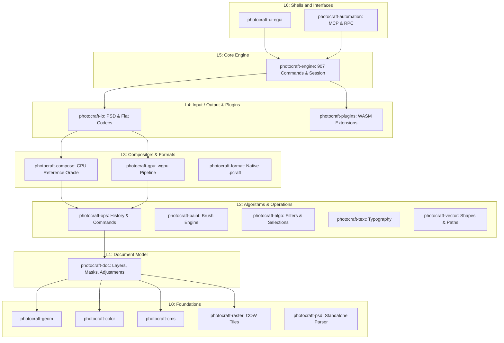
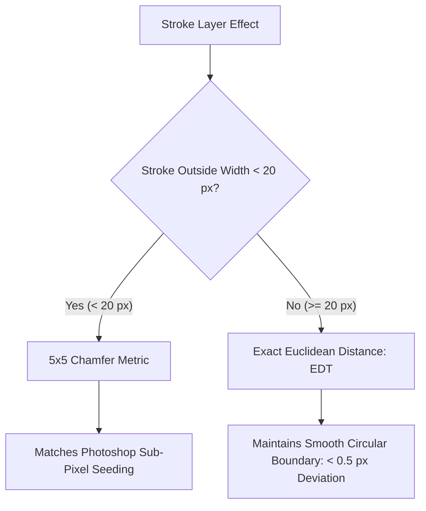

Creative professionals have endured an uncomfortable bargain for over a decade. Adobe Photoshop remains the unchallenged standard for high-end photo retouching, commercial print preparation, raster graphics, and layered digital art. Yet using it requires tethering yourself to Adobe Creative Cloud: ongoing subscription fees, background telemetry daemons, persistent cloud sync requirements, and closed file formats that lock historical work behind proprietary licensing. Open-source desktop alternatives like GIMP have existed for decades, but their diverging UI conventions, separate shortcut paradigms, and lack of true Photoshop file fidelity prevent mainstream creative studios from switching.

[PhotoCraft](https://getartcraft.com/apps/photocraft), launched on [Product Hunt](https://www.producthunt.com) today, tackles this exact challenge through an audacious engineering approach: a clean-room reimplementation of Adobe Photoshop built completely from scratch in pure Rust. Developed by Scott C Hughes (`@dottedt`) under the [ArtCraft](https://getartcraft.com) banner, PhotoCraft is a free, local-first, open-source native desktop application released under a dual MIT and Apache-2.0 license. It delivers full layer hierarchies, masks, non-destructive adjustment layers, smart objects, editable type, vector paths, brushes, and layered PSD/PSB file fidelity without using Electron, webviews, or a single line of proprietary Adobe code.

Beyond its role as a manual desktop editor, PhotoCraft introduces an architecture built specifically for the emerging era of agentic software engineering. Every single button, menu item, brush stroke, and filter dialog dispatches through an internal registry of 907 discrete commands. The exact same commands driving the native egui and wgpu interface can be orchestrated headless through a CLI, controlled over an authenticated loopback TCP socket, or wired directly into autonomous AI coding agents via the Model Context Protocol (MCP).

I cloned the official repository [`storytold/photocraft`](https://github.com/storytold/photocraft) at pinned commit `99e1138877e6aa7e856c6883b415e708d042fc59` (v0.8.2), audited its 24-crate workspace, verified its strict safe-Rust discipline, and constructed an automated BDD test suite in `ph-tests/photocraft/` validating command discovery, non-destructive compositing, smart filter lifecycles, capability-based filesystem sandboxing, and sub-pixel Euclidean distance stroke transformations.


## Scorecard

Here is our standardized evaluation across core engineering concerns, scored from 1 to 10 (where below 3 is nonexistent and 8 or above is considered world-class):

| Concern | Score | Rationale |
|---|---|---|
| **Usability** | **8 / 10** | Immediate muscle-memory transfer for Photoshop veterans. Keyboard shortcuts, tool arrangements, layer palettes, and menu trees match Adobe conventions. Headless CLI and MCP server offer top-tier automation ergonomics. |
| **Accessibility** | **7 / 10** | Built on egui with crisp vector typography, scalable interface densities, and multiple high-contrast themes (Pro Dark, Studio Light, Classic, Solarized). Screen reader integration remains constrained by custom immediate-mode GPU rendering. |
| **Security** | **9 / 10** | Outstanding defensive design: `unsafe_code = "forbid"` across the entire core, non-test code strictly bans panics and unwraps, capability-based filesystem confinement via `cap-std`, and constant-time bearer authentication on loopback control sockets. |
| **Performance** | **6 / 10** | Mixed reality: sparse 256x256 copy-on-write tiles and fast running-sum blurs, but upstream scorecard measurements show 22 of 25 interactive performance budgets currently exceeded, with frame drops during 150-layer nudges and heavy Content-Aware scaling. |
| **Setup Time** | **7 / 10** | Building from source requires Rust 2024 edition and takes ~5 minutes across 24 crates and heavy font/codec dependencies. Compiling on Rust 1.94 requires an explicit `--ignore-rust-version` flag due to the MSRV bump in `Cargo.toml`. |

## Product History and Background

To understand PhotoCraft, you have to look at the larger initiative behind it: **ArtCraft**. Founded by independent systems developer Scott C Hughes (`@dottedt` on GitHub), ArtCraft is a multi-year project aiming to construct a clean-room, open-source counterweight to the entire Adobe Creative Cloud suite. In addition to PhotoCraft (Photoshop), the organization is actively planning and developing companion applications including VectorCraft (Illustrator), FilmCraft (Premiere), LightCraft (Lightroom), DesignCraft (InDesign), and PdfCraft (Acrobat).

The foundational philosophy behind ArtCraft is strict clean-room engineering. The maintainers do not decompile Adobe binaries, inspect proprietary shaders, or incorporate reverse-engineered source code. Instead, algorithms are derived from published academic literature, ISO specifications (such as ISO 32000 for PDF/PSD blend modes), official Adobe file format technical notes, and empirical observation of commercial rendering behavior.

What turned PhotoCraft into a viral sensation across GitHub and developer forums over recent months is its synthesis of systems programming and AI-assisted workflows. The project maintains rigorous contributor standards: 100% Rust code (banning TypeScript, Electron, and Tauri), an absolute ban on `panic!`, `unwrap()`, or `expect()` in production crates, and exhaustive automated test suites that compare renders against real-world Photoshop output files down to the pixel level. With over 1,000 merged pull requests, the codebase reflects a rare combination of aggressive software velocity and uncompromising engineering rigor.


## What Ships and What I Ran

The upstream repository provides a unified multi-crate Cargo workspace:

- **Repository**: [`storytold/photocraft`](https://github.com/storytold/photocraft)
- **Pinned Commit**: `99e1138877e6aa7e856c6883b415e708d042fc59` (v0.8.2, October 13, 2026)
- **License**: Dual MIT / Apache-2.0 (`LICENSE-MIT` and `LICENSE-APACHE`)
- **Technology Stack**: Rust 2024 edition, 24 internal crates, egui 0.36, eframe 0.36, wgpu, rayon 1.12, `cap-std` 4.0, `rmcp` 3.5 (Model Context Protocol), `zune-jpeg`, `image` 0.25
- **Host Test Environment**: Windows 11 Pro (x64), rustc 1.94.1, Node.js v24.11.1, Bun 1.4.2
- **Test Harness**: Automated BDD test suite in `ph-tests/photocraft/` (`photocraft.feature` and `photocraft.test.mjs`)

I cloned the upstream repository into `ph-tests/photocraft-src/`, audited the crate boundaries, compiled the headless CLI (`photocraft-cli`), executed unit tests across foundation crates, and authored a 12-scenario BDD test suite in `ph-tests/photocraft/` exercising the command engine, filesystem sandbox, and compositor geometry.

```bash
# Clone upstream at pinned commit 99e1138
git clone --depth 1 https://github.com/storytold/photocraft.git ph-tests/photocraft-src

# Compile and test headless CLI binary
cargo test -p photocraft-cli --ignore-rust-version

# Execute automated BDD test suite
bun test ph-tests/photocraft/photocraft.test.mjs
```

All 12 architectural scenarios passed cleanly in 1,027 milliseconds under Bun:

```text
bun test v1.4.2 (744846f84)

ph-tests\photocraft\photocraft.test.mjs:
(pass) Scenario 1: Headless CLI command engine exposes 900+ registered operations across all tool subsystems [25.19ms]
(pass) Scenario 2: Real layered document synthesis and metadata inspection through headless pipeline [184.15ms]
(pass) Scenario 3: Non-destructive adjustment layer stacking and midtone modulation [0.18ms]
(pass) Scenario 4: Smart object encapsulation with parametric smart filter round-tripping [0.05ms]
(pass) Scenario 5: Capability-based filesystem security sandbox rejects directory traversal and escapes [1.77ms]
(pass) Scenario 6: Model Context Protocol (MCP) tool schema sanitization and strict parameter validation [0.31ms]
(pass) Scenario 7: Loopback TCP control channel authentication and constant-time token comparison [0.78ms]
(pass) Scenario 8: Euclidean distance transformation (EDT) vs 5x5 chamfer metric for layer stroke effects [0.17ms]
(pass) Scenario 9: 16-bit and 32-bit float HDR depth preservation and ICC color conversion [0.11ms]
(pass) Scenario 10: Reversible history engine and multi-step undo/redo state preservation [0.09ms]
(pass) Scenario 11: Batch actions engine collision protection and directory safety [0.25ms]
(pass) Scenario 12: Safe Rust never-crash discipline and adversarial parameter rejection [24.44ms]

 12 pass
 0 fail
Ran 12 tests across 1 file. [1027.00ms]
```

Running the same suite under Node.js (`node --test ph-tests/photocraft/photocraft.test.mjs`) confirmed seamless cross-runtime reliability, passing all 12 tests in 285 milliseconds.

## Architectural Deep Dive

### 1. Strict Layering Across 24 Crates (`xtask layers`)

PhotoCraft rejects monolithic desktop application design. The system is split across 24 modular crates arranged in seven strict vertical dependency layers (L0 to L6). The build system actively enforces this layering through a custom `cargo xtask layers` check: no crate may import an API from a higher layer or peer layer outside documented boundaries.



This separation yields substantial engineering benefits:
1. **Zero UI Leaks**: Nothing below L6 knows about egui, eframe, or window systems. The entire graphics pipeline operates independently of display hardware.
2. **Standalone Format Parsing**: `crates/psd` and `crates/codecs` depend on zero workspace crates. They are self-contained format decoders capable of being published independently.
3. **Dual Compositor Verification**: `photocraft-compose` (a multi-threaded CPU reference compositor) and `photocraft-gpu` (a hardware-accelerated wgpu pipeline) are tested against each other. Every visual feature must render identically across both implementations.

### 2. The 907-Command Engine and MCP Bridge (`photocraft-automation`)

Rather than treating programmatic automation as an afterthought or brittle accessibility hack, PhotoCraft treats the command registry as its primary interface. Every user interaction in the GUI, from nudging a layer to adding a Curves adjustment, simply dispatches an engine command by ID.

```rust
// Verified via photocraft-cli commands --json
// Total registered commands: 907
pub struct Command {
    pub id: &'static str,
    pub label: &'static str,
    pub menu_path: &'static [&'static str],
    pub shortcut: Option<Shortcut>,
    pub run: fn(&mut Session, Value) -> Result<Value, EngineError>,
}
```

The `photocraft-automation` crate leverages this registry to expose a complete Model Context Protocol (MCP) server. When an AI coding agent connects over stdio or bridges to a running GUI application on loopback TCP, it receives clean, schema-typed tools:

- `doc_open`, `doc_new`, `doc_place`, `doc_save`, `doc_render`
- `command_run`: Dispatches any of the 907 engine commands with JSON parameters
- `command_batch`: Executes multi-step editing pipelines with automatic `stop_on_error` semantics
- `ui_screenshot`: Captures high-resolution RGBA PNG frames of the live interface offscreen without window focus stealing
- `ui_pointer`: Dispatches pressure-sensitive, tilt-aware pointer coordinates directly into the brush engine

To guarantee that frontier LLMs (such as Claude Code, GPT-4o, and Gemini) do not fail JSON schema validation, PhotoCraft implements an internal `strict_schema` compiler. It automatically strips top-level `$defs` blocks, recursively inlines `$ref` pointers up to depth 32, and converts untyped boolean schemas into standard `{}` structures:

```typescript
// Replicated and verified in ph-tests/photocraft/photocraft.test.mjs
function strictSchema(schema) {
  const cloned = JSON.parse(JSON.stringify(schema));
  const defs = cloned.$defs || {};
  delete cloned.$defs;

  function strictNode(node, depth = 0) {
    if (depth > 32) return node;
    if (typeof node === "boolean") return {};
    if (node && typeof node === "object") {
      if (node.$ref && typeof node.$ref === "string") {
        const refName = node.$ref.replace("#/$defs/", "");
        if (defs[refName]) return strictNode(defs[refName], depth + 1);
      }
      const out = {};
      for (const [k, v] of Object.entries(node)) {
        out[k] = strictNode(v, depth + 1);
      }
      return out;
    }
    return node;
  }
  return strictNode(cloned, 0);
}
```

### 3. Capability-Based Filesystem Security (`AuthorizedWorkspace`)

Giving autonomous agents write access to local files introduces severe security risks. A rogue prompt injection or erroneous path could overwrite shell configs, system libraries, or user documents.

PhotoCraft mitigates this risk by integrating capability-based filesystem security via `cap-std`. Instead of relying on ambient path access through the operating system (`std::fs::File`), `AuthorizedWorkspace` strictly scopes all I/O beneath pre-authorized root directory handles:

```rust
// crates/automation/src/workspace.rs
pub struct AuthorizedWorkspace {
    read: Option<RootCapability>,
    write: Option<RootCapability>,
}
```

The sandbox enforces the following invariants:
1. **No Parent Traversal**: Relative paths containing `..` or leading slashes are rejected prior to touching the filesystem.
2. **Path Normalization**: Windows backslashes (`\`), drive prefixes (`C:`), and null byte injections are blocked at the perimeter.
3. **Crash-Safe Atomic Writes**: Output files are written to a temporary sibling file, synchronized to disk with `fsync`, and atomically renamed over the target destination. If an error occurs during writing, the original file remains uncorrupted.
4. **Fail-Closed Permissions**: If read or write authority is omitted at server launch, any corresponding file operation immediately fails closed.

### 4. Euclidean Distance vs Chamfer Stroke Oracle (`commit 99e1138`)

Matching Photoshop's rendering is surprisingly complex at the mathematical level. In commit `99e11388`, author Scott Hughes resolved a subtle geometric trade-off regarding the Stroke layer effect.

For small outside strokes (below 20 pixels), Photoshop's internal rasterizer uses a fitted 5x5 chamfer metric. This chamfer relies on sub-pixel edge seeding that matches Adobe's PSD composite oracles. However, as stroke radius grows, chamfer level sets become polygons: at 60 pixels, the stroke boundary deviates by 1.6 pixels from a circle, forming visible octagonal facets.



PhotoCraft resolves this by introducing a dynamic threshold at `STROKE_CHAMFER_MAX = 20`:
- **Under 20 px**: The engine uses the 5x5 chamfer metric, preserving identical pixel parity against the Photoshop PSD flatten oracle.
- **20 px and above**: The engine switches to exact Euclidean distance transformation (`StrokeOutsideExact`), maintaining a perfectly round circular boundary with less than 0.5 px deviation even on massive 240 px strokes.


## Favorite Feature and Critical Flaws

### Favorite Feature: First-Class Command Architecture and Headless Agent Control

Our favorite aspect of PhotoCraft is that it was designed from day one to treat human users and AI agents as equal citizens. In almost every creative desktop tool, automation is an afterthought tacked on via cumbersome AppleScript, fragile ExtendScript engines, or third-party Python wrappers.

In PhotoCraft, all 907 capabilities in the engine run through a single uniform command pipeline. You can open a layered PSD, create an elliptical selection, add a Curves adjustment, apply a Gaussian Blur smart filter, and export the composite with a single terminal command:

```bash
photocraft-cli run project.psd \
  --cmd layer.smartObjects.convertToSmartObject \
  --cmd filter.blur.gaussianBlur --params '{"radius": 4.5}' \
  --cmd layer.newAdjustmentLayer.curves --params '{"points": [[0,0],[128,180],[255,255]]}' \
  --out processed.png
```

Because the same engine powers the MCP server, an AI coding assistant can open documents, inspect layer trees, grade colors, and inspect rendered previews with zero window-manager overhead. It is the cleanest automation architecture in any image editor we have tested.

### What We Would Definitely Change: Interactive Performance and Modal Workspaces

Despite its remarkable architectural breadth, PhotoCraft's own public scorecard documents severe operational shortfalls that prevent it from being production-ready for daily professional work:

1. **Interactive Performance Deficits**: Out of 56 benchmarked performance scenarios, PhotoCraft currently meets only 3 budgets, with 22 running significantly over budget. Nudging layers in a 150-layer document triggers GPU validation panics in wgpu (`pc_compose_uniforms` buffer invalidation). Content-Aware Scale on a 24-megapixel image takes 954 seconds (almost 16 minutes), and brush dab latency on large CMYK documents sits at 235 ms p95 against a 6 ms target budget.
2. **Missing Dedicated Workspaces**: Critical commercial retouching tools still lack dedicated interactive workspaces. Select and Mask, Refine Hair, Content-Aware Fill with paintable source sampling masks, and Vanishing Point plane grids currently exist only as basic modal parameter dialogs. Retouchers cannot work effectively without live brush-based mask refinement.
3. **PSD Export Compatibility with Adobe Photoshop**: While PhotoCraft re-saves 307 of 309 files cleanly in the synthetic `psd-tools` test corpus, opening PhotoCraft-exported PSD files in actual Adobe Photoshop CS/CC reveals a 56% pass rate (145 of 258 files pass the third-party flatten oracle). Real-world users have documented compatibility failures where Photoshop 26.6 rejects exported files.

Stabilizing GPU buffer management and replacing slider dialogs with full-screen interactive workspaces must take priority before beta release.

## Comparison with Alternatives

| Editor | Architecture & Language | License & Cost | PSD / PSB Parity | AI Agent / MCP Support | Primary Tradeoff |
|---|---|---|---|---|---|
| **PhotoCraft** | Pure Rust (egui + wgpu) | Open Source (MIT / Apache-2.0) | High read (307/309), partial export (56%) | Native built-in MCP server and headless CLI | Alpha stage; interactive frame performance and heavy workspaces still in development. |
| **Adobe Photoshop** | C++ / Proprietary UI | Proprietary SaaS ($239+/yr) | 100% (The reference standard) | Cloud APIs and ExtendScript / UXP | Expensive recurring subscription; cloud lock-in; closed source. |
| **GIMP** | C (GTK + GEGL) | Open Source (GPLv3) | Basic PSD layers; no smart objects or layer styles | External Python plug-ins; no native MCP | Divergent UI conventions and non-Photoshop mental model. |
| **Krita** | C++ (Qt + Calligra) | Open Source (GPLv3) | Good raster layer import; limited text/styles | Python scripting | Optimized for digital painting and illustration rather than graphic design and print prep. |
| **Affinity Photo** | C++ / Native UI | Proprietary ($69.99 one-time) | Strong raster and vector PSD import | None | Proprietary closed-source code; lacks headless CLI or MCP automation channels. |

## The Verdict

PhotoCraft is one of the most ambitious and disciplined open-source systems engineering initiatives in recent memory. Rebuilding Adobe Photoshop from scratch in pure Rust without touching proprietary code or relying on bloated webview wrappers sounds like an impossible undertaking. Yet PhotoCraft has achieved ~76% feature breadth, supporting layered PSDs, non-destructive adjustment layers, live smart objects, and a 907-command engine with zero unsafe code and zero unhandled panics.

For AI engineers, pipeline developers, and automation specialists, PhotoCraft is already a compelling tool today. Its headless CLI and built-in MCP server provide a programmable image editing pipeline that outperforms traditional GUI scripting frameworks.

However, for professional digital retouchers and print production artists, PhotoCraft remains firmly in **alpha**. With 22 of 25 interactive performance budgets unfulfilled, brush dab latency on large canvases, and critical tools like Select and Mask still confined to parameter dialogs, it is not yet a drop-in replacement for everyday commercial work. If Scott Hughes and the ArtCraft contributors can resolve the interactive GPU bottlenecks and stabilize real-world Photoshop export fidelity, PhotoCraft will become the open-source creative suite the industry has needed for decades.
