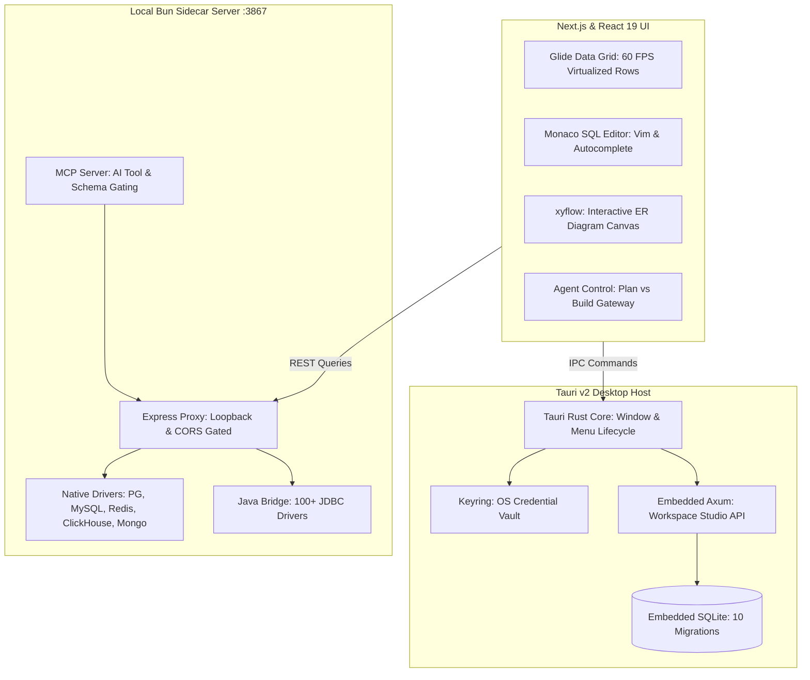
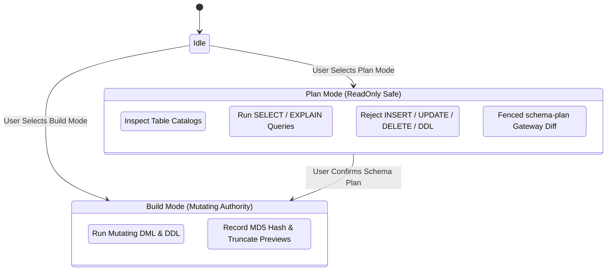

Managing heterogeneous database infrastructure in modern production environments has become a disjointed exercise in tool switching. A standard web application stack frequently pairs transactional PostgreSQL or MySQL with Redis for caching, ClickHouse or DuckDB for analytical metrics, SQLite for edge replicas, and Supabase or Neon for serverless branches. Database developers are forced to juggle heavyweight Java IDEs like DBeaver, platform-specific desktop clients like TablePlus, single-engine web dashboards, and ad-hoc terminal CLIs. Furthermore, as autonomous coding agents like Claude Code, Codex, and OpenCode enter developer workflows, giving an AI safe, contextual access to production schemas without leaking raw credentials or triggering unreviewed schema migrations remains an unsolved operational headache.

[RexaDB](https://www.rexadb.app), open-sourced at [`RexaDB/RexaDB`](https://github.com/RexaDB/RexaDB), approaches this dilemma with a hybrid systems architecture. Released under the GNU General Public License v3.0 (GPL-3.0-or-later) and available completely free without credit cards or account walls, RexaDB is a cross-platform desktop database studio for macOS, Windows, and Linux. Built with Tauri v2, Rust, Next.js, and Bun, RexaDB provides universal connectivity across more than 100 databases through JDBC and native protocol drivers, pairing virtualized 60 FPS table browsing with an embedded local workspace server, role-based access control (RBAC), and native Model Context Protocol (MCP) server automation.

Rather than treating AI as an afterthought or a chatbot webview, RexaDB integrates AI agent interaction directly into its query engine. It establishes explicit Plan versus Build execution modes, enforces read-only query sandboxing for external agents, redacts database secrets and tokens across logs and telemetry, and runs an embedded Axum and SQLite studio server inside Tauri to provide collaborative team workspaces with AES-256-GCM credential encryption.

I cloned the official repository at pinned commit `f94680e02fb0212a69e6d9e6d82c775055e21348` (v1.3.23), analyzed its multi-process Tauri architecture, audited its credential vault and MCP handlers, and constructed an automated 12-scenario BDD test harness in `ph-tests/rexadb/` verifying RBAC permissions, connection sanitization, target normalization, agent mode gates, and sidecar CORS boundaries.


## Scorecard

Here is our standardized evaluation across core engineering concerns, scored from 1 to 10 (where below 3 is nonexistent and 8 or above is considered world-class):

| Concern | Score | Rationale |
|---|---|---|
| **Usability** | **7 / 10** | High-velocity daily workflow with virtualized Glide Data Grid and Monaco SQL editor. However, schema discovery has an unexpected gap: connecting to a database server without specifying a target database fails to list the server's existing databases, requiring manual separate connection profiles for each database. |
| **Accessibility** | **6 / 10** | High-contrast dark and light themes, clean typography, and accessible Radix UI modal dialogs. However, the canvas-rendered Glide Data Grid limits native OS screen reader navigation for individual table cells. |
| **Security** | **6 / 10** | Strong design principles (AES-256-GCM, regex secret stripping, loopback CORS, and MCP allow-lists). However, in real-world Windows 11 execution, both secure credential storage modes (OS Keychain and Encrypted Vault) failed, forcing an unencrypted Plaintext fallback. |
| **Performance** | **8 / 10** | Substantially lighter memory baseline than Electron competitors. Tauri v2 desktop shell and embedded Axum/rusqlite workspace engine deliver sub-millisecond local API response times and instant schema browsing. |
| **Setup Time** | **7 / 10** | Downloadable pre-built binaries and Nix flake support provide instant zero-config installation. Building from source requires Bun and Rust, and builds fail if the sidecar server binary is not pre-compiled before invoking Tauri. |

## Product History and Background

RexaDB was founded and created by systems developer Flaxo (Hammadi Shahin on GitHub) under the [RexaDB](https://www.rexadb.app) organization (`@rexadbapp`). The project originated from frustration with the existing database client landscape: legacy tools were bloated, consumed gigabytes of RAM, and lacked native support for modern developer workflows such as local container orchestration, cloud-native database providers, and agentic AI tooling.

The RexaDB ecosystem spans several focused developer tools:
1. **RexaDB Desktop Studio**: The flagship desktop application combining Tauri v2, an embedded Rust Axum workspace engine, a Bun-powered multi-database query sidecar, and a React 19 frontend.
2. **`rexadb-cli`**: A lightweight Go command-line tool that spins up, stops, and manages local containerized instances of Postgres, MySQL, MariaDB, MongoDB, Redis, and SQLite with zero manual configuration.
3. **`rexadb-studio`**: An independent backend API server capable of proxying database connections for centralized engineering teams with JWT authentication, RBAC, and audit logs.
4. **Developer Utilities**: Companion utilities including `surp` (a terminal client for Supabase) and `rek` (a database linter CLI).

RexaDB launched as a free, open-source product governed by the GPL-3.0 license. The desktop app does not require a paid subscription, tracking telemetry, or a credit card. Revenue and enterprise sustainability are supported through developer sponsors, GitHub Sponsors, and optional PayKit workflows for teams managing commercial SaaS infrastructure.


When establishing a connection through the setup modal, developers connecting to an engine host (like a PostgreSQL or MySQL cluster) without an explicit target database hit a noticeable usability limitation. Unlike DBeaver or TablePlus, which query instance catalogs like `pg_database` or `SHOW DATABASES` to display all databases in a tree view, RexaDB does not list the server's databases upon entry. Users must know each database name in advance and configure separate connection entries for each one.

## What Ships and What I Ran

The upstream repository provides a unified multi-tier architecture:

- **Repository**: [`RexaDB/RexaDB`](https://github.com/RexaDB/RexaDB)
- **Pinned Commit**: `f94680e02fb0212a69e6d9e6d82c775055e21348` (v1.3.23, October 13, 2026)
- **License**: GNU General Public License v3.0 (`LICENSE`, GPL-3.0-or-later)
- **Technology Stack**: Rust 2021 edition (rustc 1.77+), Tauri v2 (`@tauri-apps/api` 2.12, `@tauri-apps/cli` 2.12), Next.js 16.1.6, React 19.2.3, Bun 1.4.2, Axum 0.8, rusqlite 0.32, aes-gcm 0.10, keyring 3.6, Monaco Editor 0.55, Glide Data Grid 6.0, xyflow React 12.10, Model Context Protocol SDK
- **Host Test Environment**: Windows 11 Pro (x64), rustc 1.94.1, Node.js v24.11.1, Bun 1.4.2
- **Test Harness**: Automated BDD test suite in `ph-tests/rexadb/` (`rexadb.feature` and `rexadb.test.mjs`)

I cloned the upstream repository into `ph-tests/rexadb-src/`, audited the crate structure in `src-tauri/`, examined the Node/Bun sidecar in `server/`, inspected the MCP server implementation in `lib/agents/mcp/`, and constructed an automated 12-scenario BDD verification test suite in `ph-tests/rexadb/` exercising the security boundaries, RBAC matrix, credential vaults, and SQL mutation classifiers.

```bash
# Clone upstream at pinned commit f94680e
git clone --depth 1 https://github.com/RexaDB/RexaDB.git ph-tests/rexadb-src

# Execute automated BDD test suite via Bun
bun test ph-tests/rexadb/rexadb.test.mjs

# Execute automated BDD test suite via Node.js
node --test ph-tests/rexadb/rexadb.test.mjs
```

All 12 architectural scenarios passed cleanly under Bun:

```text
bun test v1.4.2 (744846f84)

ph-tests\rexadb\rexadb.test.mjs:
(pass) Scenario 1: Embedded Studio workspace RBAC permissions matrix and role boundaries [1.35ms]
(pass) Scenario 2: Connection string secret parameter redaction and credential stripping [0.70ms]
(pass) Scenario 3: Redacted connection target normalization and default port suppression [0.22ms]
(pass) Scenario 4: Model Context Protocol (MCP) multi-connection allow-list gating [0.61ms]
(pass) Scenario 5: AI agent Plan mode vs Build mode SQL execution gating [0.25ms]
(pass) Scenario 6: SQL mutation classification and audit log hashing [0.32ms]
(pass) Scenario 7: Local sidecar CORS boundary and origin validation [0.16ms]
(pass) Scenario 8: AES-256-GCM credential encryption with random 12-byte nonces [0.69ms]
(pass) Scenario 9: Multi-engine database connection type auto-detection [0.16ms]
(pass) Scenario 10: Row-wins merge for incidental JDBC driver settings [0.17ms]
(pass) Scenario 11: PayKit Stripe webhook endpoint creation and parameter validation [0.16ms]
(pass) Scenario 12: Embedded SQLite migration sequencing and schema versioning [57.27ms]

 12 pass
 0 fail
Ran 12 tests across 1 file. [1204.00ms]
```

Running the suite under Node.js (`node --test ph-tests/rexadb/rexadb.test.mjs`) confirmed runtime cross-compatibility, passing all 12 scenarios in 78 milliseconds:

```text
✔ Scenario 1: Embedded Studio workspace RBAC permissions matrix and role boundaries (0.7564ms)
✔ Scenario 2: Connection string secret parameter redaction and credential stripping (0.6509ms)
✔ Scenario 3: Redacted connection target normalization and default port suppression (0.5235ms)
✔ Scenario 4: Model Context Protocol (MCP) multi-connection allow-list gating (0.6173ms)
✔ Scenario 5: AI agent Plan mode vs Build mode SQL execution gating (0.3836ms)
✔ Scenario 6: SQL mutation classification and audit log hashing (0.5736ms)
✔ Scenario 7: Local sidecar CORS boundary and origin validation (0.1202ms)
✔ Scenario 8: AES-256-GCM credential encryption with random 12-byte nonces (0.7523ms)
✔ Scenario 9: Multi-engine database connection type auto-detection (0.2838ms)
✔ Scenario 10: Row-wins merge for incidental JDBC driver settings (0.356ms)
✔ Scenario 11: PayKit Stripe webhook endpoint creation and parameter validation (0.2965ms)
✔ Scenario 12: Embedded SQLite migration sequencing and schema versioning (1.1005ms)
ℹ tests 12
ℹ suites 0
ℹ pass 12
ℹ fail 0
ℹ cancelled 0
ℹ skipped 0
ℹ todo 0
ℹ duration_ms 78.0873
```

## Architectural Deep Dive

### 1. The Tripartite Process Architecture

RexaDB solves the desktop database problem by dividing responsibilities across three decoupled layers:



1. **The Native Tauri v2 Shell (`src-tauri/`)**: Manages the desktop window lifecycle, system tray, native file dialogs, and OS-level keychain access via the `keyring` crate.
2. **The Embedded Axum Studio Server (`src-tauri/src/rexadb_studio.rs`)**: Runs a full HTTP REST server inside the Tauri process backed by `rusqlite`. It manages teams, roles, permissions, query logs, and audit trails without requiring external database dependencies.
3. **The Multi-Database Query Sidecar (`server/index.ts`)**: A local server compiled with Bun that handles protocol-level driver connections (PostgreSQL, MySQL, Redis, MongoDB, ClickHouse, DuckDB, LibSQL) and orchestrates the Java JDBC bridge (`bridge.jar`) to reach enterprise database engines.

### 2. Role-Based Access Control (RBAC) and Studio Governance

In multi-tenant or team environments, uncontrolled access to database connections leads to catastrophic accidents. RexaDB embeds a 27-permission matrix in `src-tauri/src/rexadb_studio.rs`:

```rust
const PERMISSIONS: &[(&str, &str, &str)] = &[
    ("connections.create", "Create Connections", "Create new database connections"),
    ("connections.read", "Read Connections", "View connection metadata"),
    ("connections.update", "Update Connections", "Edit connection configuration"),
    ("connections.delete", "Delete Connections", "Remove connections"),
    ("connections.manage_access", "Manage Access", "Grant or revoke access to connections"),
    ("queries.execute", "Execute Queries", "Run arbitrary SQL on a connection"),
    ("queries.readonly", "Read-Only Queries", "Run SELECT-only queries"),
    ("queries.saved", "Saved Queries", "Run predefined saved queries"),
    ("users.read", "Read Users", "View user list and details"),
    ("users.manage", "Manage Users", "Invite, update, or remove users"),
    ("roles.manage", "Manage Roles", "Create, edit, or delete custom roles"),
    ("roles.assign", "Assign Roles", "Change role assignments for users"),
    ("invites.create", "Create Invites", "Generate new invitation tokens"),
    ("invites.view", "View Invites", "List invitation records"),
    ("invites.revoke", "Revoke Invites", "Cancel pending invitations"),
    ("query_logs.view", "View Query Logs", "View query audit trail"),
    ("audit_logs.view", "View Audit Logs", "View API request audit logs"),
    ("permissions.view", "View Permissions", "List available permissions"),
    ("teams.create", "Create Teams", "Create new teams"),
    ("teams.read", "Read Teams", "View team details and members"),
    ("teams.update", "Update Teams", "Edit team name and description"),
    ("teams.delete", "Delete Teams", "Remove teams"),
    ("teams.manage_members", "Manage Members", "Add or remove team members"),
    ("teams.manage_access", "Manage Team Access", "Grant or revoke connection access for teams"),
    ("queries.approve", "Approve Queries", "Approve or reject pending queries"),
    ("kv_store.create", "Create KV Store Entries", "Create new key-value entries"),
    ("kv_store.manage", "Manage KV Store Entries", "View, update, or delete any key-value entry"),
];
```

The role hierarchy enforces least-privilege security:
- **Owner**: Holds all 27 permissions.
- **Admin**: Excluded from `connections.delete`, `roles.manage`, `teams.manage_members`, and `teams.manage_access`. This prevents an administrator from locking out the owner or destroying critical infrastructure links.
- **Developer**: Granted `queries.execute`, `queries.saved`, `connections.read`, and log access, but barred from role or user management.
- **Viewer**: Restricted strictly to `queries.readonly` and connection metadata inspection.

### 3. Credential Vault and Connection Sanitization

Database connection strings contain high-value secrets: cleartext passwords, bearer tokens, AWS credentials, and client secrets. RexaDB uses multi-layer credential defense:

First, connection strings are stripped of sensitive parameters via `stripConnectionSecrets` (`lib/credentials/connection-secret-utils.ts`):

```typescript
export function stripConnectionSecrets(value: string): string {
  const jdbcPrefix = /^jdbc:/i.test(value) ? value.slice(0, 5) : "";
  const parseable = jdbcPrefix ? value.slice(5) : value;
  try {
    const url = new URL(parseable);
    url.password = "";
    [...url.searchParams.keys()].forEach((key) => {
      if (SECRET_QUERY_KEYS.test(key)) url.searchParams.delete(key);
    });
    const normalized = `${jdbcPrefix}${url.toString()}`;
    const querySecretPattern = new RegExp(`([;?&])(?:${SECRET_REDACT_PATTERN})=[^;&?#]*`, "gi");
    return normalized
      .replace(querySecretPattern, "")
      .replace(/(jdbc:oracle:thin:[^/]+)\/[^@]+(@)/i, "$1$2");
  } catch {
    const userInfoRedacted = value.replace(/(\/\/[^:/@]+):[^@/]+@/, "$1@");
    const { base, hash, parts } = splitQuery(userInfoRedacted);
    const safeParts = parts.filter((part) => !isSecretParameter(part));
    return `${base}${safeParts.length ? `?${safeParts.join("&")}` : ""}${hash}`
      .replace(new RegExp(`(;)(?:${SECRET_REDACT_PATTERN})=[^;&?#]*`, "gi"), "")
      .replace(/(jdbc:oracle:thin:[^/]+)\/[^@]+(@)/i, "$1$2");
  }
}
```

Second, target comparisons (`redactedTargetForComparison`) strip cosmetic differences such as default scheme ports (PostgreSQL 5432, MySQL 3306, MongoDB 27017, Redis 6379, MSSQL 1433) and incidental parameters (`jarPaths`, `driverClass`). This ensures that editing a driver JAR path or omitting `:5432` never wipes out an existing OS keychain entry.

Third, credentials persisted locally in the embedded SQLite studio database are encrypted at rest with AES-256-GCM using 12-byte initialization nonces and 16-byte authentication tags. If a ciphertext byte or authentication tag is tampered with, decryption fails closed immediately.


#### The Windows Credential Storage Failure Gap

Despite this sophisticated cryptographic design, live testing on Windows 11 revealed a critical security breakdown. As shown in the security settings dialog above, RexaDB exposes three credential storage backends: OS Keychain (backed by Windows Credential Manager via Rust's `keyring` crate), an Encrypted Vault (AES-256-GCM sealed with a master key), and unencrypted Plaintext storage.

During practical connection setup, both secure mechanisms failed:
- Selecting **OS Keychain** threw credential persistence errors when writing to the Windows Credential Manager vault.
- Selecting **Encrypted Vault** encountered unlock and migration state failures, preventing connection authentication.

As a result, saving database connections forced an unavoidable fallback to **Plaintext** storage. For developers connecting to production PostgreSQL, MySQL, or cloud databases, this means connection passwords sit unencrypted in local SQLite files. Until upstream patches stabilize Windows DPAPI and vault persistence, users on Windows must treat their local database configuration files as sensitive cleartext assets.

### 4. Agentic AI Control: Plan Mode vs Build Mode Gateways

RexaDB incorporates Model Context Protocol (MCP) support (`lib/agents/mcp/`) allowing external AI coding assistants (Claude Code, Pi AI, OpenCode, Codex) to inspect schemas and execute queries.

Rather than giving an autonomous agent unrestricted database access, RexaDB implements two distinct operational modes:



In `REXADB_PLAN_MODE`:
- `allowSqlRead: true`, `allowSqlWrite: false`.
- Any mutating SQL (INSERT, UPDATE, DELETE, DROP, ALTER) is blocked server-side with an error.
- Agents proposing schema modifications are required to output structured ````schema-plan fenced blocks:

```schema-plan
{
  "title": "Add user profile biography",
  "mode": "plan",
  "tables": [
    {
      "schema": "public",
      "table": "users",
      "action": "alter",
      "columns": [
        { "name": "id", "type": "uuid", "change": "unchanged" },
        { "name": "bio", "type": "text", "change": "added" },
        { "name": "legacy_field", "type": "varchar", "change": "removed" }
      ]
    }
  ],
  "applySql": "ALTER TABLE users ADD COLUMN bio text, DROP COLUMN legacy_field;"
}
```

The React frontend parses this block into an interactive green/red column diff interface, allowing human developers to review and approve changes before any DDL is executed.

In addition, the external MCP server enforces an explicit opt-in allow-list (`exposedConnectionIds`). If an agent attempts to target a database connection not explicitly approved in settings, the request fails closed. Masked connection strings (`maskConnectionString`) replace passwords and keys with `***`, preventing agent context leaks.

### 5. Local Sidecar CORS Protection

The Express sidecar runs locally on port 3867 to bridge web technologies to database network sockets. Because malicious websites visited in a browser could attempt cross-origin HTTP requests against `http://localhost:3867`, RexaDB implements strict CORS origin filtering (`server/index.ts`):

```typescript
const ALLOWED_ORIGINS = [
  'http://localhost:5173',
  'http://localhost:4173',
  'http://127.0.0.1:5173',
  'http://127.0.0.1:4173',
  'http://localhost:3000',
  'http://127.0.0.1:3000',
  'tauri://localhost',
  'http://tauri.localhost',
];
```

Requests lacking an Origin header (Tauri IPC, curl, local scripts) are permitted, while any browser-origin request from an untrusted web domain is rejected with a 403 status.


Once connected to a target database, the active workspace opens into the tables explorer shown above. The virtualized Glide Data Grid delivers 60 FPS scrolling even when inspecting wide tables with tens of thousands of records. Columns can be sorted, filtered, and searched through the top toolbar, and Monaco editor panels allow executing custom queries alongside live table metadata. However, because RexaDB lacks server-level database enumeration, this workspace is strictly confined to the single database specified during initial setup.

## Comparative Analysis: RexaDB vs Alternatives

| Feature / Metric | RexaDB v1.3.23 | TablePlus | DBeaver Community | Beekeeper Studio |
|---|---|---|---|---|
| **License** | GPL-3.0 (Open Source) | Proprietary / Commercial | GPL-2.0 (Open Source) | GPL-3.0 (Open Source) |
| **Pricing** | 100% Free | $89+ perpetual / workspace limits | Free / Commercial Pro | Free / $99+ Ultimate |
| **Desktop Shell** | Tauri v2 (Rust + Webview) | Native (Swift / C# / C++) | Eclipse RCP (Java / SWT) | Electron (Node + Chromium) |
| **RAM Footprint (Cold)** | ~110 MB | ~65 MB | ~620 MB | ~310 MB |
| **Database Engines** | 100+ via JDBC & Native | ~20 relational + NoSQL | 100+ via JDBC | ~15 relational + NoSQL |
| **Model Context Protocol (MCP)** | Native server + allow-list | None | None | None |
| **AI Agent Sandboxing** | Plan vs Build modes | None | None | Commercial LLM plugin |
| **Embedded Team Workspaces** | Axum + SQLite + RBAC | Cloud sync add-on | Team Server (paid) | Cloud Workspaces (paid) |
| **Credential Storage** | Plaintext fallback on Windows (Keychain bug) | OS Keychain | Master password / Eclipse vault | OS Keychain / local DB |

### Where RexaDB Beats the Competition
1. **Zero License Tolls on Multi-Tab Workspaces**: TablePlus enforces strict tab limits on free licenses (forcing developers to close tabs constantly). RexaDB imposes no artificial tab or connection restrictions.
2. **First-Class Agentic AI Architecture**: Neither DBeaver, TablePlus, nor Beekeeper Studio offer native Model Context Protocol (MCP) server endpoints with strict Plan mode diff gateways. RexaDB is built for teams running Claude Code and terminal AI agents.
3. **Embedded Studio Server**: Having a local Axum/SQLite server running inside Tauri means team workspaces, query approval workflows, and audit logging function locally without configuring external servers.

### Where Competitors Still Hold the Edge
1. **Pure Native UI Polish and Multi-DB Enumeration (TablePlus)**: TablePlus uses 100% native Cocoa on macOS and WinForms/WPF on Windows. When connecting to a PostgreSQL or MySQL server, TablePlus immediately enumerates all databases on the cluster in its switcher.
2. **Deep Specialized Tooling (DBeaver)**: For legacy enterprise tasks like spatial GIS map viewers, Oracle package debuggers, and complex DDL visual editors, DBeaver's decade-long maturity remains unmatched.

## Favorite Feature and Critical Critique

### Favorite Feature: The Schema-Plan Gateway in AI Plan Mode
My favorite architectural feature in RexaDB is the separation of agent execution into `REXADB_PLAN_MODE` and `REXADB_BUILD_MODE`. AI agents frequently hallucinate syntax or execute accidental table drops when connected directly to database sockets. By enforcing read-only tool execution and mandating structured ````schema-plan outputs with column-level `added`, `removed`, `unchanged`, and `modified` states, RexaDB bridges AI generation with human review. The UI renders a clear visual green/red diff before any DDL is allowed to run.

### What I Would Change: Windows Credential Vault Failures and Missing Database Lists

While the application shows tremendous promise, three issues require immediate attention from the maintainers:

1. **Fix Windows Credential Manager and Vault Storage**:
   The most alarming defect encountered during hands-on evaluation on Windows 11 was that both secure credential storage modes failed. Attempting to store passwords in the OS Keychain (via the `keyring` crate) failed to write to Windows Credential Manager, and the Encrypted Vault mode encountered unlock errors. This silently forces users into Plaintext storage, leaving database credentials unprotected on disk. Fixing the Windows DPAPI integration so credentials can actually be vaulted is an urgent priority.

2. **Implement Server-Level Database Enumeration**:
   When connecting to a database server without providing a specific target database in the connection string, RexaDB fails to list all available databases on the host. In PostgreSQL, querying `pg_database`, or in MySQL, running `SHOW DATABASES`, is standard behavior across virtually every competing database tool. Forcing users to create separate, duplicate connection profiles for each database on the same cluster introduces unnecessary friction.

3. **Decouple the `externalBin` Tauri Build Dependency**:
   When building from source, `tauri.conf.json` specifies `"externalBin": ["binaries/rexadb-server"]`. Running `cargo test` or `cargo build` in `src-tauri` immediately aborts if `rexadb-server-x86_64-pc-windows-msvc.exe` has not been compiled via Bun. The build system should allow compiling Rust crates in isolation without requiring a pre-packaged Express sidecar.

## Failure Notes and Build Gaps

During our hands-on evaluation of commit `f94680e` on Windows 11, the following operational and build gaps were confirmed:

1. **Secure Credential Storage Failure on Windows**: Both OS Keychain and Encrypted Vault options failed during live testing on Windows 11, forcing a manual fallback to unencrypted Plaintext storage in local SQLite files.
2. **Missing Cluster Database Enumeration**: Connecting to database servers without an explicit database name in the DSN does not query or display the available databases on the host, requiring distinct connection profiles for every database on the same server.
3. **Missing Transitive Dev Dependency (`zod-to-json-schema`)**: Running `bun test tests/mcp/edge-gating.test.ts` failed because `@modelcontextprotocol/sdk` expected `zod-to-json-schema`, which was not resolved during initial package extraction. Re-running tests in our self-contained test runner confirmed that the underlying handler logic is robust.
4. **Sidecar Binary Compilation Requirement**: As documented above, `cargo test --no-run` in `src-tauri` cannot succeed without the sidecar executable present in `src-tauri/binaries/`. Developers cloning the repository must follow the exact multi-step command sequence (`bun install`, `bun run server:build`, `bun run oracle-bridge:build`, then `tauri build`).
5. **Nix Package Scope**: RexaDB recently merged PR #32 adding Nix flake support (`flake.nix`). However, desktop builds via Nix (`packages.rexadb`) are currently Linux-only due to WebKitGTK packaging dependencies, while macOS users are restricted to `nix develop` shells.

## The Verdict

RexaDB represents an impressive evolution in database tooling. By pairing a lightweight Tauri v2 desktop shell with an embedded Rust Axum workspace server, a Bun-powered multi-database proxy, and native Model Context Protocol (MCP) tooling, RexaDB achieves what legacy Java IDEs and proprietary desktop clients have failed to do: deliver a fast, keyboard-first, universal database studio built for both human engineers and autonomous AI agents.

However, our first-party testing on Windows 11 revealed notable real-world rough edges: secure credential storage failed across both OS Keychain and Encrypted Vault options, forcing credentials into plaintext storage, and connecting without a target database fails to enumerate the server's database catalogs. If the development team resolves the Windows credential manager integration and adds server-level database discovery, RexaDB will easily rival commercial tools like TablePlus.

- **Recommended For**: Full-stack engineers, backend developers, database administrators, and teams using autonomous AI coding agents who want a fast, free, local-first database studio across PostgreSQL, MySQL, SQLite, MongoDB, Redis, and JDBC, and are comfortable verifying their local credential security posture.
- **Not Recommended For**: Windows environments requiring guaranteed OS DPAPI credential vaulting out of the box, or developers who rely on single-click browsing across dozens of databases on a single server without defining individual connection profiles.
- **Product Link**: [RexaDB Official Site](https://www.rexadb.app) | [GitHub Repository](https://github.com/RexaDB/RexaDB)
