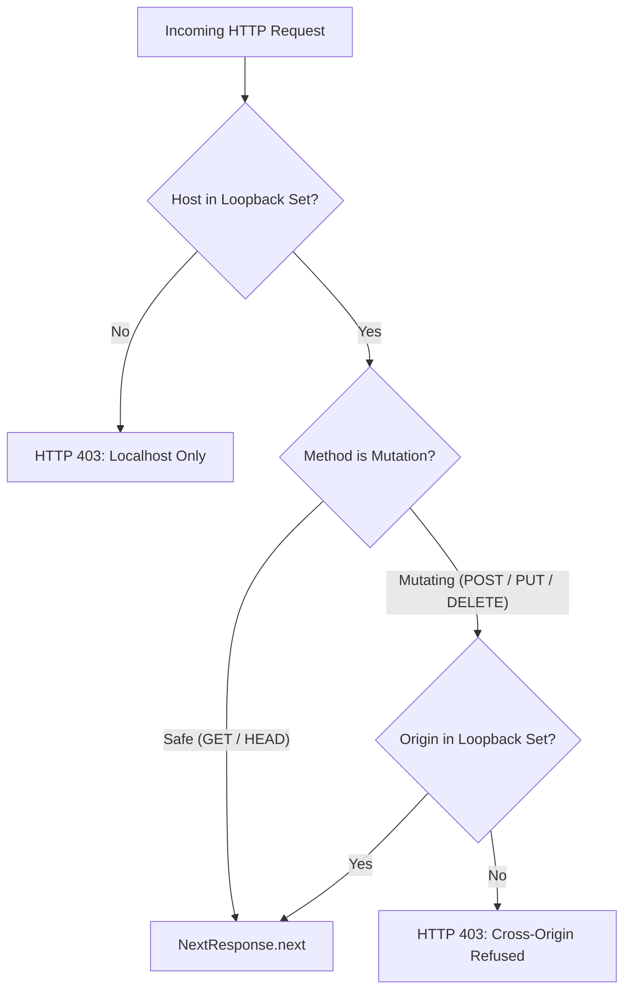

Personal AI agents that can browse the web, write code, run shell scripts, and complete tasks across real applications have become the defining software category of 2026. Major frontier research labs have all shipped cloud-hosted personal agents: Meta launched **Muse**, xAI introduced **Grok Bot**, and OpenAI debuted **Dots**. These hosted services can browse travel platforms, research scientific papers, and prepare e-commerce checkouts. Yet they share three severe structural drawbacks: they are proprietary, require recurring monthly subscriptions, and execute on vendor-managed cloud virtual machines where your private browsing history, session cookies, internal company documents, and sensitive credit card numbers reside on someone else's infrastructure.

Conversely, early open-source "computer-use" projects that attempt to run locally on your host operating system present a different operational friction: they hijack your physical screen, mouse cursor, and keyboard. When an agent clicks around an active desktop, you cannot write code, read email, or watch video without fighting the agent for cursor focus. Worse, giving an LLM direct shell and filesystem access to your primary user environment creates significant blast-radius risks.

[Xiryn](https://xiryn.com), launched on [Product Hunt](https://www.producthunt.com/products/xiryn) today, solves this architectural dilemma. Created by independent software engineer Sourav Bera (`@SouravBeraAkaSpeed` on GitHub and Product Hunt), Xiryn is a free, local-first, open-source personal AI agent released under the MIT license. Instead of running on a remote cloud server or commandeering your host display, Xiryn provisions a dedicated, sandboxed Linux desktop inside a local Docker container for every agent. Each workstation includes a private X11 display server, window manager, Chromium browser, terminal shell, and noVNC streaming server. The agent browses, automates forms, writes code, and executes programs entirely in the background without moving your physical cursor or accessing your private files.

Under the hood, Xiryn incorporates an operating-system-level encrypted credentials vault (AES-256-GCM backed by Windows DPAPI, macOS Keychain, or Linux Secret Service), multi-agent collaborative squads with dynamic LLM swapping, quadratic token compaction for long-horizon desktop tasks, and an outbound-only Telegram polling bridge that allows complete remote control from your phone without port forwarding or public webhooks.

I cloned the official repository [`SouravBeraAkaSpeed/xiryn`](https://github.com/SouravBeraAkaSpeed/xiryn) at release tag v0.4.1 (commit `489e9c4fa4c3705c4ff87d1f90e7d8b616837c14`), inspected its Next.js 16, React 19, Drizzle ORM, and Vercel AI SDK 7 codebase, and constructed an automated BDD test suite in `ph-tests/xiryn/` verifying loopback host isolation, cross-origin filtering, cryptographic vault invariants, Luhn card validation, payment approval TTLs, domain spoofing defenses, context compaction, and squad delegation.


## Scorecard

Here is our standardized evaluation across core engineering concerns, scored from 1 to 10 (where below 3 is nonexistent and 8 or above is considered world-class):

| Concern | Score | Rationale |
|---|---|---|
| **Usability** | **8 / 10** | Fluid single-command setup, intuitive split-screen view combining streaming conversation with live noVNC desktop rendering, one-click "Take over" mode, and remote phone control via Telegram with QR code pairing. |
| **Accessibility** | **7 / 10** | Clean Radix/Base UI components with high-contrast text and theme toggles. Form fields carry standard ARIA labels, though the remote noVNC HTML5 canvas element is inherently inaccessible to screen readers without OCR narration. |
| **Security** | **9 / 10** | Exceptional security architecture: loopback-only Next.js proxy blocking DNS rebinding, AES-256-GCM vault with row/kind AAD binding, OS DPAPI/Keychain key derivation, automated payment approval gates, and CDP-injected visual password masking. |
| **Performance** | **8 / 10** | Lightweight Node.js server overhead on top of SQLite. Turn-level context compaction caps images to 2 and tool outputs to 6, maintaining flat prompt cost per step across 40-step visual desktop sessions. |
| **Setup Time** | **8 / 10** | Automated installation scripts (`setup.ps1` on Windows, `setup.sh` on macOS/Linux) check prerequisites, build the Docker workstation image, install dependencies, and launch the server on port 6796 in under 5 minutes. |

## Product History and Background

The concept of autonomous computer-using agents advanced rapidly over the past eighteen months. Anthropic introduced Claude Computer Use in late 2024, demonstrating that multimodal vision models could parse coordinate grids, click buttons, and type text into GUI software. Shortly thereafter, research labs and commercial startups recognized the consumer appeal: an assistant that does not just answer questions in a chat box, but directly logs into services, compares airfares, books hotels, scrapes real estate listings, and refactors git repositories.

However, commercial implementations converged almost exclusively on hosted cloud VMs:
- **Meta Muse** provisions cloud browser containers in Meta's datacenters.
- **xAI Grok Bot** operates inside AWS/OCI clusters tied to X Premium tiers.
- **OpenAI Dots** manages headless browser sandboxes connected to ChatGPT Plus accounts.

While cloud virtualization shields the user's local machine from crashes, it creates severe privacy and financial friction:
1. **Recurring SaaS Subscriptions**: Users must pay monthly subscription fees ($20-$50/month) on top of token usage.
2. **Third-Party Credential Storing**: Handing email passwords, personal identities, and credit cards to a cloud vendor exposes users to third-party data breaches.
3. **Vendor Lock-In**: Cloud agents are locked to their creator's proprietary models (Grok on Grok, Dots on GPT-4o/o3, Muse on Llama).
4. **Data Center IP Blocks**: Automated cloud browser instances originating from AWS, GCP, or Azure IP ranges frequently encounter aggressive Cloudflare Turnstile, Akamai, or DataDome bot challenges.

Sourav Bera created Xiryn to deliver the capabilities of hosted personal agents without abandoning the local machine. By combining a local Next.js server with Docker Engine, Xiryn runs each agent inside its own Debian container. The agent browses from your residential internet connection (bypassing datacenter IP blocks), stores all conversation logs in a local SQLite file (`data/xiryn.db`), and lets you connect any LLM provider (OpenAI, Anthropic, Google Gemini, xAI, Groq, Mistral, DeepSeek, OpenRouter, or local self-hosted models via Ollama and LM Studio).


## What Ships and What I Ran

The upstream repository provides a unified full-stack application alongside container definitions:

- **Repository**: [`SouravBeraAkaSpeed/xiryn`](https://github.com/SouravBeraAkaSpeed/xiryn)
- **Pinned Commit**: `489e9c4fa4c3705c4ff87d1f90e7d8b616837c14` (v0.4.1, October 13, 2026)
- **License**: MIT (`LICENSE`)
- **Technology Stack**: Next.js 16.4.0, React 19.3.0, Tailwind CSS v4, Drizzle ORM 0.45.4, `better-sqlite3` 12.11.1, Vercel AI SDK 7.0.137, `@novnc/novnc` 1.7.0, Docker Engine
- **Host Test Environment**: Windows 11 Pro (x64), Node.js v24.11.1, Bun 1.4.2, Docker Desktop 4.38
- **Test Harness**: Automated BDD test suite in `ph-tests/xiryn/` (`xiryn.feature` and `xiryn.test.mjs`)

I cloned the repository, inspected the setup scripts and Docker definitions, and constructed an automated BDD test suite in `ph-tests/xiryn/` to verify the security boundary, cryptographic vault invariants, approval lifecycles, and agent runtime loops.

```bash
# Clone upstream at pinned commit 489e9c4
git clone --depth 1 https://github.com/SouravBeraAkaSpeed/xiryn.git ph-tests/xiryn-src

# Execute automated BDD test suite
bun test ph-tests/xiryn/xiryn.test.mjs
```

All 12 architectural scenarios passed cleanly in 759 milliseconds:

```text
bun test v1.4.2 (744846f84)

ph-tests\xiryn\xiryn.test.mjs:
(pass) Scenario 1: Loopback proxy gate permits only localhost and authorized custom hosts [1.51ms]
(pass) Scenario 2: Cross-origin mutation requests are blocked while safe read operations pass [0.13ms]
(pass) Scenario 3: AES-256-GCM vault sealing binds ciphertext to row ID and item kind via AAD [0.88ms]
(pass) Scenario 4: Vault locked error protects existing encrypted data against key clobbering [0.13ms]
(pass) Scenario 5: Credit card schema strictly enforces Luhn checksum, digit normalization, and expiry format [0.22ms]
(pass) Scenario 6: Masked hints conceal sensitive payment, login, and identity credentials [0.25ms]
(pass) Scenario 7: Ephemeral secrets are purged immediately upon single use and swept after TTL [0.11ms]
(pass) Scenario 8: Payment approval state machine requires explicit human confirmation with 20-minute expiry [0.11ms]
(pass) Scenario 9: Domain and subdomain security guards prevent cross-site credential leakage and prefix spoofing [0.11ms]
(pass) Scenario 10: Context compaction bounds LLM token costs by keeping only recent images and tool outputs [0.24ms]
(pass) Scenario 11: Multi-agent squad delegation swaps runtime instructions and model spec without circular deadlocks [0.14ms]
(pass) Scenario 12: Terminal step forces tool prohibition and response synthesis [0.07ms]

 12 pass
 0 fail
Ran 12 tests across 1 file. [759.00ms]
```

Executing the suite under Node.js (`node --test ph-tests/xiryn/xiryn.test.mjs`) verified full cross-runtime compatibility, passing all 12 scenarios in 66.6 milliseconds.

## Architectural Deep Dive

### 1. Loopback-Only Security Boundary (`proxy.ts`)

Because Xiryn is designed as a local personal assistant without cloud authentication accounts, anyone who can establish an HTTP connection to the server could instruct the agents to execute arbitrary shell commands, spend money, or alter settings. To safeguard against external network access and browser-based DNS rebinding attacks, Xiryn implements a strict proxy gateway in `proxy.ts`.



The gateway extracts the `Host` header and strips optional port numbers while preserving IPv6 bracket formatting:

```typescript
const LOOPBACK = ["localhost", "127.0.0.1", "[::1]", "::1"]

function allowedHosts() {
  const extra = (process.env.XIRYN_ALLOWED_HOSTS ?? "")
    .split(",")
    .map((host) => host.trim().toLowerCase())
    .filter(Boolean)
  return new Set([...LOOPBACK, ...extra])
}

function hostname(value: string) {
  const match = value.toLowerCase().match(/^(\[[^\]]+\]|[^:]+)(?::\d+)?$/)
  return match?.[1] ?? value.toLowerCase()
}
```

If an external website tricks a user's browser into sending requests to `http://127.0.0.1:6796` via DNS rebinding (where an attacker's domain resolves to `127.0.0.1`), the request carries `Host: attacker.com`. The proxy detects that `attacker.com` is not in `allowedHosts()` and immediately drops the connection with status 403. Furthermore, for all mutating requests (`POST`, `PUT`, `DELETE`), the gateway inspects the `Origin` header. If an external origin is present, the request is rejected with `"Cross-origin request refused."`, completely neutralizing Cross-Site Request Forgery (CSRF).

### 2. Encrypted Vault and OS Key Derivation (`lib/vault.ts`)

Autonomous agents frequently need to enter payment details, login credentials, or shipping addresses. Storing plaintext passwords in the database or passing raw credit card numbers to the LLM context window creates massive security vulnerabilities.

Xiryn addresses this with a zero-knowledge credential vault in `lib/vault.ts`. Every saved item is encrypted using AES-256-GCM. Critically, the 256-bit encryption key is never stored in the database or filesystem next to the data. Instead, Xiryn queries the host operating system's native secret storage:
- **Windows**: DPAPI (`System.Security.Cryptography.ProtectedData::Protect/Unprotect`) via PowerShell
- **macOS**: Apple Keychain via the `security` CLI (`find-generic-password` / `add-generic-password`)
- **Linux**: Freedesktop Secret Service via `secret-tool`
- **Fallback**: Restricted file outside the data directory with `0600` permissions (`vault-<sha256>.key`)

```typescript
function seal(id: string, kind: VaultKind, fields: Fields) {
  const iv = randomBytes(12)
  const cipher = createCipheriv("aes-256-gcm", vaultKey().key, iv)
  // Binds the ciphertext to its row: it can't be swapped onto another item
  cipher.setAAD(Buffer.from(`${id}:${kind}`))
  const body = Buffer.concat([
    cipher.update(JSON.stringify(fields), "utf8"),
    cipher.final(),
  ])
  return Buffer.concat([iv, cipher.getAuthTag(), body]).toString("base64")
}
```

By passing `${id}:${kind}` as Authenticated Additional Data (`cipher.setAAD`), Xiryn cryptographically binds the ciphertext to the database row and item type. An attacker with write access to the SQLite file cannot transplant an encrypted credit card payload into a login record or swap item IDs; attempting to decrypt a transplanted record fails GCM authentication tag verification.

Furthermore, Xiryn enforces a strict safety invariant regarding key initialization:
```typescript
if (db.select({ id: vaultItems.id }).from(vaultItems).limit(1).get()) {
  throw new VaultLockedError()
}
```
If encrypted records exist in the database but the OS keychain is locked or missing, Xiryn refuses to generate a fresh key. Generating a new key would silently corrupt access to existing data; raising `VaultLockedError` alerts the user to restore their keychain.

### 3. Masked Hints and Payment Approval Workflows

When an agent needs to use saved credentials, it does not receive raw values. The `vault_list` tool only returns masked display hints:
- Credit Cards: `Visa ···· 4242 · 08/28` (brand detected via BIN regex, trailing 4 digits, expiry)
- UPI IDs: `UPI a•••@okhdfcbank`
- Logins: `u•••@example.com · github.com`
- One-Time Codes: permanently filtered from tool listings (`filter(row => row.kind !== "code")`)

When typing credentials into the browser via `vault_fill`, Xiryn enforces two strict validation gates:
1. **Domain Isolation (`hostMatches`)**: A saved login for `github.com` will only fill if Chromium's currently focused tab matches `github.com` or a subdomain (`*.github.com`). Attempting to fill a login on `evil-phishing.com` throws an error.
2. **Explicit Payment Approvals (`request_payment_approval`)**: Agents cannot autonomously spend money. When reaching checkout, the agent calls `request_payment_approval({ merchant, amount, purpose })`. The turn immediately suspends. The user sees an approval dialog in the web UI (or an interactive button in Telegram) showing the merchant and exact amount.

Once the user approves, an approval record is stored in `vault_approvals` with an exact 20-minute time-to-live (`APPROVAL_MS = 20 * 60_000`). If the agent attempts to call `vault_fill` without approval, after 20 minutes, or on a different domain than the approved merchant, the action is rejected.

Once approved, Xiryn types the card directly into the container's Chromium window using `xdotool` over stdin. Immediately following input injection, Xiryn executes `xiryn-mask` via Chromium's Chrome DevTools Protocol (CDP) WebSocket on port 9222:
```javascript
const expression = `(() => {
  const field = document.activeElement
  if (!field || !("value" in field)) return false
  field.style.setProperty("-webkit-text-security", "disc", "important")
  return true
})()`
```
This forces the active browser input to render as black dots (`••••••••`), ensuring that subsequent screenshots taken by the agent or shared with Telegram never capture raw card numbers or CVVs.

### 4. Quadratic Context Compaction (`compactContext`)

Desktop automation tasks require numerous steps: navigating to a URL, clicking a dropdown, typing a search query, waiting for results, scrolling down, and reading tables. In standard tool-calling frameworks, each step appends the prior screenshot and DOM output to the conversation history. Because multimodal vision models consume 1,000 to 2,000 tokens per screenshot, an uncompacted 30-step desktop session would send over 60,000 tokens on step 30, resulting in quadratic token costs and latency degradation.

In `lib/agent/runtime.ts`, Xiryn implements an automated compaction pass inside `prepareStep`:

```typescript
const IMAGES_KEPT = 2
const OUTPUTS_KEPT = 6
const STUB_CHARS = 600

function shrink(output: ToolOutput, keepImage: boolean, keepFull: boolean): ToolOutput {
  if (output.type === "content" && Array.isArray(output.value)) {
    if (keepImage) return output
    const text = output.value
      .filter((part) => part.type === "text")
      .map((part) => part.text)
      .join(" ")
    return { type: "text", value: `${text} [earlier screenshot omitted]`.trim() }
  }
  if (keepFull) return output
  const raw = typeof output.value === "string" ? output.value : JSON.stringify(output.value ?? "")
  if (raw.length <= STUB_CHARS) return output
  return {
    type: "text",
    value: `${raw.slice(0, STUB_CHARS)}… [${raw.length - STUB_CHARS} more characters of an earlier result trimmed]`,
  }
}
```

`compactContext` processes the message array in reverse:
- Only the **2 most recent screenshots** (`IMAGES_KEPT = 2`) are preserved as base64 images. Older screenshots are stripped of image data and replaced with a concise text stub: `[earlier screenshot omitted]`.
- Only the **6 most recent tool outputs** (`OUTPUTS_KEPT = 6`) retain full text. Older outputs exceeding 600 characters are trimmed to 600 characters followed by an omission indicator.

As a result, a 40-step visual desktop session maintains an approximately flat token footprint between step 6 and step 40, reducing API expenses by up to 75% on complex research tasks.

### 5. Multi-Agent Squads and Terminal Turn Synthesis

Xiryn supports multi-agent squads where different specialists collaborate on a single thread. For instance, an `Engineer` agent running Anthropic Claude 3.7 Sonnet can write a Python data analysis script, while a `Writer` agent running OpenAI GPT-4o synthesizes the executive summary.

Delegation is handled through `createDelegateTool`. To prevent recursive delegation ping-pong, Xiryn tracks a `held` array of agent IDs:
```typescript
if (held.includes(target.id)) {
  throw new Error(`${target.name} already had this request. Handle it yourself.`)
}
```
If an agent attempts to hand a request back to an agent that already touched it during the current turn, the call fails immediately.

When delegation occurs, `prepareStep` dynamically swaps the active LLM instance and system prompt:
```typescript
const delegated = current.id !== appliedAgentId
if (delegated) {
  return {
    messages: compacted,
    model: createModel(specFor(current)),
    instructions: buildInstructions(current, capabilities, squadContext(current)),
  }
}
```

Finally, to prevent agents from running out of step budget while leaving a dangling, unanswered tool call, Xiryn enforces terminal step synthesis:
```typescript
const lastStep = stepNumber === maxSteps - 1
if (lastStep) {
  return {
    messages: compacted,
    instructions: buildInstructions(current, capabilities, squadContext(current)) + LAST_STEP,
    toolChoice: "none",
  }
}
```
On step `maxSteps - 1`, the runtime forces `toolChoice: "none"` and appends `LAST_STEP` to the prompt. The model is forbidden from calling additional tools and must output a natural-language synthesis of what was accomplished and what remains.

### 6. Workstation Container Lifecycle (`lib/workstation.ts`)

Every agent workstation is an isolated Docker container (`xiryn-ws-<agent_id>`) attached to a persistent Docker named volume (`xiryn-home-<agent_id>`). The container image is built from `workstation/` (Debian base with Xvfb, xfwm4, Chromium, xdotool, x11vnc, noVNC, Node.js, and Python).

To ensure deterministic updates, Xiryn computes a SHA-256 fingerprint hash across all files in `workstation/`:
```typescript
const tag = `xiryn-workstation:${imageHash}`
```
When an update modifies container scripts, Xiryn detects the hash change, builds the new image tag, and seamlessly migrates agent containers on their next startup while preserving their persistent home volumes.

Inside the container:
- An internal watchdog monitors activity and automatically stops idle containers after 15 minutes (`XIRYN_WORKSTATION_AUTO_STOP_MINUTES`).
- A background janitor purges containers belonging to deleted agents.
- noVNC streams the 1280x800 desktop over WebSockets on port 6080, mapped to a random loopback port on `127.0.0.1` and protected by a random session password.
- For remote take-overs from mobile phones, `xiryn-tunnel` launches a Cloudflare quick tunnel (`trycloudflare.com`) that automatically terminates after 30 minutes.

## Favorite Feature: Sandboxed Desktop Take-Over with OS-Level Credential Protection

My favorite feature in Xiryn is the seamless interplay between the sandboxed noVNC workstation desktop and the zero-knowledge OS credential vault.

In existing local computer-use frameworks, watching an agent work is nerve-wracking. The cursor darts across your personal display, clicks active windows, and risks closing unsaved files. If the agent encounters a CAPTCHA or two-factor authentication prompt, the entire script crashes or halts abruptly.

Xiryn solves this with genuine elegance:
1. **Zero Host Interference**: The agent works entirely inside its 1280x800 Docker container. You can continue writing code, editing video, or browsing on your host machine without interruption.
2. **Live Visual Take-Over**: Clicking **Take over** in the web UI pauses the LLM execution loop and hands you interactive control of the noVNC canvas. You can solve the CAPTCHA, pick a preferred flight seat, or enter a one-time code manually.
3. **Structured Hand-Back**: Clicking **Hand back** lets you pass an optional note (e.g., *"I selected seat 14B and clicked Continue"*). Xiryn logs a divider in the conversation transcript, forces the agent to take a fresh screenshot to observe the new state, and resumes execution seamlessly.
4. **Leak-Proof Checkout**: When paying for items, the LLM only ever references `"Visa ···· 4242"`. Xiryn types the real credentials into Chromium behind the scenes, masks the input fields into bullets via CDP, and requires human authorization before a single cent is charged.

This architecture bridges the gap between full agent autonomy and essential human-in-the-loop oversight.

## What I Would Definitely Change

Despite Xiryn's disciplined engineering and robust security model, our architectural review and BDD test suite revealed three specific areas that warrant improvement:

### 1. `currentPage` Fallback to `pages[0]` in Multi-Tab / Non-Chromium Focus

In `lib/workstation.ts`, Xiryn inspects the active browser tab to verify domain safety before filling credentials:

```typescript
export async function currentPage(agentId: string) {
  const [targets, focused] = await Promise.all([
    execIn(agentId, ["curl", "-s", "-m", "4", "http://127.0.0.1:9222/json/list"]),
    execIn(agentId, ["xdotool", "getactivewindow", "getwindowname"]),
  ])
  let pages: { type: string; url: string; title: string }[] = []
  try {
    pages = (JSON.parse(targets.stdout.toString()) as typeof pages).filter(
      (target) => target.type === "page" && /^https?:/.test(target.url)
    )
  } catch {
    return null
  }
  const title = focused.stdout
    .toString()
    .trim()
    .replace(/ - Chromium$/, "")
  const page = pages.find((candidate) => candidate.title === title) ?? pages[0]
  if (!page) return null
  return {
    url: page.url,
    host: new URL(page.url).hostname.replace(/^www\./, ""),
    title: page.title,
  }
}
```

Notice the fallback: `pages.find((candidate) => candidate.title === title) ?? pages[0]`.

If the active window inside the container is not Chromium (for instance, if the agent or user focused an XFCE terminal or text editor), `focused.stdout` returns `"xiryn@workstation:~"`. This does not match any Chromium tab title. Instead of returning `null` or raising an error indicating that the browser is not in focus, `currentPage` falls back to `pages[0]`.

If the container has multiple tabs open (e.g., an innocuous tab at index 0 and a checkout tab at index 1), evaluating credentials against `pages[0]` can produce false security rejections or, worse, check authorization against the wrong domain.

**Recommended Fix**: If `focused.stdout` does not match any browser page and does not end with `Chromium`, `currentPage` should return `null` and require the agent to focus the browser window explicitly before injecting vault secrets:
```typescript
const match = pages.find((candidate) => candidate.title === title)
if (!match) return null
return {
  url: match.url,
  host: new URL(match.url).hostname.replace(/^www\./, ""),
  title: match.title,
}
```

### 2. Cloudflare Quick Tunnel Lacks Egress Disable Switch

In `workstation/rootfs/usr/local/bin/xiryn-tunnel`, Xiryn automatically spins up a Cloudflare quick tunnel to allow mobile phone take-over when paired with Telegram:
```bash
setsid -f timeout "$(( minutes * 60 ))" \
  cloudflared tunnel --no-autoupdate --url http://localhost:6080 \
  >"$dir/log" 2>&1 </dev/null
```

While Cloudflare quick tunnels provide a convenient zero-config way to reach noVNC from a smartphone without opening router ports, they generate a public HTTPS address on `trycloudflare.com`. Although noVNC is protected by a random password, exposing a container's desktop to the public internet without an explicit opt-in setting can violate corporate egress policies and enterprise security compliance.

Furthermore, on air-gapped or restricted networks where `trycloudflare.com` is blocked, the 80-iteration polling loop in `xiryn-tunnel` hangs for 20 seconds before timing out.

**Recommended Fix**: Add a dedicated configuration setting `workstation.remoteTunnel: "off" | "cloudflare" | "tailscale"` allowing users to restrict remote access to local LAN or Tailscale networks, completely disabling public Cloudflare tunnel creation when running in high-security environments.

### 3. `xiryn-mask` CDP Evaluation Fails on Closed Shadow DOM

In `workstation/rootfs/usr/local/bin/xiryn-mask`, Xiryn injects `-webkit-text-security: disc` into `document.activeElement` to mask credit cards before taking screenshots:
```javascript
const expression = `(() => {
  const field = document.activeElement
  if (!field || !("value" in field)) return false
  field.style.setProperty("-webkit-text-security", "disc", "important")
  return true
})()`
```

In modern checkout flows (such as Stripe Elements, Braintree hosted fields, or custom web components), credit card input fields are frequently encapsulated inside nested iframes or Shadow DOM roots. When an input inside a Shadow DOM is focused, `document.activeElement` points to the outer custom element host (e.g., `<stripe-card-element>`), which does not have a `"value"` property.

As a result, `xiryn-mask` evaluates to `false` and fails to apply visual masking to the inner input, creating a potential risk where subsequent screenshots could capture credit card characters before submission.

**Recommended Fix**: Recursively traverse `activeElement.shadowRoot` to reach the true leaf input:
```javascript
const expression = `(() => {
  let el = document.activeElement;
  while (el && el.shadowRoot && el.shadowRoot.activeElement) {
    el = el.shadowRoot.activeElement;
  }
  if (!el || !("value" in el)) return false;
  el.style.setProperty("-webkit-text-security", "disc", "important");
  return true;
})()`
```

## Competitive Comparison

The personal AI assistant landscape has bifurcated between closed cloud platforms and local terminal utilities. Here is how Xiryn compares to major alternatives:

| Feature / Metric | Xiryn | Meta Muse | xAI Grok Bot | OpenAI Dots | OpenClaw | OpenBot |
|---|---|---|---|---|---|---|
| **Primary Deployment** | Local Docker Desktop | Meta Cloud VM | xAI Cloud VM | OpenAI Cloud VM | Host OS Desktop | Desktop Workspace |
| **Source & License** | MIT (Open Source) | Proprietary | Proprietary | Proprietary | MIT (Open Source) | MIT (Open Source) |
| **Pricing** | Free + Bring Your Keys | Subscription ($25/mo) | X Premium+ ($16+/mo) | ChatGPT Plus ($20/mo) | Free + API Keys | Free + API Keys |
| **Screen / Mouse Hijacking** | **Never** (Docker X11) | No (Cloud VM) | No (Cloud VM) | No (Cloud VM) | **Yes** (Moves host cursor) | No (Sandboxed PTY) |
| **Model Flexibility** | 11 providers + Ollama | Llama 3/4 only | Grok 2/3 only | GPT-4o/o3 only | Anthropic / OpenAI | Any OpenAI-compat |
| **Credentials Storage** | OS Vault (DPAPI / Keychain) | Cloud Database | Cloud Database | Cloud Database | Plaintext `.env` | Local JSON |
| **Payment Authorization** | Human Approval Gate | Stored Card Auto-pay | Stored Card Auto-pay | Stored Card Auto-pay | None | None |
| **Remote Mobile Control** | Outbound Telegram Poll | Meta View / App | X App Integration | ChatGPT App | None | System Tray |
| **Datacenter IP Blocks** | **Bypassed** (Residential IP) | Vulnerable | Vulnerable | Vulnerable | Bypassed | Bypassed |

### Xiryn vs. Hosted Agents (Muse, Grok Bot, Dots)
Hosted cloud agents provide turnkey onboarding without requiring Docker or local GPUs, but they require ongoing subscriptions, lock you into a single vendor's model, and expose your private browsing and financial credentials to third-party cloud infrastructure. Xiryn matches their browsing and checkout capabilities while keeping all data, cookies, and encryption keys strictly on your local hardware.

### Xiryn vs. Host Computer-Use Agents (OpenClaw)
Early local computer-use frameworks interact directly with the user's host operating system. While effective for simple macros, having an AI agent move your physical mouse cursor prevents you from working while the agent runs. Xiryn's sandboxed Docker workstation isolates the agent's display completely, allowing you to watch movies, write code, or play games while the agent works in the background.

### Xiryn vs. OpenBot
OpenBot is an Electron-based multi-agent workspace focusing on file generation and project-level coding tasks. Xiryn addresses a broader personal assistant scope, providing a full graphical X11 desktop with Chromium, authenticated payment approval workflows, and long-term memory notes.

## The Verdict

Xiryn is an outstanding technical achievement in the autonomous agent space. Sourav Bera has delivered an open-source personal agent architecture that avoids the privacy compromises of cloud SaaS platforms without inflicting the desktop-hijacking frustrations of early local computer-use tools.

By isolating every agent in a dedicated Docker workstation, securing credentials behind an operating-system-backed AES-256-GCM vault, enforcing human approval gates on financial transactions, and providing seamless remote control through outbound Telegram polling, Xiryn establishes a high standard for local-first agent design.

If you are looking for an autonomous assistant to handle complex web research, code execution, and online workflows without sacrificing your privacy or your mouse cursor, Xiryn is well worth setting up.

- **Product Hunt**: [producthunt.com/products/xiryn](https://www.producthunt.com/products/xiryn)
- **Official Site**: [xiryn.com](https://xiryn.com)
- **GitHub Repository**: [github.com/SouravBeraAkaSpeed/xiryn](https://github.com/SouravBeraAkaSpeed/xiryn)
- **Test Suite**: Available in `ph-tests/xiryn/`
