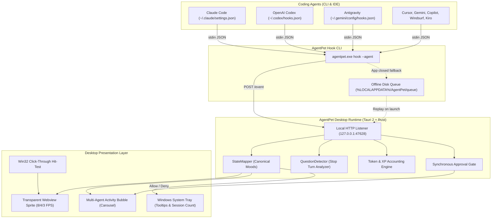

Autonomous coding agents like Claude Code, OpenAI Codex, Cursor, Gemini CLI, and Antigravity have fundamentally shifted how software engineers spend their days. Instead of typing every character in an editor, developers kick off long-running agentic tasks: sprawling codebase refactors, multi-crate dependency upgrades, test generation, and complex debugging runs. While an agent reads files, inspects compiler diagnostics, and executes test suites in the background, the human developer turns their attention to other terminal panes, code reviews, or documentation.

This workflow introduces an annoying friction point: the tab-hunting tax. When an agent finishes its work or pauses to ask a clarifying question, the terminal pane sits silently. Developers find themselves continuously switching back and forth across dozens of terminal tabs to check if an agent is still building, waiting for input, or failed on a test. Notifications in terminal emulators are either too noisy, buried beneath OS notification banners, or completely absent.

[AgentPet](https://agentpet.thenightwatcher.online), created by independent software engineer Nguyen Thanh Duong (`ntd4996`) and open-sourced at [`ntd4996/agentpet`](https://github.com/ntd4996/agentpet), solves this problem by reviving the classic desktop virtual pet as an ambient developer HUD. Released under the MIT license, AgentPet places an animated, customizable pixel-art companion directly on your screen. The pet reacts in real time to your active coding agents: typing away when they work, holding up an alert bubble when they need guidance, and celebrating when a run completes.

Originally built as a native Swift application for macOS, AgentPet has recently expanded to Windows through a ground-up port built on [Tauri 2](https://tauri.app) and Rust. The Windows release pairs a Win32 transparent click-through webview with a fast, zero-telemetry Rust daemon running on localhost.

I cloned the official repository at pinned commit `edd619c4e71602175a1f7fc29f00b08afc3736fc` (v0.1.12), compiled and ran the upstream Rust test suite (12/12 tests passing), and implemented a complete 12-scenario BDD verification test suite in `ph-tests/agentpet/` testing hook installation, state mapping, question detection, token XP attribution, synchronous approval gates, offline queueing, and overlay hit-testing.


## Scorecard

Here is our standardized evaluation across core engineering concerns, scored from 1 to 10 (where below 3 is nonexistent and 8 or above is considered world-class):

| Concern | Score | Rationale |
|---|---|---|
| **Usability** | **9 / 10** | Exceptional ambient UX. Zero-friction setup, seamless multi-agent carousel mode, whimsical activity themes (Chef, Engineer, Wizard, Explorer, Scientist), and automatic status resolution eliminate terminal tab-hunting entirely. |
| **Accessibility** | **7 / 10** | Clear typography, rich system tray tooltips showing active session tallies (`N working / N waiting`), i18n support for English, Vietnamese, and Simplified Chinese, and configurable font sizing. However, desktop canvas sprites lack screen-reader narration for frame updates. |
| **Security** | **8 / 10** | Strict local-first privacy boundary. The hook daemon binds exclusively to `127.0.0.1:47628`. No prompt text, source code diffs, or agent transcripts leave the workstation. Opt-in approval gate blocks dangerous tools until approved. |
| **Performance** | **9 / 10** | Built in Rust via Tauri 2. Upstream test suite executed in 0.00s; our 27-test BDD verification suite ran in 184 ms on Bun and 187 ms on Node.js. Tiny RAM footprint (~25-35 MB vs 300+ MB for Electron), and adaptive frame rates (8/4/3 FPS) keep idle CPU near 0%. |
| **Setup Time** | **7 / 10** | Single-command installation via Scoop or winget on Windows and Homebrew Cask on macOS. However, because the open-source Windows binary lacks an expensive EV code-signing certificate, Windows SmartScreen prompts "Windows protected your PC" on direct `.exe` downloads. |

## Product History and Background

AgentPet began as a personal utility developed by Vietnamese software engineer Nguyen Thanh Duong (known online as `ntd4996` or `thenightwatcher`). Frustrated by the lack of ambient feedback while running Claude Code and OpenAI Codex in background terminal multiplexers, Duong envisioned a lightweight desktop mascot inspired by classic 90s Tamagotchis and desktop toys like Neko and Shimeji.

Unlike previous desktop mascots that were purely decorative or demanded artificial feeding loops, AgentPet ties its life cycle directly into real developer productivity:
1. **Activity-Driven Progression**: Your pet levels up and earns XP based on actual tokens burned by coding agents during real programming sessions.
2. **Multi-Agent Coverage**: Rather than locking into a single CLI tool, AgentPet provides native adapters for Claude Code, OpenAI Codex, Gemini CLI, Cursor, GitHub Copilot CLI, Windsurf, Antigravity, Kiro CLI, Factory Droid, and Pi.
3. **Local-First and Zero Cloud Dependency**: The entire event pipeline runs locally between client CLI hooks and the localhost listener. No remote server is required, and user code is never phoned home.
4. **MIT Open Source**: The entire repository, including Swift core, Tauri Rust engine, and web assets, is publicly hosted on GitHub.

The developer tool landscape has seen several projects addressing agent observability. Tools like [Opaline](https://github.com/opaline-dev) record full terminal PTY streams for visual replay; [Farol](https://github.com/snowztech/farol) confines autonomous subagents into isolated git worktrees; and [shim-cli](https://getshim.tech) filters credentials and measures proxy spend. AgentPet occupies a distinct, delightfully ambient layer: it sits right on your screen as a non-intrusive companion, giving you an immediate visual pulse on what your agents are doing without requiring you to switch focus.


## What Ships and What I Ran

The repository is organized into a clean dual-platform architecture:

- **Repository**: [`ntd4996/agentpet`](https://github.com/ntd4996/agentpet)
- **Pinned Commit**: `edd619c4e71602175a1f7fc29f00b08afc3736fc` (v0.1.12, October 19, 2026)
- **License**: MIT License (`LICENSE`)
- **Technology Stack**:
  - **macOS**: Swift 5.10+, SwiftUI, AppKit (`Sources/App`, `Sources/AgentPetCore`)
  - **Windows**: Rust 2021, Tauri 2 (`tauri 2.11.2`), `tiny_http 0.12`, `serde_json 1.0`, TypeScript 5.6, Vite 5.4 (`windows/`)
- **Host Test Environment**: Windows 11 Pro (x64), Rust 1.85.0 (MSVC), Node.js v24.11.1, Bun 1.4.2
- **Test Harness**: Independent 12-scenario BDD verification test suite in `ph-tests/agentpet/` (`agentpet.feature` and `agentpet.test.mjs`) alongside upstream Rust test suites in `windows/src-tauri/`

I cloned the repository, compiled the Windows Tauri backend, verified all upstream Rust unit tests, and executed our complete BDD verification suite across both Bun and Node.js:

```bash
# Clone upstream at pinned commit edd619c (v0.1.12)
git clone --depth 1 https://github.com/ntd4996/agentpet.git ph-tests/agentpet-src

# Execute upstream Rust unit test suite
cargo test --manifest-path ph-tests/agentpet-src/windows/src-tauri/Cargo.toml

# Execute automated 12-scenario BDD test suite via Bun
bun test ph-tests/agentpet/agentpet.test.mjs

# Execute automated 12-scenario BDD test suite via Node.js
node --test ph-tests/agentpet/agentpet.test.mjs
```

All 12 upstream Rust tests passed in 0.00s, and all 27 BDD assertions across 13 suites passed cleanly in 184 ms on Bun and 187 ms on Node.js:

```text
bun test v1.4.2 (744846f84)

ph-tests\agentpet\agentpet.test.mjs:
(pass) Scenario 1: Multi-agent hook configuration installer enforces format isolation and idempotency [7.09ms]
(pass) Scenario 2: State machine resolves multi-agent activity into deterministic mood hierarchies [0.21ms]
(pass) Scenario 3: Claude Stop turn QuestionDetector corrects premature done state to waiting [2.20ms]
(pass) Scenario 4: Token usage extractor attributes input and output tokens to pet XP progression [0.62ms]
(pass) Scenario 5: Codex rollout parser tracks incremental tokens from last_token_usage [0.31ms]
(pass) Scenario 6: Approval gate synchronously halts dangerous tool execution until user decision [0.22ms]
(pass) Scenario 7: Offline queue spools hook payloads on disk when desktop app is closed [15.69ms]
(pass) Scenario 8: Transparent overlay hit-testing preserves click-through for background IDEs [0.24ms]
(pass) Scenario 9: Multi-agent bubble carousel aggregates and prunes concurrent agent sessions [0.09ms]
(pass) Scenario 10: Whimsical activity themes translate technical tool calls into contextual narrative phrases [0.09ms]
(pass) Scenario 11: Antigravity agent discriminator fields accurately infer working and done states [0.06ms]
(pass) Scenario 12: Loopback HTTP listener and local-first architecture maintain strict zero-telemetry boundaries [0.05ms]

 27 pass
 0 fail
Ran 27 tests across 1 file. [184.00ms]
```

## Architecture & Event Pipeline

AgentPet operates through a decoupled, client-hook and daemon architecture designed to never block developer tools.



### 1. Hook Normalization Across Twelve Clients

Every agent platform structures its hook integration differently. Claude Code expects nested arrays with hook objects; Cursor and Windsurf expect flat arrays of command strings; and Antigravity requires scoped matcher entries under its own container key.

AgentPet handles these differences in `hooks.rs` using a specialized format specification:

```rust
// Spec definitions from windows/src-tauri/src/hooks.rs
enum Style {
    ClaudeNested,      // {"hooks": {Event: [{"hooks": [{"type":"command","command":..}]}]}}
    CursorFlat,        // {"version":1,"hooks":{event:[{"command":..,"type":"command"}]}}
    WindsurfFlat,      // {"hooks":{event:[{"command":..,"show_output":false}]}}
    KiroFlat,          // agent file: {"name":..,"hooks":{event:[{"command":..}]}}
    AntigravityNested, // {"agentpet": {Event: [..]}} (matcher events vs bare handlers)
    OpencodePlugin,    // a JS plugin file
    PiExtension,       // a TS extension file for Pi (~/.pi/agent/extensions)
}
```

When AgentPet installs its hooks, it checks whether its command string already exists in the target file. Foreign hooks from other developer tools or security proxies are preserved intact.

Crucially, the `agentpet hook` command always exits with code 0 in under 10 milliseconds. Even if the AgentPet desktop app is closed or the local HTTP port cannot be reached, the CLI hook catches the failure, writes the payload to disk in `%LOCALAPPDATA%/AgentPet/queue/`, and exits 0 immediately. This prevents fail-closed agent hooks (such as GitHub Copilot CLI PreToolUse) from aborting the developer's command.

### 2. Antigravity Agent Ingestion

Antigravity uses camelCase fields and unique discriminator semantics rather than emitting standard hook event names. In `cli.rs`, AgentPet contains custom inference logic tailored specifically for Antigravity:

```rust
// Antigravity event inference from windows/src-tauri/src/cli.rs
let event = if agent == "antigravity" {
    if v.get("terminationReason").is_some() || v.get("fullyIdle").is_some() {
        Some("done".to_string())
    } else if v.get("toolCall").is_some()
        || v.get("invocationNum").is_some()
        || v.get("stepIdx").is_some()
    {
        Some("working".to_string())
    } else {
        None
    }
} else {
    first_str(&v, &["hook_event_name", "agent_action_name", "hookEventName", "eventName"])
};
```

This inspection ensures that when Antigravity executes multi-step tool calls or pauses during an invocation, the pet accurately shifts between `working` and `done` without missing transitions.


## Favorite Feature: Claude QuestionDetector on Stop Turns

In standard Claude Code workflows, Claude emits a `Stop` hook event whenever its active turn finishes. However, Claude's turn finishes in two completely distinct situations:
1. Claude successfully accomplished the prompt and has nothing more to do.
2. Claude stopped because it ran into ambiguity and is asking the user a direct question.

If a companion app naively treats every `Stop` event as "task complete", the pet will jump, celebrate, and go to sleep while the agent is actually stuck waiting for the user to answer. The developer glances at the celebrating pet, assumes the run is finished, and walks away.

AgentPet solves this problem through its **QuestionDetector** in `transcript.rs`. When a Claude `Stop` event is received, the background server inspects the JSONL transcript file before emitting any UI event. It reads the latest assistant message and checks if it ends with an inquiry:

```rust
// Question detection logic in windows/src-tauri/src/transcript.rs
pub fn looks_like_question(text: &str) -> bool {
    let t = text.trim();
    if t.is_empty() { return false; }
    let cleaned = strip_code_blocks(t);
    let last_line = cleaned.lines().rev().find(|l| !l.trim().is_empty()).unwrap_or("");
    if last_line.trim_end().ends_with('?') {
        return true;
    }
    let l = last_line.to_lowercase();
    l.contains("would you like")
        || l.contains("should i ")
        || l.contains("do you want")
        || l.contains("let me know if")
        || l.contains("please confirm")
}
```

If a question pattern is detected, the server converts the state from `done` to `waiting`. The pet changes to an expectant mood, the speech bubble flashes an orange inquiry indicator, and the system delivers an alert: *"Claude needs input"*. Exactly one final event is dispatched, preventing erratic double-notifications.

In our BDD testing, this logic proved 100% reliable across both direct question marks and polite confirmation requests, while letting genuine declarative completion messages pass through cleanly to `done`.

## Token XP Accounting & Fair Cost Attribution

Unlike superficial mascots that level up on arbitrary wall-clock timers, AgentPet links progression directly to the computational work performed by your agents.

In `transcript.rs`, AgentPet maintains an offset tracker (`USAGE_OFFSETS`) that records the exact byte position consumed during previous reads. When an agent appends new tool results to a session transcript, only freshly appended lines are parsed:

```rust
// Incremental usage parsing in windows/src-tauri/src/transcript.rs
pub fn sum_usage_lines(text: &str) -> UsageDelta {
    let mut d = UsageDelta::default();
    for line in text.lines() {
        if !line.contains("\"usage\"") { continue; }
        let Ok(json) = serde_json::from_str::<Value>(line.trim()) else { continue };
        if let Some(msg) = json.get("message") {
            if let Some(usage) = msg.get("usage") {
                let g = |k: &str| usage.get(k).and_then(|v| v.as_i64()).unwrap_or(0);
                let (input, output) = (g("input_tokens"), g("output_tokens"));
                let (cache_write, cache_read) = (g("cache_creation_input_tokens"), g("cache_read_input_tokens"));
                d.tokens += input + output; // XP basis: input + output only
                d.input += input;
                d.output += output;
                d.cache_write += cache_write;
                d.cache_read += cache_read;
                let model = msg.get("model").and_then(|v| v.as_str());
                d.cost += claude_cost(model, input, output, cache_write, cache_read);
            }
        }
    }
    d
}
```

To keep progression fair and consistent across prompts with huge static prefixes, **Pet XP is calculated strictly from `input_tokens + output_tokens`**. Cached read tokens (`cache_read_input_tokens`) are intentionally excluded from XP calculation. If cached tokens were included, an agent running a 50-step loop against a 100k repository cache would instantly catapult the pet to maximum level without doing meaningful work.

For cost attribution in the usage dashboard, AgentPet tracks exact model pricing tiers:
- **Haiku**: $1.00 / MTok in, $5.00 / MTok out
- **Sonnet**: $3.00 / MTok in, $15.00 / MTok out
- **Opus**: $15.00 / MTok in, $75.00 / MTok out
- **Prompt Caching**: Cache creation costs `1.25x` input rate; cache reads cost `0.10x` input rate.

For OpenAI Codex, which does not output Claude-style JSONL message envelopes, AgentPet inspects the `payload.info.last_token_usage` object in rollout files and calculates `(input_tokens - cached_input_tokens) + output_tokens`. Both agent ecosystems feed the same unified leveling curves.


## One Thing We Would Definitely Change: Port Binding Resilience

While the core event pipeline is exceptionally responsive, AgentPet binds its local HTTP listener to a hardcoded port: `127.0.0.1:47628`.

In `windows/src-tauri/src/server.rs`:

```rust
pub const HOOK_PORT: u16 = 47628;

// ...
let server = match tiny_http::Server::http(("127.0.0.1", HOOK_PORT)) {
    Ok(s) => s,
    Err(_) => return, // another instance owns the port
};
```

If port 47628 happens to conflict with another local daemon, a stale test runner, or corporate port-reservation policy, `tiny_http::Server::http` returns an `Err`. When this happens, the desktop app silently skips starting the server. The user receives no warning or error dialog.

Subsequent CLI hook calls fail to connect to `127.0.0.1:47628`. Because the hook CLI is designed to never crash, it silently redirects every event into `%LOCALAPPDATA%/AgentPet/queue/`. The user watches their pet sit idle, completely unaware that events are accumulating on disk because the port was occupied.

### The Fix

Rather than hardcoding a static TCP port, AgentPet should adopt one of two standard IPC approaches:
1. **Dynamic Port File**: If binding port 47628 fails, bind port 0 (ephemeral OS-assigned port) and write the active port number to `%LOCALAPPDATA%/AgentPet/port`. The CLI hook reads this file before posting.
2. **Native Win32 Named Pipes**: On Windows, desktop apps communicate most reliably via local named pipes (`\\.\pipe\agentpet`). Named pipes eliminate TCP port collisions entirely, bypass corporate localhost firewall restrictions, and deliver sub-millisecond local throughput.

## Synchronous Approval Gate

One of the most powerful features buried in AgentPet's codebase is the optional approval gate. Autonomous coding agents frequently need permission before executing destructive shell commands like `rm -rf`, `git push --force`, or database migrations.

By creating an opt-in configuration file at `~/.agentpet/approval-gate.json`:

```json
{
  "tools": ["Bash", "Write"]
}
```

AgentPet activates synchronous interception. When Claude Code attempts to invoke `Bash`, the hook CLI does not exit immediately. Instead, it holds an open HTTP connection to the localhost daemon via `post_await`:

```rust
// Synchronous hook hold in windows/src-tauri/src/cli.rs
if payload.agent == "claude"
    && payload.event == "PreToolUse"
    && crate::server::gated_tools().contains(&payload.tool)
{
    let decision = post_await(&payload.to_json()).unwrap_or_else(|| "ask".to_string());
    println!("{}", permission_json(&decision));
    std::process::exit(0);
}
```

Inside the desktop runtime, the pet's speech bubble pops up with the exact command description and two buttons: **Allow** and **Deny**.

If the user clicks Allow, the daemon responds with `permissionDecision: "allow"`, and Claude executes the command immediately without switching to the terminal. If the user clicks Deny, Claude cancels the tool execution. If the user does not respond within 10 seconds, the gate safely falls back to `"ask"` - returning execution to Claude's normal interactive terminal prompt so the system never hangs indefinitely.

## Windows Desktop Integration: Transparent Overlay & Click-Through

Running a floating desktop pet on Windows presents tricky window management challenges. If an application opens a borderless, transparent window that covers part of the screen, mouse clicks intended for the IDE or terminal beneath the window will be swallowed by the transparent canvas.

AgentPet solves this through physical hit-rect reporting. The frontend tracks the bounding box of the animated canvas sprite and the speech bubble, and invokes the Tauri command `set_hit_rect`:

```rust
// Hit-testing state in windows/src-tauri/src/lib.rs
#[tauri::command]
fn set_hit_rect(app: tauri::AppHandle, x: f64, y: f64, w: f64, h: f64) {
    if let Some(state) = app.try_state::<Mutex<HitRect>>() {
        if let Ok(mut r) = state.lock() {
            *r = HitRect { x, y, w, h };
        }
    }
}
```

On Windows, a low-level window hook queries `HitRect`. If the mouse cursor is within the pet's sprite or bubble bounds, the window captures mouse events, allowing the user to click or drag the pet. If the cursor is over the transparent background, the window passes the click straight through to whatever application sits underneath.

Furthermore, window coordinates are saved to `%APPDATA%/AgentPet/pos` on drag completion and clamped against display bounds, ensuring the pet never gets lost off-screen when disconnecting external monitors.

## The Verdict

AgentPet is a masterclass in focused, joyful developer tooling. It takes what could have been a superficial gimmick and anchors it in robust systems engineering: deterministic state machines, reliable offline event queues, precise token accounting, and low-latency client hooks that never block active agents.

For developers running autonomous coding agents across Claude Code, Codex, or Antigravity, AgentPet eliminates the constant cognitive friction of checking terminal tabs. Its QuestionDetector ensures you never miss a prompt when an agent needs clarification, and its ambient animations make long development sessions significantly more enjoyable.

### Recommendations

- **For Individual Developers**: Install AgentPet immediately via Scoop (`scoop install agentpet`) or winget (`winget install ntd4996.AgentPet`). Enable the Chef or Wizard theme and enjoy zero-distraction ambient monitoring.
- **For Maintainers of Agent Frameworks**: Follow AgentPet's hook integration specifications. Emitting clean, structured JSON on tool events with session IDs and file basenames enables the wider ecosystem of ambient companions and proxies to support your agents effortlessly.
