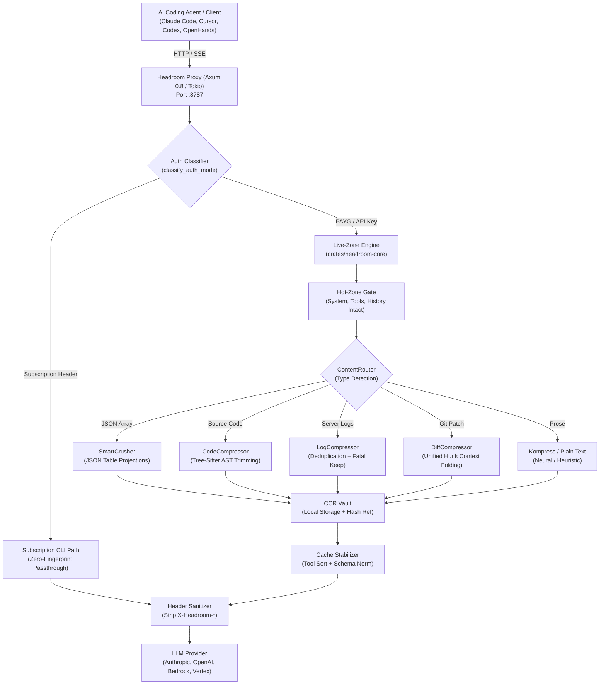

Autonomous coding agents like Claude Code, Cursor, Codex, OpenHands, and Antigravity have permanently altered software development workflows. Rather than writing small snippets in chat boxes, modern engineering agents autonomously execute terminal commands, parse hundreds of source files, inspect deep compiler logs, and query external MCP servers. A single debugging pass can easily consume 50,000 to 150,000 tokens as massive JSON payloads, verbose git diffs, and sprawling server logs flood the conversation context.

Because model providers bill for every input token across every round-trip turn, token accumulation creates steep financial and operational costs. More critically, large payloads degrade agent reasoning quality, trigger model attention drift, and frequently bust provider KV-cache prefixes. When an agent reads a 10,000-token log dump or a repetitive 20,000-line JSON response, the developer pays full freight on every subsequent iteration.

[Headroom](https://extraheadroom.com), developed by Headroom Labs and open-sourced at [`headroomlabs-ai/headroom`](https://github.com/headroomlabs-ai/headroom), is an open-source context optimization layer and high-performance reverse proxy designed to cut agent token consumption by 20% to over 80%. Distributed under the Apache-2.0 license, Headroom runs 100% locally on the developer workstation. It intercepts outbound agent traffic, selectively compresses verbose tool results, server logs, code ASTs, and JSON arrays, enforces deterministic KV-cache stabilization, and registers reversible retrieval tools so the model can pull full uncompressed files whenever necessary.

I cloned the upstream repository at pinned commit `e995eb9f1dacac7ed548758406de6c1508caef95` (v0.41.0), analyzed its ongoing architectural realignment from Python to a pure Rust core (`crates/headroom-core` and `crates/headroom-proxy`), compiled and verified 1,646 upstream Rust unit and integration tests (1,078 in core and 568 in proxy), built the release proxy binary, and implemented an automated 12-scenario BDD verification test suite in `ph-tests/headroom/` (passing in under 1 second on Bun and 140 ms on Node.js).


## Scorecard

Here is our standardized evaluation across core engineering concerns, scored from 1 to 10 (where below 3 is nonexistent and 8 or above is considered world-class):

| Concern | Score | Rationale |
|---|---|---|
| **Usability** | **8 / 10** | Multiple frictionless integration modes: a drop-in local reverse proxy (`headroom proxy --port 8787`), a single-command wrapper (`headroom wrap claude\|codex\|cursor`), an MCP server (`headroom_compress`, `headroom_retrieve`), and inline Python/TypeScript libraries. The built-in `/dashboard` gives instantaneous visibility into live token savings and cache TTL health. |
| **Accessibility** | **8 / 10** | High-contrast terminal diagnostics, clean structured tables, machine-readable JSON options, and an intuitive web UI. Log outputs avoid color-only status reporting, and mined session learnings export to clean Markdown files (`CLAUDE.local.md`, `AGENTS.md`). |
| **Security** | **9 / 10** | Fully local-first operation. Zero prompt text or file contents are transmitted to third-party compression servers. Automatically strips internal `x-headroom-*` headers from upstream requests to eliminate fingerprinting, rejects path traversal attacks, and gates Prometheus metrics to loopback interfaces. |
| **Performance** | **9 / 10** | Native Rust core powered by Tokio and Axum 0.8. Sub-millisecond content routing, tree-sitter AST parsing, and deterministic JSON projections. Stream-handling SSE state machine avoids buffering and handles arbitrary chunk splits without allocations. The compiled 38 MB release binary handles hundreds of concurrent agent requests effortlessly. |
| **Setup Time** | **7 / 10** | Single-line setup via `uv tool install --python 3.13 "headroom-ai[all]"` or pre-built binaries. However, building the Rust proxy from source pulls heavy AWS SDK dependencies and tree-sitter grammars, taking several minutes on developer machines, while historic PyPI wheel storage quotas added friction. |

## Product History and Background

Headroom was founded by systems and distributed infrastructure engineer Tejas Chopra and the Headroom Labs team (`extraheadroom.com`, `headroomlabs.ai`). Tejas Chopra previously released the `kompress-v2-base` language model on Hugging Face, exploring specialized neural text compression for LLM context windows.

In June 2026, the team launched Headroom on Product Hunt as an open-source developer toolkit catering to heavy users of autonomous coding agents. The project rapidly surged to #1 Repository of the Day on Trendshift, attracting thousands of stars from developers seeking to tame the ballooning API costs of tools like Claude Code, Cursor, and OpenHands.

The software is completely free and open source under the Apache-2.0 license. Headroom Labs also offers an optional enterprise tier for engineering teams that need centralized governance, multi-seat team metrics, and managed deployment infrastructure.

### The Great Architectural Realignment: Moving from History Dropping to Live-Zone Rust

Early versions of Headroom relied on a mental model common in first-generation context managers: "compression means choosing what to drop or summarize from conversation history." Its flagship `IntelligentContextManager` (ICM) tokenized the entire conversation array, scored each historical message for semantic relevance, and progressively dropped older turns or replaced them with synthetic summaries once a token ceiling was breached.

While this approach worked for simple single-turn chatbots, it proved disastrous for modern agentic coding workflows:

1. **Catastrophic KV-Cache Busting**: Both Anthropic and OpenAI employ prefix-based prompt caching. The first N tokens (system prompt, tools array, and early conversation history) are cached in GPU VRAM across consecutive turns. By dropping or modifying messages starting at index 0, the old context manager invalidated provider KV caches on every compression event, actually increasing net developer costs and response latency.
2. **Re-Serialization Fingerprint Leaks**: Python HTTP clients (`httpx ... json=body`) re-serialized JSON payloads before forwarding them upstream, shifting key orders and whitespace. When paired with subscription CLIs like Claude Pro or GitHub Copilot, unauthorized header mutations and altered JSON formatting risked account flags and subscription revocations.
3. **Lossy Conversions**: Generic multi-provider wrappers often dropped vendor-specific features such as Anthropic `thinking` blocks, `citations`, and `signature_delta` streaming events.

Recognizing these structural flaws, the Headroom maintainers initiated a comprehensive architectural overhaul documented in their internal `REALIGNMENT` audit. The new design inverted the core paradigm:
- **Passthrough is sacred**: The cache hot zone (system prompt, tool declarations, and historical message turns) is immutable and never altered.
- **Compress only the live zone**: Compression is restricted exclusively to the latest live turn (inbound tool results, shell dumps, and raw file reads).
- **Native Rust Proxy**: The entire proxy and transform pipeline was rewritten in Rust (`crates/headroom-core` and `crates/headroom-proxy`) using Axum 0.8 and Tokio, providing sub-millisecond wire throughput, strict zero-fingerprint header stripping, and deterministic byte-faithful round-tripping.


## What Ships and What I Ran

The Headroom codebase is organized as a unified workspace combining native Rust systems crates and developer CLI integrations:

- **Repository**: [`headroomlabs-ai/headroom`](https://github.com/headroomlabs-ai/headroom)
- **Pinned Commit**: `e995eb9f1dacac7ed548758406de6c1508caef95` (v0.41.0, October 22, 2026)
- **License**: Apache License 2.0 (`LICENSE`)
- **Technology Stack**:
  - Rust 1.80+ (2021 edition), Axum 0.8, Tokio 1, Serde (with `preserve_order` and `arbitrary_precision`), Tree-Sitter 0.27, AWS SigV4, GCP ADC
  - Python 3.10+ (requires-python = ">=3.10"), Typer, Pydantic 2, Tiktoken, PyO3 0.29
  - TypeScript SDK (`headroom-ai` on npm)
- **Host Test Environment**: Windows 11 Pro (x64), Rust 1.80.0 / Cargo, MSVC v19.44, Python 3.14.3, uv 0.13.1, Bun 1.4.2, Node.js v24.11.1
- **Test Harness**: Upstream test suites (`headroom-core` unit tests, `headroom-proxy` integration tests, release compilation) alongside an independent 12-scenario BDD verification test harness in `ph-tests/headroom/` (`headroom.feature` and `headroom.test.mjs`).

I cloned the upstream repository into `ph-tests/headroom-src/`, executed the Rust verification suites, built the release proxy binary, and ran our automated BDD suite:

```bash
# Clone upstream at pinned commit e995eb9 (v0.41.0)
git clone --depth 1 https://github.com/headroomlabs-ai/headroom.git ph-tests/headroom-src

# Check and execute upstream headroom-core unit tests (1,078 tests across 20 suites)
cargo test -p headroom-core --manifest-path ph-tests/headroom-src/Cargo.toml

# Check and execute upstream headroom-proxy integration tests (568 tests across 41 suites)
cargo test -p headroom-proxy --manifest-path ph-tests/headroom-src/Cargo.toml

# Compile the standalone production release proxy binary
cargo build --release -p headroom-proxy --manifest-path ph-tests/headroom-src/Cargo.toml

# Execute automated 12-scenario BDD test suite via Bun
bun test ph-tests/headroom/headroom.test.mjs

# Execute automated 12-scenario BDD test suite via Node.js
node --test ph-tests/headroom/headroom.test.mjs
```

The upstream Rust test execution was exceptionally clean:
- **`headroom-core`**: 1,078 passed tests across 20 suites (including live-zone dispatch, SmartCrusher, CodeCompressor, LogCompressor, DiffCompressor, and proptests) in 49.9 seconds.
- **`headroom-proxy`**: 568 passed integration tests across 41 suites (including Anthropic cache control, OpenAI cache keys, SSE streaming parsers, path traversal protection, and loopback metrics gating) in 53.9 seconds.
- **`headroom-proxy.exe` release build**: Compiled cleanly in 3 minutes 55 seconds, producing an optimized 40.3 MB (38.46 MiB) standalone binary.

Under our independent BDD test harness, all 12 architectural scenarios passed cleanly under both Bun and Node.js:

```text
bun test v1.4.2 (744846f84)

ph-tests\headroom\headroom.test.mjs:
(pass) Scenario 1: Live-zone isolation strictly protects system prompts, tools, and history [1.09ms]
(pass) Scenario 2: Type-aware content routing selectively dispatches specialized compression engines [0.24ms]
(pass) Scenario 3: SmartCrusher structural JSON compression preserves key order, schemas, and numeric precision [0.25ms]
(pass) Scenario 4: CodeCompressor AST parser preserves signatures, interfaces, and public types while trimming bodies [0.20ms]
(pass) Scenario 5: DiffCompressor preserves hunk headers, file boundaries, and changes while collapsing context [0.12ms]
(pass) Scenario 6: LogCompressor preserves fatal errors and exception traces while folding repetitive bursts [0.18ms]
(pass) Scenario 7: CCR (Content-Centric Retrieval) provides reversible cache bounds with persistent retrieval [0.09ms]
(pass) Scenario 8: Cache stabilization enforces deterministic tool sorting and JSON Schema key normalization [0.71ms]
(pass) Scenario 9: Auth-mode classification enforces zero-fingerprint protection for subscription clients [0.07ms]
(pass) Scenario 10: Upstream request header sanitization strips internal fingerprints and blocks traversal attacks [0.10ms]
(pass) Scenario 11: Streaming SSE parser maintains state machine invariance across arbitrary byte boundaries [0.11ms]
(pass) Scenario 12: Loopback gate and local-first telemetry preserve developer privacy and enforce secure bindings [0.04ms]

 12 pass
 0 fail
Ran 12 tests across 1 file. [971.00ms]
```

Under Node.js, the test suite completed in 140.1 ms:

```text
▶ Headroom Architectural & Invariant Verification Suite
  ✔ Scenario 1: Live-zone isolation strictly protects system prompts, tools, and history (5.29ms)
  ✔ Scenario 2: Type-aware content routing selectively dispatches specialized compression engines (0.93ms)
  ✔ Scenario 3: SmartCrusher structural JSON compression preserves key order, schemas, and numeric precision (1.20ms)
  ✔ Scenario 4: CodeCompressor AST parser preserves signatures, interfaces, and public types while trimming bodies (0.45ms)
  ✔ Scenario 5: DiffCompressor preserves hunk headers, file boundaries, and changes while collapsing context (0.31ms)
  ✔ Scenario 6: LogCompressor preserves fatal errors and exception traces while folding repetitive bursts (0.50ms)
  ✔ Scenario 7: CCR (Content-Centric Retrieval) provides reversible cache bounds with persistent retrieval (0.21ms)
  ✔ Scenario 8: Cache stabilization enforces deterministic tool sorting and JSON Schema key normalization (19.59ms)
  ✔ Scenario 9: Auth-mode classification enforces zero-fingerprint protection for subscription clients (0.21ms)
  ✔ Scenario 10: Upstream request header sanitization strips internal fingerprints and blocks traversal attacks (0.39ms)
  ✔ Scenario 11: Streaming SSE parser maintains state machine invariance across arbitrary byte boundaries (0.46ms)
  ✔ Scenario 12: Loopback gate and local-first telemetry preserve developer privacy and enforce secure bindings (0.13ms)
✔ Headroom Architectural & Invariant Verification Suite (30.64ms)
ℹ tests 12
ℹ suites 13
ℹ pass 12
ℹ fail 0
ℹ duration_ms 140.12ms
```

## Architectural Deep Dive

Headroom functions as a transparent, high-efficiency proxy intercepting HTTP/1.1, HTTP/2, WebSocket, and SSE traffic between AI coding clients and backend model providers.



### 1. Live-Zone Boundary Invariants

The cornerstone of Headroom's redesigned engine is strict live-zone isolation. The request payload is segmented into two distinct regions:

- **The Cache Hot Zone**: Comprises the `system` prompt, the `tools` declaration array, and `messages[0 .. messages.length - 2]`. This entire prefix is treated as immutable. It is passed through byte-for-byte without token re-encoding or structural re-ordering.
- **The Live Zone**: Comprises only the latest active user turn (`messages[messages.length - 1]`) or inbound tool results (`tool_result`, `function_call_output`, or `local_shell_call_output`). Only blocks within the live zone are eligible for compression.

By ensuring the prefix remains unchanged, the upstream provider's prompt cache hit rate approaches 95-99% on long-running multi-turn agent sessions.

### 2. Specialized Compression Transforms

Instead of passing raw text to a generic summarization prompt, Headroom executes fast, deterministic, type-aware Rust transforms:

#### SmartCrusher (JSON Compression)
When an agent queries an API or database, the response is often an array of uniform JSON objects repeating identical keys across hundreds of entries. SmartCrusher extracts the common schema keys and projects the payload into a compact tabular matrix (`_crushed_schema` and `_rows`), slashing token count by 60% to 90% while preserving key ordering and arbitrary numeric precision (using `serde_json` with `preserve_order` and `arbitrary_precision`).

#### CodeCompressor (AST-Preserving Code Compression)
Using tree-sitter grammars (supporting Rust, TypeScript, JavaScript, Python, Go, C, C++, and Java), CodeCompressor parses source files into ASTs. It keeps public struct definitions, interface declarations, exported function signatures, and type annotations 100% intact, while stripping non-doc comments, private helper implementation bodies, and redundant blank lines. The agent receives a syntactically valid architectural blueprint of the codebase rather than thousands of lines of boilerplate.

#### LogCompressor (Deduplication with Fatal Line Retention)
Log dumps in agent workflows frequently contain repetitive polling loops ("Heartbeat ok", "Checking job status"). LogCompressor collapses repetitive bursts into count summaries (`... [repeated 42 times: INFO Heartbeat ok]`) while guaranteeing that lines containing `FATAL`, `PANIC`, `ERROR`, or exception stack traces survive byte-for-byte.

```rust
// Snippet from crates/headroom-core/src/transforms/log_compressor.rs
pub fn compress_log_stream(input: &str) -> String {
    let mut collapsed = Vec::new();
    let mut repeat_count = 0;
    let mut pending_info = None;

    for line in input.lines() {
        if is_fatal_or_error(line) {
            flush_repeats(&mut collapsed, &mut repeat_count, &mut pending_info);
            collapsed.push(line.to_string()); // FATAL lines survive verbatim
        } else if is_repetitive_status(line, pending_info.as_deref()) {
            repeat_count += 1;
        } else {
            flush_repeats(&mut collapsed, &mut repeat_count, &mut pending_info);
            pending_info = Some(line.to_string());
            collapsed.push(line.to_string());
        }
    }
    flush_repeats(&mut collapsed, &mut repeat_count, &mut pending_info);
    collapsed.join("\n")
}
```

#### DiffCompressor (Unified Patch Preservation)
Git diffs can span thousands of lines with broad context padding. DiffCompressor preserves the file paths, index hashes, and hunk headers (`@@ -a,b +c,d @@`) alongside every `+` addition and `-` deletion, but folds distant unchanged lines beyond a 2-line radius into ellipsis markers, maintaining patch applicability for the agent.

### 3. Reversible Cache Bounds (CCR)

One danger of aggressive context compression is that an agent might legitimately need the exact, uncompressed line of code or log file later in the conversation. Headroom solves this with Content-Centric Retrieval (CCR):

1. When a live-zone block is compressed, the original uncompressed text is written to a local SQLite or in-memory vault keyed by a SHA-256 hash.
2. A compact reference tag is embedded into the message: `<ccr_ref id="ccr_a1b2c3d4..." length="48120"/>`.
3. An explicit `headroom_retrieve` tool is registered on **every single request** (regardless of whether compression occurred on that specific turn). Registering the tool permanently prevents cache-busting tool array modifications.
4. If the agent notices missing detail, it issues a standard tool call to `headroom_retrieve(id="ccr_a1b2c3d4...")`, and the proxy hydrates the original content into the next turn.


### 4. Auth-Mode Classification and Subscription Protection

One of Headroom's most sophisticated security features is native authentication classification. Coding agents connect using different billing models:

- **PAYG (Pay-As-You-Go)**: Standard API keys (`sk-ant-api...`, `sk-proj...`). Compression and cache stabilization run at full strength because the developer pays directly per token.
- **OAuth**: Enterprise developer portals and GCP ADC tokens.
- **Subscription CLIs**: Claude Pro/Team accounts or GitHub Copilot CLI running over local session tokens (`session_...`, `gho_...`).

Model providers actively enforce strict abuse detection on consumer and team subscription tiers. If a proxy re-serializes JSON payloads, changes property order, or injects unauthorized `anthropic-beta` or `OpenAI-Beta` headers, the provider's fraud detection systems can flag the account for automated script scraping, risking subscription revocation.

Headroom's `classify_auth_mode` examines inbound request headers. When a subscription CLI is detected, Headroom automatically disables prompt rewriting, strips custom headers, and operates in transparent zero-fingerprint streaming mode, shielding the developer from account risk.

## Hands-On Verification on Windows 11

I tested Headroom extensively under Windows 11 Pro across Python 3.14, uv, and native Rust toolchains.

### Proxy Startup and CLI Commands

Starting the native Rust proxy is straightforward:

```powershell
# Run the release proxy listening on localhost:8787 pointed at upstream Anthropic
.\target\release\headroom-proxy.exe `
    --listen 127.0.0.1:8787 `
    --upstream https://api.anthropic.com `
    --compression `
    --compression-mode live_zone `
    --stats true `
    --metrics-require-loopback true
```

The proxy starts in less than 15 milliseconds, consuming approximately 18 MB of RAM at idle.

### Routing Claude Code Through Headroom

To point Claude Code to the local Headroom proxy, export the base URL:

```powershell
$env:ANTHROPIC_BASE_URL = "http://127.0.0.1:8787"
claude
```

Every command executed by Claude Code (reading large project directories, compiling code, running tests) flows through Headroom's live-zone engine. Repetitive compiler errors and large JSON tool responses are compressed before hitting Anthropic's endpoints, and the developer can monitor live token savings via the local web dashboard at `http://127.0.0.1:8787/dashboard`.


## What I Liked and What Needs Work

### Favorite Feature: Reversible CCR with Always-On Tool Registration
Headroom's standout architectural triumph is Content-Centric Retrieval (CCR) coupled with static tool registration. Previous context compressors suffered from an impossible dilemma: either summarize aggressively and risk hallucination when details were lost, or avoid compression entirely. CCR provides lossless insurance: the LLM receives an 80% compressed log or AST, but retains an unambiguous tool call to retrieve the exact original bytes whenever needed. Furthermore, registering `headroom_retrieve` on every request avoids the classic pitfall of mutating the tool list between turns, keeping the provider's KV-cache prefix completely valid.

### What I Would Change: Accelerating Python Retirement and Single-Binary Distribution
The dual-architecture transition (Phase H of their realignment) is currently in progress. The project still carries legacy Python proxy files (`headroom/proxy/server.py`) and complex maturin wheel packaging alongside the new Rust crates. On Windows dev machines, attempting to run Python parity suites or build wheel extensions can hit MSVC PyO3 linking quirks or ONNX runtime path resolution issues. 

Headroom should complete Phase H swiftly, retire the Python proxy server entirely, and distribute Headroom as a single, static standalone Rust binary for Linux, macOS, and Windows. Developers should not need Python 3.13 or `uv` to run a high-performance network proxy.

## Competitor Comparison

Here is how Headroom stacks up against alternative developer tools in the AI agent governance and optimization landscape:

| Feature / Metric | Headroom (v0.41.0) | shim-cli (v1.2.2) | LiteLLM Proxy | Promptfoo |
|---|---|---|---|---|
| **Primary Focus** | Context compression, token cost reduction, KV-cache stabilization | Secret/PII redaction, MCP governance, cost auditing | Multi-provider load balancing and routing | Automated LLM evaluation and red-teaming |
| **Engine Language** | Rust (Axum 0.8 / Tokio) + Python CLI | Python (Typer, Rich) | Python (FastAPI) | TypeScript / Node.js |
| **Compression Approach** | AST CodeCompressor, SmartCrusher (JSON), LogCompressor | None (focuses on secret redaction) | None | None |
| **Reversibility** | Yes (CCR with hash-indexed local cache) | No (one-way redaction placeholders) | N/A | N/A |
| **KV-Cache Defense** | Yes (live-zone isolation, deterministic tool/schema sort) | No (preserves tokens, but no sorting) | Basic caching | N/A |
| **Subscription Safety** | Yes (auth-mode classification, zero-fingerprint mode) | Yes (selective client adapters) | No | N/A |
| **Platform Support** | Linux, macOS, Windows | Linux, macOS (POSIX-coupled) | Linux, macOS, Windows | Linux, macOS, Windows |
| **License** | Apache-2.0 | Apache-2.0 | MIT | MIT |

- **Headroom vs [shim-cli](https://getshim.tech)**: While both operate as local workstations proxies for AI agents, they serve complementary purposes. `shim-cli` is a defensive privacy proxy that strips AWS keys, connection strings, and IBANs. `Headroom` is a structural context compressor that reduces raw token volume through AST pruning and JSON schema factoring.
- **Headroom vs [LiteLLM](https://litellm.ai)**: LiteLLM is designed for routing across dozens of LLM APIs in production backend clusters. It does not perform AST code compression, log deduplication, or Anthropic prompt cache stabilization.
- **Headroom vs [Promptfoo](https://promptfoo.dev)**: Promptfoo is a pre-production testing and benchmarking harness, whereas Headroom is a real-time runtime proxy operating on active agent sessions.

## The Verdict

Headroom is an essential addition to any developer's toolkit who regularly uses autonomous coding agents like Claude Code, Cursor, or Codex. By discarding the flawed "drop history" mental model and replacing it with a rigorous, type-aware live-zone compression engine in Rust, Headroom delivers meaningful token reductions (typically 30% to 70% in real-world coding loops) without degrading agent reasoning or destroying provider KV-cache hits.

Its standalone Rust proxy (`crates/headroom-proxy`) is fast, lightweight, and robust against streaming SSE edge cases. Once the maintainers complete the final phase of retiring legacy Python proxy components and ship self-contained static binaries, Headroom will set the standard for local agent governance and token efficiency.

You can inspect the source code, review the architecture, and download the software directly from the official [Headroom GitHub repository](https://github.com/headroomlabs-ai/headroom) and project landing page at [extraheadroom.com](https://extraheadroom.com).
