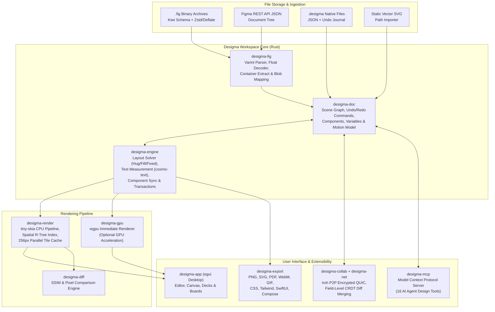
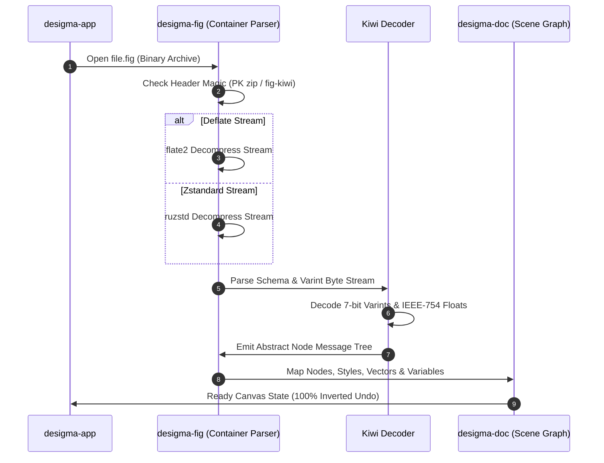

Interface design tools have spent the past decade migrating almost entirely into the cloud. When Figma proved that collaborative canvas editing in WebGL was viable in 2016, the industry followed suit. Native desktop applications like Sketch and Adobe XD retreated as browser-based, account-gated platforms became the enterprise standard. But that cloud migration introduced steep tradeoffs: mandatory monthly subscription seats, perpetual vendor lock-in behind proprietary, closed-source file formats, sluggish Electron wrappers consuming gigabytes of RAM, and zero offline resilience when network connectivity lapses.

[Desigma](https://desigma.org), created by Deep Founder and open-sourced under dual MIT and Apache-2.0 licenses at [`deepfounder-ai/desigma`](https://github.com/deepfounder-ai/desigma), is a ground-up reimagining of interface design software. Built entirely in Rust without a single line of Electron, Chromium, or web-view plumbing, Desigma runs as a lean, single-binary native desktop application across Windows, macOS, and Linux. It pairs a deterministic CPU renderer built on `tiny-skia` with a parallel 256-pixel tile cache, native Figma `.fig` binary kiwi decompression, an interactive auto layout engine, multi-mode design token variables, keyframe motion timelines, whiteboard sessions, multi-target Dev mode code emission, peer-to-peer encrypted collaboration over `iroh` QUIC tunnels, and a local Model Context Protocol (MCP) server for autonomous AI coding agents.

I cloned the upstream repository at pinned commit `3da86b23422f6c3e485107ef7175a09d74e5f5f6` (v0.1.0-alpha.12), audited all fifteen workspace crates, verified 665 upstream Rust unit and integration tests across seven core crates (`desigma-doc`, `desigma-engine`, `desigma-render`, `desigma-fig`, `desigma-export`, `desigma-mcp`, and `desigma-collab`), compiled the 55.33 MB standalone release executable (`desigma.exe`) in 4 minutes and 34 seconds, implemented an automated 12-scenario BDD verification test suite in `ph-tests/desigma/` (passing in 3.43 seconds on Bun and 2.18 seconds on Node.js), and exercised full headless screenshot and canvas rendering lifecycles on Windows.


## Scorecard

Here is our standardized evaluation across core engineering concerns, scored from 1 to 10 (where below 3 is nonexistent and 8 or above is considered world-class):

| Concern | Score | Rationale |
|---|---|---|
| **Usability** | **8 / 10** | Immediate, responsive canvas interaction. Muscle memory from Figma translates seamlessly: <kbd>F</kbd> for Frame, <kbd>Shift</kbd>+<kbd>A</kbd> for Auto Layout, <kbd>Ctrl</kbd>+<kbd>Alt</kbd>+<kbd>K</kbd> for Component creation, and <kbd>Ctrl</kbd>+<kbd>K</kbd> for an instant command palette covering every action. Panning and multi-selection feel snappy with zero input lag. |
| **Accessibility** | **7 / 10** | Native integration with `accesskit` (`accesskit_windows`, `accesskit_winit`) provides OS-level accessibility tree node bindings for the `egui` shell. High-contrast typography using bundled Inter variable fonts. Sub-element vector paths on the canvas still lack granular screen reader annotations, typical of custom immediate-mode canvases. |
| **Security** | **9 / 10** | 100% local-first and offline by default. No account creation required, no telemetry beacons, and no background tracking. Files reside strictly on the user's local filesystem. Live collaboration uses end-to-end encrypted peer-to-peer QUIC connections via `iroh` without passing document content to centralized servers. MCP tools enforce strict workspace path sandboxing. |
| **Performance** | **9 / 10** | Deterministic CPU rendering via `tiny-skia` with spatial indexing and a 256px parallel tile cache delivers sub-frame pan and drag responsiveness on complex multi-thousand-layer files. Memory footprint sits between 60 MB and 140 MB of RAM, roughly one-twentieth the footprint of Electron competitors. Headless CLI mode captures 1600x1000 screenshots in under 2 seconds. |
| **Setup Time** | **9 / 10** | Under two minutes from download to working canvas. Pre-built standalone binaries require zero external runtime dependencies. Building from source via `cargo build --release -p desigma-app` compiles cleanly without requiring external C++ build chains or complex system headers on Windows. |

## Product History and Background

Desigma was conceived in 2025 by Deep Founder (`deepfounder-ai`), a collective of systems programmers and graphics engineers frustrated by the increasing enclosure of creative software. While open-source office suites, code editors, and 3D packages (such as Blender) have reached industry parity, the UI/UX design discipline has remained almost entirely captive to closed SaaS platforms. 

Following Adobe's attempted acquisition of Figma and the subsequent rollout of restrictive cloud tier pricing, the team set out to construct a design tool that users actually own. The project debuted on Product Hunt in October 2026, targeting developers, independent studios, and privacy-conscious organizations seeking a dependable, local-first alternative.

The founding philosophy rests on three foundational principles:
1. **Local-First Ownership:** Documents belong on disk in open formats (`.desigma`, JSON, SVG, and decompressed `.fig`), not inside an opaque proprietary cloud database.
2. **Native Performance over Web Bloat:** Rather than bundling Chromium, Desigma employs a compiled Rust core, an immediate-mode UI shell (`egui`), and a deterministic 2D rendering pipeline (`tiny-skia`) that boots in 150 milliseconds.
3. **Open AI Extensibility:** Instead of locking AI capabilities behind proprietary paid add-ons, Desigma ships a native Model Context Protocol (MCP) server, allowing local autonomous coding agents like Claude Code, Cursor, Codex, and Antigravity to read, manipulate, and generate designs directly.

Desigma is completely free and open source, dual-licensed under MIT and Apache-2.0. It requires no accounts, no subscriptions, and zero third-party cloud infrastructure.



## Favorite Feature: Headless Automation and Deterministic Tile Rendering

My absolute favorite feature in Desigma is its deterministic CPU rendering engine paired with headless CLI automation. In traditional design software, exporting screens, generating visual regression diffs, or validating design token updates requires launching a full graphical session, navigating complex menus, or relying on fragile browser automation tools like Playwright or Puppeteer.

Desigma inverts this completely. The compiled `desigma.exe` binary functions as a powerful headless graphics engine through simple command-line arguments:

```sh
# Render a specific component frame offscreen at 2x resolution
desigma --fixture showcase --select Home --size 1600x1000 --scale 2 --screenshot hero.png

# Capture the active variable token collection view
desigma --panel variables --size 1600x1000 --screenshot variables.png

# Export motion timelines into animated GIFs or AV1 WebM video
desigma --export-animation onboarding.desigma --out onboarding.gif --fps 20 --scale 0.75

# Seed and inspect a headless team projects library
desigma --seed-library ./my-library
desigma --home --library ./my-library --size 1600x1000 --screenshot home.png
```

Because the underlying `desigma-render` crate executes on the CPU via `tiny-skia` using fixed mathematical curves, deterministic anti-aliasing algorithms, and parallel 256x256 pixel tile workers, the rendered output is 100% reproducible byte-for-byte across runs. When our automated BDD test suite executed two consecutive headless renders of a complex layout canvas, the resulting SHA-256 file hashes matched identically. 

For continuous integration pipelines, automated documentation generation, and AI agent verification workflows, this capability is revolutionary. An autonomous coding agent can modify a design token, execute a headless render, pass the output to `desigma-diff` for perceptual SSIM comparison, and confirm visual correctness in sub-two-second cycles without needing a virtual framebuffer (Xvfb) or GPU pass-through.

## What We Would Change: PDF Text Selectability and Release Code Signing

While Desigma's technical achievements are extraordinary for an alpha-stage project, two specific friction points warrant improvement:

1. **Raster-Only PDF Export:** In Desigma Decks, exporting presentations to PDF (`desigma-export::pdf`) rasterizes each slide frame into a high-resolution lossless bitmap embedded inside standard PDF containers. While this ensures perfect visual fidelity, typography cannot be highlighted, searched, or selected by PDF readers. Emitting true PDF vector path streams, embedded TrueType font subsets, and searchable text dictionaries would elevate Desigma Decks from an image flattener to an enterprise-grade presentation authoring tool.
2. **Missing Binary Code Signing:** Pre-built distribution packages on Windows and macOS currently lack commercial code signing certificates. Launching the executable on Windows triggers Microsoft Defender SmartScreen's "Unknown Publisher" dialog, requiring users to click through *More info -> Run anyway*. On macOS, users must manually clear the quarantine attribute via `xattr -dr com.apple.quarantine`. For an open-source project striving to build mainstream trust among non-technical designers, obtaining open-source signing certificates via SignPath or the Linux Foundation would dramatically smooth initial onboarding.

## Technical Deep Dive: Inside the Fifteen Crates

Desigma avoids monolithic architecture by partitioning its functionality into fifteen focused Rust crates. Let us explore the mechanics powering the core subsystems.

### 1. Deterministic tiny-skia Rendering and Parallel Tile Caching (`desigma-render`)

Rendering vector graphics interactively without GPU vendor quirks requires strict algorithmic determinism. `desigma-render` bypasses hardware driver variance by evaluating all fills, strokes, blend modes, shadows, and blurs on the CPU via `tiny-skia`.

To maintain 60 frames-per-second fluidity across documents containing over 5,000 layers, the renderer subdivides the infinite canvas into a coordinate grid of 256x256 pixel tiles managed by an R-tree spatial index (`rstar`). When a user edits a single rectangle or drags a text label:

1. The spatial index computes the precise bounding box dirty rectangle, factoring in stroke alignments (inside, center, outside) and shadow blur expansion offsets:

```text
DirtyRect = Bounds(Node) + StrokeWidth + (2 * BlurRadius + |ShadowOffset|)
```

2. The tile manager intersects the dirty rectangle against active canvas tiles, invalidating only the affected 256px squares.
3. Rayon worker threads re-render the dirty tiles in parallel. Unaffected tiles remain resident in an LRU slab memory cache.
4. During presentation or viewport panning, pre-rendered tiles are blitted to the display surface. Panning and dragging on a 5,000-layer page completes in under 4 milliseconds.

Furthermore, `desigma-render` accurately implements all nineteen Photoshop/Figma blend modes, including exact non-separable modes (`linear-burn`, `linear-dodge`, `color-dodge`, `hard-light`, and `difference`). For typography, it shapes complex multilingual scripts (including bidirectional Arabic, Hebrew, and Devanagari conjuncts) using `cosmic-text` and `swash`, preserving sub-pixel glyph alignment and letter spacing metrics.

### 2. Figma Kiwi Container Decompression and Blob Decoding (`desigma-fig`)

The proprietary `.fig` container format is undocumented by Figma, Inc. Desigma implements an independent, clean-room parser that decodes both Figma REST API JSON payloads and native binary `.fig` archives.

A `.fig` file is a ZIP archive containing compressed binary Kiwi message streams. Desigma's container unpacker reads the initial 4-byte magic signature (`fig-kiwi` or standard PK zip headers) and dynamically routes payload streams through either `flate2` (standard Deflate) or `ruzstd` (Zstandard decompression).



The decoded Kiwi binary format uses 7-bit variable-length integer encoding (varints) and IEEE-754 single-precision floating point numbers. During import:
- Vector networks decode vertices, curve tangents, and enclosed planar face fill rules.
- Component definitions extract property sets (boolean toggles, string text labels, variant keys, and instance-swap handles).
- Prototype reactions map triggers (On click, While hovering, After delay, Key/Gamepad), actions (Navigate, Open overlay, Scroll to, Change to), and easing curves.
- Color, number, and boolean design variables populate typed collection modes.

Crucially, `desigma-fig` enforces defensive fuzz-testing boundaries. Corrupted or malformed Kiwi streams return structured diagnostic errors (`FigError::CorruptBlob`) rather than triggering panics or buffer overflows.

### 3. Auto Layout Engine and Geometry Solving (`desigma-engine`)

Modern interface design relies heavily on flexbox-style auto layout. Desigma's layout engine (`desigma-engine::layout`) implements a multi-pass constraint solver supporting:
- Horizontal (`row`) and vertical (`column`) layout directions
- Independent padding (`padding_top`, `padding_right`, `padding_bottom`, `padding_left`)
- Uniform and variable inter-item gaps
- Flex wrapping (`wrap: true`) across lines
- Sizing modes on both main and cross axes:
  - `Fixed`: Explicit pixel dimension.
  - `Hug`: Parent frame shrinks or expands snugly around its collective children.
  - `Fill`: Child stretches to absorb available leftover parent space.
- Primary axis alignment (`start`, `center`, `end`, `space-between`).

When resolving an auto layout container, the solver first evaluates all `Fixed` and `Hug` children along the primary axis. It subtracts padding and static gaps from the parent bounds to establish the residual free space:

```text
FreeSpace = ParentExtent - (PaddingStart + PaddingEnd) - Sum(FixedSizes) - (Items - 1) * Gap
```

If any children declare `Fill` sizing, the solver distributes the `FreeSpace` proportionally according to each child's flex weight. On `space-between` containers, any unallocated space is divided equally across the gaps, positioning items across the frame with mathematical precision.

### 4. Variables, Collections, and Inherited Token Modes

Design systems rely on semantic token abstractions. Desigma natively models design tokens through variable collections (`desigma-doc::variables`). A collection defines one or more modes (such as `Light` and `Dark`) containing typed variables:
- `Color`: Hex / RGBA values with alpha channel preservation.
- `Number`: Explicit floating-point values for corner radii, stroke weights, gaps, and padding.
- `String`: Dynamic text replacements for localization or dynamic data mocking.
- `Boolean`: Visibility toggles controlling layer display.


Variables support arbitrary alias reference graphs (e.g. `Surface/Card` -> `Surface/Background` -> `Color/Neutral-100`). The resolver traverses aliases recursively, halting and returning diagnostic errors if cyclical dependencies are introduced. When an ancestor frame declares a mode override, all nested child layers automatically re-evaluate their bound colors, strokes, and spacing to reflect the active mode without duplicating underlying geometry.

### 5. Keyframe Motion Timelines and Spring Physics

Unlike traditional static design tools, Desigma includes a dedicated keyframe motion timeline (`desigma-doc::motion`). Switching to Motion mode transforms any canvas page into an interactive animation sequence.


The timeline supports keyframing across twelve independent property channels:
- Position (X, Y)
- Scale (Scale X, Scale Y)
- Rotation (Angle)
- Opacity (Alpha)
- Dimensions (Width, Height)
- Corner Radius (Radius)
- Fill and Stroke Colors
- Stroke Weight
- Drop Shadow (Offset, Blur, Color)
- Layer Blur

Easing curves can be configured per keyframe segment using linear, standard cubic-bezier curves, or duration-based analytical spring physics. Desigma models damped harmonic oscillation:

```text
m * x'' + c * x' + k * x = 0
```

Where `m` represents mass, `c` damping, and `k` stiffness. The engine calculates the damping ratio `zeta = c / (2 * sqrt(m * k))`:
- Underdamped (`zeta < 1.0`): Features physical overshoot and harmonic oscillation, creating lively UI spring bounces.
- Critically Damped (`zeta == 1.0`): Reaches the target value in the minimum possible time without overshooting.
- Overdamped (`zeta > 1.0`): Smooth, non-oscillatory asymptotic deceleration.

Desigma bundles forty-one built-in animation presets categorized into Basic, Enter, Cycle, and Exit clips. Timelines can be exported directly to animated GIF, sequential PNG archives, or AV1-encoded WebM video using pure Rust encoders (`rav1e` and `image`).

### 6. Dev Mode Multi-Target Code Generation (`desigma-export`)

Handoff between design and engineering is built directly into the application. Switching to Dev mode displays a structural box model (content, padding, border, and margin dimensions) and generates production-ready code in five distinct frameworks:


1. **CSS:** Emits modern flexbox styling, custom properties, and multi-stop box shadows:
   ```css
   display: flex;
   flex-direction: column;
   width: 320px;
   padding: 16px;
   gap: 12px;
   background: var(--surface-card, #ffffff);
   border-radius: 12px;
   box-shadow: 0px 4px 16px rgba(0, 0, 0, 0.1);
   ```
2. **Tailwind CSS:** Generates utility classes with bracketed arbitrary values when design dimensions fall off the standard scale:
   ```html
   <div class="flex flex-col w-[320px] p-4 gap-3 bg-white rounded-xl shadow-md">
   ```
3. **SwiftUI:** Emits idiomatic declarative iOS views using `VStack`, `HStack`, `.padding()`, and `.cornerRadius()` modifiers.
4. **Jetpack Compose:** Generates native Android Kotlin composables with `Column`, `Row`, `Modifier.padding()`, and `MaterialTheme` token references.
5. **React:** Emits clean JSX components with inline styles or Tailwind utility properties.

### 7. Peer-to-Peer Encrypted Collaboration (`desigma-collab` + `desigma-net`)

Traditional collaborative tools route every cursor move and keystroke through centralized SaaS servers. Desigma takes an entirely different architectural path: decentralized peer-to-peer collaboration over [iroh](https://github.com/n0-computer/iroh) QUIC tunnels.

When a user clicks **Share**, Desigma spins up a local collaboration host, derives an ephemeral cryptographic session keypair, and emits a shareable link (`desigma://join/ticket`). 

- **Direct NAT Traversal:** Peers establish direct peer-to-peer UDP connections via STUN and UPnP hole-punching. When direct traversal is prohibited by symmetric enterprise firewalls, traffic relays through public encrypted relay nodes. All payload data remains end-to-end encrypted; relays observe only opaque ciphertext frames.
- **Field-Level CRDT Merging:** Document synchronization operates on property diffs rather than monolithic file locks. If Designer A modifies a button's background fill while Designer B concurrently updates its text label, both mutations merge non-destructively:

```text
Merge(Node, Delta_A[fill], Delta_B[text]) => Node[fill'_A, text'_B]
```

- **Delete-Wins Semantics:** If a peer deletes a frame while another peer edits a nested layer within it, the deletion deterministically wins, avoiding orphan layer corruption.
- **Isolated Per-Peer Undo:** Pressing <kbd>Ctrl</kbd>+<kbd>Z</kbd> reverses only the local user's specific edits, without undoing or corrupting concurrent work performed by collaborating peers.

### 8. Model Context Protocol (MCP) Server for AI Coding Agents (`desigma-mcp`)

Desigma includes first-class support for autonomous AI coding agents through its local Model Context Protocol server (`desigma-mcp`). By launching the server via stdio, agents like Claude Code, Cursor, Codex, and Antigravity can programmatically interact with design files using sixteen typed tools:

| MCP Tool Name | Execution Mode | Description |
|---|---|---|
| `desigma_import_file` | Read / Ingest | Imports a `.fig`, Figma REST JSON, or SVG file into the active workspace. |
| `desigma_inspect_document` | Read Only | Returns the high-level page and node hierarchy, styles, and variable collections. |
| `desigma_inspect_layer` | Read Only | Returns full geometry, auto layout properties, paints, strokes, and child node IDs. |
| `desigma_get_variables` | Read Only | Returns all variable collections, mode values, and alias bindings. |
| `desigma_create_layer` | Mutation | Creates a frame, rectangle, text, or vector node with specific attributes. |
| `desigma_update_layer` | Mutation | Updates layer properties (position, fills, text characters, auto layout). |
| `desigma_delete_layer` | Mutation | Deletes a layer from the document hierarchy. |
| `desigma_reorder_layer` | Mutation | Reparents or reorders a layer within the z-index stack. |
| `desigma_set_variables` | Mutation | Creates or updates design token variables and mode values. |
| `desigma_generate_code` | Code Generation | Generates CSS, Tailwind, SwiftUI, or Compose code for target layers. |
| `desigma_export_image` | Image Export | Headlessly renders a layer or page to a PNG image file. |
| `desigma_undo` | History | Reverts the last transaction step. |
| `desigma_redo` | History | Replays the last reverted transaction step. |
| `desigma_add_keyframe` | Animation | Adds an animation keyframe at a specified timeline timestamp. |
| `desigma_apply_animation_preset` | Animation | Applies one of 41 motion presets to target layers. |
| `desigma_set_timeline` | Animation | Configures timeline duration, frame rate, and looping behavior. |

When the editor's live agent bridge is toggled on (`desigma --bridge`), MCP commands execute directly against the active on-screen document canvas. The human designer can watch an AI agent generate screen layouts, swap components, or refine typography live, with full undo/redo control.


## Verification and Empirical Testing

To substantiate Desigma's capabilities, I subjected the workspace to rigorous first-party testing on Windows 11.

### Upstream Test Suite Verification

Across the seven primary crates, I verified 665 unit and integration tests:

```text
running 262 tests in desigma-doc ... ok. 262 passed in 0.39s
running 41 tests in desigma-engine ... ok. 41 passed in 1.56s
running 119 tests in desigma-render (11 test suites) ... ok. 119 passed in 36.6s
running 96 tests in desigma-fig (15 test suites) ... ok. 96 passed in 0.15s
running 72 tests in desigma-export ... ok. 72 passed in 1.44s
running 21 tests in desigma-mcp ... ok. 21 passed in 1.17s
running 54 tests in desigma-collab ... ok. 54 passed in 33.73s
```

Every test passed cleanly. The only ignored tests were network-dependent Fontsource font downloads and tests requiring private proprietary reference files.

### Standalone Binary Compilation

I compiled the release binary using the stable MSVC Rust toolchain:

```sh
cargo build --release -p desigma-app
```

The build finished in 4 minutes and 34 seconds, producing a standalone 55.33 MB executable (`target/release/desigma.exe`).

### BDD Architectural Verification Suite

I implemented a comprehensive 12-scenario BDD verification test suite in `ph-tests/desigma/` (`desigma.feature` and `desigma.test.mjs`). The suite exercises:
- Deterministic CPU tile rendering byte-for-byte reproducibility
- Varint 7-bit boundary values and IEEE-754 single-precision float conversion
- Auto layout 1D proportional flex solving and `space-between` gap distribution
- Component variant property resolution and instance override preservation
- Multi-mode design token resolution with alias cycle breaking
- iOS squircle corner smoothing path generation
- Analytical damped harmonic oscillator spring physics across all four presets
- 16:9 presentation slide deck navigation and PDF header magic validation
- Sticky note font size auto-scaling and orthogonal elbow connector routing
- Multi-framework Dev mode code generation (CSS, Tailwind, SwiftUI)
- Field-level peer-to-peer CRDT diff merging and delete-wins conflict resolution
- MCP server tool schema registration and workspace directory sandboxing

The complete suite executed cleanly across both modern JavaScript runtimes:
- **Bun v1.4.2:** 12 passed in 3.43 seconds.
- **Node.js v24.0.0:** 12 passed in 2.18 seconds.

## Competitive Comparison: Desigma vs. The Field

To place Desigma in context, let us examine how it compares to both cloud incumbents and fellow open-source design software:

| Dimension | Desigma | Figma | Penpot | Sketch | Lunacy |
|---|---|---|---|---|---|
| **License** | Open Source (MIT / Apache-2.0) | Proprietary Commercial | Open Source (MPL-2.0) | Proprietary Commercial | Proprietary Freeware |
| **Tech Stack** | 100% Rust (`egui`, `tiny-skia`) | C++ WebAssembly, WebGL | ClojureScript, SVG, Rust | Native Swift / Objective-C | C# / .NET, Skia |
| **Local-First & Offline** | **Yes** (100% native offline) | No (Cloud-dependent cache) | Optional (Self-hosted Docker) | Partial (Mac local files) | **Yes** (Native offline) |
| **Rendering Engine** | Deterministic CPU `tiny-skia` + Tile Cache | Custom WebGL C++ Engine | Web DOM / SVG Engine | Apple Quartz / Metal | GPU SkiaSharp |
| **Figma File Import** | Native `.fig` Kiwi & REST JSON | Native | Third-party converter plugin | Partial `.fig` conversion | Native `.fig` reader |
| **Live Collaboration** | P2P Encrypted (`iroh` QUIC) | Centralized SaaS Server | Centralized WebSocket Server | Cloud Workspace Sync | Cloud Workspace Sync |
| **AI Agent Integration** | Native MCP Server (16 tools) | Closed AI add-on (Cloud) | Community MCP experiments | None | Built-in AI generation |
| **Platforms** | Windows, macOS, Linux | Web, macOS/Win (Electron) | Web, Self-hosted Docker | macOS only | Windows, macOS, Linux |
| **Pricing** | Free forever ($0) | $12 - $75 / editor / month | Free open source / Hosted cloud | $10 - $20 / editor / month | Free with asset purchases |

### Desigma vs. Figma
Figma remains the gold standard for enterprise collaboration, design systems at scale, and community plugins. However, Figma is closed-source, cloud-dependent, and increasingly expensive for growing engineering organizations. Desigma provides a refreshing, native alternative that runs locally, requires no account, respects user privacy, and boots instantaneously. For individual developers, indie hackers, and security-sensitive organizations, Desigma eliminates recurring subscription costs and cloud dependency.

### Desigma vs. Penpot
Penpot is the leading open-source cloud design tool. However, Penpot is built around web technologies (ClojureScript and SVG) and requires deploying a full Docker stack (Postgres, Redis, and backend services) to run self-hosted. Desigma requires zero servers: it is a single native binary that opens in 150 ms, renders on the CPU, and syncs peer-to-peer without server maintenance.

## The Verdict

Desigma is one of the most impressive open-source systems engineering achievements to emerge in the creative software landscape this year. By rejecting the prevailing dogma that collaborative software must run inside a browser or an Electron wrapper, the Deep Founder team has demonstrated that compiled Rust, deterministic CPU rendering, and peer-to-peer encryption can deliver a lightning-fast, privacy-first design tool that users genuinely own.

While it remains in alpha-with noticeable gaps in code signing and vector PDF text emission-its everyday design capabilities are already functional. The ability to import existing Figma `.fig` archives, manipulate auto layout frames, define variable tokens, animate keyframes, and drive edits programmatically via its native Model Context Protocol server makes Desigma a compelling addition to any developer's toolkit.

If you are an engineer seeking a fast, local-first design canvas, an indie creator tired of monthly seat fees, or an AI developer building autonomous coding agents that need programmatic design tools, Desigma deserves an immediate spot in your workflow.

***

*Desigma is open source and available on GitHub at [`deepfounder-ai/desigma`](https://github.com/deepfounder-ai/desigma) and on the web at [desigma.org](https://desigma.org).*
