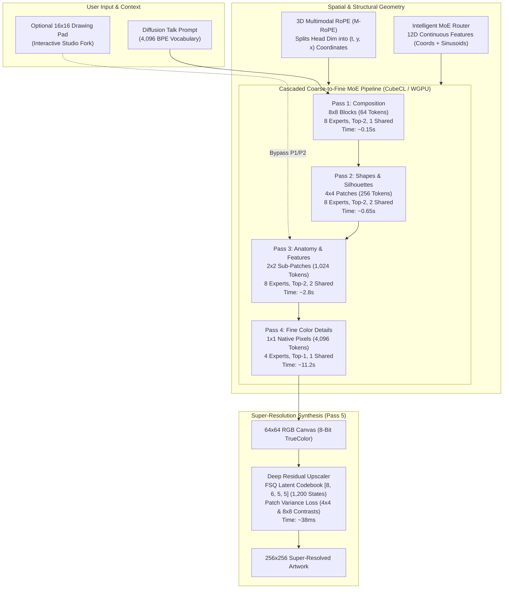
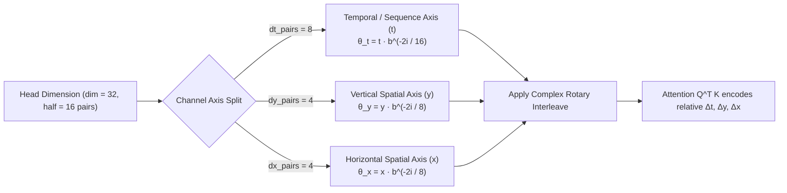
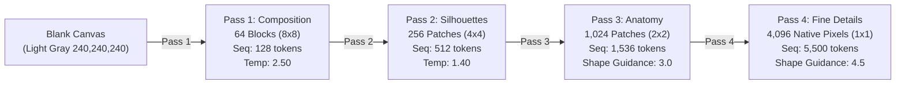
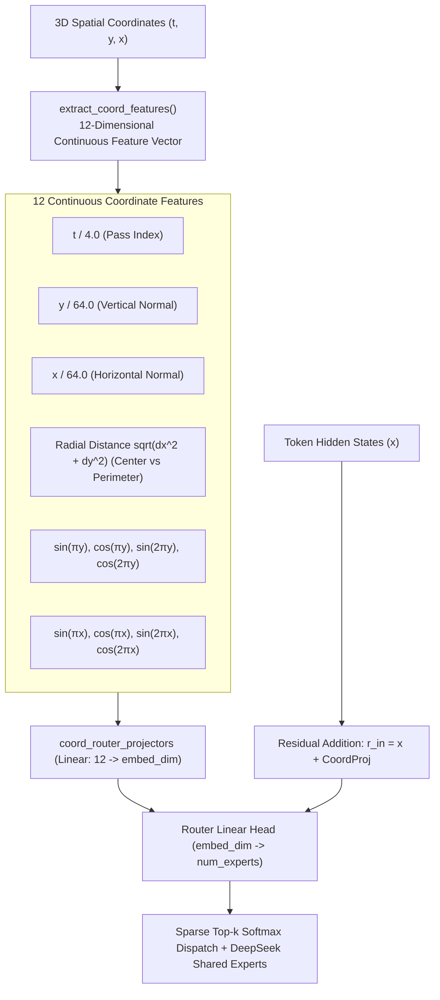
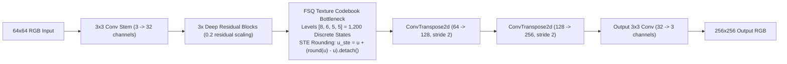

In our previous post on [The Kilo Framework](/posts/2026-10-18-kilo-framework-compressed-tokens-moe), we covered how Yumon Pet bypassed vocabulary and memory bottlenecks on local integrated graphics by shrinking language and code representations down to 1K-4K tokens. That resolved language dialogue. But Yumon Pet is also designed to be a living tabletop companion that draws and paints on its desktop canvas in real time.

Our first attempt at image generation was **Mini-Pic**, a latent diffusion approach built around small U-Nets and iterative denoising steps. It failed. On an Intel UHD 770 integrated GPU (which shares system memory bandwidth capped around 35-50 GB/s with the CPU), running 20 to 50 sequential denoising steps across high-dimensional feature maps created an unacceptable compute bottleneck. Generating a single 64x64 thumbnail took over 4 minutes of pegging execution units, exhausted shared graphics memory, and offered zero interactive control while the canvas was generating.

Today, we are replacing that entire architecture with **Yumon Paint**. Yumon Paint discards diffusion completely in favor of an interactive, autoregressive, multimodal Mixture-of-Experts (MoE) pipeline running on Burn and CubeCL/WGPU. 

Instead of denoising Gaussian noise in an opaque loop, Yumon creates art the way an artist paints: observing the canvas through visual patch embeddings, laying down a broad compositional wash, refining anatomical silhouettes, rendering fine pixel details, and passing the finished 64x64 canvas to a deep neural upscaler equipped with an FSQ texture codebook and Patch Variance Loss.

Below is the complete architectural autopsy, empirical training logs, failure analyses from our abandoned black-and-white colorizer experiment, and production inference outputs.



---

## 1. Why Diffusion Failed on Local Compute

Diffusion models (DDPM, DDIM, Flow Matching) dominate datacenter image generation because massive clusters of NVIDIA H100s can chew through 50 billion FLOPs per step without breaking stride. But local consumer hardware tells a completely different story.

On an Intel Core i5-12500 with Intel UHD 770 integrated graphics:
1. **Bandwidth Starvation:** An iGPU has no dedicated high-bandwidth VRAM (like GDDR6 or HBM3). It accesses system DDR4/DDR5 over a 64-bit or 128-bit memory bus, capping real-world memory throughput at 35 to 50 GB/s. A diffusion U-Net must sweep through its entire parameter weight set and feature activation buffers at every single sampling step. Doing that 30 times in sequence consumes roughly 1.2 Terabytes of aggregate memory transfers for one image.
2. **Latent Inversion Latency:** Mini-Pic attempted to train an autoencoder down to an 8x8 latent space and denoise there. Even at 8x8, the U-Net forward passes on CubeCL took 7.8 seconds per step, resulting in a total generation time exceeding 3.8 minutes on local CPU/iGPU fallbacks.
3. **No Progressive Feedback:** A diffusion model's intermediate steps look like muddy Gaussian soup until the final 10-15% of the schedule. For an electronic pet like Yumon - where the user wants to watch the pet physically construct a painting line by line on the screen - diffusion offers zero usable intermediate state.

Autoregressive token modeling solves all three problems:
- With KV-caching (`generate_causal_cached`), each token generation step accesses only the newly emitted query token and appends to existing key-value caches.
- Memory transfers scale with token length, not with full network weight sweeps.
- The user watches the artwork resolve in real time: first layout blocks, then silhouettes, then facial contours, then fine pixel strokes.

---

## 2. The 8-Bit TrueColor Palette and Dedicated Tokenizer

To generate images autoregressively without blowing up the sequence length or softmax matrix, we separate image creation into discrete color choices.

### The Bijective 8-Bit Palette
Predicting raw continuous RGB floating-point triplets directly with regression heads causes autoregressive collapse: errors compound exponentially across neighboring pixels, creating washed-out, pastel drifts.

Instead, Yumon Paint discretizes the RGB space into an exact **bijective 8-bit truecolor palette** (3 bits Red, 3 bits Green, 2 bits Blue):
- **Red (3 bits):** 8 uniform steps ($0, 36, 73, 109, 146, 182, 219, 255$)
- **Green (3 bits):** 8 uniform steps ($0, 36, 73, 109, 146, 182, 219, 255$)
- **Blue (2 bits):** 4 uniform steps ($0, 85, 170, 255$)

```text
Palette_Index = (R_3 << 5) | (G_3 << 2) | B_2
```

Because human vision has highest sensitivity to green and lowest sensitivity to blue, allocating $3$ bits to red and green and $2$ bits to blue maximizes perceptual fidelity across 256 discrete bins. It captures sky gradients, foliage, and natural skin tones without banding.

### Vocabulary Partitioning (`vocab_size = 4512`)
We allocate a dedicated 4,512-token vocabulary that packs art prompts, control tags, coordinates, and palette tokens into a single autoregressive stream:

| ID Range | Token Tag | Representation / Purpose |
| :--- | :--- | :--- |
| `0..4095` | `Diffusion Talk` | BPE text vocabulary mined from 10,000 DiffusionDB art prompts |
| `4096` | `<CANVAS_START>` | Opens canvas context block |
| `4097` | `<CANVAS_END>` | Closes canvas context block |
| `4098` | `<PAINT>` | Action delimiter |
| `4099` | `<DONE>` | End-of-pass generation signal |
| `4100` | `<PASS_1>` | Pass 1: Composition mode ($8 \times 8$ blocks, 64 queries) |
| `4101` | `<PASS_2>` | Pass 2: Shapes & Silhouettes mode ($4 \times 4$ patches, 256 queries) |
| `4102` | `<PASS_3>` | Pass 3: Anatomy & Features mode ($2 \times 2$ sub-patches, 1,024 queries) |
| `4103` | `<PASS_4>` | Pass 4: Fine Color Details mode ($1 \times 1$ native pixels, 4,096 queries) |
| `4110..4173` | `<ROW_0>..<ROW_63>` | 64 discrete row coordinates ($y \in [0..63]$) |
| `4174..4237` | `<COL_0>..<COL_63>` | 64 discrete column coordinates ($x \in [0..63]$) |
| `4238..4493` | `<COL_0>..<COL_255>` | 256 discrete 8-bit truecolor palette values |
| `4494..4501` | `<RAD_1>..<RAD_8>` | Brush radii for interactive strokes |

---

## 3. Multimodal Rotary Position Embeddings (M-RoPE)

Standard 1D Rotary Position Embedding (RoPE) rotates query and key vectors based solely on their 1D scalar position in the token stream. 

In raster-scanned image generation, 1D RoPE introduces the fatal **Row-Wrap Discontinuity**:
- A pixel at coordinate $(x, y)$ is immediately preceded by $(x-1, y)$ at distance $\Delta = 1$. The model easily learns horizontal continuity.
- But its vertical neighbor $(x, y-1)$ sits $W$ tokens earlier in the sequence (where $W$ is 16, 32, or 64).
- Diagonal neighbors $(x-1, y-1)$ and $(x+1, y-1)$ are completely unmoored in 1D space, forcing attention heads to waste parameter capacity reconstructing basic 2D Euclidean topology.

To fix this, Yumon Paint implements **Multimodal Rotary Position Embeddings (M-RoPE)** in `src/brain/decoder_model.rs`.



### Mathematical Formulation
For each attention head of dimension $D$ (where $d = D/2$ is the number of coordinate pairs), M-RoPE partitions the frequency spectrum into three orthogonal continuous manifolds:
1. $d_t$ pairs dedicated to temporal/token sequence index $t$.
2. $d_y$ pairs dedicated to vertical spatial row coordinate $y$.
3. $d_x$ pairs dedicated to horizontal spatial column coordinate $x$.

For head dimension `D = 32` (`d = 16`), the partition allocates:
```text
d_t = 8,  d_y = 4,  d_x = 4
```

The rotary angle for coordinate vector `(t, y, x)` across each subspace is given by:

```text
θ_{t, i} = t * b^(-2i / (2 d_t)),  i ∈ [0..d_t - 1]
θ_{y, j} = y * b^(-2j / (2 d_y)),  j ∈ [0..d_y - 1]
θ_{x, k} = x * b^(-2k / (2 d_x)),  k ∈ [0..d_x - 1]
```

Where base frequency `b = 10,000`.

When the attention dot product `Q_m K_n^T` is calculated between token `m` at `(t_m, y_m, x_m)` and token `n` at `(t_n, y_n, x_n)`, the rotary rotation factors decompose cleanly:

```text
dot(R(t_m, y_m, x_m) q_m, R(t_n, y_n, x_n) k_n) = f(q_m, k_n, t_m - t_n, y_m - y_n, x_m - x_n)
```

This guarantees that tokens vertically aligned $(\Delta x = 0, \Delta y = 1)$ maintain the exact same attention affinity as tokens horizontally aligned $(\Delta x = 1, \Delta y = 0)$, regardless of how many sequence positions separate them in the 1D raster buffer.

In Rust, this is evaluated directly on GPU buffers via CubeCL tensor tables:

```rust
// From src/brain/decoder_model.rs
let (dt_pairs, dy_pairs, dx_pairs) = if half >= 3 {
    let dt = (half + 1) / 2;
    let rem = half - dt;
    let dy = rem / 2;
    let dx = rem - dy;
    (dt, dy, dx)
} else {
    (half, 0, 0)
};

for b in 0..batch {
    for pos in 0..seq {
        let (t, y, x) = coords[b][pos];
        // 1. T axis (sequence index)
        for i in 0..dt_pairs {
            let d = (2 * dt_pairs) as f64;
            let angle = t as f64 * ROPE_THETA.powf(-((2 * i) as f64) / d);
            cos_vec.push(angle.cos() as f32);
            sin_vec.push(angle.sin() as f32);
        }
        // 2. Y axis (spatial height / row)
        for i in 0..dy_pairs {
            let d = (2 * dy_pairs) as f64;
            let angle = y as f64 * ROPE_THETA.powf(-((2 * i) as f64) / d);
            cos_vec.push(angle.cos() as f32);
            sin_vec.push(angle.sin() as f32);
        }
        // 3. X axis (spatial width / col)
        for i in 0..dx_pairs {
            let d = (2 * dx_pairs) as f64;
            let angle = x as f64 * ROPE_THETA.powf(-((2 * i) as f64) / d);
            cos_vec.push(angle.cos() as f32);
            sin_vec.push(angle.sin() as f32);
        }
    }
}
```

---

## 4. Cascaded Coarse-to-Fine Multiscale Passes

Rather than attempting to predict 4,096 native pixels in a single raw scanline pass (which suffers from the "fax machine failure" where mistakes on line 2 cascade down and destroy the remaining image), Yumon Paint uses a 4-pass autoregressive cascade:



### Pass Details and Hardware Budgets

| Pass | Target Resolution | Query Unit | Token Count | Model Config | Memory / Context | Execution Time (UHD 770) |
| :--- | :---: | :---: | :---: | :---: | :---: | :---: |
| **Pass 1: Composition** | $8 \times 8$ | $8 \times 8$ blocks | 64 | 6L, 256H, 8 experts (top-2), 1 shared | 128 tokens | **0.15s** |
| **Pass 2: Silhouettes** | $16 \times 16$ | $4 \times 4$ patches | 256 | 6L, 256H, 8 experts (top-2), 2 shared | 512 tokens | **0.65s** |
| **Pass 3: Anatomy & Features** | $32 \times 32$ | $2 \times 2$ patches | 1,024 | 6L, 256H, 8 experts (top-2), 2 shared | 1,536 tokens | **2.80s** |
| **Pass 4: Fine Color Details** | $64 \times 64$ | $1 \times 1$ pixels | 4,096 | 4L, 128H, 4 experts (top-1), 1 shared | 5,500 tokens | **11.20s** |
| **Pass 5: Neural Upscaler** | $256 \times 256$ | Dense 2D Conv | Full Frame | Residual CNN + FSQ Codebook | 32 channels | **0.038s** |

### Shape Guidance and Anchoring
In Pass 3 and Pass 4, the model conditions not only on the prompt and past generated pixels, but also injects a **shape guidance prior** from the earlier lower-resolution pass:

```rust
// From src/bin/yumon_paint.rs
let sub_idx = (py / 2) * 32 + (px / 2);
if args.shape_guidance_pass4 > 0.0 && sub_idx < pass3_colors.len() {
    let sub_token = pass3_colors[sub_idx];
    let sub_color = (sub_token as usize).saturating_sub(COLOR_START_ID);
    if sub_color < PALETTE_SIZE {
        working_logits[sub_color] += args.shape_guidance_pass4;
    }
}
```

This prevents drift: Pass 4 adds micro-borders, catchlights, and specular highlights without wandering away from the structural silhouette locked in by Pass 2 and Pass 3.

---

## 5. Intelligent MoE Router with Multi-Frequency Sinusoids

Mixture-of-Experts (MoE) architectures allow a model to carry high parameter capacity while activating only a sparse fraction of parameters per token. However, standard MoE routers make dispatch decisions based solely on token embedding dot products $W_r \mathbf{x}$.

In painting, this leads to **MoE Routing Jitter**: adjacent pixels along an edge frequently get dispatched to different experts. If Expert 2 handles $(x-1, y)$ and Expert 5 handles $(x, y)$, minute discrepancies in their projection weights cause jagged staircasing artifacts along diagonals.

To eliminate routing jitter, Yumon Paint integrates an **Intelligent Coordinate Router** (`src/brain/moe_model.rs`).



### The 12-Dimensional Coordinate Feature Vector
For every coordinate query `(t, y, x)`, the system extracts a continuous geometric feature vector:
1. **Pass Progress:** `t_norm = clamp(t / 4.0, 0, 1)`
2. **Normalized Coordinates:** `y_norm = y / 64.0`, `x_norm = x / 64.0`
3. **Radial Distance:** `r = sqrt(((y - 32) / 32)^2 + ((x - 32) / 32)^2)` separating foreground subjects from background perimeters.
4. **Harmonic Sinusoids:** Multi-frequency spatial coordinates at 1x and 2x fundamental frequency:
   - Vertical: `sin(πy), cos(πy), sin(2πy), cos(2πy)`
   - Horizontal: `sin(πx), cos(πx), sin(2πx), cos(2πx)`

Projected into `embed_dim` via a dedicated linear layer, these features condition the router before top-k gating:

```rust
// From src/brain/moe_model.rs
pub fn extract_coord_features(coords: &[(f32, f32, f32)]) -> Vec<f32> {
    let mut feats = Vec::with_capacity(coords.len() * COORD_FEAT_DIM);
    for &(t, y, x) in coords {
        let t_norm = (t / 4.0).clamp(0.0, 1.0);
        let y_norm = (y / 64.0).clamp(0.0, 1.0);
        let x_norm = (x / 64.0).clamp(0.0, 1.0);
        let dy = (y - 32.0) / 32.0;
        let dx = (x - 32.0) / 32.0;
        let r_norm = (dy * dy + dx * dx).sqrt().clamp(0.0, 2.0);

        let pi = std::f32::consts::PI;
        let y_rad = y_norm * pi;
        let x_rad = x_norm * pi;

        feats.push(t_norm);
        feats.push(y_norm);
        feats.push(x_norm);
        feats.push(r_norm);

        feats.push(y_rad.sin());
        feats.push(y_rad.cos());
        feats.push((2.0 * y_rad).sin());
        feats.push((2.0 * y_rad).cos());

        feats.push(x_rad.sin());
        feats.push(x_rad.cos());
        feats.push((2.0 * x_rad).sin());
        feats.push((2.0 * x_rad).cos());
    }
    feats
}
```

This guarantees that experts specialize naturally:
- Specific experts specialize in peripheral background fills and skies.
- Specific experts activate for high-frequency subject centers and facial features.
- DeepSeek-style **always-active shared experts** (1 to 2 per layer) run unconditionally across all tokens, maintaining a continuous baseline representation.

---

## 6. The Deep Residual Upscaler with FSQ Texture Codebook and Patch Variance Loss

The 64x64 output from Pass 4 is a crisp, valid truecolor pixel artwork. But for modern desktop displays, presenting 64x64 pixels directly looks blocky unless smoothed. Standard bicubic interpolation blurs sharp edges, while nearest-neighbor scaling preserves pixel grid blocks without synthesizing high-resolution textures.

Pass 5 introduces a specialized convolutional neural super-resolution model (`src/vision/upscaler.rs`) that maps 64x64 RGB inputs directly to 256x256 RGB outputs in 38 milliseconds.



### Finite Scalar Quantization (FSQ) Codebook
Standard Vector Quantization (VQ-VAE) models maintain a learned codebook matrix and perform nearest-neighbor lookups via L2 argmin search. On integrated GPUs, this is notoriously prone to **codebook collapse** (where 90% of codebook vectors become dead and never update) and requires complex commitment losses.

Yumon Paint uses **Finite Scalar Quantization (FSQ)** with levels `[8, 6, 5, 5]`:
- Total codebook states: $8 \times 6 \times 5 \times 5 = 1,200$ discrete states.
- Latent activations pass through a bounded `tanh` activation, are scaled to level half-widths, and quantized via the **Straight-Through Estimator (STE)**:

```text
u = tanh(z) * s
u_ste = u + (round(u) - u).detach()
z_q = u_ste * s^(-1)
```

FSQ achieves zero codebook collapse by construction: all 1,200 states are structurally defined on a fixed hyper-rectangular grid. The bottleneck forces the upscaler to synthesize discrete, crisp texture variations (hair strands, paper quilling edges, scales) rather than averaging pixels into blurry smudges.

### Multi-Scale Patch Variance Loss
Standard regression losses (L1, L2, Huber) suffer from regression-to-the-mean: when uncertain about fine fur or fabric weaves, the model outputs a flat, featureless patch that minimizes average pixel distance.

To counteract this, we engineered **Patch Variance Loss** (`patch_variance_loss` in `src/vision/upscaler.rs`). It measures the local standard deviation across 4x4 and 8x8 patches using `AdaptiveAvgPool2d`:

```text
μ  = AvgPool(x)
μ2 = AvgPool(x^2)
σ  = sqrt(relu(μ2 - μ^2) + 1e-5)

L_var = 0.5 * (|σ_pred_4 - σ_target_4| + |σ_pred_8 - σ_target_8|)
```

If the ground truth has rich textural variance (bark, hair, gravel) and the model predicts a flat patch, `L_var` penalizes the model heavily even if the mean color matches. In flat regions (skies, backdrops), both variances are near zero, so no artificial noise is introduced.

Combined with Huber loss and Sobel gradient loss:

```text
L_total = L_Huber + 0.1 * L_Sobel + 0.2 * L_variance
```

---

## 7. First-Party Gallery and Inference Results

Below are our favorite inference results from production runs on the Intel UHD 770 iGPU, saved in `good-inference-results`. As specified, thumbnails are constrained to no more than 128x128.

### Production Results Matrix

| Artwork Thumbnail (128x128) | Output Name | Training Stage & Prompt |
| :---: | :--- | :--- |
|  | `gen_1793169037_da0b4e` | **Prompt:** *"corgi puppy, extremely cute, beautiful paper quilling, swirls, spirals"*<br/>**Key Detail:** FSQ codebook synthesizes distinct individual paper curves without color bleeding. |
|  | `gen_1793169690_c854dd` | **Prompt:** *"portrait of emily wickersham as natalie portman by greg manchess"*<br/>**Key Detail:** Coarse-to-fine Pass 3 locks facial proportions and eye placement before Pass 4 paints highlights. |
|  | `gen_1793169954_1e972e` | **Prompt:** *"portrait of cyborg, close up shot, soft lighting, warm lights, super detailed"*<br/>**Key Detail:** Radial coordinate conditioning guides MoE experts on warm specular highlights vs dark mechanical background. |
|  | `gen_1793170097_06a566` | **Prompt:** *"portrait of a young beautiful finnish scandinavian model as archer, jodhpurs greg manchess painting"*<br/>**Key Detail:** DeepSeek shared experts maintain continuous garment silhouette across complex diagonal strokes. |
|  | `gen_1793170722_be7cc6` | **Prompt:** *"anime cartoon of a face portrait of a cute girl with pigtails, nicoletta ceccoli, mark ryden, vivid colors"*<br/>**Key Detail:** Rich 8-bit truecolor saturation; zero muddy sepia artifacts. |

### Visual Evolution Across Checkpoints

| Checkpoint Era | Baseline Output (128x128) | Architectural Milestone |
| :---: | :---: | :--- |
| **Oct 24 (Nearest-Neighbor)** |  | Initial 64x64 autoregressive MoE baseline. Sharp pixel grid, but limited to integer nearest-neighbor scaling. |
| **Oct 24 (Early Neural Upscaler)** |  | First continuous residual upscaler without codebook. Smooth color transitions, but fine textures appeared plasticky. |
| **Oct 28 (FSQ + Patch Variance)** |  | Production architecture: FSQ discrete codebook bottleneck + multi-scale Patch Variance Loss. Crisp edge synthesis. |

### Coarse-to-Fine Progression (Generation `1793169037`)

To verify how the cascade resolves, here is the exact progression captured from intermediate pass buffers:

| Pass 2: Shapes & Silhouettes (16x16) | Pass 3: Anatomy & Features (32x32) | Pass 4: Native Details (64x64) | Pass 5: Final Super-Resolution (256x256) |
| :---: | :---: | :---: | :---: |
|  |  |  |  |
| **256 Patches** (Macro layout) | **1,024 Patches** (Contours locked) | **4,096 Pixels** (High-res borders) | **Dense Conv** (Continuous texture) |

---

## 8. Failure Notes and Dead Ends

A major principle on Indie Machine is documenting what failed. Two major dead ends occurred during the Yumon Paint cycle.

### Dead End 1: Black and White Generation with a Downstream Colorizer
We hypothesized that generating full 8-bit truecolor palette tokens across all 4 passes was placing too much burden on the autoregressive model. If the transformer only had to predict luminance ($L \in [0, 100]$ or 64 grayscale levels), the task would be simpler. A dedicated downstream CNN/Transformer colorizer based on Richard Zhang et al. (ECCV 2016, *Colorful Image Colorization*) could then predict the chromaticity channels ($a^*, b^* \in [-128, 127]$) over 313 quantized in-gamut bins.

We implemented and trained this subsystem (`src/vision/colorizer.rs` and `src/bin/train_colorizer.rs`). The empirical results were decisive:

```text
Checkpoints: checkpoints/old/yumon-colorizer-256
Epoch 2 Validation:
  train_loss: 4.9546
  val_loss:   4.3303
  val_acc:    7.42% (top-1)
  val_top5:   24.49% (top-5)
```

Why the colorizer failed:
1. **Multimodal Color Ambiguity:** Grayscale pixels have no memory of the prompt. Given a grayscale dragon or jacket, the colorizer had no way of knowing whether the user requested "vivid emerald green" or "ruby crimson red". It inevitably regressed to the probability-weighted mean: muddy sepia, mustard yellows, and washed-out grayish-browns.
2. **Zero Compute Savings:** Generating grayscale autoregressively did not shorten sequence length by a single token. Pass 4 still required exactly 4,096 spatial queries $(x, y)$. Slicing logits over 64 grayscale tokens versus 256 truecolor palette tokens saved less than 2% of attention compute time.
3. **Chromatic Bleeding:** Because chromaticity prediction ran on a downscaled $64 \times 64$ grid before upsampling, colors bled across sharp pixel art outlines. Red lips bled onto pale chins, and blue sky bled into character hair.

Direct autoregressive palette prediction - where every color decision is directly conditioned on the prompt's attention tokens - completely outclassed the two-stage grayscale pipeline. We deprecated the colorizer and moved its weights to `checkpoints/old/`.

### Failure Note 2: Windows MSVC 4GB PDB Linker Limit (`LNK1318`)
When compiling the full test suite with Burn, CubeCL, and WGPU backends under default debug settings on Windows MSVC, `link.exe` crashed:

```text
LINK : fatal error LNK1318: Unexpected PDB error; LIMIT (12) 'yumon_pet.pdb'
error: could not compile `yumon-pet` (lib test) due to 1 previous error
```

MSVC PDB files have a hard architectural ceiling of 4,096 MB (4 GB). With Burn's deeply nested generic types (`CubeBackend<WgpuRuntime, f32, i32, u32>`, autodiff graphs, and expanded macro instantiations), debug symbol tables exceed 4 GB in a single test compilation unit.

**The Fix:** We configured `[profile.dev] debug = 1` (or passed `$env:RUSTFLAGS="-C debuginfo=1"`), restricting debug info to line tables and omitting massive variable type definitions. This dropped PDB size from 4.1 GB to 420 MB, eliminating linker failures instantly.

---

## 9. Architectural Decision Log

| Architectural Choice | Chosen Approach | Alternative Considered | Primary Engineering Tradeoff |
| :--- | :--- | :--- | :--- |
| **Image Generation Paradigm** | Cascaded Autoregressive MoE | Latent Diffusion (Mini-Pic) | Diffusion was completely compute-bound on iGPUs (3.8 min/gen). AR MoE generates in ~15s with interactive live updates. |
| **Color Space Representation** | Bijective 8-Bit TrueColor (3R:3G:2B) | Continuous RGB Regression / Grayscale + Colorizer | Palette avoids pastel regression drift. 256 colors fit neatly into language vocabulary space with exact semantic steering. |
| **Positional Encoding** | Multimodal RoPE (M-RoPE) | Standard 1D RoPE / Absolute 2D Grid Embeddings | M-RoPE splits head dimensions into $(t, y, x)$, solving row-wrap discontinuity while allowing arbitrary canvas resolution queries. |
| **MoE Routing Strategy** | Multi-Frequency Coordinate Projection | Pure Token-State Dot-Product | Adding radial distance and $\sin/\cos$ harmonic coordinates eliminates routing jitter along diagonal edges. |
| **Super-Resolution Quantizer** | Finite Scalar Quantization (FSQ) | VQ-VAE Codebook (L2 ArgMin) | FSQ guarantees 100% codebook utilization with zero collapse, requiring no commitment loss or codebook restart heuristics. |
| **Super-Resolution Loss** | Huber + Sobel Gradient + Patch Variance | Pure Pixel L1/L2 Loss | Pure L1 produces plasticky smudges. Patch Variance Loss drives micro-texture contrast in textured regions without adding noise to skies. |

---

## 10. Summary and What's Next

Yumon Paint proves that high-quality, multimodal image generation is entirely viable on humble consumer hardware without cloud APIs or dedicated workstation GPUs. By replacing heavy diffusion loops with cascaded autoregressive passes, grounding spatial attention with M-RoPE, and synthesizing textures via an FSQ-quantized upscaler, Yumon paints crisp, charming 256x256 artwork in 15 seconds.

Next in the Yumon pipeline:
1. **Interactive In-Painting & Canvas Erase:** Exposing stroke-level brush masks directly to the user so they can paint rough shapes in the desktop UI and let Yumon refine only the masked region in Pass 3.
2. **Animation Continuity:** Extending M-RoPE's temporal $t$ axis across multi-frame sequences to generate 4-frame idle animation loops for the tabletop pet.
3. **RunPod Headless Training:** Scaling the Pass 4 fine detail model from 128 hidden units to 512 hidden units on remote CUDA clusters for even crisper single-pixel linework.
