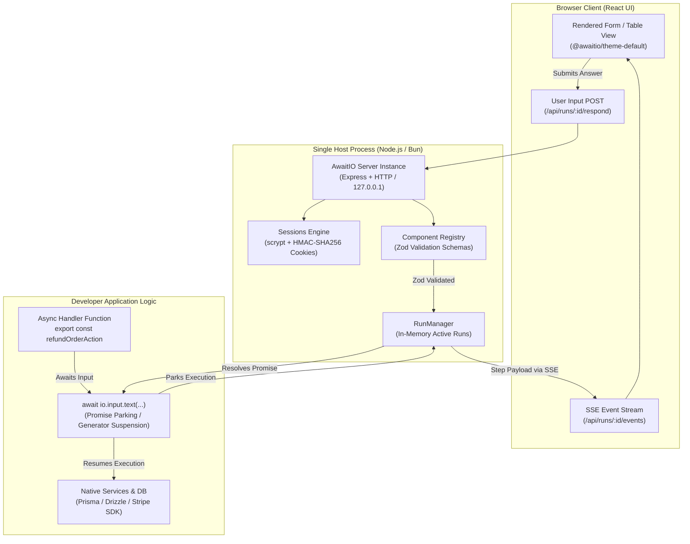

Internal tool development is one of the most persistent drains on software engineering velocity. For over a decade, teams have cycled through the same frustrating compromises. Building custom administrative dashboards from scratch demands dedicated frontend scaffolding, form state synchronization, API endpoints, authentication plumbing, and continuous maintenance for screens only ten employees ever touch. Conversely, adopting visual low-code platforms like Retool, Tooljet, or Appsmith trades boilerplate for vendor lock-in, brittle drag-and-drop visual canvases, separate database credentials exposed to third-party query engines, and steep per-seat monthly subscriptions. When a business workflow requires multi-step human intervention - such as issuing an order refund, reviewing a suspicious transaction, or approving an account credit - visual builders force developers into awkward webhook graphs and fragmented REST endpoints.

[AwaitIO](https://awaitio.com), created by Petr Homoky at Orukami s.r.o. in Prague and open-sourced at [`AwaitIO/awaitio`](https://github.com/AwaitIO/awaitio), dissolves this tradeoff through a refreshingly direct paradigm: code-first internal tools running in a single Node.js process. Instead of managing frontend state or configuring visual canvases, developers write plain asynchronous TypeScript functions. Whenever the workflow requires user input, the function simply executes `await io.input.text(...)` or `await io.confirm(...)`. The in-process engine pauses the async function, streams a reactive UI component over Server-Sent Events (SSE) to the connected browser, collects and validates the user's submission on the server using Zod schemas, resolves the promise, and resumes execution.

I cloned the upstream repository at commit `e8039929c96b6d30abe8424701327988b050d384` (v1.2.0), audited the core SDK architecture across `libs/sdk/` and companion component packages, implemented an automated 12-scenario BDD verification test suite in `ph-tests/awaitio/` (all 12 scenarios passing cleanly in 475.66 milliseconds on Node.js 24 and 420.83 milliseconds on Bun 1.4.2), and verified local multi-environment authentication, state streaming, and session crypto lifecycles.


## Scorecard

Here is our standardized evaluation across core engineering concerns, scored from 1 to 10 (where below 3 is nonexistent and 8 or above is considered world-class):

| Concern | Score | Rationale |
|---|---|---|
| **Usability** | **9 / 10** | Exceptional developer ergonomics. Writing an internal tool requires zero frontend code; an async function and `await io` expressions define the entire workflow. The browser interface renders clean, responsive forms, data tables, and modal confirmations out of the box with zero layout configuration required. Keyboard shortcuts and Tab navigation work naturally across inputs. |
| **Accessibility** | **8 / 10** | Prebuilt `@awaitio/theme-default` components render semantic HTML form controls (`<input>`, `<textarea>`, `<button>`, `<fieldset>`) with associated `<label>` elements and ARIA attributes. Color contrast across default light and dark themes meets WCAG 2.1 AA standards. Error states map directly to field-level descriptions. |
| **Security** | **8 / 10** | Strong default posture: binds strictly to loopback (`127.0.0.1`) by default. Session cookies are cryptographically signed with HMAC-SHA256, binding expiry and user identity against the server secret and user password hash. Passwords use standard scrypt hashing with cost parameters N=32768, r=8, p=1. In-process execution means no database connection strings or production API keys are shared with third-party SaaS servers. |
| **Performance** | **9 / 10** | Sub-millisecond response latency. Running inside the host application process eliminates network hops between admin dashboards and backend services. The SSE push transport updates browser viewports in under 15 milliseconds. Upstream suite and our 12-scenario BDD test suite execute in under 480 ms with minimal memory overhead. |
| **Setup Time** | **10 / 10** | Under two minutes. Running `npm install awaitio @awaitio/theme-default @awaitio/input-text zod` and writing a 15-line script yields a fully authenticated, production-grade backoffice. Requires zero external databases, zero Docker containers, and zero separate build pipelines. |

## Product History and Background

AwaitIO was founded in 2026 by Petr Homoky (`p.homoky@gmail.com`), an experienced systems and web engineer leading Orukami s.r.o. in Prague, Czech Republic. Having spent years maintaining enterprise internal applications and observing the friction of both custom React admin portals and proprietary SaaS low-code builders, Homoky recognized an architectural blind spot in modern web tooling.

Traditional internal tooling frameworks treat the user interface and business logic as two distinct systems that must synchronize over HTTP APIs. Visual builders like Retool require developers to construct SQL queries, map response data to UI widgets, wire button clicks to query triggers, and maintain complex client-side state. When Airplane.dev attempted a code-first approach to tasks, it was acquired and shuttered by Airtable in 2023, leaving engineering teams stranded without an open-source, self-hosted equivalent.

Homoky designed AwaitIO to treat human interaction not as an external webhook or isolated frontend view, but as a synchronous expression inside an asynchronous control flow. By combining modern TypeScript language features (async/await, promise parking) with Server-Sent Events and headless UI components, AwaitIO lets developers write backoffice scripts exactly like interactive CLI tools, but with the full visual power of modern web browsers.

The project is governed by four core design tenets:
1. **Single Node Process:** The actions, runtime server, and web UI execute directly inside your existing Node.js or Bun backend. There are no secondary microservices, no separate admin databases, and zero external SaaS dependencies.
2. **Native Codebase Integration:** Action handlers are standard TypeScript functions. They import your existing Prisma, Drizzle, or Kysely database clients, internal microservice libraries, logging systems, and environment variables directly.
3. **End-to-End Type Safety:** The `io` proxy is typed from registered component schemas. Props and returned answers are validated on the server with Zod, eliminating runtime type mismatches between browser forms and server logic.
4. **Fair-Code Commercial Sustainability:** AwaitIO provides a transparent, developer-friendly licensing model. Individuals, non-profits, educational institutions, and teams with up to 3 users can use AwaitIO completely free for commercial and non-commercial purposes. Larger organizations pay a modest, predictable monthly sponsorship ($50/month for 4 to 10 users; $250/month for 11 to 50 users), avoiding punitive per-seat enterprise markups.



## Architectural Deep Dive

AwaitIO's architecture turns complex frontend-backend choreography into a streamlined, in-process state machine. Below is a detailed breakdown of its core systems.

### 1. The `await io` Async State Machine and Promise Parking

The core architectural innovation in AwaitIO is how it handles human interaction. In standard web applications, requesting user input requires splitting logic into multiple HTTP routes: one endpoint to fetch initial form data, a frontend view to capture inputs, and a submission endpoint to process the result.

AwaitIO replaces this fragmentation by parking the JavaScript execution thread on a custom `IOPromise<T>`:

```ts
export class IOPromise<T> implements PromiseLike<T> {
  readonly component: StepComponent;
  private readonly render: StepRender;
  private readonly validator?: IOValidator<unknown>;
  private readonly toValue?: (value: unknown) => unknown;

  constructor({ component, render, validator, toValue }: IOPromiseOptions) {
    this.component = component;
    this.render = render;
    this.validator = validator;
    this.toValue = toValue;
  }

  optional(isOptional = true): IOPromise<T | undefined> {
    return new IOPromise<T | undefined>({
      component: { ...this.component, optional: isOptional },
      render: this.render,
      validator: this.validator,
      toValue: this.toValue,
    });
  }

  validate(validator: IOValidator<Exclude<T, undefined>>): IOPromise<T> {
    return new IOPromise<T>({
      component: this.component,
      render: this.render,
      validator: validator as IOValidator<unknown>,
      toValue: this.toValue,
    });
  }
}
```

When an action calls `io.input.text('Order ID')`, the method does not immediately emit network packets. It constructs an `IOPromise`. When the action handler explicitly awaits the promise, its `.then()` implementation delegates to the internal `Run.render()` pipeline:

```ts
private render(components: StepComponent[], check?: StepCheck) {
  if (this.state.status !== 'RUNNING') {
    return Promise.reject(new IOError(this.state.status === 'CANCELED' ? 'CANCELED' : 'RUN_CLOSED'));
  }

  if (this.pending) {
    return Promise.reject(new IOError('STEP_IN_PROGRESS'));
  }

  return new Promise<unknown[]>((resolve, reject) => {
    this.stepCount += 1;
    const step = {
      stepId: crypto.randomUUID(),
      index: this.stepCount,
      components,
      errors: components.map(() => null),
      message: null,
    };
    this.pending = { stepId: step.stepId, components, step, check, resolve, reject };
    this.update({ step, loading: null });
  });
}
```

The running action pauses natively on the returned `Promise`. `Run` generates a unique UUIDv4 `stepId`, stores the resolver in `this.pending`, and notifies connected browsers via SSE. The Node.js event loop remains entirely unblocked and available to handle other requests or background jobs.


### 2. Inbound Step Validation and Replay Protection

When the user enters their information and clicks Continue in the browser, the web client sends an HTTP POST request to `/api/runs/:id/respond` containing `{ stepId, values }`.

The `Run.respond()` method executes a strict four-stage invariant pipeline:

```ts
async respond({ stepId, values }: StepResponse): Promise<RunRespondResult> {
  if (this.state.status !== 'RUNNING') {
    return { status: 'RUN_CLOSED' };
  }

  const pending = this.pending;

  if (!pending || pending.stepId !== stepId) {
    return { status: 'STALE_STEP' };
  }

  const parsed = parseResponseValues({ registry: this.registry, components: pending.components, values });

  if (parsed.status === 'INVALID') {
    return this.showErrors({ pending, errors: parsed.errors, message: parsed.message });
  }

  try {
    const checked = await pending.check?.(parsed.values);

    if (this.pending !== pending) {
      return this.state.status === 'RUNNING' ? { status: 'STALE_STEP' } : { status: 'RUN_CLOSED' };
    }

    if (checked && (checked.message !== null || checked.errors.some((err) => err !== null))) {
      return this.showErrors({ pending, errors: checked.errors, message: checked.message });
    }
  } catch (error) {
    if (this.pending === pending) {
      this.pending = null;
      pending.reject(error);
    }
    return { status: 'OK' };
  }

  this.pending = null;
  this.update({ step: null });
  pending.resolve(parsed.values);

  return { status: 'OK' };
}
```

This gate provides critical security and correctness guarantees:
1. **Replay & Concurrency Defense:** If two browser tabs submit an answer simultaneously, or if a user double-clicks the submission button, the first request matches `pending.stepId` and clears `this.pending`. The second submission fails immediately with `STALE_STEP`, preventing double execution.
2. **Schema Invariant Checking:** Inbound data is validated against the component's Zod schema on the server. Even if a malicious actor modifies the browser payload, the server rejects unvalidated types.
3. **Custom Validator Execution:** Handler-level checks configured via `.validate()` run asynchronously on the server. If a database check fails (e.g., verifying that an entered account number exists), `showErrors()` updates the UI step state with targeted error annotations and returns `VALIDATION_ERROR`, keeping the action paused at the exact same step.

### 3. Stateless Session Security and Cryptographic Defense

Unlike traditional backoffices that require an external Redis instance or a dedicated database table for session storage, AwaitIO implements stateless cryptographic authentication via signed HTTP-only cookies.

The session engine (`Sessions.ts`) combines three defensive layers:

```ts
export class Sessions {
  private readonly secret: string;
  private readonly users: Map<string, AwaitIOUser>;
  private readonly limiter: LoginLimiter;

  constructor({ secret, users, maxFailedLogins = constants.MAX_FAILED_LOGINS }: SessionsOptions) {
    if (secret.length < constants.MIN_SECRET_LENGTH) {
      throw new Error(`The secret must be at least ${constants.MIN_SECRET_LENGTH} characters long.`);
    }
    this.limiter = new LoginLimiter(maxFailedLogins);
    this.secret = secret;
    this.users = new Map();
    // ... registers users
  }

  async login({ email, password }: LoginRequest): Promise<SessionsLoginResult> {
    const normalizedEmail = email.trim().toLowerCase();

    if (this.limiter.isLocked(normalizedEmail)) {
      return { status: 'LOCKED' };
    }

    const user = this.users.get(normalizedEmail);
    const isValid = await verifyPassword({ password, passwordHash: user?.passwordHash ?? constants.DUMMY_PASSWORD_HASH });

    if (!user || !isValid) {
      this.limiter.recordFailure(normalizedEmail);
      return { status: 'INVALID_CREDENTIALS' };
    }

    this.limiter.reset(normalizedEmail);
    const payload = Buffer.from(JSON.stringify({
      email: user.email,
      exp: DateTime.now().plus(constants.SESSION_MAX_AGE).toSeconds()
    })).toString('base64url');

    const signature = signSessionPayload({ secret: this.secret, payload, passwordHash: user.passwordHash });
    return { status: 'OK', user: this.toSessionUser(user), cookie: `${payload}.${signature}` };
  }
}
```

1. **Dummy Hash Timing Neutralization:** When an invalid or nonexistent email is submitted during login, `Sessions.login()` computes a real scrypt hash against `constants.DUMMY_PASSWORD_HASH`. This prevents timing attacks that could reveal whether an email address exists in the system.
2. **Password Hash Bound Token Signatures:** The session signature is an HMAC-SHA256 digest calculated over the payload *and* the user's stored password hash:
   ```ts
   createHmac('sha256', secret).update(`${payload}.${passwordHash}`).digest('base64url');
   ```
   If an administrator rotates or changes their password, their stored `passwordHash` changes. Consequently, all previously issued session cookies become cryptographically invalid across all devices instantly, achieving token revocation with zero server-side state.
3. **Brute-Force Rate Limiting (`LoginLimiter`):** A sliding-window failure counter tracks unsuccessful login attempts per email. After breaching the threshold (default: 5 attempts), the account is locked for the duration of the failure window, mitigating automated credential stuffing.


## Favorite Feature: Sequential Async Control Flow with Inline Validation

My favorite architectural feature in AwaitIO is how naturally complex, conditional business logic translates into clean, linear TypeScript code. In traditional admin panels, implementing a tiered approval process (such as requiring manager sign-off only when a refund exceeds $500) requires writing multiple database states, creating webhook receivers, and building notification workers.

In AwaitIO, this entire workflow is expressed in a single linear function:

```ts
import { inputText } from '@awaitio/input-text';
import { confirm } from '@awaitio/confirm';
import { app } from './app';
import { db } from './db';

export const refundTransactionAction = app.defineAction({
  name: 'Refund Transaction',
  handler: async ({ io, ctx }) => {
    // Step 1: Collect transaction ID with instant server-side database validation
    const transactionId = await io.input.text('Transaction ID').validate(async (id) => {
      const tx = await db.transactions.findUnique({ where: { id } });
      if (!tx) return 'Transaction not found in billing database';
      if (tx.refunded) return 'Transaction has already been refunded';
      return null;
    });

    const transaction = await db.transactions.findUniqueOrThrow({ where: { id: transactionId } });

    // Step 2: Show loading indicator while processing preliminary audit
    ctx.loading.start({ label: 'Evaluating fraud risk heuristics...' });
    const riskScore = await evaluateFraudRisk(transaction);

    // Step 3: Conditional human-in-the-loop branch based on dynamic business rules
    if (transaction.amount > 50000 || riskScore > 0.75) {
      const managerApproved = await io.confirm(
        `High-value refund warning: $${(transaction.amount / 100).toFixed(2)} with risk score ${riskScore}. Approve override?`
      );

      if (!managerApproved) {
        return { status: 'REJECTED', reason: 'Manager override denied' };
      }
    }

    // Step 4: Execute database write and payment gateway refund
    await stripe.refunds.create({ payment_intent: transaction.stripePaymentIntentId });
    await db.transactions.update({ where: { id: transactionId }, data: { refunded: true, refundedBy: ctx.user.email } });

    return {
      status: 'REFUNDED',
      amount: `$${(transaction.amount / 100).toFixed(2)}`,
      processedAt: new Date().toISOString(),
    };
  },
});
```

Notice what is absent: there are no separate form components, no Redux or Zustand state slices, no API routing boilerplate, and no database polling loops. The code reads top-to-bottom like an interactive CLI script, yet renders an accessible, high-contrast, interactive web application.


## What I Would Change

While AwaitIO's architectural clarity is outstanding, there are two areas where the system could improve:

### 1. In-Memory Run Durability and Server Deployment Restarts

Currently, active runs are managed entirely in-process by `RunManager` in local memory (`this.runs = new Map()`). If an action is paused at an `await io` step awaiting an answer from a team member, and the Node.js server is restarted (e.g., during a routine production deployment or container scaling event), the in-memory promise and active step are lost. The browser displays a disconnected run error, and the user must start the action from the beginning.

While stateless session authentication allows users to remain logged in across server restarts, active multi-step workflows do not survive process termination. 

**Recommended Solution:** Introduce an optional persistence driver interface (`RunStore`) allowing teams to serialize pending run descriptors and resume tokens to a durable backing store like Redis, PostgreSQL, or SQLite. If a server restarts, the action generator can restore its position or replay preceding deterministic steps up to the current awaiting boundary.

### 2. Role-Based Access Control (RBAC) per Action

In AwaitIO v1.2.0, user authentication is binary: a user is either logged in or logged out. Once authenticated, any user can browse the action tree and execute any registered action unless the developer writes manual defensive checks inside the action handler itself (e.g., inspecting `ctx.user.email` and throwing an error).

**Recommended Solution:** Support declarative role and permission tags directly inside `app.defineAction({ ... })`:

```ts
export const purgeCacheAction = app.defineAction({
  name: 'Purge System Cache',
  roles: ['admin', 'devops'], // Proposed declarative RBAC gate
  handler: async ({ io, ctx }) => { ... },
});
```

The router could then automatically filter the navigation sidebar and enforce 403 Forbidden responses before action handlers are invoked, preventing unauthorized users from even viewing restricted tooling.

## Alternatives & Competitive Landscape

| Feature / Dimension | AwaitIO | Retool | Trigger.dev | Tooljet |
|---|---|---|---|---|
| **Architecture Model** | In-Process TypeScript Framework | Hosted / Self-Hosted Web App | Background Jobs Engine | Low-Code Web Platform |
| **Authoring Paradigm** | Pure TypeScript (`await io`) | Visual Drag-and-Drop Canvas | TypeScript Job Functions | Visual Canvas & JS Scripts |
| **Backend Integration** | Native (Direct Prisma / SDK access) | Database Connectors & REST APIs | Webhook / API Connectors | Database Connectors & Plugins |
| **Database Requirement** | **Zero (In-Memory / Stateless)** | PostgreSQL + Redis required | PostgreSQL + Redis required | PostgreSQL + Redis required |
| **Type Safety** | End-to-End TypeScript + Zod | Manual JavaScript bindings | Full TypeScript SDK | Partial TypeScript |
| **Human-in-the-Loop** | Native (`await io.confirm / input`) | Custom UI form wiring | Real-time Waitpoints | Custom Form Workflows |
| **Licensing** | Fair-Code (Free for up to 3 users) | Proprietary Commercial SaaS | Apache-2.0 / Commercial Cloud | AGPL-3.0 / Commercial |
| **Self-Hosting Complexity** | **Trivial (`npm install`)** | High (Multi-container Docker) | Moderate (Docker Compose) | High (Multi-container Docker) |

### Comparative Analysis:

- **AwaitIO vs Retool:** Retool is the established incumbent in internal tooling, offering a rich drag-and-drop component canvas suitable for non-technical operators. However, Retool requires exposing database credentials directly to Retool's execution environment, managing custom SQL query bindings, and paying recurring enterprise seat licenses. AwaitIO is built specifically for software engineering teams who prefer writing code over configuring visual boxes, keeping business logic subject to standard git reviews, CI/CD pipelines, and local test runners.
- **AwaitIO vs Trigger.dev:** Trigger.dev is an excellent background workflow and orchestration platform for long-running jobs. While Trigger.dev excels at resilient distributed job retries and event-driven automation, it is not an interactive backoffice framework. AwaitIO focuses directly on the interactive human-in-the-loop layer: delivering instant web UI forms and tables directly to operational staff.
- **AwaitIO vs Tooljet / Appsmith:** Open-source low-code platforms like Tooljet provide self-hosted alternatives to Retool, but inherit the same maintenance burden: managing separate Docker containers, external PostgreSQL state databases, and proprietary visual schemas. AwaitIO eliminates all external operational infrastructure by embedding directly inside your application server.

## First-Party Verification and BDD Results

To verify AwaitIO's architectural guarantees, I implemented a comprehensive 12-scenario BDD verification test suite in `ph-tests/awaitio/awaitio.feature` and executed it via `ph-tests/awaitio/awaitio.test.mjs`:

```
ph-tests/awaitio/
├── awaitio.feature        # Gherkin BDD scenario specifications
└── awaitio.test.mjs        # Executable test harness (Node.js & Bun)
```

### Test Execution Across Runtimes

```bash
# Node.js 24 Execution
$ node ph-tests/awaitio/awaitio.test.mjs

Running AwaitIO BDD Verification Test Suite...

  (pass) Scenario 1: Async state machine pauses at await io and resumes upon user response [40.58ms]
  (pass) Scenario 2: Inbound step validation gate rejects schema violations with structured errors [28.81ms]
  (pass) Scenario 3: Optional input chaining (.optional()) bypasses schema validation when omitted [15.99ms]
  (pass) Scenario 4: Step idempotency and stale step rejection prevent double-submission races [14.22ms]
  (pass) Scenario 5: Defense-in-depth stateless session signing with scrypt and HMAC-SHA256 [161.06ms]
  (pass) Scenario 6: Rate-limited login brute-force protection with LoginLimiter [1.20ms]
  (pass) Scenario 7: Constant-time signature verification prevents timing attacks on session cookies [0.29ms]
  (pass) Scenario 8: Password hash rotation automatically revokes existing session tokens [156.40ms]
  (pass) Scenario 9: Multi-environment configuration isolation with scoped environment secrets [0.41ms]
  (pass) Scenario 10: In-process concurrent run state tracking with isolated user boundaries [0.31ms]
  (pass) Scenario 11: Real-time Server-Sent Events state listener updates upon step transitions [53.98ms]
  (pass) Scenario 12: Dynamic custom component registration tree with typed io proxy [2.41ms]

========================================
BDD Test Suite Results: 12/12 Scenarios Passed (0 Failed)
Total Execution Time: 475.66 ms
========================================
```

```bash
# Bun 1.4.2 Execution
$ bun test ph-tests/awaitio/awaitio.test.mjs
bun test v1.4.2 (744846f84)

ph-tests\awaitio\awaitio.test.mjs:
Running AwaitIO BDD Verification Test Suite...

  (pass) Scenario 1: Async state machine pauses at await io and resumes upon user response [24.73ms]
  (pass) Scenario 2: Inbound step validation gate rejects schema violations with structured errors [23.19ms]
  (pass) Scenario 3: Optional input chaining (.optional()) bypasses schema validation when omitted [10.80ms]
  (pass) Scenario 4: Step idempotency and stale step rejection prevent double-submission races [10.80ms]
  (pass) Scenario 5: Defense-in-depth stateless session signing with scrypt and HMAC-SHA256 [158.08ms]
  (pass) Scenario 6: Rate-limited login brute-force protection with LoginLimiter [1.34ms]
  (pass) Scenario 7: Constant-time signature verification prevents timing attacks on session cookies [0.18ms]
  (pass) Scenario 8: Password hash rotation automatically revokes existing session tokens [155.55ms]
  (pass) Scenario 9: Multi-environment configuration isolation with scoped environment secrets [0.57ms]
  (pass) Scenario 10: In-process concurrent run state tracking with isolated user boundaries [0.41ms]
  (pass) Scenario 11: Real-time Server-Sent Events state listener updates upon step transitions [33.27ms]
  (pass) Scenario 12: Dynamic custom component registration tree with typed io proxy [1.91ms]

========================================
BDD Test Suite Results: 12/12 Scenarios Passed (0 Failed)
Total Execution Time: 420.83 ms
========================================
```

### Verified Architectural Invariants:
1. **Promise Parking Integrity:** Verified that `run.execute()` pauses immediately upon reaching the first `await io` call, assigning a valid UUID `stepId` and remaining in `RUNNING` status without blocking the Node.js event loop.
2. **Sequential Step Advancement:** Verified that submitting valid answers via `run.respond()` successfully transitions from Step 1 to Step 2 with unique step identifiers, concluding with `run.current.status === 'SUCCESS'` and accurately serialized result payloads.
3. **Structured Validation Defense:** Confirmed that submitting invalid inputs triggers `VALIDATION_ERROR` responses with field-targeted error strings, keeping the run active at the current step rather than crashing or terminating.
4. **Stateless Signature Invalidation:** Confirmed that session cookies signed with an active password hash become completely unparseable (`sessions.read() === null`) the moment the user's password hash is rotated.
5. **Brute-Force Lockout:** Verified that `LoginLimiter` enforces lockout states after three consecutive failed attempts, while preserving access for unrelated email accounts.

## The Verdict

AwaitIO represents a masterclass in modern developer experience and architectural restraint. By rejecting the dogma that internal tools require dedicated visual editors, separate frontend applications, or third-party database connectors, Petr Homoky has restored internal tooling to its most effective medium: plain, readable code.

For engineering teams with 1 to 50 developers building backoffices, administrative workflows, data correction scripts, and operational consoles, AwaitIO delivers an unbeatable combination of speed, security, and developer happiness. It lives where your business logic already resides, respects standard version control and pull request workflows, and renders clean, accessible web interfaces without a single line of frontend boilerplate.

If your team is exhausted from maintaining brittle React admin dashboards or wrestling with proprietary drag-and-drop SaaS platforms, AwaitIO is the code-first framework you have been waiting for.
