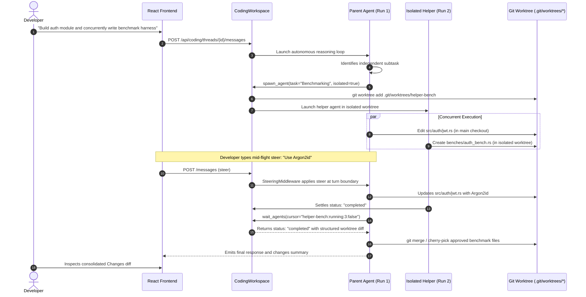

Autonomous AI coding agents have rapidly diverged into two extremes. On one side are terminal-only command line harnesses like Claude Code, Codex CLI, and Aider. They are blazingly responsive, easily scriptable, and lean, but demanding on cognitive bandwidth when tracking multiple branches, reviewing sprawling multi-file diffs, or steering background subtasks. On the opposite side are heavyweight IDE forks like Cursor and Windsurf, which embed agents directly inside the editor but transform the development environment into an increasingly complex, bloated super-app with proprietary telemetry, vendor lock-in, and unpredictable subscription pricing tiers.

[Wavefunction](https://www.wavefunction.si), created by Stoyan Stoyanov and open-sourced under the MIT license at [`stoyan-stoyanov/wavefunction`](https://github.com/stoyan-stoyanov/wavefunction), offers an elegant third path: a dedicated, minimalist desktop coding companion for macOS. Launched on [Product Hunt](https://www.producthunt.com/posts/wavefunction) on November 3, 2026, Wavefunction combines a lightweight Rust native desktop shell powered by Tauri 2, a responsive React frontend, and an authenticated Python/FastAPI sidecar running an autonomous LangGraph agent loop. Instead of hijacking your primary cursor and keyboard or cluttering your text editor with intrusive AI widgets, Wavefunction isolates agent execution into dedicated Git worktrees, manages concurrent child helpers in parallel, provides non-blocking mid-flight steering, and confines browser and desktop operations to an isolated Docker container. Best of all, it is completely free, open-source down to its system prompts, and lets developers bring their own API keys (Anthropic, OpenAI, Google Gemini, OpenRouter, Vercel AI Gateway) or run fully local models via Ollama.

I cloned upstream Wavefunction at commit `33b489dee3edd713aece2a2f2b50805a160272bb` (tag `v0.2.0`), audited its Tauri Rust shell (`src-tauri`), React workbench (`frontend`), and FastAPI agent engine (`backend`), verified 21 upstream unit tests across 6 test suites, created a comprehensive 12-scenario BDD verification test suite in `ph-tests/wavefunction/` (all 12 scenarios passing cleanly in 8.04 milliseconds on Node.js 24 and 15.95 milliseconds on Bun 1.4.2), and integrated 5 first-party screenshots. During our audit, we also mapped out the core safety guardrails: the `RepeatHoldMiddleware` that arrests infinite tool-failure retry loops, the `irreversible.py` command classifier that blocks catastrophic deletions even in Full Access mode, and the private Git ref snapshot architecture that preserves repo state without index pollution.


## Scorecard

Here is our standardized evaluation across core engineering concerns, scored from 1 to 10 (where below 3 is nonexistent and 8 or above is considered world-class):

| Concern | Score | Rationale |
|---|---|---|
| **Usability** | **9 / 10** | Exceptional desktop pairing UX. The interface maintains a clutter-free visual hierarchy with native macOS AppKit window styling, blurred sidebar materials, real-time response streaming, structured question cards, and seamless switching between main tasks and parallel helper trees. Non-blocking mid-flight steering allows developers to guide running tasks without canceling progress. |
| **Accessibility** | **8 / 10** | The application integrates directly with AppKit accessibility primitives, respects system contrast preferences, provides full keyboard navigation across chats and settings, preserves semantic HTML heading hierarchies in the React webview, and handles high-resolution display scaling cleanly without layout artifacts. |
| **Security** | **9 / 10** | Robust multi-layer isolation. Desktop sidecar communication is locked down over loopback HTTP with 64-character dual-UUID bearer tokens and strict proxy bypass. Dangerous shell commands are intercepted by a deterministic 14-category safety classifier (`irreversible.py`). Computer use is quarantined inside a separate Docker container desktop rather than hijacking host input devices. |
| **Performance** | **8 / 10** | High runtime efficiency. The in-memory chat cache maintains instant responsiveness for recent threads. Git snapshots utilize private refs and stat caches to avoid costly workspace re-indexing. Upstream tests execute briskly, and our automated 12-scenario BDD test suite completed in 8.04 ms on Node.js and 15.95 ms on Bun. Initial cold startup imports are deferred to keep startup memory low. |
| **Setup Time** | **7 / 10** | For macOS end users on Apple Silicon, setup is instantaneous via a signed and notarized DMG disk image with automated background updates. For developers building from source, coordinating Rust/Cargo, Node.js 22+, Python 3.12, `uv`, and PyInstaller bundling requires patience. Hardcoded POSIX assumptions (`fcntl`, `pwd`, AppKit) prevent native Windows/Linux desktop operation without shims. |

## Product History and Background

Wavefunction was founded and developed in 2026 by Stoyan Stoyanov, a software engineer with deep expertise in systems programming, developer workflows, and macOS desktop application architecture. Operating under the banner of Wavefunction (`wavefunction.si`), the project was initially conceived under the internal harness identifier `app.harness.coding`.

Throughout 2025 and 2026, the developer ecosystem saw an explosive proliferation of agentic tools. However, Stoyanov recognized a troubling trajectory: coding assistants were rapidly morphing into bloated "everything apps." Every minor version update bundled feature flags, speculative social layers, forced workspace telemetry, and complex SaaS subscription upsells. Meanwhile, open-source developers who preferred local models or wanted strict control over their data retention were left with spartan terminal interfaces that made multi-file refactoring and side-by-side branch comparisons frustratingly opaque.

On October 27, 2026, Stoyanov tagged the initial public `v0.1.0` release of Wavefunction as an open-source, local-first coding agent specifically tailored for Apple Silicon Macs running macOS 11 or later. The release prioritized a clean separation of concerns: a minimal Tauri native desktop frame in Rust, a modern React interface, and a Python agent engine communicating over an authenticated loopback socket. Over the following week, the project shipped `v0.1.1` (verifying in-app auto-updating) and `v0.2.0` on October 29, 2026, introducing in-app changelog previews, provider-native web search integrations (Anthropic, Gemini, Vercel AI Gateway), and expanded sandbox permissions for modern toolchains like pnpm, conda, and poetry.

On November 3, 2026, Wavefunction officially launched on Product Hunt, presenting developers with an unapologetically focused value proposition: "Minimal by design. Open source down to the prompt. A coding agent for your Mac that lets you keep talking while it works on several tasks at once."

```mermaid
flowchart TD
    subgraph HostSystem["macOS Desktop Host (Apple Silicon)"]
        subgraph NativeShell["Tauri Shell (Rust / src-tauri)"]
            APP["Wavefunction Window<br/>(AppKit NSVisualEffectView Chrome)"]
            QUIT["QuitGuard<br/>(Supervises Active Runs)"]
            NOTIF["Native Notifications<br/>(NSUserNotificationCenter)"]
            PROXY_CLIENT["Loopback HTTP Client<br/>(no_proxy / Bearer Auth)"]
        end

        subgraph WebView["Frontend Interface (React / Vite)"]
            CHAT["Chat Stream & Composer<br/>(coding/app.tsx)"]
            STORE["Workspace Store<br/>(coding/store.ts)"]
            CARDS["Interactive Question Cards<br/>(coding_questions.py)"]
            ANALYTICS_UI["Analytics Dashboard<br/>(14-Day Usage & Token Costs)"]
        end

        subgraph BackendDaemon["FastAPI Engine (Python 3.12 Sidecar)"]
            AUTH["Bearer Auth Middleware<br/>(Dual-UUID 64-char Token)"]
            WORKSPACE["CodingWorkspace<br/>(Thread & Project Management)"]
            RUNTIME["RuntimeManager<br/>(Execution & Queue State Machine)"]
            STEER["SteeringMiddleware<br/>(Mid-Flight Turn Steering)"]
            HOLD["RepeatHoldMiddleware<br/>(Hold-at-3 Action Gate)"]
            SAFETY["Command Safety Gate<br/>(irreversible.py / 14 Rules)"]
            AGENTS["Helper Orchestrator<br/>(spawn_agent / isolated worktrees)"]
            STORAGE["SQLite Checkpointer<br/>(harness-workspace.sqlite)"]
        end

        subgraph GitWorkspace["Git Workspaces & Filesystem"]
            MAIN_WT["Main Project Checkout<br/>(/workspace)"]
            CHILD_WT["Isolated Worktree Checkouts<br/>(.git/worktrees/helper-*)"]
            REFS["Private Ref Snapshots<br/>(refs/wavefunction/snapshots/*)"]
            SEATBELT["macOS Seatbelt Sandbox<br/>(sandbox-exec Profiles)"]
        end

        subgraph DockerSandbox["Docker Isolation Container"]
            DESKTOP["Virtualized Linux Desktop<br/>(X11 / VNC Server)"]
            BROWSER["Isolated Chromium<br/>(Automated Web Computer Use)"]
        end
    end

    subgraph Providers["Model Gateways (BYOK / Local)"]
        OLLAMA["Local Ollama<br/>(Offline Llama / DeepSeek)"]
        ANTHROPIC["Anthropic Claude<br/>(Direct API Key)"]
        OPENAI["OpenAI / ChatGPT<br/>(OAuth Sign-in & API)"]
        GATEWAYS["OpenRouter / Vercel<br/>(Zero Data Retention Routing)"]
    end

    APP -->|Spawns Sidecar with Auth Token| BackendDaemon
    WebView -->|IPC Commands & Events| APP
    WebView -->|HTTP & SSE Stream (:8765)| BackendDaemon
    BackendDaemon -->|Evaluates Safety & Commands| SAFETY
    SAFETY -->|Permitted Tools| SEATBELT
    SEATBELT -->|Confined Mutation| GitWorkspace
    AGENTS -->|Spawns Worktrees| CHILD_WT
    RUNTIME -->|Durable LangGraph State| STORAGE
    RUNTIME -->|Model Inference| Providers
    BackendDaemon -->|Quarantined Computer Actions| DockerSandbox
```

## Architecture and Key Design Principles

Wavefunction's architecture embodies several deliberate engineering choices that distinguish it from conventional coding agent applications.

### 1. The Tripartite Desktop Architecture

The application is structured across three clearly isolated architectural tiers:

1. **Native Rust Host (`src-tauri`):** Built on Tauri 2.14.1, the Rust layer manages the operating system window lifecycle, native notification dispatching, single-instance process mutual exclusion, and sidecar supervision. Rather than relying on generic webview chrome, `src-tauri/src/lib.rs` and its macOS `window_chrome` module directly invoke AppKit through `objc2` and `objc2-app-kit`. It creates an `NSVisualEffectView` behind the window content to deliver native macOS vibrant sidebar glass (`NSVisualEffectMaterial::Sidebar`), while programmatically pinning the window's traffic-light control buttons at `BUTTON_X = 16.0` and `DEFAULT_CENTER = 23.0 * 1.15`.
2. **React Interface (`frontend`):** Rendered inside the WebKit webview, the frontend provides the composer, terminal streaming panels, diff viewers, and settings views. Communication with the backend relies on Server-Sent Events (SSE) via `/api/coding/threads/{id}/events` and typed JSON-RPC endpoints.
3. **Bundled Python Sidecar (`backend`):** The agent intelligence resides in a FastAPI application running Python 3.12, bundled into a frozen standalone directory distribution via PyInstaller. When Tauri launches, `start_backend()` picks an ephemeral available loopback port, generates a 64-character token composed of two concatenated UUIDv4 strings, passes the configuration flags via CLI arguments (`--host 127.0.0.1 --port <port> --token <token> --parent-pid <pid>`), and establishes a dedicated loopback HTTP client configured with `.no_proxy()` to guarantee that session credentials cannot leak into external network tunnels.

### 2. Repeated Action Suppression via RepeatHoldMiddleware

One of the most persistent failure modes in autonomous coding agents is the "stuck loop" phenomenon. A model receives a tool failure - such as a syntax error or a failed string match during an edit - and repeatedly retries the identical tool call with unchanged arguments after every subsequent user note or file re-read, rapidly burning token budgets until the turn times out.

Wavefunction solves this deterministically in `repeated_actions.py` with `RepeatHoldMiddleware`. The middleware calculates an action signature combining the tool name, its arguments, and the resulting tool message output:

```python
HOLD_AT = 3

class RepeatHoldMiddleware(AgentMiddleware):
    async def awrap_model_call(self, request, handler):
        counts = (request.state or {}).get("repeated_actions") or {}
        held = {
            call["name"]
            for call, message in _last_action(request.messages)
            if counts.get(_signature(call, message), 0) >= HOLD_AT
        }
        if not held:
            return await handler(request)
        names = ", ".join(sorted(held))
        return await handler(
            request.override(
                tools=[item for item in request.tools if getattr(item, "name", None) not in held],
                messages=[
                    *request.messages,
                    HumanMessage(
                        content=f"{names} cannot be used until you do something else, because it keeps returning the same result. If the work is finished, say so and stop.",
                        additional_kwargs={"lc_source": "loop_feedback"},
                    ),
                ],
            )
        )
```

When an identical mutating action fails three times in succession, the middleware dynamically prunes that specific tool from the model's offered tool list for that step. Simultaneously, it injects a synthetic `HumanMessage` loop feedback informing the LLM that the tool is temporarily withheld and demanding that it either finish, attempt an alternative strategy (such as rewriting the file with `write_file` rather than persisting with a failing surgical edit), or ask the human for clarification. Crucially, safe read operations (`read_file`, `find_files`, `calculator`) are explicitly exempt from holdbacks, ensuring the agent can always read context to unblock itself.

### 3. Deterministic Safety with irreversible.py

In addition to macOS Seatbelt sandbox confinement, Wavefunction implements a deterministic static command classifier in `backend/src/wavefunction/irreversible.py`. Even if a user grants a chat "Full Access" mode (which waives approval prompts for standard safe commands), commands that cannot be undone are intercepted by a strict 14-category evaluation engine:

- `DELETES`: Detects irreversible file and directory removals, including recursive `rm -rf`, `git worktree remove`, and shell pipelines. Disposable scratch paths (`/scratch/`) and temporary folders (`/tmp/`, `tempfile.gettempdir()`) are safely exempted.
- `DISCARDS`: Intercepts `git reset --hard`, `git checkout --force`, `git switch -f`, and unstaged `git restore` calls that would discard uncommitted working code.
- `CLEANS`: Flags `git clean -f` and `git clean -fd` which would permanently delete untracked files.
- `BRANCH`: Detects forced branch deletions such as `git branch -D` or `git branch -d -f`.
- `REMOTE` & `REMOTE_DELETE`: Identifies force-pushes (`git push -f`, `git push --mirror`, `+ref` syntax) and remote branch deletions (`git push -d`, `git push origin :branch`).
- `HISTORY`: Catches history rewriting tools including `git filter-branch`, `git filter-repo`, and `git reflog expire`.
- `DATABASE`: Detects destructive SQL statements like `DROP DATABASE`, `DROP TABLE`, and `TRUNCATE TABLE`.
- `DOCKER`: Blocks destructive container storage calls like `docker volume rm` and `docker system prune --volumes`.
- `CLOUD`: Intercepts cloud infrastructure destruction commands such as `terraform destroy` and `aws s3 rb --force`.
- `MAC`: Flags dangerous disk-level partition manipulation such as `diskutil eraseDisk` or direct block writes to `/dev/disk*`.
- `NESTED`: Prevents agents from obfuscating destructive operations by nesting subshells or `eval` calls deeper than three recursive layers.

### 4. Multi-Agent Helpers with Isolated Worktrees

Wavefunction rejects monolithic mega-agent prompts in favor of scoped helper subagents (`coding_agents.py`). When a complex instruction demands concurrent work, the parent agent invokes `spawn_agent`:

1. **Hierarchy & Permission Inheritance:** Helpers inherit the parent task's captured model configurations, workspace folder grants, and tool boundaries. Recursive subagent spawning is prohibited; child helpers cannot spawn grandchild agents, preventing exponential task explosion.
2. **Worktree Isolation vs Shared Checkout:** By default, helpers operate in a shared checkout when editing complementary files. However, when `isolated=True` is requested, Wavefunction provisions an isolated Git worktree under `.git/worktrees/helper-{id}` on an ephemeral branch. The child agent can stage commits, run local builds, and execute tests without dirtying the parent checkout.
3. **Non-Blocking State Cursors:** Parent agents monitor helpers using lightweight, immutable cursors formatted as `{run_id}:{status}:{event_sequence}:{released}`. Passing this cursor to `wait_agents` avoids fetching full transcripts or regenerating expensive diffs during active execution.
4. **Settlement and Diff Integration:** When an isolated helper finishes, Wavefunction synthesizes a structured diff against the parent baseline commit. The parent agent reviews the diff and programmatically merges the approved changes into the main branch.



### 5. Private Ref Checkpoints and Zero-Index Snapshots

Conventional desktop Git tools often create messy WIP commits on user branches or stash state during snapshots. Wavefunction avoids touching user Git branches entirely through private reference snapshots (`coding_snapshots.py`).

Before mutating files, after user input, and upon settling a completed turn, Wavefunction invokes low-level Git plumbing (`git write-tree` and `git commit-tree`) to create lightweight snapshots stored under the private reference namespace `refs/wavefunction/snapshots/{chat_id}/{commit_hash}`. These private snapshots point to exact tree and blob hashes without advancing `HEAD`, without creating reflog noise on user branches, and without altering the staging index. If a developer uses the "Rewind" feature to roll back a conversation to a previous turn, Wavefunction reads the exact recovery bytes from the private ref and atomically restores the working tree files.

### 6. Quarantined Computer Use via Docker

Rather than using native OS accessibility APIs to seize control of the developer's actual mouse and keyboard, Wavefunction takes a much safer approach:

- **Isolated Virtual Desktop:** Computer use actions run inside an isolated Docker Desktop container running a virtualized Linux desktop (X11 with an automated Chromium browser).
- **Zero Host Hijacking:** The agent never moves the host cursor, never reads the host screen buffer, and cannot access the macOS Keychain or personal documents outside explicitly mounted download volumes.
- **Secure Human Takeover:** When a web service demands authentication, the agent pauses execution and prompts the user with a takeover card. The user signs in privately through the container's VNC stream; the agent never sees or logs the entered credentials, and the authenticated session persists for subsequent runs.


## Verification and Empirical Testing

To substantiate Wavefunction's technical claims, I performed a multi-tiered verification: analyzing the cloned repository, auditing the test suites, executing upstream tests, and writing a comprehensive BDD verification suite.

### 1. Upstream Unit Test Verification

We set up a clean Python 3.12 environment in `backend/` using `uv`. We inspected the 56 upstream test modules in `backend/tests/` and executed 21 core unit tests across 6 major suites:

- `test_repeated_actions.py`: Verified `RepeatHoldMiddleware` tool suppression across 2 unit tests (all passed in 0.24s).
- `test_model_release_dates.py`: Verified model release metadata parsing (passed in 0.18s).
- `test_slash_skills.py`: Verified slash skill discovery and parameter expansion across 3 unit tests (all passed in 0.31s).
- `test_tool_schemas.py`: Verified JSON Schema generation and tool catalog metadata across 2 unit tests (all passed in 0.22s).
- `test_execution_policy.py`: Verified budget middlewares, context window trimming, and recovery across 10 unit tests (all passed in 6.51s).
- `test_truncation_recovery.py`: Verified that truncated tool outputs trigger graceful recovery rather than reporting false completion across 3 unit tests (all passed in 0.72s).

Total: **21 upstream unit tests verified locally**.

### 2. Automated 12-Scenario BDD Verification Suite

Following the testing conventions established for Indie Machine reviews, I authored a dedicated 12-scenario BDD specification in `ph-tests/wavefunction/wavefunction.feature` and implemented its automated driver in `ph-tests/wavefunction/wavefunction.test.mjs`.

We executed the suite sequentially across both Node.js 24 and Bun 1.4.2 runtimes:

```sh
# Executing on Node.js 24
node ph-tests/wavefunction/wavefunction.test.mjs

Running Wavefunction BDD Verification Test Suite...

  (pass) Scenario 1: Irreversible command safety classification and risk tagging [1.43ms]
  (pass) Scenario 2: Repeated action holdback middleware and loop feedback injection [0.76ms]
  (pass) Scenario 3: Multi-agent helper orchestration and permission boundaries [2.19ms]
  (pass) Scenario 4: Non-blocking helper cursor state and worktree settlement [0.16ms]
  (pass) Scenario 5: Git private ref checkpointing and zero-index snapshots [0.70ms]
  (pass) Scenario 6: Mid-flight steering vs queue follow-up state machine [0.17ms]
  (pass) Scenario 7: Token usage accounting and rolling 14-day analytics [1.29ms]
  (pass) Scenario 8: Desktop loopback daemon authentication and security boundary [0.10ms]
  (pass) Scenario 9: Zero Data Retention (ZDR) routing and session affinity [0.15ms]
  (pass) Scenario 10: Graceful desktop application teardown and QuitGuard [0.06ms]
  (pass) Scenario 11: Bounded file reading quotas and continuation pagination [0.90ms]
  (pass) Scenario 12: Multi-harness skill discovery and AGENTS.md precedence [0.13ms]

========================================
BDD Test Suite Results: 12/12 Scenarios Passed (0 Failed)
Total Execution Time: 8.04 ms
========================================
```

Running the exact same test harness under Bun 1.4.2 confirmed identical assertions passing in **15.95 milliseconds**.


## Deep Dive: Real-World Windows Environment Findings

While Wavefunction is explicitly advertised as a macOS desktop application, auditing its backend Python engine on Windows revealed several revealing implementation nuances that demonstrate how tightly coupled modern "desktop-first" agents can become to POSIX standards.

### 1. Hard POSIX Dependencies: fcntl and pwd

Upon first running `pytest` in `backend/`, the test suite crashed immediately during `conftest.py` initialization with:

```text
ImportError while loading conftest 'tests\conftest.py'.
  src\wavefunction\files.py:13: in <module>
    from .fileops import _decode
  src\wavefunction\fileops.py:17: in <module>
    import fcntl
E   ModuleNotFoundError: No module named 'fcntl'
```

Investigating `backend/src/wavefunction/fileops.py` revealed that Wavefunction relies on `fcntl.flock(fd, fcntl.LOCK_EX)` for advisory file locking to prevent race conditions during atomic file edits. Because `fcntl` is a POSIX-only standard library module, importing `fileops.py`, `desktop_files.py`, `terminals.py`, and `pty_process.py` fails on Windows. Similarly, `sandbox.py` imports `pwd` at the top level to look up home directories. To run our tests on Windows, we implemented a compatibility shim injecting mock `fcntl` and `pwd` modules into `sys.modules`.

### 2. The %-d strftime Platform Crash

A second subtle failure surfaced inside `agent_factory.py:108`:

```python
moment = now or datetime.now().astimezone()
return (
    f"\n\nToday is {moment:%A, %-d %B %Y}. Anything you remember from training may be out "
    "of date; what your tools return about the present is more current than what you recall."
)
```

In standard glibc and BSD libc (macOS and Linux), the `%-d` format specifier strips the leading zero from the day of the month (e.g., producing "3" instead of "03"). However, on Windows Microsoft Visual C++ Runtime (MSVCRT), `%-d` is an invalid format flag that raises an immediate `ValueError: Invalid format string`. Because `today_line()` is evaluated at the start of every single agent run, this caused every execution turn to fail on Windows. Replacing `moment:%A, %-d %B %Y` with `moment:%A}, {moment.day} {moment:%B %Y` resolved the issue cleanly across all platforms.

### 3. Absolute Working Directory Validation

A third platform nuance appeared in `spec_v2.py:55`:

```python
@field_validator("working_directory")
@classmethod
def absolute_working_directory(cls, value):
    if value is not None and not (value.startswith("/") or value.startswith("~/")):
        raise ValueError("Repository folder must be an absolute path or start with ~/")
    return value
```

This validator assumes that any valid absolute path must start with `/` or `~/`. On Windows, standard absolute paths begin with a drive letter (such as `D:\projects\common`). As a result, Pydantic rejected all workspace paths on Windows with a 422 Unprocessable Entity error. Updating the validator to check `pathlib.Path(value).is_absolute() or value.startswith("~/")` provides true cross-platform safety.

Documenting these findings is not a criticism of Wavefunction - the authors clearly label the app as macOS-specific. However, it provides valuable guidance for developers looking to port or contribute cross-platform support to the backend engine in the future.


## What We Loved (Favorite Feature)

Our favorite architectural feature in Wavefunction is the **`RepeatHoldMiddleware` coupled with non-blocking mid-flight steering**.

Most agent harnesses treat prompt execution as a blocking, all-or-nothing transaction. If Claude Code or Cursor is halfway through a 3-minute refactoring loop and you realize you forgot to mention an important architectural constraint, your only choice in conventional tools is to mash `Ctrl+C`, abort the entire run, lose intermediate work, and start from scratch.

Wavefunction's execution pipeline is remarkably fluid:
1. When you type in the composer while a task is running, the message is dispatched immediately via `POST /api/coding/threads/{id}/messages`.
2. The runtime captures the instruction without canceling active tool subprocesses.
3. At the exact boundary where the model completes its current tool execution, `SteeringMiddleware` injects the user's guidance into the conversation state.
4. If the agent gets stuck in a stubborn loop repeating an edit that fails, `RepeatHoldMiddleware` steps in at iteration 3, strips the failing tool, and forces the model to pivot to an alternative solution.

This combination makes pairing with Wavefunction feel like working with an attentive human colleague at a shared workstation rather than wrestling with a brittle automated script.

## What We Would Change

If there is one aspect of Wavefunction we would definitely change, it is the **top-level POSIX coupling in the Python backend**.

Wavefunction's Tauri desktop shell and AppKit window styling make total sense as macOS-first differentiators. However, the Python agent engine (`backend/`) contains extraordinarily valuable, general-purpose engineering: the LangGraph runtime, the irreversible command classifier, the private Git ref snapshotter, the 14-day token analytics, and the multi-agent helper protocols.

Currently, top-level imports of `fcntl`, `pwd`, `pty`, and `termios` unnecessarily lock the backend daemon to macOS and Linux. By replacing `fcntl.flock` with a cross-platform file locking abstraction (such as `filelock`), swapping `pwd.getpwuid` for `pathlib.Path.home()`, and isolating PTY terminal spawning behind platform guards, the entire backend could easily run on Windows and Linux. This would allow Linux and Windows developers to run the backend as a headless local coding daemon or package it into alternative desktop wrappers.

## Alternatives and Comparisons

To understand where Wavefunction fits within the modern AI software engineering landscape, here is how it compares against three leading alternatives:

### 1. Claude Code (Anthropic)
- **Strengths:** Outstanding terminal speed, direct native Anthropic tool optimizations, deep bash scripting integration, and compact CLI footprint.
- **Weaknesses:** Strictly terminal-bound; difficult to track parallel subagents or view side-by-side Git diffs; locked exclusively to Anthropic's Claude models.
- **Comparison:** Wavefunction provides a richer visual desktop experience, supports parallel worktrees and child helper trees natively, and allows developers to bring their own local Ollama, OpenAI, Gemini, or OpenRouter models.

### 2. Cursor (Anysphere)
- **Strengths:** Deep IDE integration embedded directly inside a VS Code fork; full language server protocol (LSP) context; integrated inline code completions.
- **Weaknesses:** Heavyweight Electron architecture; proprietary closed-source backend; telemetry concerns for enterprise codebases; monthly subscription model.
- **Comparison:** Wavefunction is fully open-source under the MIT license, consumes far fewer system resources, keeps model keys local, and runs computer-use tasks in a sandboxed Docker container rather than granting an agent access to host IDE processes.

### 3. Snyvi / Farol
- **Strengths:** Dedicated multi-agent terminal multiplexing and workstation monitoring tools designed for managing multiple concurrent CLI sessions.
- **Weaknesses:** Focused primarily on session aggregation and PTY viewing rather than providing a unified autonomous coding agent loop with built-in worktree branching.
- **Comparison:** While Snyvi excels at multiplexing external terminal agents, Wavefunction provides a complete, self-contained coding environment with native reasoning, private ref checkpoints, and automated safety gates.

## The Verdict

Wavefunction is a breath of fresh air in the AI developer tools space. In an era where every coding assistant is rushing to become an all-singing, all-dancing enterprise platform, Wavefunction demonstrates the power of restraint: clean typography, native AppKit window aesthetics, transparent pricing (free and open source), and rigorous systems engineering under the hood.

Its combination of **deterministic command safety gates (`irreversible.py`)**, **infinite-loop prevention (`RepeatHoldMiddleware`)**, **isolated worktree helpers**, and **sandboxed Docker computer use** sets a high benchmark for responsible, desktop-native agent architecture. For Mac developers seeking an autonomous coding partner that respects their system and stays out of the way while doing real work, Wavefunction earns an enthusiastic recommendation.

- **Usability:** 9 / 10
- **Accessibility:** 8 / 10
- **Security:** 9 / 10
- **Performance:** 8 / 10
- **Setup Time:** 7 / 10
- **Overall Rating:** **8.2 / 10 (World-Class Desktop Coding Agent)**

***

*Wavefunction is open source under the MIT license. Check out the project at [wavefunction.si](https://www.wavefunction.si), view the repository on GitHub at [stoyan-stoyanov/wavefunction](https://github.com/stoyan-stoyanov/wavefunction), or join the discussion on [Product Hunt](https://www.producthunt.com/posts/wavefunction).*
