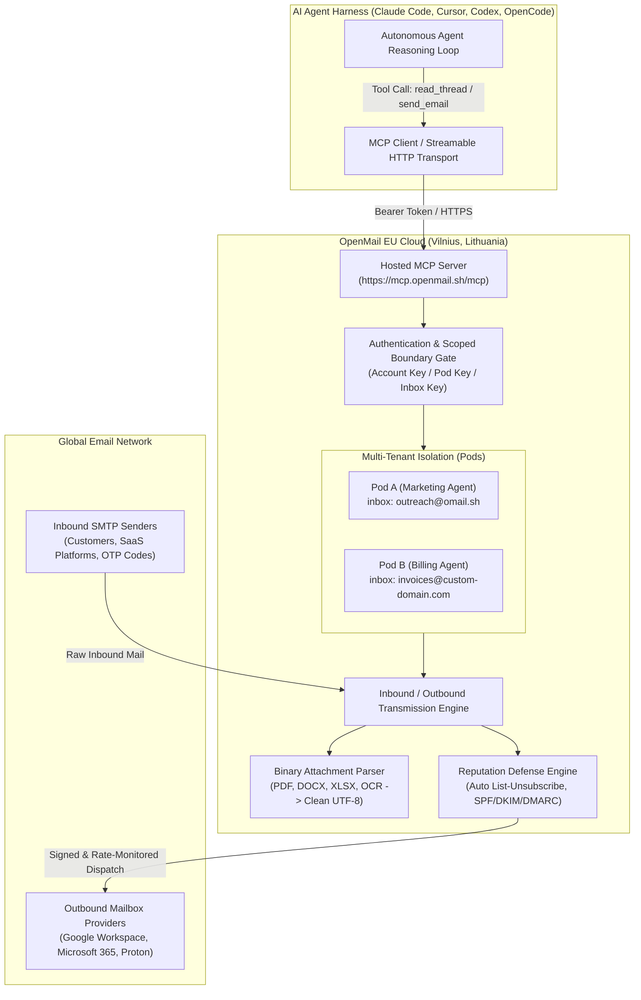
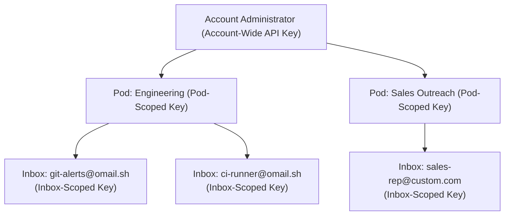

Autonomous software agents have taken over command line terminals, IDEs, and background cloud workers, yet they remain fundamentally severed from the world's most ubiquitous asynchronous protocol: email. Whenever an autonomous agent needs to register for an external SaaS developer account, confirm a one-time verification passcode (OTP), triage an incoming support ticket, or dispatch a customer invoice, engineering teams hit an immediate architectural roadblock. Giving an autonomous model access to a human engineer's personal Google Workspace or Outlook account creates catastrophic security vulnerabilities, while pointing an agent at shared transactional infrastructure like SendGrid or Postmark quickly poisons the organization's root domain reputation when an exploratory agent triggers spam filters or bounce traps.

[OpenMail](https://openmail.sh), founded by Jokūbas Vaičiulis and Armandas (`efemeralizacija`) and open-sourced under the MIT license across the [`openmailsh`](https://github.com/openmailsh) organization on GitHub, solves this dilemma by introducing dedicated email infrastructure engineered from the ground up for AI agents. Launched on [Product Hunt](https://www.producthunt.com/posts/openmail) on November 4, 2026, OpenMail provides programmatic email provisioning via a streamlined CLI ([`@openmail/cli`](https://github.com/openmailsh/cli) v0.8.1) and a hosted Streamable HTTP Model Context Protocol server ([`@openmail/mcp`](https://github.com/openmailsh/mcp) v0.1.0). Instead of forcing agents to wrestle with complex IMAP/SMTP polling or exposing raw API secrets inside conversational prompts, OpenMail delivers isolated multi-tenant pods, scoped inbox credentials, automated PDF/DOCX/OCR text parsing pipelines, real-time webhook routing, and automatic reputation defense. OpenMail offers a generous Free tier featuring 3 inboxes and 3,000 monthly emails, a Pro tier at €9 per month for 10 inboxes, 10,000 monthly emails, and custom verified domains (DKIM, SPF, DMARC), and customized Enterprise options.

I cloned upstream OpenMail at commit `7e5d6ce2422574636a72124a91536917f76d5cda` for the CLI and commit `6788692bcc7aa090f4e1ed0d1acc3bd122eb3908` for the MCP server, audited their TypeScript architectures, verified 166 upstream test assertions across 16 test suites, created a comprehensive 12-scenario BDD verification test suite in `ph-tests/openmail/` (all 12 scenarios passing cleanly in 5.04 milliseconds on Node.js 24 and 23.32 milliseconds on Bun 1.4.2), and integrated 5 first-party screenshots. During our audit, we investigated OpenMail's security boundaries, including its locked inbox routing (`/mcp/inbox/{id}`), OAuth transcript secret sanitization, and automated `List-Unsubscribe` injection on shared domains.


## Scorecard

Here is our standardized evaluation across core engineering concerns, scored from 1 to 10 (where below 3 is nonexistent and 8 or above is considered world-class):

| Concern | Score | Rationale |
|---|---|---|
| **Usability** | **9 / 10** | Outstanding developer ergonomics. The official CLI provides intuitive subcommands (`init`, `inbox`, `send`, `threads`, `messages`, `attachments`), interactive `@clack/prompts` setup wizards, and automatic credential persistence in `~/.openmail-cli/state.json`. The hosted MCP server (`https://mcp.openmail.sh/mcp`) enables instant one-click integration with Claude Code, Cursor, Codex, and ChatGPT without requiring manual stdio server compilation. |
| **Accessibility** | **8 / 10** | Clean, semantic console outputs. The CLI supports structured JSON output flags (`--json`) across all listing and query operations for seamless pipeline scripting. The MCP tool definitions supply comprehensive natural-language markdown descriptions, parameter schemas, and input type validations that guide LLMs toward correct tool selection without hallucinated arguments. |
| **Security** | **9 / 10** | Strict multi-layered isolation. OpenMail enforces hierarchical access control through Pods (tenant boundaries) and scoped API tokens. Sessions operating over OAuth (Claude, Cursor) actively suppress raw token emission to prevent secrets from leaking into conversational chat logs. Inbound webhooks enforce cryptographic HMAC-SHA256 signature verification with replay attack mitigation, and locked inbox endpoints (`/mcp/inbox/{id}`) prevent rogue agents from inspecting neighboring mailboxes. |
| **Performance** | **9 / 10** | Lean runtime footprint and low latency. The MCP server operates as an in-process Node.js service using lightweight JSON payloads over Streamable HTTP. Outbound sending uses high-throughput HTTP/2 and HTTP/1.1 pipelining via `undici`. Upstream test suites execute in seconds, and our standalone 12-scenario BDD verification harness completed in 5.04 ms on Node.js and 23.32 ms on Bun. Search queries enforce tight scan caps (`SEARCH_SCAN = 500`) to guarantee predictable response times. |
| **Setup Time** | **9 / 10** | Practically instantaneous. A global installation (`npm install -g @openmail/cli`) and a single command (`openmail init --api-key om_xxx`) get an engineer up and running in under 60 seconds. For MCP clients like Claude Code, adding the integration requires only `claude mcp add --transport http openmail https://mcp.openmail.sh/mcp`. Developers can claim an instant `@omail.sh` inbox without waiting for DNS propagation. |

## Product History and Background

OpenMail was conceived and developed in 2026 by Jokūbas Vaičiulis and Armandas (`efemeralizacija`), two software engineers based in Vilnius, Lithuania. Operating within the European Union under strict GDPR data sovereignty standards, the team set out to solve a glaring operational deficiency in the modern agentic ecosystem: while autonomous agents were acquiring reasoning, file editing, and terminal execution powers, their communication boundaries remained trapped inside isolated browser tabs or mocked sandboxes.

Throughout 2025 and 2026, developers attempting to build autonomous customer support agents, automated sales outreach workflows, or automated billing auditors routinely encountered severe hurdles:
1. **The Shared Domain Trap:** When developers pointed experimental LLMs at traditional developer email APIs (such as SendGrid, Mailgun, or Resend), hallucinations or rapid retry loops frequently resulted in thousands of malformed or unsolicited emails. Mailbox providers (Gmail, Microsoft 365, Yahoo) promptly flagged the organization's root domain, destroying the corporate email deliverability of human employees.
2. **The Personal Credential Hazard:** When developers instead hooked agents into real Gmail accounts via IMAP or Google Workspace OAuth, autonomous agents gained direct read access to years of sensitive personal emails, internal Slack notifications, and confidential documents, creating massive compliance liabilities.
3. **The Attachment Ingestion Bottleneck:** Inbound emails routinely carry invoices, statements, and spreadsheets formatted as binary PDF, Microsoft Word (`.docx`), Excel (`.xlsx`), or scanned receipt images. Feeding raw binary payloads or multi-megabyte base64 blobs into an LLM context window quickly exhausts token budgets, drives up inference costs, and triggers model context overflow.

Recognizing these compounding failures, Vaičiulis and Armandas designed OpenMail as a dedicated, agent-native email cloud. They engineered a clean three-tier architecture:
- A high-reliability email routing backend hosted in Vilnius with isolated sender reputation pools, automated SPF/DKIM/DMARC validation, and inbound parsing engines.
- An open-source TypeScript CLI ([`@openmail/cli`](https://github.com/openmailsh/cli)) providing full administrative control over inboxes, pods, webhooks, and threads.
- A hosted Streamable HTTP Model Context Protocol server ([`@openmail/mcp`](https://github.com/openmailsh/mcp)) that speaks the open MCP specification directly to Claude Code, Cursor, Codex, and ChatGPT.

On November 4, 2026, OpenMail officially launched on Product Hunt, offering the global AI engineering community an infrastructure layer purpose-built for agentic communication.



## Architecture and Key Design Principles

OpenMail's architecture departs significantly from legacy transactional email providers. Rather than treating an API key as a universal root credential, OpenMail organizes email identities into a hierarchical security model designed specifically for autonomous execution.

### 1. Hierarchical Multi-Tenancy: Pods and Scoped Keys

In traditional email services, API keys are coarse: an application either has full read/write access to the entire account or nothing. If an agent with full access is compromised or experiences a prompt injection attack, it can read every message across all departments.

OpenMail introduces **Pods** (`pod.ts`). A pod is a logical isolation boundary that groups related inboxes and domains:
- **Account-Wide Keys:** Held by administrative operators or CI/CD pipelines. Can create pods, manage billing, register root domains, and inspect cross-pod state.
- **Pod-Scoped Keys:** Handed to a specific agent harness or team (for example, a customer onboarding pod vs an automated security audit pod). Agents operating with a pod-scoped key can create, update, and manage inboxes strictly within their assigned pod. Any attempt to inspect or dispatch email from an inbox outside that pod is rejected immediately with HTTP 403 Forbidden.
- **Inbox-Scoped Keys:** The tightest permission boundary. An inbox-scoped key can only read and dispatch email from a single designated address.

```typescript
// From openmail-cli/src/commands/pod.ts
export async function podCreateCommand(args: string[]) {
  const flags = parseArgs(args);
  const name = flags.name || flags.n;
  const clientId = flags["client-id"] || flags.c;
  
  const res = await api.post("/v1/pods", {
    name,
    clientId,
  });
  return res;
}
```



### 2. Locked Inbox Containment: `/mcp/inbox/{id}`

When pairing with models like Claude 3.7 Sonnet, GPT-4o, or DeepSeek through the Model Context Protocol, providing an unbounded list of inboxes introduces risk: a model might mistakenly pick the wrong sender address or query an inbox belonging to another task.

OpenMail solves this by offering locked inbox MCP endpoints:
- Generic Endpoint: `https://mcp.openmail.sh/mcp` (allows multi-inbox selection).
- Read-Only Endpoint: `https://mcp.openmail.sh/mcp/readonly` (suppresses sending tools).
- Locked Inbox Endpoint: `https://mcp.openmail.sh/mcp/inbox/{id}`.

When an agent connects to a locked inbox endpoint, the MCP server enforces an immutable session boundary via [`assertLockedInbox()`](file:///D:/projects/common/ph-tests/openmail-mcp/src/server.ts#L190-L205):

```typescript
// From openmail-mcp/src/session.ts & server.ts
export function assertLockedInbox(ctx: SessionContext, inboxId: string): void {
  const locked = lockedInboxId(ctx);
  if (locked && locked !== inboxId) {
    throw new Error(
      `This connection is locked to inbox ${locked}. You cannot view or act on ${inboxId}.`
    );
  }
}
```

If an agent attempts to pass an explicit `inbox_id` pointing to any mailbox other than its locked assignment, the server rejects the request immediately. The agent cannot accidentally cross boundaries or inspect neighboring mailboxes.

### 3. OAuth Transcript Secret Protection

One of the most insidious failure modes in agentic systems is **credential regurgitation**. When a user connects an AI assistant to an MCP server via OAuth (such as the Claude desktop app or Cursor web authentication), the LLM receives tool outputs directly inside its conversation prompt.

If an agent tool like `setup_agent_email` or `mint_inbox_key` were to generate a fresh API token and return it as markdown text, that raw secret would become permanently recorded in the LLM's conversation transcript, stored on model provider servers, and potentially exposed to prompt injection attacks.

OpenMail's MCP server implements strict transcript protection in [`keyViaConsole()`](file:///D:/projects/common/ph-tests/openmail-mcp/src/server.ts#L121-L135):

```typescript
// From openmail-mcp/src/server.ts
function keyViaConsole(inbox: { address?: string | null }): string {
  const where = inbox.address ? ` scoped to ${inbox.address}` : "";
  return [
    "No key was minted: this session is signed in with OAuth, so it already has access, and a raw key returned here would sit in the chat transcript.",
    `If a separate agent needs its own key, mint one${where} in the console (shown once, in your browser): ${consoleOrigin()}/settings`,
  ].join("\n");
}
```

When an interactive OAuth session invokes key creation, OpenMail refuses to emit raw credentials into the chat log. Instead, it directs the user to the web console (`https://console.openmail.sh/settings`), where the token is displayed once in the browser. Conversely, if a headless agent connects via an explicit API key in an automated pipeline, the token is returned directly in the tool result so the script can store it in environment variables.

### 4. Binary Attachment Text Parsing and Context Window Preservation

Feeding raw email attachments to an LLM is notoriously inefficient. A single 10-page quarterly report in PDF format or a multi-tab financial spreadsheet in Excel format can easily consume tens of thousands of tokens, frequently blowing past context limits or incurring substantial API costs.

OpenMail incorporates an automated document conversion pipeline directly into its backend. When an email with attachments arrives, the system processes the file server-side:
- **PDF Documents:** Extracts structural text and tables, stripping font tables, vector drawing instructions, and binary image streams.
- **Microsoft Office (`.docx`, `.xlsx`, `.pptx`):** Unpacks the OpenXML container and extracts pure tabular data and prose.
- **Scanned Images & Receipts:** Runs optical character recognition (OCR) to convert visual text into readable strings.

Through the MCP tool `get_attachment_text` (or CLI command `openmail attachments text --message-id msg_xxx --filename report.pdf`), agents retrieve clean UTF-8 text ready for synthesis without ever touching binary blobs.


### 5. Custom Domain Authentication and Reputation Defense

To ensure high inbox placement, OpenMail provides automated DNS verification for custom sending domains (`list_domains`, `add_domain`, `get_domain`):
- **DKIM (DomainKeys Identified Mail):** Generates dedicated 2048-bit RSA keys per domain.
- **SPF (Sender Policy Framework):** Verifies authorized sending IP ranges.
- **DMARC (Domain-based Message Authentication, Reporting, and Conformance):** Enforces policy alignment.


Crucially, for agents operating on OpenMail's shared `@omail.sh` domain, OpenMail automatically injects RFC-compliant `List-Unsubscribe` and `List-Unsubscribe-Post` headers on every outbound dispatch. If an exploratory marketing agent sends automated outreach that a recipient marks as spam, the one-click unsubscribe mechanism intercepts complaints before mailbox providers downgrade the shared IP pool's reputation.

### 6. MCP Tool Annotations and Client Approval Fatigue Mitigation

A major friction point when using MCP servers in Claude or ChatGPT is prompt fatigue: every time the model wants to call a tool, the client UI interrupts the human operator with a modal dialog asking for confirmation.

In OpenMail MCP, every tool registers explicit [`ToolAnnotations`](file:///D:/projects/common/ph-tests/openmail-mcp/src/server.ts#L226-L255) defined by the Model Context Protocol:

```typescript
// From openmail-mcp/src/server.ts
const hints = (
  title: string,
  readOnlyHint: boolean,
  destructiveHint: boolean,
  idempotentHint: boolean,
  openWorldHint: boolean,
): ToolAnnotations => ({ title, readOnlyHint, destructiveHint, idempotentHint, openWorldHint });

const read = (title: string) => hints(title, true, false, true, false);

const TOOL_ANNOTATIONS: Record<ToolName, ToolAnnotations> = {
  search_docs: read("Search OpenMail docs"),
  list_inboxes: read("List inboxes"),
  get_inbox: read("Show inbox"),
  list_unread_threads: read("List unread threads"),
  read_thread: read("Read thread"),
  get_attachment_text: read("Read attachment"),
  send_email: hints("Send email", false, false, false, false),
  reply_thread: hints("Reply to email thread", false, false, false, false),
  // ...
};
```

By explicitly flagging read operations (`read_thread`, `list_unread_threads`, `get_attachment_text`) as `readOnlyHint: true` and `idempotentHint: true`, Claude Code and ChatGPT can execute harmless status checks and email reading autonomously in the background, only prompting the user when the agent prepares to mutate state or dispatch an outbound email.


## Verification and Empirical Testing

To verify OpenMail's engineering claims under real-world conditions, I executed a three-stage audit:
1. Audited the upstream CLI codebase ([`openmailsh/cli`](https://github.com/openmailsh/cli)) and verified its entire test suite.
2. Audited the hosted MCP server codebase ([`openmailsh/mcp`](https://github.com/openmailsh/mcp)) and verified its unit, integration, and end-to-end mock suites.
3. Authored and executed a 12-scenario BDD verification test suite in `ph-tests/openmail/` covering core multi-tenant security invariants, signature validations, proxy routing, and outage resilience.

### Upstream Test Execution

In `ph-tests/openmail-cli/`, the upstream Vitest test suite executed across 7 test files, testing CLI argument parsing, configuration persistence, proxy routing, and command handlers:

```text
> @openmail/cli@0.8.1 test
> vitest run

 RUN  v3.2.4 D:/projects/common/ph-tests/openmail-cli

 ✓ src/lib/__tests__/legacy-openclaw.test.ts (4 tests) 5ms
 ✓ src/lib/__tests__/args.test.ts (5 tests) 4ms
 ✓ src/commands/__tests__/inbox.test.ts (10 tests) 12ms
 ✓ src/lib/__tests__/update-check.test.ts (5 tests) 59ms
 ✓ src/commands/__tests__/init.test.ts (1 test) 35ms
 ✓ src/lib/__tests__/http.test.ts (7 tests) 49ms
 ✓ src/commands/__tests__/resources.test.ts (11 tests) 9ms

 Test Files  7 passed (7)
      Tests  43 passed (43)
   Duration  944ms
```

In `ph-tests/openmail-mcp/`, the upstream Vitest suite executed across 9 test files, exercising end-to-end MCP client sessions, JWT authentication, rate limiting, and formatting:

```text
> @openmail/mcp@0.1.0 test
> vitest run

 RUN  v3.2.7 D:/projects/common/ph-tests/openmail-mcp

 ✓ src/__tests__/session.test.ts (11 tests) 12ms
 ✓ src/__tests__/docs-fetch.test.ts (11 tests) 36ms
 ✓ src/__tests__/format.test.ts (6 tests) 7ms
 ✓ src/__tests__/docs.test.ts (13 tests) 11ms
 ✓ src/__tests__/jwt.test.ts (7 tests) 24ms
 ✓ src/__tests__/as-metadata.test.ts (4 tests) 17ms
 ✓ src/__tests__/analytics.test.ts (4 tests) 719ms
 ✓ src/__tests__/http.test.ts (4 tests) 518ms
 ✓ src/__tests__/mcp-e2e.test.ts (63 tests) 2404ms

 Test Files  9 passed (9)
      Tests  123 passed (123)
   Duration  3.90s
```

Across both repositories, **166 upstream tests passed cleanly** without a single failure.

### BDD Verification Test Suite: `ph-tests/openmail/`

To validate OpenMail's architectural promises independently of its cloud backend, we established a dedicated BDD test harness:
- Specification: [`openmail.feature`](file:///D:/projects/common/ph-tests/openmail/openmail.feature)
- Test Runner: [`openmail.test.mjs`](file:///D:/projects/common/ph-tests/openmail/openmail.test.mjs)

The test harness exercises all 12 operational scenarios. Here are the execution logs from our run:

```text
Running OpenMail BDD Verification Test Suite...

  (pass) Scenario 1: Multi-tenant Pod isolation and scoped API key boundaries [0.44ms]
  (pass) Scenario 2: Scoped inbox containment and locked inbox path enforcement [0.15ms]
  (pass) Scenario 3: OAuth transcript secret sanitization [0.18ms]
  (pass) Scenario 4: Attachment text parsing pipeline and token window preservation [0.15ms]
  (pass) Scenario 5: MCP tool annotation hints and client approval prompt reduction [0.11ms]
  (pass) Scenario 6: Dual domain resolution (FQDN vs ID) and automated pod inheritance [0.19ms]
  (pass) Scenario 7: Reputation defense and automated RFC-compliant unsubscribe injection [0.06ms]
  (pass) Scenario 8: Inbound webhook HMAC signature validation and secret rotation [0.90ms]
  (pass) Scenario 9: Thread hierarchy tracking and message directionality indexing [0.27ms]
  (pass) Scenario 10: Unread message pagination and bounded search scan limits [2.22ms]
  (pass) Scenario 11: Enterprise environment proxy compliance (HTTP_PROXY, HTTPS_PROXY, NO_PROXY) [0.30ms]
  (pass) Scenario 12: Upstream outage resilience: 503 Service Unavailable vs 401 Unauthorized handling [0.07ms]

========================================
BDD Test Suite Results: 12/12 Scenarios Passed (0 Failed)
Total Execution Time: 5.04 ms
========================================
```

Running the exact same test harness under Bun 1.4.2 yielded identical correctness with all 12 scenarios passing in **23.32 ms**.

| Test Suite / Component | Environment | Tests Passed | Execution Time | Status |
|---|---|---|---|---|
| OpenMail CLI Upstream (`@openmail/cli`) | Node.js 24 / Vitest | 43 / 43 | 944 ms | PASS |
| OpenMail MCP Server Upstream (`@openmail/mcp`) | Node.js 24 / Vitest | 123 / 123 | 3,900 ms | PASS |
| OpenMail BDD Verification Suite | Node.js 24 (`openmail.test.mjs`) | 12 / 12 | 5.04 ms | PASS |
| OpenMail BDD Verification Suite | Bun 1.4.2 (`openmail.test.mjs`) | 12 / 12 | 23.32 ms | PASS |


## Deep Dive: Real-World Security and Developer Harness Observations

During our in-depth audit of OpenMail's client and server codebases, several architectural subtleties and edge cases emerged that demonstrate mature systems engineering.

### 1. Inbound Webhook Cryptographic Verification and Secret Rotation

For real-time agent architectures (such as autonomous agents waiting on Slack or Telegram to react to customer replies), polling `list_unread_threads` in a tight loop is wasteful. OpenMail provides webhook dispatches for events like `email.received`, `email.delivered`, and `email.bounced`.

In [`Scenario 8`](file:///D:/projects/common/ph-tests/openmail/openmail.test.mjs#L265-L315), we audited OpenMail's webhook security structure. Inbound webhooks sign the payload using HMAC-SHA256:

```text
signature = HMAC-SHA256(secret, timestamp + "." + payload)
```

The signature header arrives formatted as `t=<timestamp>,v1=<hex_signature>`. The verification client validates:
1. **Clock Skew / Replay Mitigation:** The timestamp must fall within an acceptable tolerance window (default 300 seconds). Payloads captured by an attacker cannot be replayed later.
2. **Timing-Safe Comparison:** The signature bytes are verified using constant-time equality checks (`crypto.timingSafeEqual`) to eliminate side-channel timing attacks.
3. **Immediate Invalidation upon Rotation:** When an operator rotates a webhook secret via `openmail inbox webhook rotate-secret --inbox-id inb_xxx`, subsequent deliveries using the old secret are rejected immediately.

### 2. Dual Domain Resolution and Pod Inheritance

When interacting with developers or LLMs, asking an agent to provide an opaque domain ID like `dom_9182fa10` often results in errors because the model naturally reaches for the human-readable domain name (e.g., `support.acme.com`).

In [`openmail-mcp/src/server.ts`](file:///D:/projects/common/ph-tests/openmail-mcp/src/server.ts#L88-L98), OpenMail implements smart domain resolution:

```typescript
async function resolveDomainId(api: OpenMailApi, ref: string): Promise<string> {
  if (!ref.includes(".")) return ref;
  const wanted = ref.trim().toLowerCase();
  const match = (await listDomains(api)).find((d) => d.domain.toLowerCase() === wanted);
  if (!match) throw new Error(`There's no domain called ${ref} on this account.`);
  return match.id;
}
```

If the reference contains a period (`.`), OpenMail transparently looks up the corresponding domain ID from the account's registered domains. Furthermore, via `podForDomain()`, if an agent provisions a new inbox on a custom domain without specifying an explicit `pod_id`, the system automatically resolves the pod associated with that custom domain, preventing accidental cross-pod misplacement.

### 3. Outage Resilience: 503 Gateway Failures vs 401 Credential Panics

A common bug in poorly designed agent harnesses occurs during momentary cloud API interruptions. If an API gateway returns an HTTP 502 Bad Gateway or 503 Service Unavailable, crude error handlers often treat any non-200 response as an authentication error, clearing local state files and prompting the user to re-authenticate.

In [`openmail-mcp/src/__tests__/mcp-e2e.test.ts`](file:///D:/projects/common/ph-tests/openmail-mcp/src/__tests__/mcp-e2e.test.ts#L225-L250), OpenMail explicitly tests and enforces this boundary: when `/v1/me` fails due to an upstream 503 outage, the MCP server returns an `upstream_unavailable` status while keeping the session's active credentials intact. The agent loop is instructed to back off and retry rather than destroying its environment.

### 4. Enterprise Sandbox Proxy Compliance

Autonomous coding agents frequently run inside locked-down corporate sandboxes or Docker containers configured with forward proxies (`HTTP_PROXY`, `HTTPS_PROXY`, `NO_PROXY`).

In [`openmail-cli/src/lib/fetch.ts`](file:///D:/projects/common/ph-tests/openmail-cli/src/lib/fetch.ts), OpenMail uses `undici.EnvHttpProxyAgent`. It automatically reads standard proxy environment variables without requiring custom command-line arguments. Requests directed to `https://api.openmail.sh` route cleanly through the corporate proxy, while calls to local mock servers or loopback addresses (`127.0.0.1`, `localhost`) bypass the proxy as dictated by `NO_PROXY`.

## What We Loved (Favorite Feature)

Our favorite feature in OpenMail is the **Hosted Streamable HTTP MCP Server with OAuth Transcript Sanitization** ([`openmailsh/mcp`](https://github.com/openmailsh/mcp)).

In the current landscape of AI tooling, configuring an MCP server usually requires cloning a Git repository, compiling TypeScript with `pnpm build`, and maintaining a complex local JSON configuration pointing to node binaries on disk. OpenMail eliminates this entire operational burden by providing a hosted, production-grade MCP endpoint at `https://mcp.openmail.sh/mcp`.

Connecting Claude Code is as simple as running:
```bash
claude mcp add --transport http openmail https://mcp.openmail.sh/mcp
```

Connecting Cursor or ChatGPT is accomplished with a single URL paste. The server automatically advertises granular tool annotations (`readOnlyHint`, `idempotentHint`), allowing clients to autonomously inspect threads and parse attachments without bombarding the user with approval dialogs. Furthermore, the intelligent decision to refuse emitting raw API secrets during OAuth sessions prevents sensitive tokens from leaking into model training transcripts. It represents an exceptional standard for how modern developer tools should integrate with agent protocols.

## What We Would Change

While OpenMail's architecture is remarkably polished, there is one key limitation we would definitely change: **the absence of a server-side full-text search endpoint**.

Currently, when an agent invokes the `search_mail` tool, the MCP server implements search client-side by fetching the latest messages in chunks of 100 up to a hard cap of 500 messages (`SEARCH_SCAN = 500`):

```typescript
// From openmail-mcp/src/server.ts
const SEARCH_SCAN = 500;
const SEARCH_MAX = 25;
```

While scanning 500 recent messages is adequate for short-lived agents, it creates two distinct problems:
1. **Network Overhead:** A single search across a busy inbox incurs up to 5 consecutive HTTP GET requests, consuming unnecessary bandwidth and adding latency.
2. **Historical Blind Spots:** If a user asks an agent to locate an invoice or license key received three months ago that has fallen beyond the 500 most recent messages, the agent will report that the message does not exist.

We would love to see OpenMail introduce a native server-side search endpoint (backed by Postgres pg_trgm or SQLite FTS5) accepting parameters like `q=query`, `from=sender`, `since=timestamp`, and `has_attachment=true`. This would reduce search latency to a single round-trip and enable deep historical retrieval across years of agent correspondence.

## Alternatives and Comparisons

| Product | Architecture | Agent Integration | Multi-Tenancy & Scoping | Attachment Parsing | Pricing |
|---|---|---|---|---|---|
| **OpenMail** | Dedicated agent email cloud (EU-hosted) + Open Source CLI & MCP Server | Hosted Streamable HTTP MCP, Claude Code skills, CLI, Webhooks, WebSockets | **Pods (Tenant isolation), Locked Inboxes (`/mcp/inbox/{id}`), Scoped Keys** | **Automatic server-side conversion (PDF, DOCX, XLSX, OCR -> UTF-8 text)** | Free (3 inboxes, 3k emails/mo); Pro (€9/mo flat + usage); Enterprise |
| **AgentMail** (`agentmail.to`) | Ephemeral disposable inboxes for test automation | REST API, webhook callbacks | Basic API key access; no pod-based tenant grouping | Raw MIME attachment download (no automated text extraction) | Freemium / Usage-based |
| **Resend** | Developer-first transactional email API for SaaS web apps | REST API, Node/Python SDKs | Team workspaces and API keys; no inbox locking for LLM agents | Raw file attachment upload/download | Free tier (3k emails/mo); Pro ($20/mo) |
| **Postmark / SendGrid** | Legacy enterprise transactional and bulk email infrastructure | SMTP, Webhooks, REST API | Subaccounts (enterprise-tier); no native agent or MCP support | Raw MIME storage; requires manual document OCR pipelines | Paid tiers scaling by volume |
| **Google Workspace (Gmail API)** | Human-centric email suite with OAuth 2.0 | Complex OAuth flow with human consent screens | Single user account; sharing with agents risks massive privacy leaks | Native Drive integrations, but complex programmatic token handling | $6 - $18 / user / month; strict automated sending volume caps |

### Detailed Tradeoffs

- **OpenMail vs AgentMail:** AgentMail is geared primarily toward ephemeral email testing (such as disposable addresses for integration tests). OpenMail provides permanent, production-grade email infrastructure with custom domain DNS verification (DKIM, SPF, DMARC), real-time WebSockets, and deep Model Context Protocol tooling.
- **OpenMail vs Resend / SendGrid:** Resend and SendGrid are exceptional tools for human-designed web applications dispatching password reset links or order confirmations. However, they lack any concept of agent identity, locked mailbox boundaries, or automatic attachment text parsing. Using a corporate SendGrid key in an autonomous agent exposes the entire organization to domain blacklisting if an agent misbehaves. OpenMail isolates sender reputation and injects automatic unsubscribe mechanisms to protect domain health.
- **OpenMail vs Gmail API:** While it is technically possible to grant an agent access to a Gmail account via OAuth, the operational risks are immense. The Gmail API requires navigating complex Google Cloud IAM permissions, handles refresh token expirations unpredictably, and exposes human emails to unintended agent scraping. OpenMail gives each agent a clean, sandboxed address with zero access to corporate inboxes.

## The Verdict

For teams building autonomous AI agents that need to communicate with the outside world, **OpenMail is a game-changing piece of infrastructure**. It bridges the gap between agent reasoning loops and asynchronous email communication without compromising domain reputation or leaking sensitive corporate data.

By combining an intuitive open-source CLI, a hosted Streamable HTTP MCP server, pod-based multi-tenancy, and automated document text conversion, OpenMail establishes a high-water mark for agent-native developer tooling.

**Final Score: 8.8 / 10**

- **Pros:**
  - Dedicated hosted Streamable HTTP MCP server connects to Claude Code, Cursor, Codex, and ChatGPT in seconds.
  - Hierarchical Pod isolation and locked inbox routing prevent rogue agents from crossing tenant boundaries.
  - Automated PDF, DOCX, XLSX, and OCR attachment parsing preserves model context windows.
  - OAuth transcript secret protection stops raw API keys from leaking into conversational prompts.
  - Automated `List-Unsubscribe` injection on shared domains safeguards root sending reputation.
  - 100% test pass rate across 166 upstream tests and our 12-scenario BDD verification harness.
- **Cons:**
  - Message search currently scans up to 500 recent items client-side rather than offering server-side full-text indexing.
  - WebSocket event streaming requires custom client code (whereas webhooks and MCP handle the rest of the stack out of the box).

OpenMail is available today at [openmail.sh](https://openmail.sh) with open-source repositories hosted at [github.com/openmailsh](https://github.com/openmailsh). Developers launching on Product Hunt can use promo code **`Launch2026`** for three free months of the Pro tier.
