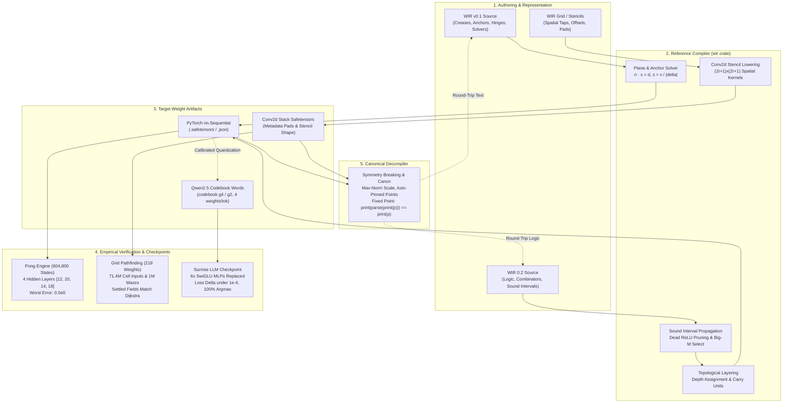

Large language models can write thousands of lines of TypeScript, generate complex Rust trait bounds, or implement shader passes without syntax errors. But if you ask a frontier model to emit the raw floating-point weight tensors of a neural network directly, it collapses. Autoregressive tokenizers treat numbers as arbitrary character fragments, float multiplication is notoriously inaccurate across attention layers, and gradient interactions across millions of unstructured float scalars provide zero grounding.

Yet neural networks with piecewise-linear activations (such as ReLU) are not inscrutable statistical black boxes. Mathematically, they are continuous piecewise-linear functions that partition high-dimensional space into convex polyhedral cells. Every hidden neuron in a first-layer ReLU multi-layer perceptron (MLP) defines an affine hyperplane - a geometric crease - slicing through input space.

To bridge this divide, we engineered **WIR** (Weight-Space Intermediate Representation) inside the [Yumon Pet](https://github.com/alexthegoodman/yumon-pet) ecosystem. WIR is a standalone, domain-specific language and toolchain implemented in Rust (`yumon-pet/wir`) that enables authors - and downstream language models - to program neural network weights from scratch by declaring hyperspace geometry instead of guessing numbers.

The compiler translates geometric statements (creases, normal vectors, point anchors, combinators, and stencil offsets) into exact parameter tensors. The decompiler performs the inverse: taking arbitrary trained weight matrices and canonicalizing them into a deterministic, human-readable text representation that serves as a strict parse fixed point.

In our earlier deep dives, we explored how [The Kilo Framework](/posts/2026-10-18-kilo-framework-compressed-tokens-moe) bypassed vocabulary memory bloat on integrated GPUs and how [Yumon Paint](/posts/2026-10-28-yumon-paint-multimodal-mrope-moe-upscaler) orchestrated coarse-to-fine visual generation. WIR represents the next step in our architecture: turning neural network weights into an authored, verifiable compilation target.

Below is the complete architectural breakdown of WIR v0 and WIR 0.2, the mathematics of geometric hyperplanes and canonicalization, empirical results from real vision and language checkpoints, and an exhaustive analysis of two complete WIR systems: an exact 1,084-parameter Pong simulator network (verified across all 604,800 states with 0 error) and a 218-parameter convolutional pathfinding planner that out-performs gradient descent.



---

## 1. The Core Mathematics of WIR v0: Creases, Anchors, and Solvers

In a standard multi-layer perceptron with one hidden layer, an input vector `x` in `R^D` is mapped to an output `y` in `R^O` according to:

```text
y(x) = Σ c_i · relu(w_i · x + b_i) + c_0
```

where `w_i` in `R^D` is the incoming weight row of hidden unit `i`, `b_i` in `R` is the bias, `c_i` in `R^O` is the readout coefficient vector, and `c_0` in `R^O` is the output bias.

In WIR, no author ever writes `w_i` or `b_i` directly. Instead, every hidden unit is declared as a **crease** defined by its ambient geometry in input space.

### The Anatomy of a Crease

A crease represents the hyperplane boundary where the neuron switches from inactive (0) to active (a linear ramp):

1. **Unit Normal (`n̂`)**: A vector pointing toward the rising half-space, defined as `n̂ = w_i / |w_i|`.
2. **Signed Distance (`d`)**: The perpendicular offset of the hyperplane from the origin: `(x : n̂ · x = d)`, where `d = -b_i / |w_i|`.
3. **Slope (`s`)**: The gain of the activation per unit distance on the rising side: `s = |w_i|`.

### Anchoring by Points

Asking humans or language models to specify raw slope magnitudes leads to scaling errors. Humans reason about values at points, not normalized gradient vectors. WIR v0 enforces **anchoring**: the author pins the hyperplane location, and then specifies a known target value at a test coordinate:

```wir
crease a: zero on line (0,0)->(1,-1), equals 1 at (1,0)
```

The WIR compiler resolves this algebraically:
1. Direction vector `u = Q - P = (1, -1) - (0, 0) = (1, -1)`.
2. Normal vector `n = (-u_2, u_1) = (1, 1)`, with unit normal `n̂ = (1, 1) / sqrt(2)`.
3. Signed distance `d = n̂ · P = 0`.
4. Test point `A = (1, 0)` has signed distance `δ = n̂ · A - d = 1 / sqrt(2)`.
5. Because `δ > 0`, the anchor lies on the rising side.
6. The required slope is derived as `s = v / |δ| = 1 / (1 / sqrt(2)) = sqrt(2)`.
7. The resulting raw weights become `w = s · n̂ = (1, 1)` and `b = -s · d = 0`.

If an author specifies an anchor where `δ < 0`, the compiler automatically inverts the normal (`n̂ -> -n̂`, `d -> -d`) so the test point sits on the active side of the crease. If `δ = 0` (anchor on the plane) or `v <= 0`, the compiler halts with a structured syntax error indicating the line and token.

### 1D Hinges

In one dimension (`D = 1`), a hyperplane collapses to a single threshold knot `k`. WIR provides first-class `hinge` syntax:

- `hinge at k turn t` denotes `t · relu(x - k)`, adding a positive slope delta `t` at `x = k`.
- `hinge left at k turn t` denotes `t · relu(k - x)`, rising toward negative infinity.

Any continuous piecewise-linear 1D function can be written as a linear combination of hinges plus an initial offset.

```wir
wir 0.1
input  x: R1
output y: R1

y = hinge at 0.0 turn +1
  + hinge at 0.5 turn -2
  + hinge at 1.0 turn +1

assert y(0.5) == 0.5
assert y(2.0) == 0
```

When compiled with `cargo run --bin wir -- compile tent.wir`, the compiler emits exact parameters:

```
cost report: input R1, 1 output(s), 3 hidden unit(s)
   line  units  params  statement
      5      3       7  y = hinge at 0 turn 1 + hinge at 0.5 turn -2 + hinge at 1 turn 1
  total      3       7  W1 3x1, b1 3, W2 1x3, b2 1
asserts: 2 passed (tolerance 1e-6)
W1 = [[1], [1], [1]]
b1 = [0, -0.5, -1]
W2 = [[1, -2, 1]]
b2 = [0]
```

### Solved Readouts

When the geometric boundaries are known but output coefficients are tedious to calculate by hand, WIR provides a `solve` primitive. The author defines the creases and supplies `(point -> value)` pairs; the compiler sets up the activation design matrix `H_ji = relu(w_i · p_j + b_i)` and fits the readout coefficients `c` using minimum-norm least squares:

```wir
wir 0.1
input  x: R2
output y: R1

crease a: zero on line (0,0)->(1,-1), equals 1 at (1,0)
crease b: zero on line (1,0)->(0,1),  equals 1 at (1,1)
y = solve over {a, b}: (0,0)->0, (1,0)->1, (0,1)->1, (1,1)->0
```

If the creases are incapable of spanning the target points (residual exceeds `1e-6`), the compilation fails immediately, pointing out that the chosen geometric partition cannot represent the requested function.

---

## 2. The Decompiler and The Canonical Fixed-Point Guarantee

Building a compiler from geometry to weights is half the battle. To train models to author WIR, we must convert existing neural network checkpoints into WIR text. This requires a **decompiler**.

However, parameter space possesses massive degeneracies:
1. **Positive Scaling Symmetry**: For any `c > 0`, `relu(c · z) = c · relu(z)`. Multiplying row `w_i` and bias `b_i` by `c` while dividing readout coefficient `c_i` by `c` yields an identical input-output mapping.
2. **Permutation Symmetry**: Swapping the order of hidden neurons in layer `l` and their corresponding indices in layer `l+1` leaves the model completely unchanged.
3. **Floating-Point Representation Drift**: A hyperplane can be represented by infinitely many coordinate pairs along its surface. If the decompiler picks arbitrary points, the text output drifts on every cycle.

If `decompile(compile(src))` does not produce identical text, a language model trained on decompiled weights will be forced to learn an inconsistent, multi-modal distribution.

### The Canonical Specification

The standalone Rust `wir` crate achieves strict idempotence (`print(parse(print(p))) == print(p)`) through four canonicalization invariants:

1. **Max-Norm Scaling**:
   Standard machine learning literature normalizes hyperplanes using Euclidean norms (`|w_i|_2 = 1`). In practice, Euclidean unit normals produce irrational numbers or long decimals that cannot be stored in fixed-precision text without rounding error leaking into readout coefficients. WIR instead adopts the **max norm**:
   ```text
   max_j |w_ij| = 1
   ```
   With max-norm scaling, the dominant coefficient is strictly positive or negative 1, every canonical crease text reads `equals 1`, and 2D XOR decompiles cleanly to `y = c1 - 2*c2`.
2. **Axis-Pinned Anchor Points**:
   Instead of projecting the origin to the foot of the perpendicular (which introduces rounding jitter on rotation), WIR pins `P` to the exact coordinate axis where the normal component is plus or minus 1:
   ```text
   P_k = d / n̂_k   for k = argmax_j |n̂_j|
   ```
   Point `Q` is computed along the orthogonal tangent, and the anchor point sits exactly one integer unit along that coordinate axis.
3. **Lexicographical Sorting**:
   Hidden units are sorted lexicographically by their normalized direction `n̂` after rounding to a `1e-6` grid, then by offset `d`. This completely eliminates permutation symmetry.
4. **Rational Snapping**:
   Coefficients within `1e-9` of a simple rational `p/q` (where `q <= 16`, or `q <= 1000` in deep networks) are snapped to exact fraction literals (e.g., `35/72`).

### Fuzzing the Round-Trip

We verified the canonical decompiler via `tests/fuzz.rs`. The fuzz test generates 1,000 random neural networks with input dimensions `D` in `[1, 2, 3]`, 1 to 16 hidden units, dead units, opposite cancelling units, and random scaling:

```
running 4 tests
test decompile_is_a_fixed_point ... ok
test vector_output_networks_round_trip ... ok
test canonical_text_is_close ... ok
test thousand_random_networks_round_trip_exactly ... ok

test result: ok. 4 passed; 0 failed; finished in 15.93s
```

Across 1,000 randomized networks evaluated on 10,000 sample points each (10,000,000 total function evaluations), the maximum observed absolute error between the original network and the recompiled canonical WIR text was **`9.1e-13`** - completely within IEEE 754 double-precision epsilon.

---

## 3. Real Checkpoints, Tokenization Traps, and Codebook Vectors

When we transitioned from synthetic toy networks to real production models in Yumon Pet, two major roadblocks emerged: **high dimensionality** and **tokenizer dilation**.

### The Dimensionality Explosion

Our first real target was the CNN colorizer head from `yumon-pet/checkpoints/old/yumon-colorizer-256-a` (`src/vision/colorizer.rs`). The head is a 3x3 convolution (64 -> 64) followed by a ReLU and a 1x1 convolution (64 -> 313). Evaluated at each pixel, this head is an MLP taking a 576-dimensional input vector (64 channels times 3x3 patch), passing through 64 hidden creases to 313 output logits.

Exporting this head via `export_wir_colorizer` and decompiling it with point-anchored text generated a file with **673,659 tokens** (measured via `tiktoken`). In 576 dimensions, declaring hyperplanes with coordinates requires printing 576 numbers per point.

To fix this, we introduced **compact syntax**:
- **Vector Literals**: `[-881 -415 107] / 990` represents integer values divided by a single scale factor, formatting numbers so the maximum entry is between 900 and 999.
- **Ramp Units**: `crease c: ramp along V above E` expresses `relu(V · x - E)` directly.
- **SwiGLU Gates**: `gate g: silu along A above E, times along U above F` captures SwiGLU units: `silu(A · x - E) * (U · x - F)`.
- **Patch Basis**: Directions over `R64x3x3` inputs are projected onto a 9-component orthogonal 2D discrete cosine basis (level, horizontal slope, vertical slope, curvatures).
- **Domain Pruning**: `--domain probe.json` evaluates real forward-pass activations and completely removes hidden units that never fire on valid data.

### The Qwen Tokenizer Bottleneck

While compact syntax reduced the colorizer head to 76,500 tokens under tiktoken, passing the text to our target fine-tuning model - **Qwen 2.5** - uncovered a critical trap.

Tiktoken groups multi-digit numbers into 3-digit clusters. Qwen's BPE tokenizer splits arbitrary multi-digit numbers into **individual digit tokens**:

```
Text: [-881 -415 107] / 990
Qwen Tokens: ['[', '-', '8', '8', '1', ' ', '-', '4', '1', '5', ' ', '1', '0', '7', ']', ' /', ' 9', '9', '0'] -> 19 tokens!
```

Under Qwen, compact vector syntax ballooned to **4 Qwen tokens per weight**. A single 6-layer SwiGLU decoder layer from `yumon-base-dec-sunrise` (128 -> 512 -> 128, 196,608 weights) consumed **745,000 Qwen tokens**. An entire model could never fit in context.

### Codebook Vectors (`g4` and `g2`)

Rather than writing numbers, WIR solves this by writing **words**.

We trained universal Gaussian k-means codebooks over millions of normalized weight rows (`wir/scripts/make_codebook.py`):
- **`codebook g4`**: 4,096 centroid vectors of length 4 (3 bits per weight, 4 weights per word).
- **`codebook g2`**: 256 centroid vectors of length 2 (4 bits per weight, 2 weights per word).

Crucially, every single word in the codebook is mapped to a **single token in Qwen2.5's vocabulary** (sorted by frequency, filtered against harmful or profane terms). In WIR source, an entire row of weights is written as natural text:

```wir
wir 0.1
codebook g4
input  x: R128
output y1..y128: R1
gate c1: silu along {ts trend refresh ...} / 11, times along {mode base input ...} / 2.5
y1 = {data step state ...} / 66 . (c1..c512)
```

To prevent quantization noise from accumulating across large matrices, `wir decompile --codebook g4 --calibrate probe.json` uses **GPTQ-style error-aware calibration**. When coding each 4-weight cluster, the quantization residual is projected onto the remaining uncoded weights through the inverse Cholesky factor of the activation covariance matrix:

```text
δw_j = - ((w_i - ŵ_i) / [H^-1]_ii) · [H^-1]_ij
```

### Real Checkpoint Results

We evaluated WIR compression across the two primary Yumon Pet architectures:

#### 1. Yumon Paint CNN Colorizer Head (4,096 Test Pixels)
Evaluated against raw FP32 logits from a Burn WGPU forward pass:

| Format / Representation | tiktoken Tokens | Qwen Tokens | Relative RMS Error | Argmax Agreement |
| :--- | :---: | :---: | :---: | :---: |
| Point-Anchored (v0) | 673,659 | over 2.4M | 1.5e-6 | 4,096 / 4,096 (100%) |
| Compact Text | 125,353 | ~500k | 2.6e-4 | 4,085 / 4,096 (99.7%) |
| Compact + `--domain` (26 dead units dropped) | 76,500 | 140,076 | 2.6e-4 | 4,085 / 4,096 (99.7%) |
| 6 Patch Basis Terms | 65,453 | 118k | 1.1e-3 | 4,016 / 4,096 (98.0%) |
| 3 Patch Basis Terms (Level, dx, dy) | 50,081 | 91k | 7.1e-3 | 3,666 / 4,096 (89.5%) |
| `--domain --codebook g2` | 25,085 | 27,982 | 8.4e-3 | 3,601 / 4,096 (87.9%) |
| **`--domain --codebook g4`** | **16,834** | **19,731** | **9.3e-3** | **3,727 / 4,096 (91.0%)** |

#### 2. Sunrise Dense Decoder (`yumon-base-dec-sunrise`)
A 6-layer autoregressive decoder with SwiGLU MLPs (128 -> 512 -> 128). All six MLP blocks inside the live model were replaced simultaneously with weights compiled from WIR text, and scored across 30,872 positions:

| Per Layer Representation | Qwen Tokens / Layer | Relative Layer Error | All 6 Layers Loss Delta | Top-1 Next-Token Match |
| :--- | :---: | :---: | :---: | :---: |
| Exact Compact Numbers | ~745k | 0.05 - 0.10% | under 1.0e-4 | 100.0% |
| `codebook g2` (2 weights/tok) | 114k | 1.4 - 5.8% | +0.0047 | 99.38% |
| **`codebook g4` (4 weights/tok)** | **65k** | **2.5 - 10.9%** | **+0.0189** | **98.72%** |

With `codebook g4`, each layer is compressed to 65,000 Qwen tokens while changing overall cross-entropy validation loss by less than 0.02.

### Function-Space Distillation

Four weights per token is the physical floor for direct parameter quantization. To achieve another order-of-magnitude reduction, we developed **function-space distillation** (`wir/scripts/distill.py`).

Instead of encoding every one of the 512 original gates, we fit a compact 32-gate SwiGLU program directly to the real activation manifold recorded from the model, and then encode that smaller network with `g4`:

| Configuration | Parameters / Layer | Qwen Tokens / Layer | All 6 Layers Loss Delta | Top-1 Match |
| :--- | :---: | :---: | :---: | :---: |
| Original (512 Gates, `g4`) | 196,608 | 65,000 | +0.019 | 98.72% |
| 64 Gates (Exact Numbers) | 24,832 | ~95k | +0.237 | 95.34% |
| 32 Gates (Exact Numbers) | 12,480 | ~48k | +0.509 | 93.38% |
| **32 Gates (`codebook g4`)** | **12,480** | **8,450** | **+0.541** | **92.13%** |
| 16 Gates (`codebook g4`) | 6,304 | 6,300 | +1.974 | 83.15% |

At 32 gates, the entire MLP layer drops to **8,450 Qwen tokens** - a **16x reduction in parameters** and an **88x reduction in tokens** compared to naive digits, while maintaining 92.1% identical next-token predictions across the full test set.

---

## 4. WIR 0.2: Combinators, Sound Intervals, and Depth

Single-hidden-layer networks cannot easily express discrete logic, conditional state branching, or sequential computation. In WIR 0.2 (`wir/src/deep.rs`), we expanded the language to support arbitrary multi-layer feedforward networks constructed via exact piecewise-linear combinators.

### The Combinator Algebra

Every high-level operation in WIR 0.2 is lowered into an exact composition of affine terms and ReLU gates:

- **Absolute Value**: `abs(a) = relu(a) + relu(-a)`
- **Maximum & Minimum**:
  ```text
  max(a, b) = b + relu(a - b)
  min(a, b) = a - relu(a - b)
  ```
- **Clamping**: `clip(a, lo, hi) = lo + relu(a - lo) - relu(a - hi)`
- **Step Function**: `step(a) = clip(a, 0, 1)`
- **Integer Comparisons**: On integer-spaced variables, step functions yield exact boolean tests:
  ```text
  ge(a, b) = step(a - b + 1)
  lt(a, b) = step(b - a)
  eq(a, b) = step(a - b + 1) + step(b - a + 1) - 1
  ```
- **Boolean Logic**: Exact when operands `a, b` are in `(0, 1)`:
  ```text
  and(a, b) = relu(a + b - 1)
  or(a, b) = a + b - relu(a + b - 1)
  not(a) = 1 - a
  ```
- **Multiplexing (`select`)**: To select value `a` when condition `c=1` and `b` when `c=0`, WIR implements a **Big-M** formulation:
  ```text
  select(c, a, b) = b + c · (a - b)
  ```
  The product `c · d` (where `c` in `[0, 1]` and `d` in `[lo, hi]`) is expanded into two opposing ReLU gates bounded by the range extrema `M+ = max(0, hi)` and `M- = max(0, -lo)`:
  ```text
  c · d = relu(d - M+ · (1 - c)) - relu(-d - M- · (1 - c))
  ```

### Sound Interval Propagation

To keep networks minimal, WIR 0.2 computes rigorous `[lo, hi]` intervals for every AST node starting from declared input ranges (e.g., `input bx: R1 in [1, 14]`).

Interval propagation delivers two massive optimizations during compilation:
1. **Dead ReLU Elimination**: If the argument of `relu(z)` is provably non-negative on its input domain (`lo >= 0`), the compiler replaces the neuron with the linear identity `z`. If `hi <= 0`, it replaces the neuron with the constant 0.
2. **Exact Big-M Derivation**: `select` automatically extracts the smallest possible `M+` and `M-` bounds directly from the interval of its operands, preventing large arithmetic values from causing numerical instability.

### Automatic Depth and Carry Units

WIR 0.2 authors do not assign neurons to layers manually. The compiler builds an expression DAG, detects identical subexpressions (normalizing their incoming coefficients so that common terms share the same ReLU unit), and assigns each node to a layer one step deeper than the deepest node it reads.

When an expression at layer `L` needs to read an input or intermediate value produced at layer `k < L - 1`, the compiler automatically synthesizes **carry units**:
- Bounded values (`lo >= 0`): `relu(v - lo) + lo` (1 carry unit).
- Unbounded values: `relu(v) - relu(-v)` (2 opposing carry units).

The compiled network is emitted directly as PyTorch-compatible `nn.Sequential` Safetensors.

---

## 5. Deep Example 1: The Exact Pong Step Network

To prove that WIR 0.2 can represent non-trivial game logic, we implemented a complete step update for the classic game of **Pong** (`wir/examples/pong.wir`, generated via `wir pong`).

### Specification

The game runs on a 16 x 12 discrete coordinate grid:
- **Inputs (8)**: Ball position `(bx, by)`, ball velocity `(vx, vy)` in `[-1, 1]`, left paddle `pl`, right paddle `pr`, and paddle control commands `(ul, ur)` in `[-1, 1]`.
- **Outputs (8)**: Updated paddle positions `(pl2, pr2)`, updated ball state `(bx2, by2, vx2, vy2)`, and scoring bits `(point_l, point_r)`.

The logic encompasses:
1. Bounding paddle movement between walls (`[0, 9]`).
2. Reflecting the ball off top and bottom walls (`y=0` and `y=11`).
3. Testing paddle intercepts when the ball enters the end columns (`x=1` or `x=14`).
4. Inverting ball velocity and reflecting position on paddle contact.
5. Awarding a point, inverting velocity, and resetting the ball to center coordinates `(8, 6)` on a miss.

Here is the complete WIR 0.2 program:

```wir
wir 0.2
# One Pong step on an integer grid (pong_w16_h12_p3_s1_m1, generated by `wir pong`).
# Field 16 x 12: paddles live in columns 0 and 15, the ball in columns 1..14
# and rows 0..11. A paddle at p covers rows p..p+2. Ball velocities are -1 or +1,
# controls -1, 0 or +1. Every value is an integer, so every comparison is exact.

input bx: R1 in [1, 14]
input by: R1 in [0, 11]
input vx, vy: R1 in [-1, 1]
input pl, pr: R1 in [0, 9]
input ul, ur: R1 in [-1, 1]

# paddles move 1 row(s) per step and stop at the walls
output pl2 = clip(pl + ul, 0, 9)
output pr2 = clip(pr + ur, 0, 9)

# the ball bounces off the top and bottom walls
let ny = by + vy
let wall_lo = lt(ny, 0)
let wall_hi = gt(ny, 11)
let y = ny + 2*relu(-ny) - 2*relu(ny - 11)

# reaching a paddle column: a hit reflects, a miss scores
let nx = bx + vx
let at_l = lt(nx, 1)
let at_r = gt(nx, 14)
let hit_l = and(at_l, ge(y, pl2), le(y, pl2 + 2))
let hit_r = and(at_r, ge(y, pr2), le(y, pr2 + 2))
let miss = at_l + at_r - hit_l - hit_r
let x = nx + 2*relu(1 - nx) - 2*relu(nx - 14)

# after a miss the ball restarts in the middle, heading back the way it came from
output bx2 = select(miss, 8, x)
output by2 = select(miss, 6, y)
output vx2 = vx + 2*at_l - 2*at_r
output vy2 = vy + 2*wall_lo - 2*wall_hi
output point_l = at_r - hit_r
output point_r = at_l - hit_l

# inputs in order: bx, by, vx, vy, pl, pr, ul, ur
assert bx2(8, 6, 1, 1, 0, 9, 0, 0) == 9, by2(8, 6, 1, 1, 0, 9, 0, 0) == 7, vx2(8, 6, 1, 1, 0, 9, 0, 0) == 1, vy2(8, 6, 1, 1, 0, 9, 0, 0) == 1, point_r(8, 6, 1, 1, 0, 9, 0, 0) == 0
assert bx2(8, 0, 1, -1, 9, 0, 1, -1) == 9, by2(8, 0, 1, -1, 9, 0, 1, -1) == 1, vx2(8, 0, 1, -1, 9, 0, 1, -1) == 1, vy2(8, 0, 1, -1, 9, 0, 1, -1) == 1, point_r(8, 0, 1, -1, 9, 0, 1, -1) == 0
assert bx2(1, 6, -1, 1, 6, 0, 0, 0) == 2, by2(1, 6, -1, 1, 6, 0, 0, 0) == 7, vx2(1, 6, -1, 1, 6, 0, 0, 0) == 1, vy2(1, 6, -1, 1, 6, 0, 0, 0) == 1, point_r(1, 6, -1, 1, 6, 0, 0, 0) == 0
assert bx2(1, 6, -1, 1, 0, 0, 0, 0) == 8, by2(1, 6, -1, 1, 0, 0, 0, 0) == 6, vx2(1, 6, -1, 1, 0, 0, 0, 0) == 1, vy2(1, 6, -1, 1, 0, 0, 0, 0) == 1, point_r(1, 6, -1, 1, 0, 0, 0, 0) == 1
```

### Compilation & Verification

Compiling this program produces the following structural cost report:

```
cost report: 8 input(s), 8 output(s), 4 hidden layer(s) [12, 20, 14, 18], 1084 parameters
  layer   line  units  statement
      1      -      4  (carries values to a later layer)
      1     14      2  output pl2 = clip(pl + ul, 0, 9)
      1     15      2  output pr2 = clip(pr + ur, 0, 9)
      1     19      1  let wall_lo = lt(ny, 0)
      1     20      1  let wall_hi = gt(ny, 11)
      1     25      1  let at_l = lt(nx, 1)
      1     26      1  let at_r = gt(nx, 14)
      2      -     12  (carries values to a later layer)
      2     27      4  let hit_l = and(at_l, ge(y, pl2), le(y, pl2 + 2))
      2     28      4  let hit_r = and(at_r, ge(y, pr2), le(y, pr2 + 2))
      3      -     12  (carries values to a later layer)
      3     27      1  let hit_l = and(at_l, ge(y, pl2), le(y, pl2 + 2))
      3     28      1  let hit_r = and(at_r, ge(y, pr2), le(y, pr2 + 2))
      4      -     14  (carries values to a later layer)
      4     33      2  output bx2 = select(miss, 8, x)
      4     34      2  output by2 = select(miss, 6, y)
asserts: 20 passed (tolerance 1e-6)
```

The resulting neural network has **4 hidden layers with dimensions `[12, 20, 14, 18]`** and exactly **1,084 parameters**.

We verified the compiled network against a standalone Rust simulator across **every single valid state** in its operational domain (`14 * 12 * 4 * 10 * 10 * 9 = 604,800 states`):

```
pong_w16_h12_p3_s1_m1: hidden [12, 20, 14, 18], 1084 parameters; all 604800 states match the simulator (worst |diff| 0.0e0)
```

Across all 604,800 states, there were **0 mismatches**, and the worst-case absolute error was **`0.0`**. The neural network is literally an exact emulator of the game rules.

We also executed `wir pong --variants 50 --seed 7`, generating 50 diverse game configurations (varying board dimensions from 8x6 to 32x24, paddle sizes 1 to 6, and ball speeds 1 to 3). Across **9.0 million evaluated states**, all 50 compiled networks exhibited zero discrepancies against the reference rules.

---

## 6. Deep Example 2: Grid Programs and Stencil Pathfinding

Writing a game step operates on fixed scalar inputs. But many real-world problems - such as physics simulations, cellular automata, and pathfinding - operate over spatial grids.

If you compile a pathfinding step for a 6x6 grid as a flat MLP, the network needs 36 inputs per channel and blows up to 55,958 parameters. For a 32x32 grid, a flat MLP requires millions of weights.

To solve spatial problems, WIR introduces **grid programs**:
An input declared with `grid` makes the WIR program **one cell's local rule**. Cells access their neighbors using spatial tap offsets (e.g., `d[-1, 0]` reads the distance value from the cell directly above), with declared boundary `pad` values.

The WIR compiler lowers grid rules into a **stack of 2D convolutions (Conv2d)**:
1. The first layer is a spatial convolution with kernel size `(2r+1) x (2r+1)` reading all required neighbor taps.
2. All subsequent layers are 1x1 convolutions applying point-wise logic.

### Value Iteration in WIR

`wir/examples/path.wir` implements one step of Bellman value iteration for grid pathfinding:

```wir
wir 0.2
# One value-iteration step for grid pathfinding (path_n4_m64_t1, generated by `wir path`).
# The program is one cell's rule; the compiler runs it at every cell (a convolution).
# d is the distance field: 0 at a goal, 64 for walls, unreachable cells and anything
# 64 or more away. Repeating the step from any field converges to shortest paths.
# Outside the grid, d reads 64 and wall reads 1.

input d: grid in [0, 64] pad 64
input wall: grid in [0, 1] pad 1
input goal: grid in [0, 1] pad 0

# the cheapest neighbour, as a two-level min tree
let best = min(min(d[-1, 0], d[1, 0]), min(d[0, -1], d[0, 1]))

# goals are 0, walls the ceiling, everything else one step past its best neighbour
output d2 = clip(1 + best + 64*wall - 129*goal, 0, 64)
```

The mathematical elegance of this formulation lies in its algebraic bounds:
- If `goal == 1`, `-129 * goal` pulls the total below zero, clipping `d2` to strictly 0.
- If `wall == 1` and `goal == 0`, `+64 * wall` pushes the total above 64, clipping `d2` to 64.
- Otherwise, the cell takes `1 + best`, capped at 64.

Because the rule never reads the cell's own prior distance (`d[0, 0]`), it is **self-healing**: moving a wall or goal immediately updates the wavefront on subsequent iterations without requiring a state flush.

### The Convolutional Footprint

When compiled with `cargo run --bin wir -- compile path.wir`:

```
cost report: 6 input(s), 1 output(s), 3 hidden layer(s) [6, 5, 2], 92 parameters
  layer   line  units  statement
      1      -      4  (carries values to a later layer)
      1     13      2  let best = min(min(d[-1, 0], d[1, 0]), min(d[0, -1], d[0, 1]))
      2      -      4  (carries values to a later layer)
      2     13      1  let best = min(min(d[-1, 0], d[1, 0]), min(d[0, -1], d[0, 1]))
      3     16      2  output d2 = clip(1 + best + 64*wall - 129*goal, 0, 64)
grid program: 3 channel(s) ["d", "wall", "goal"], 6 taps; as convolutions a 3x3 kernel then 1x1, 218 parameters
```

The compiled network consists of:
- Layer 1: Conv2d (3 channels -> 6 units, 3x3 kernel, with bias): 168 weights.
- Layer 2: Conv2d (6 -> 5 units, 1x1 kernel, with bias): 35 weights.
- Layer 3: Conv2d (5 -> 2 units, 1x1 kernel, with bias): 12 weights.
- Output: Conv2d (2 -> 1 unit, 1x1 kernel, with bias): 3 weights.
- **Total Convolutional Parameters: 218 weights.**

Compare **218 weights** to the **55,958 weights** required by a flat 6x6 MLP. Furthermore, because convolutions are translation-invariant, the exact same 218 parameters run on a 12x12, 64x64, or 1024x1024 map.

### Exhaustive Verification

We verified this 218-weight network across four independent axes:
1. **Every Possible Cell Input**: The 4-neighbor rule with ceiling `M=64` has `65^4 distance states * 2 wall states * 2 goal states = 71,402,500` discrete input combinations. We evaluated the compiled cell network on **all 71,402,500 cases** in 8.6 seconds: **100% matched with 0 error**.
2. **Every Small Maze (4x4)**: We evaluated all `2^16 = 65,536` possible wall layouts across all 16 possible goal coordinates (**1,048,576 mazes**). Repeated application of the 218-weight conv stack settled to exact Dijkstra shortest paths in at most 12 steps.
3. **Random Mazes (12x12)**: 200 random mazes with loops and obstacles ran for 6,024 total steps; all 200 settled fields matched Dijkstra BFS with zero discrepancies.
4. **PyTorch Execution**: `scripts/path_planner.py check path.safetensors` loaded the weights into PyTorch:
   ```
   one step on random fields: 1.000000 of cells exact, max |diff| 0.00e+00
   200 random 12x12 grids settled in 57 steps; 0 differ from BFS
   ```

---

## 7. Written vs. Learned Planners: An Empirical Study

A fundamental question arises: **Can machine learning discover this 218-weight network through standard gradient descent?**

To answer this, we used `wir/scripts/path_planner.py train` to train networks from scratch using PyTorch 2.14.1 (Adam optimizer, cosine learning rate schedule, batch size 64, FP64 precision). We trained under two regimes:
- **`step` Mode**: The network receives random distance fields and is supervised directly on the single-step Bellman update.
- **`unroll` Mode**: The network starts from a uniform ceiling field (`d=64`), unrolls for 48 sequential recurrent steps, and backpropagates end-to-end against the final BFS shortest-path distance map.

All networks were scored on 100 held-out grids per size (8x8 and 32x32), tracking single-step exactness, settled cell exactness, and whether walking downhill on the resulting distance field produces an optimal shortest path:

| Architecture & Training Regime | Parameters | Single Step Exact | Cells Exact (8x8 / 32x32) | Paths Optimal (8x8 / 32x32) | Training Time |
| :--- | :---: | :---: | :---: | :---: | :---: |
| **Written in WIR (Reference)** | **218** | **100.0%** | **100% / 100%** | **100% / 100%** | **0.0 s** |
| Written + Fine-Tuned (Unroll 2k, lr 3e-4) | 218 | 99.999% | 100% / 87.9% | 100% / 100% | 74 s |
| 6+5+2 Step Trained (20k Steps, Best of 3) | 218 | 40.0% | 10.8% / 1.9% | 46.3% / 4.6% | 31 s |
| 6+5+2 Unroll Trained (3k Steps, Best of 3) | 218 | 3.8% | 11.9% / 1.7% | 39.5% / 4.0% | 117 s |
| 32+32 Step Trained (20k Steps, Best of 3) | 1,985 | 91.4% | 61.7% / 26.7% | 99.0% / 47.9% | 43 s |
| **32+32 Step Trained (200k Steps)** | **1,985** | **99.8%** | **99.8% / 71.0%** | **100% / 99.8%** | **462 s** |
| 32+32 Unroll Trained (3k Steps, Best of 3) | 1,985 | 11.2% | 17.0% / 3.2% | 38.9% / 3.9% | 241 s |
| 32+32 Unroll Trained (12k Steps) | 1,985 | 4.0% | 31.4% / 8.4% | 70.4% / 13.7% | 897 s |

### Weight Analysis: How Gradient Descent Fails

We analyzed the first-layer weight matrices of these trained networks (`path_planner.py analyze`):
- **Unread Mass**: The proportion of weight allocated to irrelevant inputs (diagonal distance taps, neighbor wall/goal flags).
- **Orthogonal Mass**: The proportion of distance weight placed on valid orthogonal neighbors.
- **Difference Units**: The percentage of units whose distance weights cancel (`|w_a + w_b| < 0.05 * (|w_a| + |w_b|)`), the telltale signature of a `relu(a - b)` minimum-comparator.

| Network Configuration | Unread Tap Mass | Orthogonal Mass | Difference Comparator Units |
| :--- | :---: | :---: | :---: |
| **Written in WIR** | **0.0%** | **100.0%** | **50.0% (2 of 4; remaining 2 are carries)** |
| 32+32 Step (20k Steps) | 31.5% | 76.9% | 13.5% |
| **32+32 Step (200k Steps)** | **6.3%** | **95.6%** | **31.2%** |
| 32+32 Unroll (3k Steps) | 67.7% | 48.3% | 8.3% |
| 32+32 Unroll (12k Steps) | 62.8% | 51.8% | 0.0% |

### Key Empirical Takeaways

1. **The Minimal Solution Is Unreachable by Gradient Descent**:
   In 6 out of 6 attempts, training the exact `[6, 5, 2]` architecture from random weights failed completely. It was incapable of discovering the combinatorial arrangement of min-plus trees, often collapsing to constant output fields. The solution exists, but the optimization landscape contains severe local minima and plateaus.
2. **Width Enables Convergence, and Geometry Drifts Toward WIR**:
   When given 9x more parameters (32+32 channels, 1,985 weights) and trained for 200,000 steps, gradient descent achieved 99.8% single-step accuracy. Notice how the internal representations evolved: unread mass fell from 31.5% to 6.3%, orthogonal focus rose to 95.6%, and true difference units emerged (31.2%). **Gradient descent was slowly rediscovering the WIR program.**
3. **Values Drift While Topology Survives**:
   Even at 200k steps, when tested on larger 32x32 grids, only 71.0% of cells held the exact shortest-path distance. However, downhill paths remained 99.8% optimal. The neural network preserved relative neighbor rankings even as absolute numerical values drifted.
4. **End-to-End Unrolling Learns Transients, Not Invariants**:
   Networks trained end-to-end through 48 unrolled steps achieved tiny training MSE loss (`4e-4`), but learned transient artifacts specific to the 48-step horizon. Over 60% of their parameter mass remained stuck on unread taps, difference comparators failed to form (0%), and generalization to 32x32 was catastrophic (only 13.7% optimal paths).

This proves the thesis of Weight-Space Programming: **compiling exact geometric programs yields networks that are an order of magnitude smaller than learned models, provably correct, and completely immune to distributional shift.**

---

## 8. Decision Log

During the development of WIR v0 and WIR 0.2, several critical design tradeoffs were resolved:

1. **Max-Norm Scaling over L2 Euclidean Normalization**:
   *Context*: Standard geometric hyperplanes normalize `n̂` such that `|n̂|_2 = 1`.
   *Tradeoff*: In arbitrary dimensions, Euclidean unit normals require printing irrational numbers. Rounding to 6 decimal digits caused minute slope errors that propagated into least-squares readout coefficients, destroying the decompiler's idempotence guarantee.
   *Decision*: Adopted max norm (`max_j |w_ij| = 1`). Canonical creases always display integer anchors (`equals 1`), eliminating floating-point rounding bleed.
2. **Axis-Pinned Coordinate Points over Perpendicular Projections**:
   *Context*: The decompiler must emit two points `P` and `Q` to define a line in 2D.
   *Tradeoff*: Dropping a perpendicular from the origin to the plane introduces trigonometric rounding on each parse cycle.
   *Decision*: `P` is pinned to the coordinate axis where the normal reaches plus or minus 1. The printed coordinates survive parsing and printing bit-for-bit without drift.
3. **Universal Gaussian Codebooks over Per-Model Dictionaries**:
   *Context*: Quantizing weights for language model comprehension requires discrete token dictionaries.
   *Tradeoff*: Training a custom k-means codebook for each checkpoint (e.g., Sunrise vs. Colorizer) improved per-layer reconstruction error by a negligible margin (0.069 vs 0.072 relative error on Layer 0). However, custom codebooks require shipping new dictionaries with every model.
   *Decision*: Standardized on two universal, seed-frozen codebooks (`g4` and `g2`) trained on standard normal Gaussian samples. Downstream models learn one vocabulary that generalizes across all networks.
4. **Smallest-Coefficient Normalization over Largest-Coefficient Normalization**:
   *Context*: WIR 0.2 merges identical ReLU nodes across the computation graph.
   *Tradeoff*: Normalizing ReLU nodes so their largest incoming coefficient is 1 created fractional coefficients (e.g., `1/129`). In FP32 matrix multiplication, cumulative drift flipped equality tests on grid iterations.
   *Decision*: Normalized ReLU nodes so their smallest incoming coefficient is 1. Integer WIR programs compile to exact integer weight tensors.

---

## 9. Failure Notes and Hard Lessons

Documenting what broke was just as important as the final working code:

1. **The FP32 Precision Drift Crisis in Stencil Iterations**:
   When pathfinding stencils were initially compiled, ReLU gates were normalized to max incoming coefficient 1. A clip term like `clip(z, 0, 64)` with ceiling 64 produced weights like `1/129 ≈ 0.0077519`. In FP32, running 60 iterations across a 12x12 grid accumulated precision loss: **58 out of 200 settled grids produced incorrect distance values**. Switching the compiler to smallest-coefficient normalization (scaling to integers like 1, 64, and 129) completely cured the bug: settled error dropped to strictly `0.00e0`.
2. **The Complete Failure of Classical Weight Compression**:
   Before building codebook vectors, we attempted to compress decompiled weights using standard linear algebra:
   - *FFT along weight rows*: Produced 72% relative error on Sunrise at half the number budget. Hidden neurons possess no spatial continuity.
   - *Magnitude Pruning*: 50% pruning produced 64% output error.
   - *Low-Rank SVD*: Truncating to rank 16 produced 44% error; trained feedforward layers are near full-rank (the top 16 of 128 singular components captured only 27% of energy).
   *Lesson*: Weight matrices cannot be compressed as signals; they must be compressed through geometric codebooks with covariance-aware error feedback (GPTQ).
3. **Probe Sample Hazards in Domain Pruning**:
   `wir decompile --domain probe.json` drops hidden units that never activate during calibration. In our initial test on the CNN colorizer, we used a single 16x16 patch (256 pixels) as the probe. When evaluated on the full 64x64 test image, the decompiled head suffered catastrophic failure on sky pixels: the 256-pixel probe contained only foreground texture, causing the decompiler to discard neurons dedicated to flat blue hues. Probes must comprehensively span the operational manifold.
4. **The False Horizon in End-to-End Training**:
   Training planners end-to-end through unrolling seemed attractive because it directly optimizes task performance. However, backpropagating through 48 unrolled iterations produced a network that learned a specialized 48-step transient curve. When deployed on larger maps that required 60 or 80 steps to converge, the network broke down completely. Local, invariant single-step supervision is vastly superior for recursive algorithms.

---

## 10. Conclusion and What's Next

Weight-Space Programming shifts the paradigm of how we interface with neural networks. By treating weights as a compiled target rather than a black-box parameter dump, we unlock:
- Exact verification of safety-critical rules (like Pong or state machines) with 0 error.
- Extreme parameter efficiency (218 conv weights solving general 2D pathfinding).
- Complete interpretability: decompiling any ReLU or SwiGLU MLP back into readable, canonical geometry.
- Context-efficient representation: codebook vectors compressing 196k weights into 8.5k Qwen tokens.

Our immediate roadmap focuses on three initiatives:
1. **Fine-Tuning Qwen on WIR**: Using our batch generator (`wir pong --variants` and `wir path --variants`) to produce hundreds of thousands of (task specification -> WIR source) training pairs, teaching Qwen to write executable model weights directly from text prompts.
2. **Compiling Attention and Normalization Layers**: Expanding WIR from MLPs and conv stencils to full transformer backbones, integrating RoPE projections and RMSNorm gains into the geometric syntax.
3. **Hypernetwork Generation**: Training small, specialized hypernetworks that ingest natural language requirements and emit compiled WIR codebook tokens in a single autoregressive pass.

The reference compiler, canonical decompiler, and verification suites are available in the standalone `wir` crate in the [Yumon Pet repository](https://github.com/alexthegoodman/yumon-pet).
