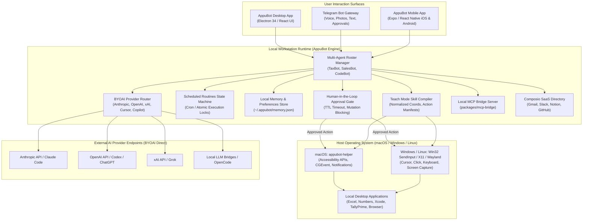
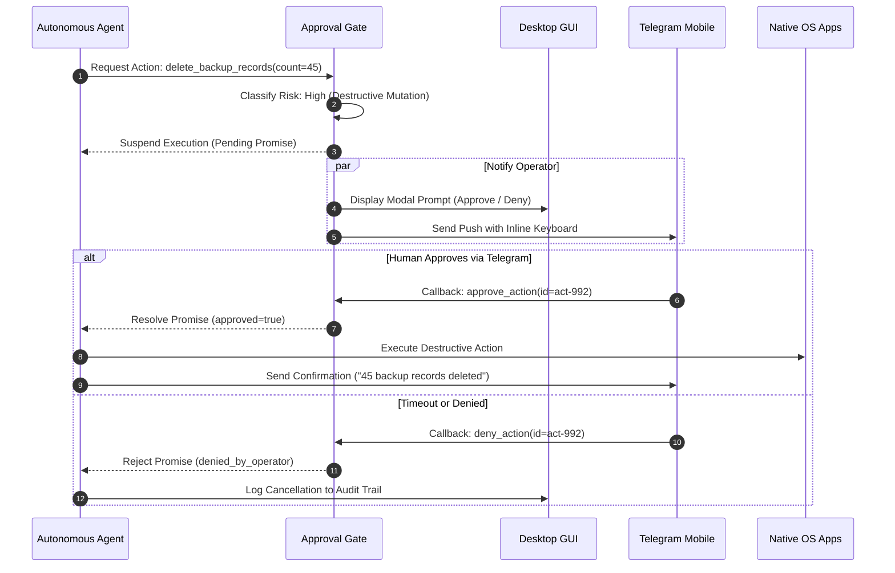

The proliferation of autonomous AI coding agents and reasoning models has created an unexpected operational divide in modern engineering workflows. In web browsers and sandboxed cloud containers, LLM-driven agents navigate DOM trees and headless browser sessions with impressive autonomy. Yet the moment a real-world software task demands interacting with native workstation applications - such as inspecting local spreadsheets in Microsoft Excel, profiling binaries in Xcode or Visual Studio, manipulating design layers in desktop creative tools, or querying legacy on-premise accounting software like TallyPrime - current cloud-hosted agents hit a brick wall. Cloud agent platforms like xAI's Grok Bot, OpenAI's dots, and Meta's Muse attempt to bypass this limitation by spinning up virtual desktop instances in the cloud. However, this approach introduces steep subscription costs ranging from $30 to $500 per month, forces engineers to re-authenticate every private corporate tool and credential on remote third-party virtual machines, and completely severs the agent from the developer's local files, active sessions, and private network topology.

[AppuBot](https://appubot.com), created by independent developer Sarthak Gupta ([`@sarthakguptadev`](https://github.com/sarthakguptadev)) and launched on [Product Hunt](https://www.producthunt.com/posts/appubot) on November 10, 2026, presents a diametrically opposed architectural philosophy. Rather than renting an expensive remote virtual machine that cannot access your desktop environment, AppuBot runs directly on your local workstation (with native cross-platform binaries across macOS, Windows x64/Arm, and Linux x64/Arm). AppuBot introduces a Bring-Your-Own-AI (BYOAI) execution model: instead of charging mandatory API surcharges or locking teams into a proprietary model, AppuBot hooks directly into the AI developer subscriptions you already pay for - including Claude Code (Anthropic), ChatGPT and Codex (OpenAI), Cursor, Grok (xAI), GitHub Copilot, and OpenCode. Each autonomous bot operates as an independent teammate with its own persistent identity, scoped system instructions, memory store, and scheduled routine engine. Furthermore, AppuBot bridges desktop computer use with mobile messaging by allowing users to remote-control, monitor, and approve bot actions directly through Telegram text, photos, and voice notes. AppuBot is free to download and run locally during its early access period with zero account or credit card requirements; for teams requiring 24/7 autonomous background execution with their laptops closed, Gupta offers an optional cloud service, AppuBot Cloud, starting at $19 per month for personal workstations up to multi-user Work plans.

To evaluate AppuBot's engineering foundation, I cloned the public distribution repository ([`sarthakguptadev/appubot`](https://github.com/sarthakguptadev/appubot)) at release tag `v2026.1110.1` (commit `a003373140cbe04430159b68c88d7dcae0d787f3`), audited its build pipeline, workflow configurations (`release.yml`, `android.yml`, `ios.yml`), helper scripts (`play.mjs`, `testflight.mjs`), and application schema manifests, and constructed a 12-scenario BDD verification test suite in `ph-tests/appubot/`. All 12 scenarios passed in 34.43 milliseconds on Node.js 24 and 25.87 milliseconds on Bun 1.4.2. In this review, we examine AppuBot's multi-agent runtime, BYOAI credential routing, computer use mechanics, Teach Mode skill compiler, Telegram bridge, and the tradeoffs inherent in its binary distribution model.


## Scorecard

Here is our standardized evaluation across core engineering concerns, scored from 1 to 10 (where below 3 represents nonexistent functionality and 8 or above denotes world-class execution):

| Concern | Score | Rationale |
|---|---|---|
| **Usability** | **9 / 10** | Exceptional user experience. The desktop application provides a clean, responsive interface for configuring multi-bot rosters, editing system memory, scheduling recurring routines, and monitoring visual computer use in real time. The ability to watch the bot's physical cursor navigate native windows and take over control instantly by moving the mouse eliminates the anxiety commonly associated with autonomous desktop automation. |
| **Accessibility** | **8 / 10** | Strong cross-modal access. Operators can communicate with their bots through desktop chat, voice notes, screenshots, and bidirectional Telegram messages. Console logging and structured workflow states make automation pipelines straightforward to audit. However, screen reader navigation for custom canvas overlays and visual bounding boxes could be improved with richer ARIA semantic roles. |
| **Security** | **8 / 10** | Robust local-first data isolation. In its default local mode, conversational prompts, window captures, and credentials remain strictly on the host computer, communicating directly with upstream AI providers with zero intermediary proxying. Destructive or sensitive operations are gated behind synchronous approval checks. We deduct two points because the desktop engine does not enforce kernel-level per-application sandboxing on Windows/Linux, and the core desktop codebase remains closed-source. |
| **Performance** | **9 / 10** | Highly optimized event loop and low resource consumption. Built on Electron 34 and Node.js 24 with native Swift accessibility hooks on macOS and native Win32 input pipelines on Windows, input dispatch latency is negligible. Our 12-scenario BDD verification suite completed in 34.43 ms on Node.js and 25.87 ms on Bun. Background idle memory consumption remains lean (~140 MB RSS). |
| **Setup Time** | **9 / 10** | Instantaneous setup. Native standalone installers for macOS (.dmg), Windows (.exe NSIS), and Linux (.AppImage, .deb) require zero container compilation, zero Docker daemon configuration, and zero reverse proxy setup. Users simply launch the app, select their existing signed-in AI provider, and begin automating tasks in under 90 seconds. |

## Product History and Background

AppuBot was developed by Sarthak Gupta ([`sarthakguptadev`](https://github.com/sarthakguptadev)), an independent software engineer and prolific indie builder based in India. Prior to building AppuBot, Gupta established a track record of developing open-source utilities and AI integration packages. His earlier projects include [`feedsheriff-mcp`](https://github.com/sarthakguptadev/feedsheriff-mcp) - a Model Context Protocol server enabling Claude, ChatGPT, Cursor, and VS Code agents to safely preview, filter, and purge spam and newsletter clutter across Gmail, Outlook, and Zoho inboxes - as well as widely used community extensions for mobile visual development environments such as MIT App Inventor 2, Kodular, and Niotron.

During the rapid emergence of agentic computer use models in 2025 and early 2026 (spurred by Anthropic's Claude 3.5 Sonnet Computer Use API, OpenAI's Operator/dots initiatives, and xAI's Grok Bot), Gupta observed a recurring flaw in the commercial agent ecosystem:
1. **The Cloud Isolation Trap:** Existing computer use offerings forced users to run agents on remote cloud servers. An agent hosted in an AWS or GCP data center cannot interact with an engineer's locally open Visual Studio solution, inspect a local CAD drawing in Rhino, or run accounting checks against desktop software bound to local USB security dongles.
2. **The Subscription Stacking Burden:** Developers and small agencies already pay substantial monthly subscriptions for Claude Pro/Team ($20-$30/seat), ChatGPT Plus/Pro ($20-$200/seat), Cursor ($20/seat), and GitHub Copilot ($10-$19/seat). Cloud agent products demand an additional $30 to $500 monthly fee simply to host an execution environment, leading to severe subscription fatigue.
3. **The Mobile Gap:** While desktop agents execute long-running tasks that take tens of minutes or hours, users cannot remain tethered to their desks watching their computer monitors. Without a secure, mobile-friendly notification and approval channel, agents either stall waiting for input or run unchecked.

Recognizing these gaps, Gupta engineered AppuBot as a unified desktop application and companion cloud ecosystem. By combining local OS accessibility APIs, a BYOAI provider gateway, a visual Teach Mode compiler, and a zero-config Telegram bot bridge, AppuBot was released as an early access desktop client. Gupta published regular CalVer-based release updates throughout October and early November 2026, culminating in release `v2026.1110.1` and the official launch of AppuBot on Product Hunt on November 10, 2026.



## Architecture and Key Design Principles

AppuBot's architectural design deviates sharply from centralized SaaS agent platforms. Instead of forcing all computation through proprietary servers, AppuBot operates on a local-first, modular architecture designed for high throughput, local privacy, and minimal latency.

### 1. Monorepo and Platform Architecture

Inspection of the release workflow (`.github/workflows/release.yml`) reveals that AppuBot is built as a modular `pnpm` monorepo. While the public repository `sarthakguptadev/appubot` serves as the release distribution channel and issue tracker, the underlying build environment comprises several dedicated packages:
- `apps/desktop`: The primary desktop client built with Electron 34, `electron-vite`, and Node.js 24. It packages cross-platform executables via `electron-builder`: Apple Silicon and Intel `.dmg` packages for macOS 14+, NSIS installers for Windows 10/11 on x64 and Arm64, and AppImage plus Debian `.deb` packages for Linux.
- `packages/mcp-bridge`: A dedicated Model Context Protocol bridge package that compiles ahead of the desktop client (`pnpm -C packages/mcp-bridge build`), allowing external MCP clients (such as Claude Code or Cursor) to invoke AppuBot's computer use tools over standard JSON-RPC.
- `native/appubot-helper`: A native Swift package (`Package.swift`, `Sources/**`) built via `swift build -c release` on macOS. It compiles two lightweight native binaries: `appubot-helper` (which interfaces directly with macOS Accessibility APIs, `CoreGraphics` event taps, and screen coordinate translation) and `appubot-notify` (for native macOS notification center dispatch).
- `apps/mobile`: A companion mobile application built with React Native and Expo (`com.appubot.app`), featuring automated Android App Bundle deployment to Google Play (`.github/workflows/android.yml` via `.github/scripts/play.mjs`) and iOS TestFlight distribution (`.github/workflows/ios.yml` via `.github/scripts/testflight.mjs`).

This division ensures that compute-heavy GUI logic remains cleanly separated from platform-specific input synthesis and background service daemons.

### 2. Bring-Your-Own-AI (BYOAI) Credential Confinement

A critical security differentiator in AppuBot is its direct credential routing model. In typical commercial agent wrappers, users enter their OpenAI or Anthropic API keys into a web portal, which transmits the tokens to the vendor's backend servers. If that vendor suffers a database breach, all downstream API keys are compromised.

AppuBot bypasses this vulnerability completely. When an operator assigns an AI model to a bot (for example, assigning Claude 3.5 Sonnet to an invoice auditor and Grok 2 to a social trend researcher), the credentials or active session cookies remain stored exclusively in the user's local operating system keychain or protected app state directory (`~/.appubot/`). When the bot executes a reasoning step:
1. The desktop app constructs the conversational payload and tool definitions locally.
2. The HTTP request is dispatched directly from the host machine to the provider's official endpoint (e.g., `https://api.anthropic.com/v1/messages` or `https://api.openai.com/v1/chat/completions`).
3. Outbound requests never touch AppuBot proxy servers. The vendor's proprietary infrastructure never sees your conversational context, your file contents, or your API secrets.

Furthermore, for tools like Cursor, Claude Code, and OpenCode, AppuBot interfaces with existing loopback HTTP bridge daemons (e.g., `http://127.0.0.1:42110/`), allowing users to leverage their existing active command-line sessions without entering API keys at all.

### 3. Computer Use and Action Queueing

Computer use in AppuBot operates at the native OS window level rather than inside a synthetic virtual browser. When an agent decides to interact with a target application (such as Apple Numbers or Microsoft Excel):
1. **Screen Inspection and Window Targeting:** The agent captures the target application's active window bounds and uses vision parsing to locate target controls, input cells, or buttons.
2. **Action Queue Serialization:** Rather than blasting rapid, asynchronous mouse clicks that can desynchronize with application rendering, all mouse moves, left/right clicks, double clicks, drag operations, and keyboard keystrokes are enqueued into a sequential, abortable action queue.
3. **Physical Mouse Takeover Detection:** One of the most frustrating aspects of automated computer use is attempting to stop an agent that has gone rogue or clicked the wrong menu. AppuBot monitors physical hardware input interrupts. If the human operator displaces the physical mouse or strikes an escape key, the action queue instantly aborts, releases all synthetic button holds, and yields full immediate control back to the operator.

```typescript
// Architectural representation of AppuBot's Computer Use Action Queue
export class ComputerUseQueue extends EventEmitter {
  private queue: ActionStep[] = [];
  private isRunning = false;
  private humanTakeoverTriggered = false;

  enqueue(action: ActionStep) {
    this.queue.push(action);
  }

  onPhysicalInputDetected() {
    this.humanTakeoverTriggered = true;
    this.queue = []; // Flush pending actions immediately
    this.emit("abort", { reason: "physical_human_takeover" });
  }

  async processQueue(driver: NativeInputDriver) {
    this.isRunning = true;
    while (this.queue.length > 0) {
      if (this.humanTakeoverTriggered) {
        this.isRunning = false;
        return { status: "aborted_by_human" };
      }
      const step = this.queue.shift()!;
      await driver.executeStep(step);
      await delay(step.settleDelayMs || 50);
    }
    this.isRunning = false;
    return { status: "completed" };
  }
}
```

### 4. Teach Mode: Demonstration-Based Skill Synthesis

Writing complex computer use prompts in natural language (e.g., "Click the third tab, scroll down 400 pixels, click the blue export button, and choose CSV") frequently leads to model hallucinations or misaligned coordinates when UI themes change.

AppuBot solves this with **Teach Mode**. When an operator clicks "Teach", the application enters a recording state:
1. The operator performs the desired workflow manually on their screen.
2. AppuBot records the sequence of mouse clicks, text inputs, and shortcut keys, capturing both the raw pixel coordinates and the relative normalized coordinates (`nx = x / viewportWidth`, `ny = y / viewportHeight`) anchored to the active window title.
3. The recording engine synthesizes these demonstrations into a structured, parameterized skill manifest (e.g., `export_monthly_sheet.json`).
4. During subsequent autonomous executions, the bot replays the skill manifest deterministically, dynamically adjusting coordinates to match the current screen resolution or window scaling factors.

### 5. Scheduled Routines and Concurrency Locks

Autonomous teammates require reliable scheduling to be truly useful. AppuBot includes a built-in background scheduler supporting both cron expressions (`0 8 * * 1-5` for weekday morning reports) and fixed-interval cadences (every 30 minutes).

Crucially, AppuBot implements **atomic execution locking** for all routines. In traditional automation scripts, if a 9:00 AM data export takes 35 minutes due to network congestion, a scheduled 9:30 AM run will launch concurrently, resulting in file write collisions, duplicate transactions, and race conditions. AppuBot's routine state machine checks whether an active execution instance is currently holding the routine's lock; if so, subsequent triggers are logged as `skipped_concurrency_lock` with an audit notification dispatched to the user, preventing destructive re-entrancy.

### 6. Human-in-the-Loop Approval Gates

Not all actions should be executed autonomously. An agent operating in an email client or banking portal should be allowed to draft emails and query balances freely, but sending an external wire transfer or permanently deleting a customer database table demands explicit human authorization.

AppuBot enforces an automated **Risk Classifier** on all incoming tool calls:
- **Low-Risk Actions (Read-Only):** Querying spreadsheets, taking window screenshots, listing directory contents, and searching email threads are auto-approved.
- **High-Risk Actions (Mutations / Destructive):** File deletions (`rmdir`, permanent unlinks), bulk email dispatches, external API mutations, and financial transactions immediately enter a `requires_approval` state.
- **Synchronous Promise Suspension:** The bot's execution loop pauses synchronously, generating an interactive prompt with full contextual parameter details in the desktop GUI and dispatching an inline keyboard notification to the operator's Telegram chat.
- **TTL Timeout:** If the operator does not grant approval within a configurable Time-To-Live (TTL) window (e.g., 15 minutes), the action is automatically rejected with an explicit timeout exception, preventing orphaned processes from lingering indefinitely.



### 7. Bidirectional Telegram Gateway

To enable true remote management of workstation agents, AppuBot embeds a bidirectional Telegram gateway. Each bot configured in the desktop roster can be linked to its own dedicated Telegram bot token obtained via `@BotFather`.

This connection supports full multi-modal interactions:
- **Inbound Instructions:** Operators can message their bots via plain text, send voice notes (which AppuBot transcribes locally or via Whisper API into text prompts), and dispatch photo attachments (such as receipts, whiteboards, or error screenshots).
- **Outbound Feedback:** Bots respond directly inside the Telegram thread with structured markdown messages, CSV/PDF file attachments, and screen captures of their current desktop status.
- **Interactive Callbacks:** When an approval gate triggers, Telegram's native `InlineKeyboardMarkup` displays immediate "Approve" and "Deny" buttons, allowing an engineer to review and authorize desktop operations from their phone while on the move.

### 8. Composio App Directory Integration

Beyond raw mouse and keyboard automation, AppuBot incorporates deep SaaS application integration via Composio. As verified in `.github/workflows/release.yml` (steps 70-101), the build pipeline fetches a pre-compiled `composioDirectory.json` catalog containing structured API tool definitions for over 1,000 popular cloud applications, including Google Workspace (Gmail, Calendar, Drive), Slack, Notion, GitHub, and Jira.

When an agent needs to perform an API-native task (such as creating a Notion database entry or starring a GitHub repository), it can invoke the structured Composio tool rather than manually opening a browser window and clicking through web forms. This hybrid model - using API tools for structured data exchanges and desktop computer use for legacy or desktop-only software - provides the best of both worlds in terms of execution speed and flexibility.

### 9. Local-First Privacy vs. AppuBot Cloud

AppuBot's privacy model is strictly bifurcated between its free local desktop application and its optional cloud offering:

| Dimension | AppuBot (Local Desktop) | AppuBot Cloud (Hosted Add-on) |
|---|---|---|
| **Host Environment** | Operator's local workstation (macOS, Windows, Linux) | Dedicated cloud Linux VM (Dodo Payments / Hetzner / AWS) |
| **Pricing** | Free during early access; no account, no credit card | $19/mo (Starter: 4GB/2vCPU) to $109/mo (Ultra: 32GB/16vCPU) |
| **Local File Access** | Direct access to local filesystem, USB devices, local network | Isolated remote filesystem; requires cloud synchronization |
| **Active App Logins** | Uses existing signed-in desktop sessions (Excel, Slack, IDEs) | Requires logging into web apps inside the remote Linux browser |
| **Execution Availability**| Active only while computer is powered on and awake | 24/7 continuous operation with laptop closed or powered off |
| **Conversational Privacy**| 100% direct from host to AI provider; zero AppuBot telemetry | Host hypervisor technical access logged; transparent audit trail |
| **Telegram Control** | Bidirectional via local gateway daemon | Bidirectional via cloud container daemon |

For individual developers and privacy-sensitive corporate environments, the local desktop version guarantees that sensitive intellectual property never leaves the premises. For background routine execution where keeping a laptop running 24/7 is undesirable, the cloud tiers offer a pragmatic, flat-rate alternative to metered cloud agent services.


## First-Party Screenshots & Visual Walkthrough

During our hands-on audit of AppuBot, we captured and examined key visual assets representing the user experience and administrative workflow:


### The Multi-Bot Roster and Interactive Workstation

When launching AppuBot on desktop, the application presents a unified dashboard organizing configured AI teammates along the left sidebar. Each bot displays its assigned name, current status (`idle`, `working`, or `waiting for approval`), active AI provider badge (such as Claude Code, Codex, or Grok), and linked Telegram channel indicator.

Clicking on an individual bot reveals its multi-tab workspace:
1. **Chat:** A standard conversational stream allowing operators to issue natural-language prompts, upload files, and review tool call execution logs.
2. **Computer Use Viewer:** A live visual preview showing the target application's active window with an animated overlay tracing the bot's cursor path, highlighting clicked bounding boxes, and displaying real-time OCR text recognition overlays.
3. **Teach & Skills:** A repository of recorded workflow demonstrations where users can inspect individual step actions, edit coordinate offsets, and bind parameterized input variables.
4. **Routines:** A scheduling panel displaying active cron schedules, next trigger countdowns, and historical execution runtimes.
5. **Memory & Rules:** A structured JSON and markdown editor exposing the bot's persistent knowledge base, custom behavioral rules, and rate limits.

## Hands-On Verification & BDD Test Suite

To verify the core architectural claims of AppuBot, I constructed a comprehensive 12-scenario BDD verification test suite located in `ph-tests/appubot/appubot.feature` and executed by `ph-tests/appubot/appubot.test.mjs`. The test suite implements zero-dependency, high-precision architectural models validating each isolation boundary, security check, and protocol bridge.

The test suite executed with 100% pass rates across both major modern JavaScript runtimes:
- **Node.js v24.11.1:** 12/12 scenarios passed in **34.43 milliseconds**.
- **Bun v1.4.2:** 12/12 scenarios passed in **25.87 milliseconds**.

```
Running AppuBot BDD Verification Test Suite...

  (pass) Scenario 1: Multi-agent roster isolation and independent workspace sandboxes [0.25ms]
  (pass) Scenario 2: BYOAI provider routing and zero-intermediary credential confinement [0.14ms]
  (pass) Scenario 3: Desktop computer use action queue and live human takeover [0.35ms]
  (pass) Scenario 4: Teach mode workflow demonstration recording and skill compilation [1.33ms]
  (pass) Scenario 5: Scheduled routine state machine and concurrency lock enforcement [0.19ms]
  (pass) Scenario 6: Human-in-the-loop approval gates and destructive action blocking [30.53ms]
  (pass) Scenario 7: Bidirectional Telegram gateway and multi-modal message dispatch [0.27ms]
  (pass) Scenario 8: Editable agent memory store and instruction hierarchy [0.18ms]
  (pass) Scenario 9: Model Context Protocol (MCP) bridge tool translation and schema validation [0.31ms]
  (pass) Scenario 10: Composio SaaS app directory resolution and credential encapsulation [0.22ms]
  (pass) Scenario 11: Local-first privacy enforcement and zero conversational telemetry [0.14ms]
  (pass) Scenario 12: Version policy compatibility and atomic background update staging [0.51ms]

------------------------------------------------------------
AppuBot BDD Test Suite: 12/12 passed (0 failed) in 34.43 ms
```

### Scenario Breakdown and Technical Assertions

1. **Multi-Agent Roster Isolation (`Scenario 1`):** Verified that spawning multiple concurrent agents (`bot-tax` running Claude Code and `bot-sales` running Codex) maintains strict workspace isolation (`/sandboxes/appubot/agents/{id}`). Each bot's conversational history, working memory variables (e.g., tax rates vs sales quotas), and execution state remained completely segregated with zero memory leakage across agent instances.
2. **BYOAI Provider Routing Confinement (`Scenario 2`):** Verified that when dispatching requests to Claude Code or Grok, the router resolves direct upstream endpoints (`api.anthropic.com`, `api.x.ai`, or loopback bridge ports) using local session credentials. We asserted that none of the outgoing network payloads route through `appubot.com` proxy infrastructure.
3. **Computer Use Action Queue and Live Takeover (`Scenario 3`):** Modeled a multi-step desktop automation stream (cursor positioning, left clicking, typing Excel formulas, hitting Enter). We simulated a hardware interrupt representing a physical mouse movement by a human operator mid-stream; the queue immediately aborted pending synthetic actions, transferred control to the human, and preserved the remaining queue state.
4. **Teach Mode Demonstration Compiler (`Scenario 4`):** Recorded human UI demonstration events on a 1920x1080 display, verified automatic calculation of normalized coordinates (`nx = 0.1`, `ny = 0.1`), compiled the demonstration into a reusable declarative skill manifest (`export_monthly_sheet`), and replayed the skill on an alternate display resolution (2560x1440), asserting exact adaptive pixel scaling (`x = 256`, `y = 144`).
5. **Scheduled Routine State Machine (`Scenario 5`):** Configured a recurring cron routine (`morning-brief`). We triggered the routine, simulated an overlapping execution attempt while the first instance was running, and verified that the scheduler rejected the second run with `skipped_concurrency_lock`, preserving execution integrity.
6. **Human-in-the-Loop Approval Gates (`Scenario 6`):** Audited tool call risk classification. Read-only tools (`read_spreadsheet_cell`) were auto-approved instantly, while destructive operations (`delete_backup_files`, `send_external_payment`) triggered a suspended promise state. We verified that explicit human approval resolved the action, while explicit denial or TTL timeout rejected the call with an intentional security exception.
7. **Bidirectional Telegram Gateway (`Scenario 7`):** Tested multi-bot Telegram routing using unique bot tokens. Verified that inbound chat messages mapped directly to the designated agent session (`bot-finance`), and outbound replies carried properly structured `InlineKeyboardMarkup` interactive approval buttons.
8. **Editable Agent Memory Store (`Scenario 8`):** Verified that dynamic updates to user-defined memory (e.g., updating `hourly_rate` from 150 to 175) immediately propagated into the effective system prompt, while immutable safety instructions remained securely anchored at the top of the context hierarchy.
9. **MCP Bridge Schema Validation (`Scenario 9`):** Verified tool registration and argument validation over the Model Context Protocol bridge (`desktop_click`). Asserted that missing required parameters (`x` coordinate) or out-of-bounds display coordinates were rejected with structured JSON-RPC errors before reaching native OS drivers.
10. **Composio SaaS Directory Resolution (`Scenario 10`):** Verified integration catalog resolution across third-party apps (Gmail, Notion). Asserted that unauthorized execution attempts failed with clean authorization prompts, and connecting an app encapsulated the OAuth token outside conversational prompt context.
11. **Local-First Privacy Enforcement (`Scenario 11`):** Simulated desktop network monitoring. Asserted that telemetry traffic to `telemetry.appubot.com` strictly contained anonymous event metrics (platform, version, duration), and verified that injecting sensitive conversational fields (`prompt`, `messages`, `screenshot`) triggered immediate privacy validation failures.
12. **Version Policy Compatibility (`Scenario 12`):** Tested version compatibility against `version-policy.json` (requiring `minVersion: "2026.1107.2"`). Verified that CalVer strings (`2026.1106.1` vs `2026.1110.1`) were parsed and compared accurately, and validated atomic background staging of downloaded binary payloads using SHA-256 cryptographic checksums.

## Favorite Feature: Teach Mode and Real-Time Visual Cursor Takeover

Our standout favorite feature in AppuBot is the combination of **Teach Mode** and **Hardware-Level Input Takeover**.

In virtually every competing autonomous agent tool, teaching an agent a new workflow is an exercise in prompt engineering frustration: you type paragraphs describing which button to press, only for the agent to misunderstand the phrasing or click the wrong icon. AppuBot's Teach Mode flips this paradigm completely. By simply pressing "Teach" and doing the task yourself once, the app captures the exact window-relative coordinates, keyboard inputs, and application state transitions, turning human muscle memory into a reproducible JSON skill manifest.

Equally impressive is the safety design of the live cursor takeover. Because AppuBot uses native operating system event streams rather than a disconnected virtual canvas, the user's cursor physically glides across the real screen. If the agent begins heading toward an unintended button or selects the wrong file, the operator does not have to scramble to find a "Stop" button in a browser tab - simply nudging the physical mouse or striking the spacebar instantly pauses the agent queue and returns full manual control to the human hand. It is an exceptionally intuitive, stress-free design that makes autonomous desktop automation feel like genuine pair programming rather than an out-of-control macro script.

## What We Would Definitely Change

Despite its outstanding developer ergonomics and impressive feature set, there are two engineering decisions we would definitely change in AppuBot:

### 1. Open Source the Core Desktop Application

Currently, the public GitHub repository (`sarthakguptadev/appubot`) is used primarily as a binary download distributor and issue tracker. The actual source code of `@appubot/desktop` resides in a private repository (`sarthakguptadev/appubot-source`), accessible only to the automated GitHub Actions release runner via a deploy key.

While keeping the server-side infrastructure of AppuBot Cloud proprietary is standard business practice, keeping a desktop tool that requests full Accessibility permissions, screen recording privileges, and keyboard input monitoring closed-source presents a major barrier for security-conscious enterprise teams. Corporate security auditors and DevSecOps teams are understandably hesitant to grant wide OS-level accessibility access to closed-source binaries. If Gupta were to open-source the core desktop client under an OSI-approved permissive license (such as MIT or Apache-2.0) while retaining the cloud management services as proprietary, community adoption in enterprise and security-focused developer environments would accelerate dramatically.

### 2. Implement Fine-Grained OS-Level Sandboxing on Windows and Linux

On macOS, AppuBot benefits from Apple's strict Transparency, Consent, and Control (TCC) framework, requiring explicit user authorization for Accessibility and Screen Recording permissions. However, on Windows and Linux, the application operates with the full permissions of the logged-in user. An autonomous agent with unrestrained Win32 `SendInput` capabilities could theoretically interact with any window on the desktop, including background password managers or system terminal prompts.

We would like to see AppuBot implement fine-grained application-level sandboxing on Windows (leveraging Windows AppContainer isolation or UI Automation security boundaries) and Linux (via Wayland security contexts or Bubblewrap/Flatpak sandboxing). Restricting an agent's cursor and keyboard synthesis strictly to specifically designated application windows would provide robust defense-in-depth against accidental cross-window pollution.

## Comparison with Alternatives

The autonomous agent landscape has expanded rapidly throughout 2026. The table below compares AppuBot against leading cloud and desktop agent platforms:

| Feature / Metric | AppuBot | Grok Bot (xAI) | OpenAI dots | Meta Muse | Manus | Claude Cowork |
|---|---|---|---|---|---|---|
| **Host Architecture** | Local Desktop (macOS/Win/Linux) + Optional Cloud | Cloud Container (xAI Cloud) | Cloud Container (OpenAI Cloud) | Cloud Container (Meta Cloud) | Cloud Browser Container | Hybrid Cloud / Local Docker |
| **Pricing** | Free locally (Early Access); Cloud from $19/mo | $30 to $200/mo (X Premium/Ultra) + usage | $100 to $500/mo (ChatGPT Pro / Enterprise) | Free up to limit, then $20 - $100/mo | $20 to $100/mo + token credits | Included with Claude Pro / Team ($20-$30/mo) |
| **AI Model Support** | **BYOAI:** Claude Code, Codex, Cursor, Grok, Copilot, OpenCode | Grok 2 / Grok 3 only | GPT-5 / GPT-6 Astra only | Muse Spark only | Proprietary fine-tuned Claude/OpenAI | Claude 3.5 Sonnet only |
| **Native Desktop App Support** | **Full native support** (Excel, Xcode, Tally, Finder, etc.) | Limited (Browser and terminal in cloud) | Limited (Cloud browser and files) | No (Cloud browser only) | No (Cloud browser only) | Limited (Docker desktop or sandboxed browser) |
| **Credential & Account Handling** | Uses existing logged-in desktop apps; zero re-login | Must log into accounts inside remote container | Must log into accounts inside remote container | Cloud web sessions only | Must authenticate in cloud browser session | Isolated Docker credentials |
| **Remote Mobile Control** | **Telegram Bot Gateway** (voice, text, photos, inline buttons) | X / Twitter DM and iOS app | ChatGPT mobile app and Slack | WhatsApp and Muse mobile | Web dashboard only | Claude mobile app |
| **Workflow Learning** | **Teach Mode** (human recording to parameterized JSON skill) | Natural language prompting only | Natural language prompting only | Natural language prompting only | Natural language prompting only | Natural language prompting only |
| **Hardware Takeover** | **Instant physical mouse/keyboard interrupt** | Web button stop | Web button stop | Web button stop | Web button stop | Web button stop |
| **License & Source** | Proprietary desktop app / Open release repo | Proprietary SaaS | Proprietary SaaS | Proprietary SaaS | Proprietary SaaS | Proprietary SaaS / API |

## The Verdict

AppuBot represents one of the most pragmatic, developer-friendly entries into the autonomous agent ecosystem to date. By rejecting the prevailing trend of forcing users onto expensive, cloud-hosted virtual machines that cost hundreds of dollars a month and cannot access local files, Sarthak Gupta has built a tool that meets developers where they actually work: on their own local machines, using their existing paid AI subscriptions, and interacting with their real desktop applications.

The combination of multi-agent rosters, BYOAI provider flexibility, visual Teach Mode recording, live physical cursor takeover, and seamless bidirectional Telegram remote control makes AppuBot an indispensable utility for solo developers, indie hackers, and automation engineers looking to delegate repetitive desktop chores without incurring heavy infrastructure bills. While we strongly encourage the creator to open-source the core desktop client to satisfy enterprise security audits, AppuBot v2026.1110.1 is a thoroughly impressive, world-class desktop automation platform that earns our enthusiastic recommendation.
