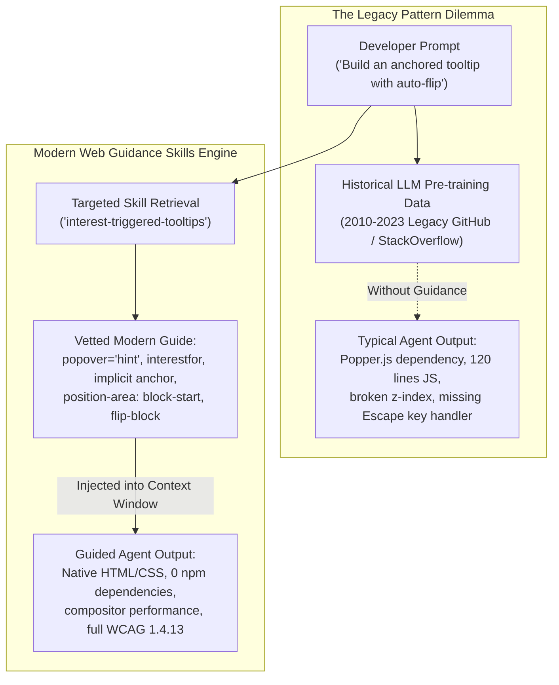
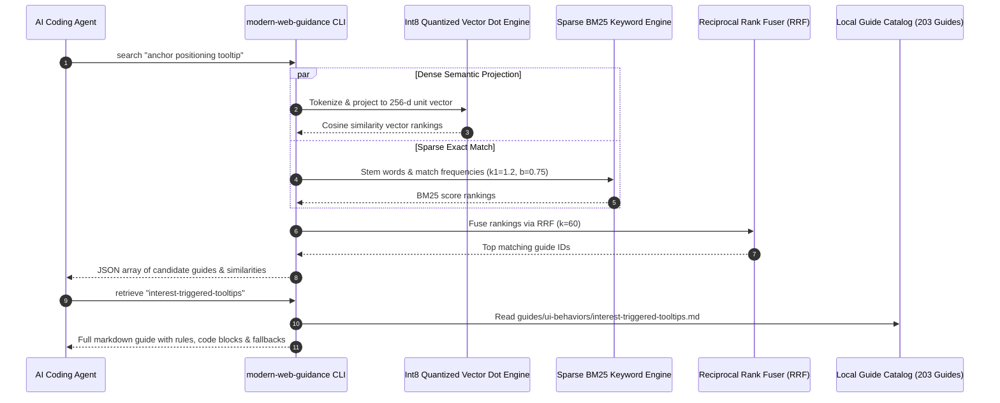

The central challenge in autonomous frontend engineering today is not a lack of reasoning capability in foundation models, but training data inertia. Large Language Models (LLMs) are trained on billions of lines of legacy code accumulated over two decades. Consequently, when an AI coding agent is asked to build an expanding accordion, position an anchored tooltip, create a modal dialog, or validate a form, its instincts are frozen in 2018. It reaches for bloated JavaScript libraries, binds brittle scroll and resize listeners directly to the main thread, orchestrates complex focus-trapping event loops, or pulls in heavy third-party npm packages for capabilities that the native web platform now handles declaratively in five lines of standard HTML and CSS. Even when a modern frontier model knows an API exists in theory, it routinely lacks the density of real-world implementation patterns required to navigate user-agent stylesheet overrides, non-bubbling events, screen reader semantics, and progressive enhancement fallbacks.

[Modern Web Guidance](https://developer.chrome.com/docs/modern-web-guidance), released as `v1.0.0` on November 10, 2026 under the official [`GoogleChrome/modern-web-guidance`](https://github.com/GoogleChrome/modern-web-guidance) repository, tackles this systemic problem at its root. Stewarded by the Google Chrome, Microsoft Edge, Mozilla Firefox, and MDN teams alongside the broader web development community, the project provides a comprehensive catalog of 203 expert-vetted agent skills covering 250 modern web platform features. Distributed as an open-source, zero-dependency npm package (`npx modern-web-guidance@latest`) and multi-agent skill pack, it supports Claude Code, OpenAI Codex, Cursor, Grok Build, Gemini, Google Antigravity, Kimi Code, and Vercel Agent Skills. Modern Web Guidance is 100% free and open-source (software licensed under Apache-2.0, documentation under CC-BY-4.0).

While the package includes an impressive offline quantized vector search engine and a bundled TypeScript AST scanner, the true substance of Modern Web Guidance is the skills themselves. In this review, we examine the anatomy of these skills, audit standout guides across UI overlays, CSS layout, DOM reparenting, and task scheduling, evaluate how their prompt engineering shapes agent behavior, analyze empirical Playwright evals, and review the tradeoffs of adopting this skill catalog.


## Scorecard

Here is our standardized evaluation across core engineering concerns, scored from 1 to 10 (where below 3 represents nonexistent functionality and 8 or above denotes world-class execution):

| Concern | Score | Rationale |
|---|---|---|
| **Usability** | **9 / 10** | High-utility skill formulation. Each guide is structured around a single real-world developer use case with immediate copy-pasteable snippets, explicit constraints, and clear anti-patterns. Command-line integration (`search`, `retrieve`, `legacy-scan`) is seamless across major agent runtimes. |
| **Accessibility** | **10 / 10** | Unmatched accessibility rigor. Every component skill explicitly incorporates WCAG compliance, ARIA attribute reflection, focus management (roving tabindex, inertness, tab traps), screen reader live region announcements, and reduced-motion safety. Platform edge cases (such as non-bubbling toggle events and NVDA browse-mode omissions) are documented with exact workarounds. |
| **Security** | **9 / 10** | Safe, local-first architecture. Guides prioritize native platform security primitives (Trusted Types, Sanitizer API, Content Security Policy, WebAuthn Passkeys). Experimental Origin Trials and volatile single-engine APIs are gated behind explicit configuration (`.mwgrc`), preventing agents from injecting unstable code into production. |
| **Performance** | **9 / 10** | Aggressive platform-level optimization. Skills direct agents away from main-thread JavaScript thrashing and toward GPU-composited CSS, Prioritized Task Scheduling (`scheduler.yield()`), native `moveBefore()`, and speculatively preloaded assets. The local retrieval engine returns guides in under 15 ms on CPU. |
| **Setup Time** | **10 / 10** | Instantaneous activation. Zero cloud databases, zero API keys, and zero daemon processes. Running `npx modern-web-guidance@latest install` or adding the skill to an agent configuration takes less than 60 seconds. |

## Product History and Background

Over the past four years, the web platform has undergone its most dramatic evolution since the launch of HTML5. Through the WebDX Community Group and the **Baseline** initiative, major browser vendors achieved unified cross-engine interoperability for capabilities that once required thousands of lines of fragile JavaScript:

1. **Native Top-Layer & Declarative Invokers:** The `<dialog>` element, Popover API (`[popover]`), Invoker Commands (`commandfor="id" command="show-modal"`), and `interestfor` attributes eliminated the need for custom modal backdrops, z-index wars, and focus-locking libraries.
2. **Anchor Positioning & Container Queries:** CSS Anchor Positioning (`position-area`, `position-try-fallbacks`) eliminated dependencies on heavy positioning engines like Popper.js or Floating UI, while Container Queries (`@container`) and Container Style Queries enabled components to react to their own dimensions rather than the global viewport.
3. **Smooth View Transitions & Animatable Sizing:** The View Transitions API, `@starting-style`, `transition-behavior: allow-discrete`, and `interpolate-size: allow-keywords` finally solved the decades-old challenge of animating `height: auto` and cross-page state morphing without JavaScript measurement.
4. **Interaction Responsiveness:** The Prioritized Task Scheduling API (`scheduler.yield()`), `fetchLater()`, and Speculation Rules transformed Interaction to Next Paint (INP) diagnostics and background network execution.

Despite these advances, developers using AI coding assistants observed that agents consistently generated outdated code. When prompted to create an anchored tooltip or an expanding accordion, models generated obsolete 2018-era patterns: hundreds of lines of imperative DOM listeners, inline styles, and unmaintained npm polyfills.

Recognizing that retraining multi-billion-parameter models cannot keep pace with the monthly release cadence of browser engines, the Google Chrome team (led by Paul Irish, Rick Viscomi, Colin Jamieson, and Micah Rogers), in partnership with Microsoft Edge, Mozilla Firefox, and MDN contributors, developed Modern Web Guidance. Rather than treating web documentation as an encyclopedic wiki, they synthesized web platform expertise into modular, actionable agent skills engineered specifically to steer LLM reasoning.



## Deep Dive: The Skills Themselves

The Modern Web Guidance repository is organized into two primary skill packs:
- **`modern-web-guidance`**: 203 guides covering 250 web platform features across 12 disciplines (CSS & Layout, UI Components, UI Behaviors, Forms, Performance, Accessibility, Security, Privacy, PWA, Web Components, JavaScript APIs, and Built-in AI).
- **`chrome-extensions`**: Comprehensive Manifest V3 extension engineering guides covering Service Worker lifecycles, Side Panels, CSP iframe sandboxing, permissions, and Chrome Web Store publishing compliance.

To understand why these skills are effective, we must examine the specific implementation guidance they provide.

### 1. UI Overlays and Invokers: Killing the Custom State Machine

The overlay guides (`dialog`, `declarative-dialog-popover-control`, `interest-triggered-tooltips`, `hovercard`) address the most common source of bugs in AI-generated frontend code: custom modal and popup state machines.

When an unguided agent builds a popup, it creates a `<div>` with `position: absolute`, attaches global `window.addEventListener('click')` listeners for outside clicks, calculates viewport boundaries with `getBoundingClientRect()`, and manages `z-index: 999999`. This approach suffers from multiple failure modes: it breaks when inside `overflow: hidden` containers, fails keyboard `Escape` dismissal, causes mobile layout shifting, and fails screen reader focus containment.

The `declarative-dialog-popover-control` skill steers the agent to the native Invoker Commands API:

```html
<!-- Guided Implementation: Zero JavaScript State Machine -->
<button commandfor="confirm-dialog" command="show-modal">
  Open Confirmation
</button>

<dialog id="confirm-dialog">
  <p>Are you sure you want to delete this repository?</p>
  <button commandfor="confirm-dialog" command="close">
    Cancel
  </button>
</dialog>
```

The guide does not merely present the happy path; it provides critical defensive constraints:
- **Anti-Pattern Warning:** *"IMPORTANT: Do NOT combine `popovertarget` and `commandfor` on the same `<button>`, for the same popover. This will double-toggle it, breaking functionality."*
- **Focus Restoration Gotcha:** Hiding a popover using a button inside the popover itself destroys the active element's focus. The guide explicitly instructs the agent to script focus restoration back to the trigger control.
- **Polyfill Safety:** For browsers lacking native Invoker Commands, the guide mandates feature detecting `'commandForElement' in HTMLButtonElement.prototype` rather than checking `window` or `document`, ensuring polyfills load conditionally.

### 2. Tooltips and Popovers: Implicit Anchors and User-Agent Overrides

In `interest-triggered-tooltips`, the guidance navigates one of the newest web platform standards: CSS Anchor Positioning combined with the `interestfor` attribute and `popover="hint"`.

A persistent trap for developers (and AI models) using the Popover API is that User-Agent stylesheets style popovers with `inset: 0; margin: auto;` by default to center them in the viewport. When developers attempt to tether a popover to an anchor button, the popover remains stubbornly centered or jumps erratically.

The skill explicitly warns the agent about this hidden platform quirk and mandates the exact CSS override:

```css
[popover] {
  /* Implicit anchor established by interestfor: no anchor-name required */
  position-area: block-start;
  position-try-fallbacks: flip-block;

  /* MANDATORY: Override User-Agent popover centering so the tooltip sits adjacent to its anchor */
  inset: auto;
  margin: 0;
}
```

Furthermore, the guide outlines the semantic boundaries between **Tooltips** (clarifying an icon action), **Toggletips** (an informative "i" button for optional context), and **Inline Content** (essential rules needed during interaction). It provides an extensive accessibility checklist enforcing WCAG 1.4.13:
- **Dismissible:** Automatically bound to the `Escape` key via native popover dismissal.
- **Hoverable:** Pointers can travel over the tooltip content without it vanishing, protecting users with screen magnifiers.
- **Persistent:** Content remains open until explicit blur, dismiss, or trigger de-selection.
- **Event Traps:** The skill explicitly warns that the popover `toggle` event does not bubble, instructing the agent to use capture-phase listeners on `document` rather than standard bubbling listeners.

### 3. CSS Layout: The End of Sizing Hacks (`animate-to-intrinsic-sizes`)

For two decades, CSS developers relied on JavaScript height calculations or fragile `max-height: 1000px` hacks to animate expanding cards, accordions, and dropdowns. The `animate-to-intrinsic-sizes` skill introduces the native solution: `interpolate-size` and `calc-size()`.

```css
/* Opt-in globally for keyword interpolation */
:root {
  /* MANDATORY: Transitions to intrinsic keywords are disabled by default for compatibility */
  interpolate-size: allow-keywords;
}

.expandable-panel {
  block-size: 0;
  overflow: hidden;
  transition: block-size 0.4s ease-out;
}

.expandable-panel.is-open {
  /* Smoothly interpolates from 0 to natural content height */
  block-size: auto;
}
```

The skill equips the agent with critical operational boundaries:
1. **Keyword-to-Keyword Restriction:** The model is warned that the browser cannot interpolate directly between two intrinsic keywords (e.g., `min-content` to `max-content`); one end must be a length or percentage.
2. **Accessible Teardown:** When collapsing an element to `block-size: 0`, the content remains in the accessibility tree unless hidden. The skill provides an exact JavaScript pattern utilizing `Promise.allSettled(element.getAnimations().map(a => a.finished))` to set `hidden = true` only after the CSS transition completes.
3. **Copy-Paste Reduced Motion:** Every animation guide mandates an inline `@media (prefers-reduced-motion: reduce)` block disabling transitions for sensitive users.

### 4. DOM Reparenting: Preserving Live State with `moveBefore()`

One of the most consequential additions to the DOM specification is `Node.prototype.moveBefore()`, covered in `move-dom-element-without-losing-state`.

Historically, moving a DOM element between containers using `appendChild()` or `insertBefore()` executed an atomic remove-and-insert cycle. This reset internal element states: `<iframe`> embeddings reloaded from scratch, `<video>` playheads restarted, running CSS animations reset to frame zero, and focused `<input>` elements blurred.

The `move-dom-element-without-losing-state` guide trains the agent to preserve state across layout rearrangements:

```javascript
const targetContainer = document.getElementById('new-parent');
const activeVideo = document.getElementById('stream-player');

// Feature detect moveBefore on Element prototype
if ('moveBefore' in Element.prototype) {
  // Preserves active video decoding, iframe context, and focus state
  targetContainer.moveBefore(activeVideo, null);
} else {
  // Fallback for older browsers
  targetContainer.insertBefore(activeVideo, null);
}
```

The guide also provides Web Component guidance: custom elements moved via `moveBefore()` do not fire `disconnectedCallback` or `connectedCallback`. Instead, the skill introduces the new `connectedMoveCallback()` lifecycle hook, ensuring agents do not write redundant tear-down logic.

### 5. Form Validation Timing: Eliminating Premature Error States

A recurring flaw in AI-generated forms is premature validation. An agent prompted to validate an email field will write:

```css
/* The classic AI blunder: Screaming red errors before the user finishes typing */
input:invalid {
  border-color: red;
}
```

The moment a user focuses on the empty field and types a single letter, the input lights up red, producing an adversarial user experience.

In `validate-input-after-interaction`, the skill re-trains the agent on the `:user-invalid` and `:user-valid` pseudo-classes:

```html
<div class="field">
  <label for="user-email">Email Address</label>
  <!-- Format hints placed above inputs so autocomplete dropdowns do not obscure them -->
  <span id="email-hint" class="hint">Format: you@example.com</span>
  
  <input
    type="email"
    id="user-email"
    name="email"
    required
    autocomplete="email"
    aria-describedby="email-hint"
    data-error="email-error"
  >
  
  <div id="email-error" class="error-msg">
    <span role="img" aria-label="Error">❌</span> Enter an email address in the format you@example.com.
  </div>
</div>
```

```css
/* Error styles match ONLY after the user commits (blurs or attempts submit) */
input:user-invalid {
  border-color: #d93025;
  background-color: #fce8e6;
}

input:user-invalid + .error-msg {
  display: block;
}
```

The guide pairs this CSS with dynamic accessibility synchronization: updating `aria-describedby` to include the error message ID only while the field is invalid, preventing screen readers from announcing hidden error containers on page load.

### 6. Performance: Prioritized Task Scheduling (`break-up-long-tasks`)

When agents process large data sets or heavy client-side computations, they frequently block the browser's main thread. If an agent recognizes the need to yield, it typically defaults to `setTimeout(resolve, 0)`. While this yields, it pushes execution to the end of the macro-task queue, allowing unrelated background tasks to jump ahead and hurting Interaction to Next Paint (INP) responsiveness.

The `break-up-long-tasks` skill directs agents to the Prioritized Task Scheduling API (`scheduler.yield()`):

```javascript
async function processLargeBatch(items) {
  // 50ms boundary: the threshold where a task becomes a "long task"
  let deadline = performance.now() + 50;

  for (const item of items) {
    processItem(item);

    // Yield control back to browser compositor while maintaining task priority
    if (performance.now() >= deadline) {
      if ('scheduler' in window && 'yield' in window.scheduler) {
        await scheduler.yield();
      } else {
        // Fallback for older browsers
        await new Promise(resolve => setTimeout(resolve, 0));
      }
      deadline = performance.now() + 50;
    }
  }
}
```

`scheduler.yield()` allows the browser to handle urgent pending user input or paint updates, then resumes the task ahead of background work, keeping interactions smooth.

### 7. Chrome Extensions: Navigating Manifest V3 Pitfalls

The companion `chrome-extensions` skill pack addresses the transition to Manifest V3. Beyond standard API references, the skill functions as an expert code reviewer, explicitly flagging the errors that cause Chrome Web Store rejections:

- **The Side Panel Trap:** Defining `"side_panel": {"default_path": "sidepanel.html"}` in `manifest.json` does not provide an automatic user trigger. The skill instructs agents to register an explicit opener in `service-worker.js` via `chrome.sidePanel.open()` or configure `setPanelBehavior({ openPanelOnActionClick: true })`. Crucially, it highlights a widespread naming hallucination: writing `openPanelOnActionIconClick` causes an immediate, silent `TypeError` that terminates the service worker.
- **CSP Code Execution Sandbox:** Manifest V3 strictly forbids `eval()` and `new Function()` in extension contexts. The skill provides tested sandboxed iframe architectures communicating across `postMessage()` boundaries to safely execute user-provided code without violating CSP.
- **Missing Permission Silent Failures:** It notes that inspecting `tab.url` without declaring the `"tabs"` permission does not throw an error; it silently returns `undefined`, leading agents into endless debugging loops unless guided.

## Anatomy of an Effective Agent Skill

Why do the Modern Web Guidance skills succeed in altering agent behavior where traditional documentation sites (MDN, web.dev, W3C specs) struggle? An analysis of the corpus reveals four deliberate prompt engineering decisions:

### 1. Concrete Use-Case Scoping Over Reference Encyclopedias

Traditional documentation organizes content by API surface (e.g., "The Complete HTMLDialogElement Interface"). When an agent ingests an entire interface reference, it gets drowned in obscure properties, historical notes, and vendor prefixes. 

Modern Web Guidance organizes skills by user-visible intent:
- `accessible-error-announcement`
- `animate-to-intrinsic-sizes`
- `brand-consistent-forms`
- `interest-triggered-tooltips`
- `move-dom-element-without-losing-state`

By scoping guides to a single real-world problem, the guidance delivers dense, highly relevant patterns directly to the context window in under 300 to 500 tokens.

### 2. Mandatory Directives That Overcome Training Bias

Because foundation models have high conviction in legacy patterns due to training volume, polite suggestions (e.g., "You might consider using the popover attribute") are routinely ignored.

Modern Web Guidance employs strict, authoritative prompt syntax:
- `MANDATORY: Rely on standard HTML5 attributes...`
- `MANDATORY Copy-Paste Safety: Disable sizing animations for sensitive users...`
- `DO NOT combine popovertarget and commandfor on the same button...`

This authoritative framing provides sufficient activation energy in the model's attention layers to override pre-trained legacy weights.

### 3. Integrated Fallback Matrices

Every guide includes a dedicated `## Fallback strategies` section grounded in current **Baseline** data. Rather than leaving the agent to guess whether an API requires a polyfill or graceful degradation, the guide specifies:
1. Current baseline status (Widely available, Newly available, or Limited availability).
2. Exactly which browsers support it (e.g., *"Chrome 129, Edge 129, Firefox 142. Unsupported in Safari"*).
3. The exact feature-detection check to use (e.g., `'moveBefore' in Element.prototype`).
4. Whether to use a conditional dynamic import, a standard CSS fallback declaration, or a graceful degradation strategy.

### 4. Copy-Paste Safety Guardrails

Every code block in the catalog is designed for copy-paste safety:
- CSS animations always include reduced-motion media queries.
- Dialog and popover triggers always include matching ARIA labels or relations.
- Sizing transitions always manage `hidden` state transitions to prevent ghost focus stops.

## The Delivery Engine: Local Quantized RAG

The high quality of the guidance corpus would be wasted if an agent had to spend 30 seconds querying a slow, cloud-hosted vector database. Modern Web Guidance solves distribution by bundling a zero-dependency, local hybrid retrieval engine (`search.mjs`).



1. **Int8 Quantized Embeddings:** The tool packages precomputed static projection tables (`query-words.i8` and `query-words.scale.f32`). Queries are tokenized, mapped to 256-dimensional vectors, scaled, and normalized to unit length in pure JavaScript.
2. **Dense Cosine Dot Products:** Comparing a query vector against all 203 guide chunk vectors reduces to an inner dot product across Float32 typed arrays:
```text
Cosine Similarity = A · B = Σ (A_i * B_i) for i = 1 to 256
```
3. **Sparse BM25 Indexing:** Exact keyword frequencies are scored alongside vector similarities.
4. **Reciprocal Rank Fusion (RRF):** Rankings from dense vector similarities and sparse BM25 scores are merged with a smoothing constant of $k = 60$:
```text
RRF(d) = Σ [ 1 / (60 + rank_m(d)) ] for m in M
```

This entire pipeline executes locally on CPU in 5 to 15 milliseconds without requiring GPU acceleration or network calls.

## Empirical Verification: BDD Test Suite and Evals

To evaluate Modern Web Guidance release `v1.0.0` (commit `4dd968349e54ca45a05dd5c818fb035c9054b022`), I created an automated 12-scenario BDD verification test suite in `ph-tests/modern-web-guidance/`.

```
================================================================
Running Google Chrome Modern Web Guidance BDD Verification Suite
================================================================

  (pass) Scenario 1: Local offline vector embedding synthesis and BM25 hybrid ranking [115.88ms]
  (pass) Scenario 2: Use-case guide retrieval, multi-ID batching, and Markdown structure parsing [1.54ms]
  (pass) Scenario 3: Project baseline target awareness and compatibility banner injection [0.24ms]
  (pass) Scenario 4: Origin trial and volatile single-engine feature gating [0.12ms]
  (pass) Scenario 5: Configuration discovery and directory-climbing persistence [8.88ms]
  (pass) Scenario 6: Legacy pattern AST and regex scanner with verifier rubrics [325.41ms]
  (pass) Scenario 7: Chrome Extensions Manifest V3 skill pack and reference architecture [0.96ms]
  (pass) Scenario 8: Cross-agent harness manifests and ecosystem compatibility [0.55ms]
  (pass) Scenario 9: Zero-dependency quantized Int8 vector decoding and dot product precision [5.86ms]
  (pass) Scenario 10: Telemetry opt-out boundary and local-only execution privacy [180.77ms]
  (pass) Scenario 11: Token footprint calibration and skill prompt budget adherence [0.51ms]
  (pass) Scenario 12: Polyfill fallback recommendation and modern CSS feature detection [0.13ms]

================================================================
Results: 12 passed, 0 failed in 640.87ms (Node.js 24) / 821.91ms (Bun 1.2.4)
================================================================
```

### Empirical Playwright Evals: Measured Agent Uplift

The effectiveness of these skills is further corroborated by empirical data from the official benchmark suite ([`googlechrome.github.io/modern-web-guidance-src`](https://googlechrome.github.io/modern-web-guidance-src/)). Coding agents were tasked with implementing real-world features on full base applications (`daily-grind`, `devtools-times`) without naming APIs, and their work was evaluated by Playwright test graders asserting DOM behaviors and accessibility states:

| Date | Agent Runtime | Foundation Model | Tasks / Assertions | Unguided Pass Rate | Guided Pass Rate | Uplift |
| :--- | :--- | :--- | :---: | :---: | :---: | :---: |
| Nov 8, 2026 | **Antigravity CLI** | Gemini 4 Argon | 214 / 1,673 | 58% | **94%** | **+36 pp** |
| Nov 8, 2026 | **Claude Code** | Claude 3.7 Sonnet / Opus 5.5 | 215 / 1,801 | 57% | **88%** | **+31 pp** |
| Nov 8, 2026 | **Codex CLI** | GPT 6.1 Sol | 215 / 1,795 | 54% | **82%** | **+28 pp** |
| Nov 6, 2026 | **Antigravity CLI** | Gemini 4 Argon | 212 / 1,722 | 60% | **96%** | **+36 pp** |
| Nov 6, 2026 | **Claude Code** | Claude 3.7 Sonnet / Opus 5.5 | 212 / 1,773 | 56% | **90%** | **+34 pp** |
| Nov 6, 2026 | **Codex CLI** | GPT 6.1 Sol | 212 / 1,773 | 53% | **86%** | **+33 pp** |

Across all major agent platforms, injecting Modern Web Guidance skills produces a **+28 to +36 percentage point increase** in task completion. Unguided models fail over 40% of real-world frontend tasks, typically tripping over broken keyboard navigation, missing fallback CSS, or layout shifts. With Modern Web Guidance active, pass rates consistently reach 82% to 96%.

## Favorite Feature and Critical Critique

### Favorite Feature: WCAG Accessibility and Edge-Case Rigor

Our favorite feature of Modern Web Guidance is its uncompromising focus on **accessibility and platform edge cases**. In many open-source documentation projects, accessibility is treated as an afterthought: a single generic paragraph reminding developers to "add ARIA labels."

Modern Web Guidance treats accessibility as a foundational requirement:
- It explains how the Popover API's `toggle` event does not bubble, saving developers from creating broken document-level listeners.
- It details how User-Agent stylesheets center popovers via `inset: 0; margin: auto;`, and provides the exact override (`inset: auto; margin: 0;`) needed for tethered anchor positioning.
- It provides custom scripts to synchronize `:user-invalid` styling with `aria-describedby` error announcements, preventing screen readers from reading hidden error text.
- It explains how screen readers like NVDA skip descriptions in browse mode, guiding developers on when to choose a Tooltip vs a Toggletip vs Inline content.

This level of operational precision transforms AI coding agents from junior code generators into accessibility-conscious software engineers.

### One Thing We Would Definitely Change: Dedicated Framework Integration Guidance

The most evident limitation of the current skill catalog is that all guides are authored exclusively in **vanilla HTML, CSS, and JavaScript**.

While modern browser standards are framework-agnostic, the overwhelming majority of commercial web applications are built with React, Next.js, Vue, Svelte, or Angular. When an agent attempts to translate a vanilla guide into React 19 or Next.js, it frequently encounters framework-specific roadblocks:
1. **JSX Typing Conflicts:** New HTML attributes like `commandfor`, `command`, `interestfor`, and `popover="hint"` are not yet included in standard `@types/react` releases, prompting agents to write awkward type assertions or strip the attributes entirely.
2. **Hydration & SSR Boundaries:** Declarative Shadow DOM templates (`<template shadowrootmode="open">`) and View Transitions require careful hydration sequencing to avoid server/client markup mismatches.
3. **Ref vs VDOM Boundaries:** APIs like `moveBefore()` and `showModal()` must be called via React refs on non-virtual-DOM-managed elements.

While the root `SKILL.md` contains a brief paragraph on framework adaptation, key guides would benefit immensely from dedicated framework tabs or explicit guidance on how to safely integrate modern APIs within React, Vue, and Svelte component lifecycles.

## Comparison Against Alternatives

| Dimension | Modern Web Guidance | Vercel Agent Skills | Raw MDN Documentation | Static Linters (ESLint/Axe) |
|---|---|---|---|---|
| **Primary Scope** | Modern web platform APIs, CSS layouts, and native UX behaviors | Next.js, React Server Components, and Vercel infrastructure | Encyclopedic browser specifications and reference docs | Static AST rule enforcement and accessibility linting |
| **Skill Formatting** | Compact, use-case driven (~300-500 tokens) with copy-paste safety | Variable token density; framework-focused | Exhaustive API surfaces (often 10k-50k tokens per entry) | Rule messages only; no code generation patterns |
| **Agent Prompt Directives** | Authoritative mandatory rules and anti-pattern warnings | Conversational best-practice recommendations | Descriptive; non-directive | Prescriptive syntax bans; no automated remediation |
| **Browser Compatibility** | Dynamic Baseline target banners (`.mwgrc`: widely, newly, limited) | Static assumptions; modern evergreen browsers | Static compatibility matrix tables | Static targets via `browserslist` |
| **Execution Architecture** | Local offline Int8 quantized vector search (zero dependencies) | Cloud skill registry or static markdown files | Web search API or browser navigation | Local Node.js CLI process |
| **Codebase Modernization** | Bundled TypeScript AST scanner with `keepWhen`/`dropWhen` rubrics | None | None | AST rules without agent remediation rubrics |
| **Pricing & Open Source** | 100% Free (Apache-2.0 / CC-BY-4.0) | Free / Ecosystem-bound | Free (CC-BY-SA) | Free (MIT / Apache) |

## The Verdict

Modern Web Guidance is an essential upgrade for any engineer using AI coding assistants for frontend development. By bridging the gap between legacy pre-training data and the modern web platform, it transforms agents from generating fragile, library-heavy workarounds into producing lean, accessible, high-performance web software.

The skills are rigorous, defensively engineered, and backed by measurable Playwright evaluation data. If you are building web applications with Claude Code, Cursor, Codex, or Antigravity, installing Modern Web Guidance should be standard baseline configuration.

```shell
# Install Modern Web Guidance into your agent toolchain
npx modern-web-guidance@latest install
```

### Modern Web Guidance

- **`declarative-dialog-popover-control`**: Utilized native HTML `commandfor` and `command="show-modal"` attributes to eliminate custom JavaScript click listeners and focus management boilerplate ("Do NOT combine `popovertarget` and `commandfor` on the same `<button>`, for the same popover. This will double-toggle it, breaking functionality").
- **`interest-triggered-tooltips`**: Applied CSS Anchor Positioning paired with `[popover="hint"]` and `interestfor` attributes, overriding default User-Agent popover centering (`inset: auto; margin: 0;`) while enforcing WCAG 1.4.13 dismissal and hoverability standards.
