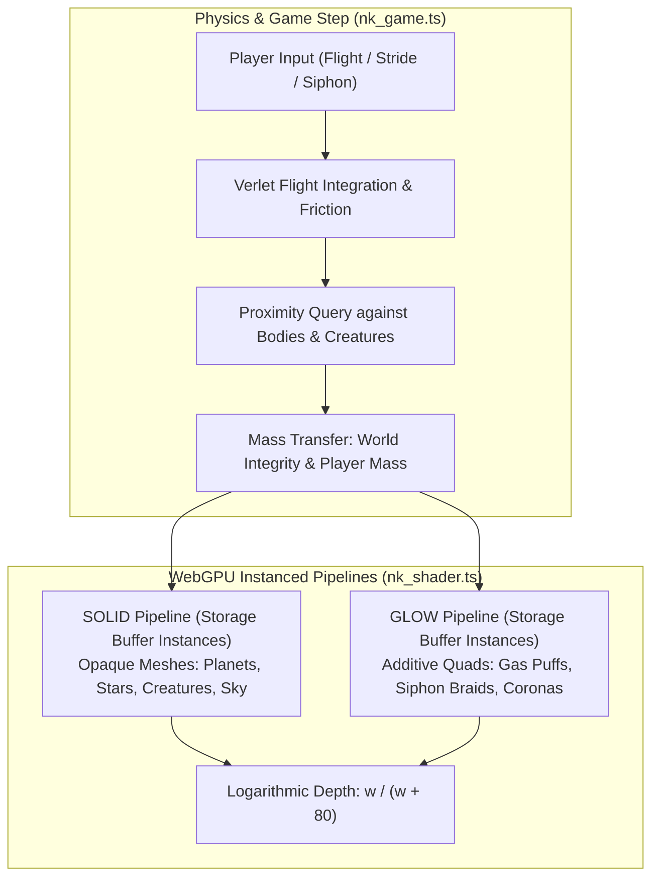
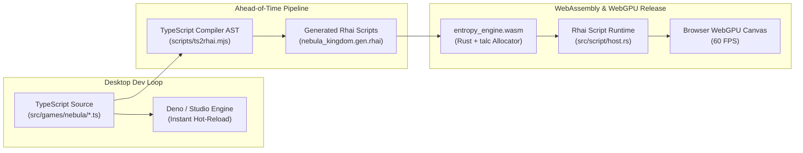

Most space games treat cosmic scale as either background wallpaper or a static backdrop for dogfights. Asteroids are rigid obstacles, planets are unyielding skyboxes, and scale is clamped to keep 32-bit floating-point coordinates from vibrating.

In Nebula Kingdom, cosmic scale is the core mechanic. You play as a newborn living nebula. You begin life in the Cradle Shoals of the Lantern Reach, born the size of Luna at a radius of 1,737.4 km. You feed on essence motes, asteroids, moons, terrestrial worlds, gas giants, and eventually stars. Over 37 discrete growth levels spanning twelve regions and six galaxies, your cloud expands until you end wider than any star in the known universe - finishing beyond hypergiants like Stephenson 2-18 and UY Scuti at more than 1.5 billion kilometers across.

Nebula Kingdom was designed to be relaxing, tactile, and distinct from typical action games. You ride your own lightwaves with smooth momentum. You siphon matter from dying worlds in braided ropes of plasma. You attune to five interstellar governments who communicate in invisible lightwave spectrums. And you learn how to handle black holes that cannot be eaten, but can be outrun, slung around, or used as gravity traps for rival hunters chasing your mass.

The main codebase is housed inside our framework, Entropy Engine (`entropy-engine`). Beyond running natively on desktop via Rust and wgpu, the complete game has been compiled to WebAssembly and WebGPU via an ahead-of-time TypeScript-to-Rhai translation pipeline. Players can jump in and play it online directly in modern browsers right now at [https://nebula-kingdom.indie-machine.com/](https://nebula-kingdom.indie-machine.com/).


Here is how the game was built, the mathematics behind its scale inversion and logarithmic depth, how black holes warp procedural sky shaders with Einstein lensing, and how we shipped a full-featured WebGPU space sim to the web with zero client-side JavaScript game overhead.

---

## The Scale Problem: From Moons to Hypergiants

A nebula expanding from 1,737.4 km to 1.5 billion km experiences a radius growth factor of roughly $8.63 \times 10^5$. Because mass scales with volume, your mass expands by more than $6.4 \times 10^{17}$.

Standard game engines fail in one of two ways when tackling this span:
1. **World-space coordinates jitter.** If coordinate units represent meters or kilometers, 32-bit IEEE 754 floats lose precision within minutes of traveling outside the origin. Vertex positions tremble, depth tests fail, and collision boundaries dissolve.
2. **Double-precision CPU overhead.** Switching to 64-bit floats (`f64`) across all entities, vectors, and matrices doubles memory footprint and requires dynamic rebasing before uploading data to GPU vertex buffers, which natively prefer 32-bit floats.

In Nebula Kingdom, we resolved this by inverting the coordinate frame: **space is drawn in the player's own units around the player**.

```typescript
// entropy-engine/examples/studio-bundle/src/games/nebula/nk_data.ts
export const START_RADIUS = 1737.4; // Luna's radius in km
export const REGION_GROWTH = 3.3;   // Each region is built for a cloud 3.3x wider
export const LEVEL_GROWTH = Math.cbrt(REGION_GROWTH);
export const MAX_LEVEL = 37;

export const radiusOfMass = (mass: number): number =>
    START_RADIUS * Math.cbrt(Math.max(mass, 1e-9));

export const massOfRadius = (radius: number): number =>
    (radius / START_RADIUS) ** 3;

export const radiusOfLevel = (level: number): number =>
    START_RADIUS * LEVEL_GROWTH ** (level - 1);
```

In the renderer (`nk_render.ts`) and scene builder (`nk_scene.ts`), the player's cloud is always positioned at origin `[0, 0, 0]` with a normalized unit radius of `1.0`. When the player moves and feeds, the world positions and radii of all celestial bodies and creatures are transformed by the player's inverse transform and scaled by `1.0 / player.radius`.

To the GPU, a 1,700 km moon viewed by a newborn Wisp has identical normalized screen proportions to an 800,000 km blue supergiant viewed by a seasoned Void Regent. Every floating-point computation stays within a well-behaved range between `0.001` and `500.0`.

To prevent geometry clipping when observing distant star clusters or planetary rings across millions of kilometers, the vertex shaders ditch standard linear z-division and write custom logarithmic depth:

```wgsl
// entropy-engine/examples/studio-bundle/src/games/nebula/nk_shader.ts
fn far_depth(clip: vec4<f32>) -> vec4<f32> {
    // Maps clip depth to w / (w + 80): nothing is ever clipped by the far plane.
    let z = (clip.w / (clip.w + 80.0)) * clip.w;
    return vec4<f32>(clip.xy, z, clip.w);
}
```

With `clip.w / (clip.w + 80.0)`, geometry at 2 units from the camera has depth `0.024`, geometry at 100 units has depth `0.555`, and geometry at 100,000 units has depth `0.9992`. The near plane remains razor-sharp at 0.1 meters, while the far plane extends indefinitely toward optical infinity with zero z-fighting.

---

## Siphoning Worlds and Procedural Planets

Feeding in Nebula Kingdom is not an instantaneous contact check. It is an active gravitational siphon. When you fly near a planet, moon, or star and hold your siphon beam, matter is drawn off the world in a continuous braided rope of plasma.


```wgsl
// The siphon stream: matter pulled off a world in a braided rope (GLOW shader)
let braid = sin(q.y * 9.0 - t * 14.0 + seed * 6.0) * 0.35;
let x = q.x - braid;
let flow = fbm(vec3<f32>(x * 3.0, q.y * 7.0 - t * 11.0, seed), 3);
a = (exp(-x * x * 12.0) * (0.4 + 1.2 * flow) + exp(-x * x * 120.0))
    * smoothstep(-1.0, -0.8, q.y) * smoothstep(1.0, 0.8, q.y);
```

As the world's mass is siphoned into your cloud, its internal integrity drops from `1.0` down to `0.0`. In the SOLID fragment shader, this drop directly triggers procedural stress fracturing:

```wgsl
// Being drunk dry: fissures of your own light open across it
if (integrity < 0.999) {
    let fissure = 1.0 - abs(fbm(p * 4.0 + vec3<f32>(seed * 11.0), 5) * 2.0 - 1.0);
    let open = smoothstep(integrity * 0.9 + 0.08, integrity * 0.9 + 0.2, fissure);
    col = mix(col, vec3<f32>(0.0), open * 0.6)
        + vec3<f32>(0.5, 0.9, 1.0) * open * (1.4 + 0.6 * sin(t * 9.0 + fissure * 30.0));
}
```

Planets are rendered with seven distinct procedural looks generated on the GPU using fractional Brownian motion (`fbm`) on normalized local coordinates:
- **Rock:** Cratered terrain with multi-octave noise displacement.
- **Ice:** High-albedo polar surfaces with deep tectonic rift cracks.
- **Ocean:** Continents, shallow shelf waters, specular water glints, dynamic swirling cloud decks, and glowing city lights on the night side of inhabited worlds.
- **Lava:** Black basalt crust crisscrossed by animated incandescent magma veins.
- **Desert:** Wind-swept longitudinal dunes and mineral shifts.
- **Gas & Banded:** Dual-tone latitudinal jet streams and Great Red Spot storm vortexes.

For stars, the shader switches to simulated solar convection cells, dynamic limb darkening, sunspots, and coronal flares. Siphoning a star produces dark cooling fissures across its photosphere before it collapses into your cloud.



---

## Governments, Lightwaves, and the Language Mechanic

The dark is not empty. Five distinct interstellar governments rule the galaxies, each characterized by its own creed, laws, color spectrum, and military temperament:

| Government | Form | Color Spectrum | Starting Standing | Core Law |
|---|---|---|---|---|
| **The Luminous Concord** | Federation of free clouds and manta shoals | Cyan `[0.45, 0.95, 0.90]` | `+20` (Known) | Inhabited worlds carry life: do not feed on them. |
| **The Drift Collective** | Nomad market with no borders | Green `[0.65, 1.00, 0.45]` | `0` (Wary) | Pay the toll. Tribute buys passage; broken deals buy bounties. |
| **The Ember Throne** | Forge-empire ruled by the Pyre Regent | Orange `[1.00, 0.45, 0.20]` | `-40` (Hostile) | All stars belong to the Throne. Clouds are kindling to be burned. |
| **The Tidal Synod** | Theocracy of medusae singing to black holes | Violet `[0.62, 0.50, 1.00]` | `-5` (Wary) | Do not cross a Singer's shadow. What the Silence takes is given. |
| **The Hollow Court** | Living black holes and orbiting husks | Red `[1.00, 0.30, 0.42]` | `-70` (Hunted) | Every horizon is the King's border. No light may be sovereign. |

Creatures and government envoys speak in lightwaves that are invisible to the naked eye. Tapping Attune (`T` key or Gamepad `Y`) switches your optical perception, exposing the pulsating electromagnetic aura of nearby species and deciphering their broadcasts.

When you first encounter an unfamiliar civilization, you do not understand their tongue. Broadcasts are mathematically garbled based on your current faction fluency:

```typescript
// entropy-engine/examples/studio-bundle/src/games/nebula/nk_data.ts
export function garble(text: string, fluency: number, seed: number): string {
    if (fluency >= 1) return text;
    const glyphs = "~^*:=+<>|/\\";
    let out = "";
    for (let i = 0; i < text.length; i++) {
        const ch = text[i];
        if (ch === " " || ch === "." || ch === ",") { out += ch; continue; }
        const h = Math.abs(Math.sin((i + 1) * 12.9898 + seed * 78.233) * 43758.5453) % 1;
        out += h < fluency ? ch : glyphs[Math.floor(h * 997) % glyphs.length];
    }
    return out;
}
```

As you spend time near their envoys, complete their region milestones, and offer tribute, your fluency increases from 0% to 100%. The strange cosmic glyphs gradually coalesce into clear English instructions and lore.

---

## Black Holes and Einstein Gravitational Lensing

Black holes are the immovable hazard of Nebula Kingdom. They cannot be siphoned or destroyed by player blasts. Touching their event horizon results in instant dispersal.

However, they are central to the game's puzzles and movement:
1. **Ergosphere Slingshotting:** Crossing into a black hole's outer ergosphere drastically boosts your velocity without consuming energy charge.
2. **Horizon Baiting:** In regions like the Comet Bazaar (the Sump) and the Event Shallows (the Second Reef), aggressive hunters chase the player in rigid pursuit trajectories. By flying close to the horizon and cutting across, players lure the pack into crossing the event horizon.
3. **Leading the Silence:** In the Choir Deeps and the Quiet Throne, wandering black holes (the Cantor and the Hollow King) hunt the largest gravitational mass in the sector. Players must either use their own cloud as bait or shed knots of mass (`F` key) to guide the singularity into interstellar rifts.

To make black holes visually distinct, the background sky shader calculates real-time gravitational lensing for up to four active black holes in the region:

```wgsl
// entropy-engine/examples/studio-bundle/src/games/nebula/nk_shader.ts
fn bend(dir_in: vec3<f32>) -> vec4<f32> {
    var dir = dir_in;
    var ring = 0.0;
    let n = i32(world.screen.w + 0.5);
    for (var i = 0; i < n; i = i + 1) {
        let h = world.holes[i];
        let to = h.xyz - camera.view_pos.xyz;
        let dist = length(to);
        let b = to / max(dist, 1e-6);
        let alpha = asin(clamp(h.w / max(dist, h.w * 1.02), 0.0, 1.0));
        let einstein = alpha * 1.9;
        let c = clamp(dot(dir, b), -1.0, 1.0);
        let theta = acos(c);
        if (theta < 1.4 && theta > 1e-4) {
            let fade = smoothstep(1.4, 0.5, theta);
            let bent = theta - fade * einstein * einstein / theta;
            let perp = normalize(dir - b * c);
            dir = normalize(b * cos(bent) + perp * sin(bent));
            ring = ring + exp(-pow((theta - einstein) / max(einstein * 0.08, 1e-4), 2.0)) * 0.3;
        }
    }
    return vec4<f32>(dir, ring);
}
```

As the player rotates the camera, light passing near a horizon bends along Einstein deflection curves. Background stars warp into circular arcs, and a bright photon ring glows around the perimeter of the shadow.

---

## The Engine Pipeline: TypeScript to Rhai to WebGPU

In Entropy Engine, our desktop workflow leverages TypeScript executing inside Deno/V8 with instant hot-reloading. However, shipping a full Deno or V8 runtime to the browser is unfeasible due to binary bloat and strict Content Security Policies that disallow `eval` and dynamic code generation.

Rather than rewriting the entire game from scratch in Rust, we built an ahead-of-time compiler: `scripts/ts2rhai.mjs`.



The transpiler parses the TypeScript AST and converts game logic into equivalent Rhai scripts:
- **Reference Semantics:** JavaScript objects and arrays are mapped to `Obj` and `List` structures (`src/script/jsrt.rs`) that preserve reference identity and array mutation semantics.
- **Inlined Accessors & Vector Acceleration:** Frequent math operations are routed directly to native Rust helpers (`src/script/rmath.rs`), including vector math, Mulberry32 bit-exact PRNGs, and instanced mesh buffer generation.
- **Native WebGPU Integration:** On the web target, Entropy compiles down to a lean `wasm32-unknown-unknown` binary utilizing the `talc` memory allocator. Shaders, vertex layouts, and buffer management run through `wgpu`'s web backend, rendering directly to an HTML5 canvas over WebGPU.
- **Strict CSP Compliance:** The hosting page runs a strict Content-Security-Policy with zero inline scripts, no remote script tags, and no `eval`. Only the static WASM file and loader execute.

---

## First-Party Verification & Benchmarks

Every claim and mechanic in Nebula Kingdom is verified by automated test suites running in our repository.

### 1. Pure TypeScript Game Tests

Running the full Nebula test suite in `entropy-engine/examples/studio-bundle`:

```bash
npm run test:nebula-kingdom
```

```text
 RUN  v4.0.18 D:/projects/common/entropy-engine/examples/studio-bundle

 ✓ tests/nebula_data.test.ts (15 tests) 64ms
 ✓ tests/nebula_render.test.ts (15 tests) 204ms
 ✓ tests/nebula_guide.test.ts (34 tests) 378ms
 ✓ tests/nebula_game.test.ts (33 tests) 825ms
 ✓ tests/nebula_campaign.test.ts (1 test) 6095ms
     ✓ can be played from Cradle Shoals to the Quiet Throne  6094ms

 Test Files  5 passed (5)
      Tests  98 passed (98)
   Duration  7.26s
```

All 98 tests pass in 7.26 seconds. In particular, `tests/nebula_campaign.test.ts` executes an automated pilot bot (`nebula_bot.ts`) that plays through the entire campaign across all 12 regions, completing goals, attuning with factions, defeating bosses, folding space, and growing from level 1 to level 37 in 6.09 seconds of headless simulation.

TypeScript type checking is completely clean:

```bash
npm run typecheck:nebula-kingdom
# tsc --project tsconfig.nebula.json --noEmit exited 0
```

### 2. Live Native BDD Verification

The live game is tested against real window rendering via Cucumber/Gherkin in `entropy-engine/tests/features/nebula_live.feature`. The test suite drives the engine via `ENTROPY_NEBULA_BDD_RESULT` and captures 22 discrete PNG verification screenshots covering title controls, Cradle Shoals mining, black hole slingshots, envoy attunement, Star Chart space folds, and the Hollow King encounter.

---

## Decision Log

1. **Rhai Scripting vs Client JavaScript:** We evaluated executing the TypeScript game directly in the browser via an embedded JS engine or running the game as standard DOM/Canvas JavaScript. We chose Rhai compiled inside Entropy's Rust WASM core because it guarantees identical physics and deterministic behavior between the native desktop binary (`cargo run --bin example -- nebula-kingdom`) and the web client. Furthermore, it enforces strict CSP compliance without needing `unsafe-eval`.
2. **Two Instanced Pipelines (SOLID and GLOW) vs Uber-Shader:** Rendering all scene elements in a single monolithic shader required excessive branching and dynamic uniform buffers for material configurations. Splitting into an opaque SOLID pipeline (writing depth) and an additive GLOW pipeline (disabling depth writes, blending quads) reduced GPU state switches and enabled thousands of gas puffs, accretion rings, and bolts to draw in single instanced passes.
3. **Logarithmic Depth vs Reversed-Z Floating Point:** While reversed-Z floating-point depth buffers provide superior precision for standard ground-scale games, cosmic games spanning astronomical units require an infinite far plane. Implementing logarithmic depth via `w / (w + 80.0)` in WGSL eliminated the far clipping plane entirely without requiring hardware extensions.
4. **Scale Inversion Coordinate System:** Rather than keeping the universe static and scaling the player up in world space, scaling the universe down relative to the player kept player coordinates at `[0, 0, 0]` with a constant unit radius of `1.0`. This made collision hitboxes, camera damping, and particle spawners numerically invariant regardless of whether the nebula was the size of a moon or larger than a hypergiant.

---

## Failure Notes

1. **WebGPU Derivative Uniformity in Chrome (Tint):** In early WebGPU builds, Chrome's shader compiler (Tint) rejected the procedural planet shader with a compilation error: `derivative functions must be called in uniform control flow`. In native desktop wgpu, calling `dpdx` and `dpdy` inside branch blocks was permitted by Vulkan and DX12 drivers. In WebGPU, this triggered strict uniformity errors. We resolved this by annotating script shaders on the web target with `diagnostic(off, derivative_uniformity)` in `src/script/gpu.rs`.
2. **Buffer Mapping at Creation Quotas:** Desktop wgpu allows creating arbitrarily large staging buffers with `mapped_at_creation = true`. In Chromium on Windows, allocating large instance storage buffers while mapped exceeded browser GPU limits and threw uncatchable allocation errors. The web runtime was modified to allocate buffers unmapped and stream instance updates through `queue.write_buffer()`.
3. **Black Hole Orbit Deadlocks in AI Pursuers:** During early testing of the Comet Bazaar, predatory Marauders baited toward the Sump would enter stable circular orbits around the event horizon rather than falling in. Because the black hole gravitational vector was purely radial, centrifugal acceleration preserved their tangential velocity indefinitely. We fixed this in `nk_game.ts` by adding an inward accretion drag factor when entities cross into the ergosphere, pulling them inexorably past the horizon.
4. **Browser Autoplay Audio Policies:** Desktop Entropy initializes audio during engine boot. In browser environments, Web Audio contexts created before user interaction remain locked in a suspended state. The audio engine in `src/script/audio.rs` was updated to defer context activation until the first key down, mouse click, or gamepad button event.

---

## Playing Online

Nebula Kingdom is deployed and freely playable in any modern browser supporting WebGPU at [https://nebula-kingdom.indie-machine.com/](https://nebula-kingdom.indie-machine.com/).

The source code and engine runtime are hosted in the open-source repository at [alexthegoodman/entropy-engine](https://github.com/alexthegoodman/entropy-engine). To run the game natively on desktop with full Vulkan/Metal/DX12 hardware acceleration:

```bash
git clone https://github.com/alexthegoodman/entropy-engine.git
cd entropy-engine
cargo run --bin example --release -- nebula-kingdom
```
