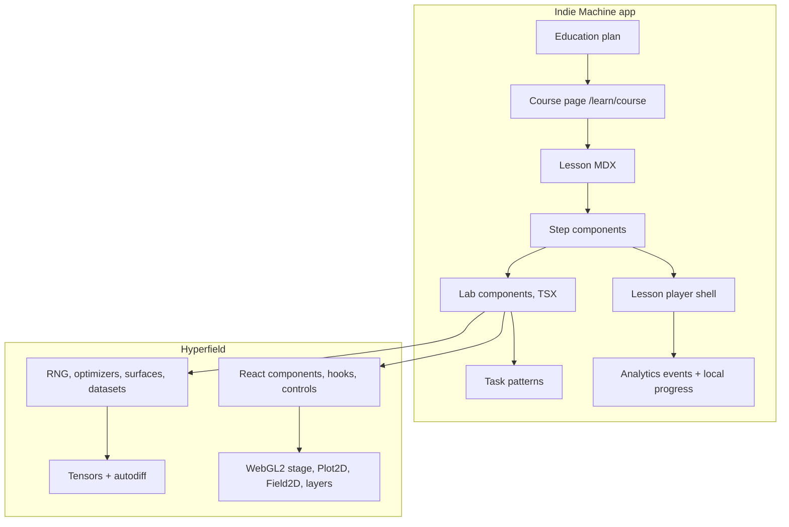

# Course SDK Plan

Plan for turning the AdamW lesson prototype into reusable parts for building Indie Machine courses. The reusable library is Hyperfield: tensors, simulation and visualization primitives for the web. The course player, task patterns and lessons live in the Indie Machine app.

Prototype: https://claude.ai/artifact/R4KYSwtJrXTRVFs82sxhzP (8 steps, one task per screen).

## Decisions

- **Rendering is WebGL2.** WebGPU still fails on some devices. Simple samples may compute on the CPU; rendering still goes through the shared WebGL2 stage.
- **React only.** No framework-agnostic core and no other bindings.
- **Lessons are MDX** that combine prose with real React components, using the same pipeline as posts.
- **Free and open.** No accounts, no payments, no paywall. Every lesson is public and indexable for SEO.
- **Charging comes later,** for new courses only. Nothing is built for it now beyond one `access` field in the education plan.
- **Hyperfield is the only library.** There is no `indie-machine` package. Course-specific code stays in the app.

## Principles

- One idea per screen. The visualization takes up most of the space. Text is a title, a one-line task, a live status line, and an optional "why".
- Every step is a task with a pass condition. Next unlocks when the learner solves it. Skip is always available.
- Goals are deterministic. All randomness is seeded, so the same settings always give the same result and challenges are fair.
- Failure gets a diagnosis, not just "not yet" ("too jumpy" vs "too slow after the flip").
- Extract a component the second time it is needed, not the first. The second course is the test of the parts.
- Every goal is machine-verified as winnable and not already solved by the default settings before a lesson ships.

## Architecture



### What lives where

| Home | Contents |
| --- | --- |
| `hyperfield` (core) | Tensors, broadcasting, ops, reverse-mode autodiff, CPU and WebGL2 compute backends |
| `hyperfield` (sim) | Seeded RNG and distributions, optimizers with readable state, loss surfaces, toy datasets |
| `hyperfield` (viz) | WebGL2 stage, Plot2D, Field2D, layers, text overlay |
| `hyperfield/react` | `<Stage>`, layer components, hooks (`useSim`, `useParam`, `useClock`), dock controls |
| Indie Machine app | Lesson player shell, step components, task patterns, lab components, MDX lessons, education plan, `/learn` routes, analytics |

Hyperfield stays general. It knows nothing about lessons, steps or goals, so it can be published on its own later. Task patterns are course logic, so they stay in the app.

## 1. Rendering (WebGL2)

- **One shared WebGL2 context per stage.** Browsers cap live WebGL contexts per page, so layers draw into the stage's single canvas instead of each owning a canvas.
- **Layer types on the GPU:**
  - Instanced lines with real widths and round joins: trajectories, streams, multi-seed lines.
  - Instanced points: scatter, dataset points, path heads.
  - Instanced quads: bars, gauges, histogram bins.
  - Field textures: heatmaps evaluated in a fragment shader (for closed-form surfaces) or uploaded from a CPU or tensor buffer, with contours computed in the shader.
- **Text and labels** go on a Canvas 2D or DOM overlay above the WebGL canvas. Text in WebGL costs a lot and gains little here.
- **CPU compute is the default for simple samples.** The AdamW lesson runs entirely on the CPU (two-parameter optimizers, 12-seed sims) and only needs the GPU for drawing.
- **GPU compute** (WebGL2 has no compute shaders) uses render-to-texture passes. Float render targets need `EXT_color_buffer_float`. If it is missing, Hyperfield falls back to the CPU backend.
- **Context loss** is handled. On `webglcontextlost` the stage rebuilds its resources from layer state, so a lost GPU doesn't break a lesson.
- **Testing:** BDD screenshots run in headless Chrome, which renders WebGL2 in software. Fine for checking correctness; not a source of performance numbers.

## 2. Hyperfield

### Core (tensors)

- **Size:** teaching scale, up to roughly 100k parameters, trained live in the browser. It does not compete with TensorFlow.js or ONNX Runtime Web on throughput.
- **What sets it apart:** introspection. Hooks expose every intermediate value, gradient and optimizer state so layers can draw them directly.
- **Contents:** Float32Array tensors, broadcasting, a small op set (matmul, elementwise ops, reductions, common activations, softmax, conv1d later), reverse-mode autodiff.
- **Determinism:** seeded initialization and ordered reductions.
- **Backends:** CPU first. WebGL2 render-to-texture for the heavier demos.

### Sim

- Seeded RNG with Gaussian and other common distributions.
- Optimizers with readable internal state: SGD, momentum, Nesterov, RMSProp, Adam, Adam + L2, AdamW, Lion. The "Inside Adam" view needs m, v, bias correction and the step after every update. They work on plain arrays for two-parameter demos and on tensors for networks.
- Loss surfaces: the curved ravine from the prototype, Rosenbrock, Beale, saddle, quadratic bowls with adjustable conditioning, and noisy versions of each. Each surface comes with a closed-form GLSL version for the heatmap shader.
- Toy datasets: blobs, moons, spirals, rings, a tiny digits set.
- Helpers: EMA, running statistics, pairwise distances, random projections.

### Viz

- **Stage:** owns the WebGL2 context, high-DPI sizing, resize, theme tokens (light and dark), and context-loss recovery.
- **Plot2D:** axes, linear and log scales, ticks, a clipped plot area.
- **Field2D:** a math-space view that keeps the aspect ratio correct at any stage size, with screen/world coordinate conversion.
- **Layers:**
  - Scalar field heatmap with contours and a highlighted target region.
  - Trajectory / path with a head marker and finish flags.
  - Scrolling stream (time series) and shaded bands.
  - Gauges and bars with an "off scale" state.
  - Histogram / distribution.
  - Vector field (arrows).
  - Scatter points (datasets, embeddings).
  - Matrix / tensor heatmap (weights, attention, Jacobians).
  - Computation graph (backprop, autodiff).
  - Multi-seed lines: faint per-seed runs plus a bold mean.
- **Overlays:** collision-aware labels, the reveal-as-you-drag curve, a scrub cursor with a big readout.

### React

- `<Stage>` with layer children, for example `<Stage><Field2D surface={ravine} /><Trajectory run={adam} /></Stage>`.
- Hooks: `useParam` (reactive values bound to controls), `useSim` (a fixed-timestep sim tied to the clock), `useClock` (pauses when the tab is hidden, supports reduced motion).
- **Dock controls:**
  - Slider with linear, log and β-style (1 − 10⁻ᵏ) mappings, so 0.9, 0.99 and 0.999 are evenly spaced.
  - Toggle switch, choice cards, playback controls (play, step, reset, speed).
  - Stage pick (click to choose a point) and stage scrub (drag).
  - Code-slot puzzle (drag a token into a line, click as fallback).
  - Hold / streak meter.
- Every control works with the keyboard and has a visible focus state.

## 3. Lessons as MDX

Lessons reuse the existing post pipeline (`compileMDX` from `next-mdx-remote/rsc` with a component map). `next-mdx-remote` 6 removes JS expressions in MDX by default (`blockJS: true`). So lesson MDX passes only string and number props, and all logic lives in TSX lab components referenced by name. This also keeps lesson files safe to edit as content.

```mdx
---
course: adamw
lesson: 2
title: Adam's two memories, and the decay bug they hide
minutes: 18
---

<Step id="memory" name="Direction" title="Give it a memory" lab="adamw.memory">
  <Task>The gradient is noisy, and its true direction flips. Set β₁ so m stays inside the band for 130 steps straight.</Task>
  <Why>m is an average that forgets old gradients at a rate of β₁ per step. A low β₁ chases every spike. A high β₁ is smooth, but it keeps pointing the old way long after the flip.</Why>
</Step>

<Step id="loudness" name="Loudness" title="Measure the loudness" lab="adamw.loudness">
  ...
</Step>
```

- **Labs** are TSX components registered by name (`adamw.memory`). A lab declares its params, sim, layers, task pattern and equation strip.
- **Copy stays in MDX.** Titles, tasks, "why" text and diagnosis messages are server-rendered HTML, so search engines index them and the lesson reads sensibly before hydration.
- **The player** reads the `<Step>` children in order. It renders the stage, dock and step dots, and unlocks Next when a step's goal is met.
- **Progress** (steps done, best scores, last step) is stored in the browser only, since there are no accounts.
- **Clock and reduced motion** come from Hyperfield's `useClock`.

## 4. Task patterns

The most valuable layer. Each pattern bundles a goal check, live status text, failure diagnoses and optional scoring, so a lesson author configures it instead of writing it.

| Pattern | Pass condition | Prototype step |
| --- | --- | --- |
| Tune to a window | A param sits in a range that the sim can only satisfy there; the diagnosis says which side you are on | 1. Give it a memory |
| Hold in a zone | A measure stays inside a target for N steps straight | 1, 7 |
| Push a param and observe | A param reaches a value while the learner watches an invariant hold | 2. Measure the loudness |
| Beat a baseline | The learner's run finishes before a fixed reference run | 3. Beat SGD |
| Find the extremum | Scrub to the max or min and hold there | 4. Find the worst early step |
| Predict, then reveal | Commit to an answer, then the sim plays out; right or wrong both complete it | 5. Which weight shrinks? |
| Fix the code | Move or arrange tokens or lines so the sim behaves correctly | 6. Move the decay |
| Toggle to compare | Ablation: switch a component off and back on | 2 (√v̂ switch) |
| Scored challenge | Pass at all, then stars by step count | 7. Land it |
| Free explore | No goal; Next is open | none yet |

Diagnoses are named keys (`too_jumpy`, `too_slow`, `diverged`, `never_reached`, `knocked_out`). The lab maps each key to a message, and the same keys go to analytics.

## 5. Education plan

A typed data file, `lib/learn/plan.ts`, lists every course and lesson with its release status. It drives the public pages and is maintained like `docs/game-announcements.json`.

```ts
type LessonStatus = "released" | "in_progress" | "planned";
type Access = "free" | "paid"; // everything is "free" for now

interface PlannedLesson { slug: string; title: string; status: LessonStatus; target?: string /* YYYY-MM */ }
interface PlannedCourse { slug: string; title: string; summary: string; access: Access; requires?: string[]; lessons: PlannedLesson[] }
```

- **`/learn`** lists released courses first, then upcoming ones with their lessons and target months.
- **`/learn/[course]`** shows the course with released lessons linked and upcoming lessons listed but not linked.
- **SEO:** upcoming lessons appear only on the course page. No placeholder lesson pages until a lesson is released, so the site doesn't publish thin pages. Released lessons get metadata, sitemap entries, `llms.txt` entries and schema.org `Course` JSON-LD.
- **Charging later** means flipping `access` to `"paid"` on a future course and adding a gate. Nothing else in the plan or lessons has to change.

### Draft roadmap

Order and scope are a starting point to revise.

| Course | Lessons | Needs |
| --- | --- | --- |
| AdamW, from the inside | 1 The ravine problem · 2 Adam's two memories (prototype) · 3 Decay at scale · 4 Warmup, schedules and β₂ · 5 Tuning λ in practice · 6 Capstone: a tiny transformer | Sim + viz. Lesson 6 needs Hyperfield core. |
| Gradient descent | 1 Following the slope · 2 Step size and divergence · 3 Conditioning and ravines · 4 Momentum · 5 Stochastic gradients and batch size | Sim + viz only. Good second course for testing the parts. |
| Variational autoencoders | 1 Autoencoders and the bottleneck · 2 Latent space as a map · 3 The reparameterization trick · 4 The ELBO, term by term · 5 Sampling and interpolation | Hyperfield core: autodiff, small MLPs trained in the browser. |
| Johnson-Lindenstrauss embeddings | 1 Distances in high dimensions · 2 Random projections · 3 How many dimensions you need · 4 JL in practice (search, sketching) | Sim helpers (random projections, pairwise distances), scatter and histogram layers. |

## 6. Verification

- **Solvability tests** run headless in CI for every goal:
  - A sweep finds settings that pass, so the goal is winnable.
  - The default settings fail, so it isn't already solved.
  - The passing window is wide enough to find by hand.
  - Star thresholds are reachable.

  This automates the Node calibration runs done by hand for the prototype. It works because sims are deterministic and run without rendering.
- **BDD screenshot features** for each step in `tests/`, in light and dark themes at desktop and phone widths.
- **Dev preview:** a `/learn/dev` route with a param inspector and "jump to step N" links, excluded from the sitemap like other dev routes.

## 7. Analytics and accessibility

- **Events** from the player, sent through the existing analytics pipeline in `lib/analytics`. Anonymous, no accounts.

  | Event | When |
  | --- | --- |
  | `step_enter` | A step mounts |
  | `attempt` | A run, launch or prediction |
  | `diagnosis` | A failure diagnosis appears (with its key) |
  | `goal_met` | The goal is passed (time and attempts so far) |
  | `skip` | Skip pressed |
  | `why_open` | The "why" panel is opened |
  | `lesson_complete` | Recap reached |

  Per-step time and attempt counts show which steps are too hard, too easy or skipped.
- **Accessibility:**
  - A text description of each scene's current state in a live region for screen readers.
  - A colorblind-safe palette.
  - Reduced motion, and full keyboard support.

## 8. Phasing

1. **Hyperfield viz and sim.** Build the WebGL2 stage, Field2D, Plot2D, the layers the prototype uses, the React components and controls, and the sim package (RNG, optimizers, surfaces).
2. **Player and MDX.** Add the `<Step>` / `<Task>` / `<Why>` components, the player shell, the lab registry and local progress. Port the AdamW lesson to MDX plus labs. Done when it matches the prototype with no step-specific plumbing.
3. **Patterns and verification.** Pull the task patterns out of the AdamW labs, add the solvability test runner and BDD screenshots.
4. **Education plan and `/learn`.** Add the plan file, the course and roadmap pages, SEO metadata and analytics events. Release lesson 2.
5. **Second course from shared parts only** (gradient descent). Any new component it needs goes into Hyperfield or the shared app code, not the lesson.
6. **Hyperfield core** (tensors and autodiff, CPU then WebGL2), started when the VAE course or AdamW lesson 6 is scheduled.

## Open questions

- Does Hyperfield start as a folder in this repo (for example `packages/hyperfield`) and move to its own repo once the API settles, or live in its own repo from day one?
- Should Hyperfield's tensor API follow PyTorch naming so course code reads like what learners will use later?
- Which lesson ships first on `/learn`: AdamW lesson 2 on its own, or lessons 1 and 2 together?
- Target cadence for the education plan (lessons per month)? It sets the target months shown publicly.
